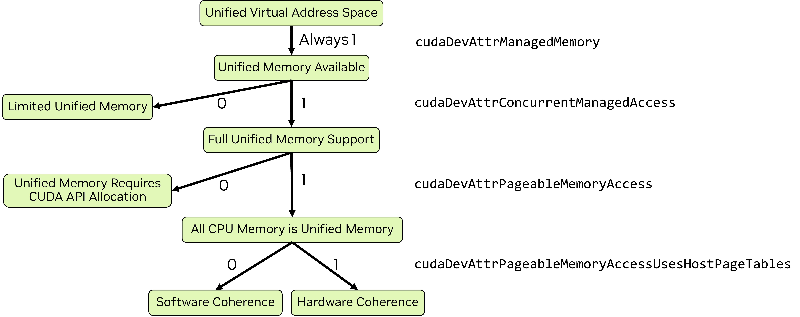

# 2.6. 统一内存和系统内存

异构系统拥有多个物理内存，数据可以存储在其中。主机 CPU 连接了 DRAM，系统中的每个 GPU 也都有自己的 DRAM。当数据位于访问它的处理器的内存中时，性能最佳。CUDA 提供了用于显式管理内存放置的 API，但这可能很冗长并使软件设计复杂化。CUDA 提供了旨在简化不同物理内存之间数据的分配、放置和迁移的特性和功能。

本章的目的是介绍和解释这些特性，以及它们对应用程序开发人员在功能和性能方面意味着什么。统一内存有几种不同的表现形式，具体取决于所使用的操作系统、驱动程序版本和 GPU。本章将展示如何确定适用的统一内存范式，以及统一内存的特性在每种范式中的行为方式。后面关于统一内存的章节会更详细地解释统一内存。

本章将定义和解释以下概念：

*   [统一虚拟地址空间](#261-统一虚拟地址空间) - CPU 内存和每个 GPU 的内存在单个虚拟地址空间内具有不同的范围
*   [统一内存](#262-统一内存) - 一种 CUDA 特性，支持可在 CPU 和 GPU 之间自动迁移的管理内存
    *   [受限统一内存](#2623-有限的统一内存支持) - 具有某些限制的统一内存范式
    *   [完整统一内存](#2622-完整的统一内存功能支持) - 对统一内存特性的完整支持
    *   [具有硬件一致性的完整统一内存](#26221-具有硬件一致性的完整统一内存) - 使用硬件功能对统一内存的完整支持
    *   [统一内存提示](#2624-内存建议和预取) - 用于指导特定分配的统一内存行为的 API
*   [页锁定主机内存](#263-页锁定主机内存) - 不可分页的系统内存，某些 CUDA 操作需要它
    *   [映射内存](#2631-映射内存) - 一种（不同于统一内存的）机制，用于直接从内核访问主机内存

此外，这里还介绍了讨论统一内存和系统内存时使用的以下术语：

*   [异构管理内存](#26222-hmm---具有软件一致性的完整统一内存) (HMM) - Linux 内核的一个特性，为完整的统一内存提供软件一致性
*   [地址转换服务](#26221-具有硬件一致性的完整统一内存) (ATS) - 一种硬件特性，当 GPU 通过 NVLink 芯片到芯片 (C2C) 互连连接到 CPU 时可用，为完整的统一内存提供硬件一致性

## 2.6.1. 统一虚拟地址空间

在单个操作系统进程内，所有主机内存和系统中所有 GPU 上的所有全局内存都使用一个统一的虚拟地址空间。主机和所有设备上的所有内存分配都位于此虚拟地址空间中。无论分配是通过 CUDA API（例如 `cudaMalloc`、`cudaMallocHost`）还是通过系统分配 API（例如 `new`、`malloc`、`mmap`）进行的，都是如此。CPU 和每个 GPU 在统一的虚拟地址空间内都有一个唯一的范围。

这意味着：

*   可以使用 `cudaPointerGetAttributes()` 从指针的值确定任何内存的位置（即，CPU 或位于哪个 GPU 的内存中）
*   `cudaMemcpy*()` 的 `cudaMemcpyKind` 参数可以设置为 `cudaMemcpyDefault`，以根据指针自动确定复制类型

## 2.6.2. 统一内存

*统一内存* 是一种 CUDA 内存特性，它允许称为 *管理内存* 的内存分配从运行在 CPU 或 GPU 上的代码访问。统一内存在 [CUDA C++ 入门](../chapter-2-CUDA%20GPU编程/2.1-CUDA%20C++%20入门.md) 中展示过。统一内存在所有 CUDA 支持的系统上都可用。

在某些系统上，管理内存必须显式分配。在 CUDA 中，可以通过几种不同的方式显式分配管理内存：

*   CUDA API `cudaMallocManaged`
*   使用 `allocType` 设置为 `cudaMemAllocationTypeManaged` 创建的池，通过 CUDA API `cudaMallocFromPoolAsync`
*   使用 `__managed__` 说明符的全局变量（参见[内存空间说明符]()）

在具有 [HMM](#26222-hmm---具有软件一致性的完整统一内存) 或 [ATS](#26221-具有硬件一致性的完整统一内存) 的系统上，无论内存是如何分配的，所有系统内存都隐式地是管理内存。不需要特殊分配。

### 2.6.2.1. 统一内存范式

统一内存的特性和行为因操作系统、Linux 内核版本、GPU 硬件和 GPU-CPU 互连而异。可用的统一内存形式可以通过使用 `cudaDeviceGetAttribute` 查询以下几个属性来确定：

*   `cudaDevAttrConcurrentManagedAccess` - 1 表示完整统一内存支持，0 表示有限支持
*   `cudaDevAttrPageableMemoryAccess` - 1 表示所有系统内存都是完全受支持的统一内存，0 表示只有显式分配为管理内存的内存才是完全受支持的统一内存
*   `cudaDevAttrPageableMemoryAccessUsesHostPageTables` - 指示 CPU/GPU 一致性的机制：1 是硬件，0 是软件。

[图 21](../assets/img/unified-memory-explainer.png) 直观地说明了如何确定统一内存范式，随后是 [代码示例]()，实现了相同的逻辑。

有四种统一内存操作范式：

*   [对显式管理内存分配的完整支持]()
*   [对具有软件一致性的所有分配的完整支持]()
*   [对具有硬件一致性的所有分配的完整支持]()
*   [有限的统一内存支持]()

当完全支持可用时，它可能需要显式分配，或者所有系统内存可能隐式地是统一内存。当所有内存都隐式统一时，一致性机制可以是软件或硬件。Windows 和一些 Tegra 设备对统一内存的支持有限。

<figure class="align-center" id="unified-memory-flow-chart">

<figcaption>
<p><span class="caption-number">图 21 </span><span class="caption-text">所有当前的 GPU 都使用统一的虚拟地址空间并具有可用的统一内存。当 <code class="docutils literal notranslate"><span class="pre">cudaDevAttrConcurrentManagedAccess</span></code> 为 1 时，可提供完整的统一内存支持，否则仅提供有限支持。当完全支持可用时，如果 <code class="docutils literal notranslate"><span class="pre">cudaDevAttrPageableMemoryAccess</span></code> 也为 1，则所有系统内存都是统一内存。否则，只有使用 CUDA API（如 <code class="docutils literal notranslate"><span class="pre">cudaMallocManaged</span></code>）分配的内存才是统一内存。当所有系统内存都统一时，<code class="docutils literal notranslate"><span class="pre">cudaDevAttrPageableMemoryAccessUsesHostPageTables</span></code> 指示一致性是由硬件（当值为 1 时）还是软件（当值为 0 时）提供的。</span></p>
</figcaption>
</figure>

[表 3]() 以表格形式显示了与[图 21](../assets/img/unified-memory-explainer.png) 相同的信息，并附有指向本章相关章节以及本指南后面更完整文档的链接。

| 统一内存范式 | 设备属性 | 完整文档 |
| :--- | :--- | :--- |
| [有限的统一内存支持](#2623-有限的统一内存支持) | `cudaDevAttrConcurrentManagedAccess` 为 0 | [Windows、WSL 和 Tegra 上的统一内存](#)<br>[Tegra 的 CUDA 内存管理](https://docs.nvidia.com/cuda/cuda-for-tegra-appnote/index.html#memory-management)<br>[Tegra 上的统一内存](https://docs.nvidia.com/cuda/cuda-for-tegra-appnote/index.html#effective-usage-of-unified-memory-on-tegra) |
| [对显式管理内存分配的完整支持](#) | `cudaDevAttrPageableMemoryAccess` 为 0<br>并且 `cudaDevAttrConcurrentManagedAccess` 为 1 | [仅支持 CUDA 管理内存的设备上的统一内存](#) |
| [对具有软件一致性的所有分配的完整支持](#26222-hmm---具有软件一致性的完整统一内存) | `cudaDevAttrPageableMemoryAccessUsesHostPageTables` 为 0<br>并且 `cudaDevAttrPageableMemoryAccess` 为 1<br>并且 `cudaDevAttrConcurrentManagedAccess` 为 1 | [具有完整 CUDA 统一内存支持的设备上的统一内存](#) |
| [对具有硬件一致性的所有分配的完整支持](#26221-具有硬件一致性的完整统一内存) | `cudaDevAttrPageableMemoryAccessUsesHostPageTables` 为 1<br>并且 `cudaDevAttrPageableMemoryAccess` 为 1<br>并且 `cudaDevAttrConcurrentManagedAccess` 为 1 | [具有完整 CUDA 统一内存支持的设备上的统一内存](#) |

#### 2.6.2.1.1. 统一内存范式：代码示例

以下代码示例演示了查询设备属性并确定统一内存范式，遵循[图 21]() 的逻辑，针对系统中的每个 GPU。

```C++
void queryDevices()
{
    int numDevices = 0;
    cudaGetDeviceCount(&numDevices);
    for(int i=0; i<numDevices; i++)
    {
        cudaSetDevice(i);
        cudaInitDevice(0, 0, 0);
        int deviceId = i;

        int concurrentManagedAccess = -1;     
        cudaDeviceGetAttribute (&concurrentManagedAccess, cudaDevAttrConcurrentManagedAccess, deviceId);    
        int pageableMemoryAccess = -1;
        cudaDeviceGetAttribute (&pageableMemoryAccess, cudaDevAttrPageableMemoryAccess, deviceId);
        int pageableMemoryAccessUsesHostPageTables = -1;
        cudaDeviceGetAttribute (&pageableMemoryAccessUsesHostPageTables, cudaDevAttrPageableMemoryAccessUsesHostPageTables, deviceId);

        printf("Device %d has ", deviceId);
        if(concurrentManagedAccess){
            if(pageableMemoryAccess){
                printf("full unified memory support");
                if( pageableMemoryAccessUsesHostPageTables)
                    { printf(" with hardware coherency\n");  }
                else
                    { printf(" with software coherency\n"); }
            }
            else
                { printf("full unified memory support for CUDA-made managed allocations\n"); }
        }
        else
        {   printf("limited unified memory support: Windows, WSL, or Tegra\n");  }
    }
}
```

### 2.6.2.2. 完整的统一内存功能支持

大多数 Linux 系统都具有完整的统一内存支持。如果设备属性 `cudaDevAttrPageableMemoryAccess` 为 1，则所有系统内存（无论是由 CUDA API 还是系统 API 分配的）都作为具有完整功能支持的统一内存运行。这包括使用 `mmap` 创建的文件支持的内存分配。

如果 `cudaDevAttrPageableMemoryAccess` 为 0，则只有由 CUDA 分配为管理内存的内存才充当统一内存。使用系统 API 分配的内存不是管理内存，并且不一定可以从 GPU 内核访问。

通常，对于具有完整支持的统一分配：

*   管理内存通常在首次接触它的处理器的内存空间中分配
*   管理内存通常在被当前所在处理器之外的处理器使用时迁移
*   管理内存以内存页（软件一致性）或缓存行（硬件一致性）的粒度进行迁移或访问
*   允许超额订阅：应用程序可以分配比 GPU 上物理可用内存更多的管理内存

分配和迁移行为可能偏离上述情况。这可以通过程序员使用[提示和预取](#2624-内存建议和预取)来影响。完整的统一内存支持的全面覆盖可以在[具有完整 CUDA 统一内存支持的设备上的统一内存]()中找到。

#### 2.6.2.2.1. 具有硬件一致性的完整统一内存

在诸如 Grace Hopper 和 Grace Blackwell 的硬件上，其中使用了 NVIDIA CPU 并且 CPU 和 GPU 之间的互连是 NVLink 芯片到芯片 (C2C)，地址转换服务 (ATS) 可用。当 ATS 可用时，`cudaDevAttrPageableMemoryAccessUsesHostPageTables` 为 1。

使用 ATS，除了对所有主机分配的完整统一内存支持之外：

*   驻留在 GPU 上的管理分配（例如 `cudaMallocManaged`）可以从 CPU 访问而无需迁移（`cudaDevAttrDirectManagedMemAccessFromHost` 将为 1）
*   CPU 和 GPU 之间的链接支持原生原子操作（`cudaDevAttrHostNativeAtomicSupported` 将为 1）
*   与软件一致性相比，硬件对一致性的支持可以提高性能

ATS 提供了 [HMM](#26222-hmm---具有软件一致性的完整统一内存) 的所有功能。当 ATS 可用时，HMM 会自动禁用。关于硬件与软件一致性的进一步讨论可以在 [CPU 和 GPU 页表：硬件一致性与软件一致性](.) 中找到。

> **注意**
> 硬件一致性不允许从主机访问仅 GPU 的分配，例如使用 `cudaMalloc` 进行的分配。

#### 2.6.2.2.2. HMM - 具有软件一致性的完整统一内存

*异构内存管理* (HMM) 是 Linux 操作系统（具有适当内核版本）上可用的一项功能，它支持软件一致的[完整统一内存支持](#2622-完整的统一内存功能支持)。异构内存管理将 ATS 提供的一些功能和便利性带到了 PCIe 连接的 GPU。

在至少具有 Linux 内核 6.1.24、6.2.11 或 6.3 或更高版本的 Linux 上，异构内存管理 (HMM) 可能可用。以下命令可用于查找寻址模式是否为 `HMM`。

```c++
$ nvidia-smi -q | grep Addressing
Addressing Mode : HMM
```

当 HMM 可用时，支持[完整统一内存](#2622-完整的统一内存功能支持)，并且所有系统分配都隐式地是统一内存。如果系统也具有 [ATS](#26222-hmm---具有软件一致性的完整统一内存)，则 HMM 被禁用并使用 ATS，因为 ATS 提供了 HMM 的所有功能甚至更多。

### 2.6.2.3. 有限的统一内存支持

在 Windows（包括 Windows Subsystem for Linux (WSL)）以及某些 Tegra 系统上，只有有限子集的统一内存功能可用。在这些系统上，管理内存可用，但 CPU 和 GPU 之间的迁移行为不同。

*   管理内存首先在 CPU 的物理内存中分配
*   管理内存以比虚拟内存页更大的粒度迁移
*   当 GPU 开始执行时，管理内存迁移到 GPU
*   当 GPU 活动时，CPU 不得访问管理内存
*   当 GPU 同步时，管理内存迁移回 CPU
*   不允许超额订阅 GPU 内存
*   只有由 CUDA 显式分配为管理内存的内存才是统一的

此范式的全面覆盖可以在 [Windows、WSL 和 Tegra 上的统一内存]() 中找到。

### 2.6.2.4. 内存建议和预取

程序员可以向管理统一内存的 NVIDIA 驱动程序提供提示，以帮助其最大化应用程序性能。CUDA API `cudaMemAdvise` 允许程序员指定分配的特性，这些特性会影响它们的放置位置以及在从另一个设备访问时是否迁移内存。

`cudaMemPrefetchAsync` 允许程序员建议开始将特定分配异步迁移到另一个位置。一种常见用法是在内核启动之前开始传输内核将使用的数据。这使得数据复制能够在其他 GPU 内核执行时进行。

关于 [性能提示]() 的部分介绍了可以传递给 `cudaMemAdvise` 的不同提示，并展示了使用 `cudaMemPrefetchAsync` 的示例。

## 2.6.3. 页锁定主机内存

在[入门代码示例](./2.1-CUDA%20C++%20入门.md)中，使用 `cudaMallocHost` 在 CPU 上分配内存。这分配了主机上的 *页锁定* 内存（也称为 *固定* 内存）。通过传统分配机制（如 `malloc`、`new` 或 `mmap`）进行的主机分配不是页锁定的，这意味着它们可能会被操作系统交换到磁盘或物理重定位。

页锁定主机内存是 [CPU 和 GPU 之间的异步复制](2.5-异步执行.md) 所必需的。页锁定主机内存还可以提高同步复制的性能。页锁定内存可以被 [映射](#2631-映射内存) 到 GPU，以便从 GPU 内核直接访问。

CUDA 运行时提供了分配页锁定主机内存或将现有分配页锁定的 API：

*   `cudaMallocHost` 分配页锁定主机内存
*   `cudaHostAlloc` 默认行为与 `cudaMallocHost` 相同，但也接受标志以指定其他内存参数
*   `cudaFreeHost` 释放使用 `cudaMallocHost` 或 `cudaHostAlloc` 分配的内存
*   `cudaHostRegister` 页锁定 CUDA API 之外分配的现有内存范围，例如使用 `malloc` 或 `mmap`

`cudaHostRegister` 允许由第三方库或开发人员控制之外的代码分配的主机内存被页锁定，以便它可以用于异步复制或映射。

> **注意**
> 页锁定主机内存可用于系统中所有 GPU 的异步复制和映射内存。
> 页锁定主机内存在非 I/O 一致的 Tegra 设备上不会被缓存。此外，`cudaHostRegister()` 在非 I/O 一致的 Tegra 设备上不受支持。

### 2.6.3.1. 映射内存

在具有 [HMM](#26222-hmm---具有软件一致性的完整统一内存) 或 [ATS]() 的系统上，所有主机内存都可以使用主机指针直接从 GPU 访问。当 ATS 或 HMM 不可用时，可以通过将内存 *映射* 到 GPU 的内存空间来使主机分配可供 GPU 访问。映射内存始终是页锁定的。

后续的代码示例将演示在映射的主机内存上直接运行的数组复制内核。

```C++
__global__ void copyKernel(float* a, float* b)
{
        int idx = threadIdx.x + blockDim.x * blockIdx.x;
        a[idx] = b[idx];
}
```

虽然在某些情况下，当某些未复制到 GPU 的数据需要从内核访问时，映射内存可能很有用，但在内核中访问映射内存需要通过 CPU-GPU 互连（PCIe 或 NVLink C2C）进行事务。与访问设备内存相比，这些操作具有更高的延迟和更低的带宽。对于内核的大部分内存需求，映射内存不应被视为[统一内存](#262-统一内存)或[显式内存管理]()的高性能替代方案。

#### 2.6.3.1.1. cudaMallocHost 和 cudaHostAlloc

使用 `cudaMallocHost` 或 `cudaHostAlloc` 分配的主机内存会自动映射。这些 API 返回的指针可以直接在内核代码中用于访问主机上的内存。主机内存通过 CPU-GPU 互连访问。

```C++
void usingMallocHost() {
  float* a = nullptr;
  float* b = nullptr;
  
  CUDA_CHECK(cudaMallocHost(&a, vLen*sizeof(float)));
  CUDA_CHECK(cudaMallocHost(&b, vLen*sizeof(float)));

  initVector(b, vLen);
  memset(a, 0, vLen*sizeof(float));

  int threads = 256;
  int blocks = vLen/threads;
  copyKernel<<<blocks, threads>>>(a, b);
  CUDA_CHECK(cudaGetLastError());
  CUDA_CHECK(cudaDeviceSynchronize());

  printf("Using cudaMallocHost: ");
  checkAnswer(a,b);
}
```

```C++
void usingCudaHostAlloc() {
  float* a = nullptr;
  float* b = nullptr;

  CUDA_CHECK(cudaHostAlloc(&a, vLen*sizeof(float), cudaHostAllocMapped));
  CUDA_CHECK(cudaHostAlloc(&b, vLen*sizeof(float), cudaHostAllocMapped));

  initVector(b, vLen);
  memset(a, 0, vLen*sizeof(float));

  int threads = 256;
  int blocks = vLen/threads;
  copyKernel<<<blocks, threads>>>(a, b);
  CUDA_CHECK(cudaGetLastError());
  CUDA_CHECK(cudaDeviceSynchronize());

  printf("Using cudaHostAlloc: ");
  checkAnswer(a, b);
}
```

#### 2.6.3.1.2. cudaHostRegister

当 ATS 和 HMM 不可用时，系统分配器进行的分配仍然可以使用 `cudaHostRegister` 进行映射，以便从 GPU 内核直接访问。然而，与使用 CUDA API 创建的内存不同，内存不能使用主机指针从内核访问。必须使用 `cudaHostGetDevicePointer()` 获取设备内存区域中的指针，并且必须在内核代码中使用该指针进行访问。

```C++
void usingRegister() {
  float* a = nullptr;
  float* b = nullptr;
  float* devA = nullptr;
  float* devB = nullptr;

  a = (float*)malloc(vLen*sizeof(float));
  b = (float*)malloc(vLen*sizeof(float));
  CUDA_CHECK(cudaHostRegister(a, vLen*sizeof(float), 0 ));
  CUDA_CHECK(cudaHostRegister(b, vLen*sizeof(float), 0  ));

  CUDA_CHECK(cudaHostGetDevicePointer((void**)&devA, (void*)a, 0));
  CUDA_CHECK(cudaHostGetDevicePointer((void**)&devB, (void*)b, 0));

  initVector(b, vLen);
  memset(a, 0, vLen*sizeof(float));

  int threads = 256;
  int blocks = vLen/threads;
  copyKernel<<<blocks, threads>>>(devA, devB);
  CUDA_CHECK(cudaGetLastError());
  CUDA_CHECK(cudaDeviceSynchronize());

  printf("Using cudaHostRegister: ");
  checkAnswer(a, b);
}
```

#### 2.6.3.1.3. 比较统一内存和映射内存

映射内存使 CPU 内存可从 GPU 访问，但不保证所有类型的访问（例如原子操作）在所有系统上都受支持。统一内存保证所有访问类型都受支持。

映射内存保留在 CPU 内存中，这意味着所有 GPU 访问都必须通过 CPU 和 GPU 之间的连接：PCIe 或 NVLink。通过这些链接进行的访问延迟明显高于对 GPU 内存的访问，并且总可用带宽较低。因此，将所有内核内存访问都使用映射内存不太可能充分利用 GPU 计算资源。

统一内存通常迁移到访问它的处理器的物理内存。在第一次迁移之后，内核重复访问同一内存页或缓存行可以利用完整的 GPU 内存带宽。

> **注意**
> 映射内存在以前的文档中也称为 *零拷贝* 内存。
> 在所有 CUDA 应用程序使用统一虚拟地址空间之前，需要额外的 API 来启用内存映射（带有 `cudaDeviceMapHost` 的 `cudaSetDeviceFlags`）。这些 API 不再需要。
> 在映射的主机内存上操作的原子函数（参见[原子函数](../05-appendices/cpp-language-extensions.html#atomic-functions)）从主机或其他 GPU 的角度来看不是原子的。
> CUDA 运行时要求从设备发起的主机内存的 1 字节、2 字节、4 字节、8 字节和 16 字节自然对齐的加载和存储，从主机和其他设备的角度来看，保持为单次访问。在某些平台上，对内存的原子操作可能被硬件分解为单独的加载和存储操作。这些组件加载和存储操作对自然对齐访问的保持有相同的要求。CUDA 运行时不支持 PCI Express 总线拓扑，其中 PCI Express 桥接器拆分 8 字节自然对齐的操作，并且 NVIDIA 不知道有任何拆分 16 字节自然对齐操作的拓扑。

## 2.6.4. 总结

*   在具有异构内存管理 (HMM) 或地址转换服务 (ATS) 的 Linux 平台上，所有系统分配的内存都是管理内存
*   在没有 HMM 或 ATS 的 Linux 平台上，在 Tegra 处理器上，以及在所有 Windows 平台上，必须使用 CUDA 分配管理内存：
    *   `cudaMallocManaged` 或
    *   使用 `allocType=cudaMemAllocationTypeManaged` 创建的池，通过 `cudaMallocFromPoolAsync`
    *   具有 `__managed__` 说明符的全局变量
*   在 Windows 和 Tegra 处理器上，统一内存具有限制
*   在具有 ATS 的 NVLINK C2C 连接系统上，使用 `cudaMallocManaged` 分配的设备内存可以从 CPU 或其他 GPU 直接访问
