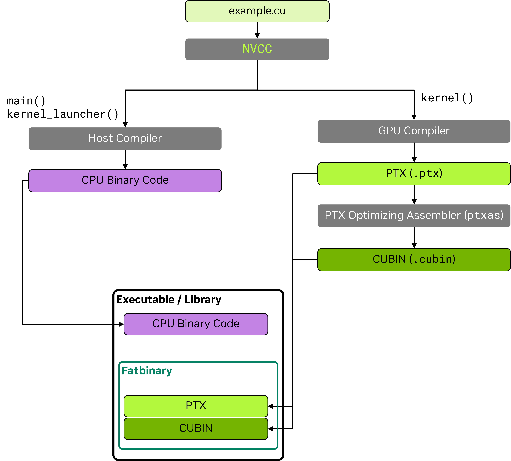

# 2.7. NVCC：NVIDIA CUDA 编译器

[NVIDIA CUDA 编译器](https://docs.nvidia.com/cuda/cuda-compiler-driver-nvcc/index.html) `nvcc` 是 NVIDIA 提供的工具链，用于编译 CUDA C/C++ 以及 [PTX](https://docs.nvidia.com/cuda/parallel-thread-execution/index.html) 代码。该工具链是 [CUDA 工具包](https://developer.nvidia.com/cuda-toolkit) 的一部分，包含编译器、链接器、PTX 和 [Cubin](../chapter-1-CUDA简介/1.3-CUDA平台.md#134-cubinscuda-binary-cuda二进制文件-and-fatbins) 汇编器等多个工具。顶层的 `nvcc` 工具协调编译过程，在编译的每个阶段调用相应的工具。

与由 CUDA 运行时编译器 [nvrtc](https://docs.nvidia.com/cuda/nvrtc/index.html) 驱动的在线或即时 (JIT) 编译不同，`nvcc` 驱动 CUDA 代码的离线编译。

本章介绍构建应用程序时最常用的 `nvcc` 用法和细节。完整的 `nvcc` 文档请参见 [nvcc 文档](https://docs.nvidia.com/cuda/cuda-compiler-driver-nvcc/index.html)。

## 2.7.1. CUDA 源文件和头文件

使用 `nvcc` 编译的源文件可以包含在 CPU 上执行的主机代码和在 GPU 上执行的设备代码的组合。`nvcc` 接受常见的 C/C++ 源文件扩展名 `.c`、`.cpp`、`.cc`、`.cxx` 用于仅包含主机代码的文件，以及 `.cu` 用于包含设备代码或主机和设备代码混合的文件。包含设备代码的头文件通常采用 `.cuh` 扩展名，以区别于仅包含主机代码的头文件 `.h`、`.hpp`、`.hh`、`.hxx` 等。

| 文件扩展名 | 描述 | 内容 |
| :--- | :--- | :--- |
| `.c` | C 源文件 | 仅主机代码 |
| `.cpp`, `.cc`, `.cxx` | C++ 源文件 | 仅主机代码 |
| `.h`, `.hpp`, `.hh`, `.hxx` | C/C++ 头文件 | 设备代码、主机代码或混合代码 |
| `.cu` | CUDA 源文件 | 设备代码、主机代码或混合代码 |
| `.cuh` | CUDA 头文件 | 设备代码、主机代码或混合代码 |

## 2.7.2. NVCC 编译工作流

在初始阶段，`nvcc` 将设备代码与主机代码分离，并分别将其分派给 GPU 编译器和主机编译器进行编译。

*   要编译主机代码，CUDA 编译器 `nvcc` 需要可用的兼容主机编译器。CUDA 工具包定义了 [Linux](https://docs.nvidia.com/cuda/cuda-installation-guide-linux/index.html#host-compiler-support-policy) 和 [Windows](https://docs.nvidia.com/cuda/cuda-installation-guide-microsoft-windows/index.html#system-requirements) 平台的主机编译器支持策略。
*   仅包含主机代码的文件可以直接使用 `nvcc` 或主机编译器构建。生成的目标文件可以在链接时与包含 GPU 代码的 `nvcc` 目标文件合并。

*   GPU 编译器将 C/C++ 设备代码编译为 PTX 汇编代码。对于编译命令行中指定的每个虚拟机指令集架构（例如 `compute_90`），都会运行 GPU 编译器。
*   然后，各个 PTX 代码被传递给 `ptxas` 工具，该工具为目标的硬件 ISA 生成 [Cubin](../chapter-1-CUDA简介/1.3-CUDA平台.md#134-cubinscuda-binary-cuda二进制文件-and-fatbins)。硬件 ISA 由其 [SM 版本](../chapter-1-CUDA简介/1.3-CUDA平台.md#131-compute-capability-and-streaming-multiprocessor-versions-计算能力和流式多处理器版本) 标识。
*   可以将多个 PTX 和 Cubin 目标嵌入到应用程序或库中的单个二进制 [Fatbin](../chapter-1-CUDA简介/1.3-CUDA平台.md#134-cubinscuda-binary-cuda二进制文件-and-fatbins) 容器中，以便单个二进制文件可以支持多个虚拟和目标的硬件 ISA。

上述工具的调用和协调由 `nvcc` 自动完成。可以使用 `-v` 选项显示完整的编译工作流和工具调用。`-keep` 选项可用于保存编译过程中生成的 [中间文件](https://docs.nvidia.com/cuda/cuda-compiler-driver-nvcc/#keeping-intermediate-phase-files)，它们将保存在当前目录或由 `--keep-dir` 指定的目录中。

以下示例说明了 CUDA 源文件 `example.cu` 的编译工作流：

```C++
// ----- example.cu -----
#include <stdio.h>
__global__ void kernel() {
    printf("Hello from kernel\n");
}

void kernel_launcher() {
    kernel<<<1, 1>>>();
    cudaDeviceSynchronize();
}

int main() {
    kernel_launcher();
    return 0;
}
```

`nvcc` 基本编译工作流：

<figure class="align-center" id="high-level-nvcc-flow">

</figure>

`nvcc` 带有多个 PTX 和 Cubin 架构的编译工作流：

<figure class="align-center" id="high-level-nvcc-flow-multi-archs">

</figure>

关于 `nvcc` 编译工作流的更详细描述可以在 [编译器文档](https://docs.nvidia.com/cuda/cuda-compiler-driver-nvcc/#the-cuda-compilation-trajectory) 中找到。

## 2.7.3. NVCC 基本用法

使用 `nvcc` 编译 CUDA 源文件的基本命令是：

```bash
nvcc <source_file>.cu -o <output_file>
```

`nvcc` 接受常用的编译器标志，用于指定包含目录 `-I <path>` 和库路径 `-L <path>`、链接其他库 `-l<library>` 以及定义宏 `-D<macro>=<value>`。

```bash
nvcc example.cu -I path_to_include/ -L path_to_library/ -lcublas -o <output_file>
```

### 2.7.3.1. NVCC PTX 和 Cubin 生成

默认情况下，`nvcc` 为 CUDA 工具包支持的最早的 GPU 架构（最低 `compute_XY` 和 `sm_XY` 版本）生成 PTX 和 Cubin，以最大程度地提高兼容性。

*   `-arch` [选项](https://docs.nvidia.com/cuda/cuda-compiler-driver-nvcc/index.html#gpu-architecture-arch) 可用于为特定 GPU 架构生成 PTX 和 Cubin。
*   `-gencode` [选项](https://docs.nvidia.com/cuda/cuda-compiler-driver-nvcc/index.html#generate-code-specification-gencode) 可用于为多个 GPU 架构生成 PTX 和 Cubin。

支持的虚拟和真实 GPU 架构的完整列表可以通过分别传递 `--list-gpu-code` 和 `--list-gpu-arch` 标志获得，或者参考 `nvcc` 文档中的[虚拟架构列表](https://docs.nvidia.com/cuda/cuda-compiler-driver-nvcc/index.html#virtual-architecture-feature-list)和[GPU 架构列表](https://docs.nvidia.com/cuda/cuda-compiler-driver-nvcc/index.html#gpu-feature-list)部分。

```bash
nvcc --list-gpu-code # 列出所有支持的物理 GPU 架构
nvcc --list-gpu-arch # 列出所有支持的虚拟 GPU 架构
```

```bash
nvcc example.cu -arch=compute_<XY> # 例如 -arch=compute_80 用于 NVIDIA Ampere GPU 及更高版本
                                   # 仅 PTX，GPU 向前兼容

nvcc example.cu -arch=sm_<XY>      # 例如 -arch=sm_80 用于 NVIDIA Ampere GPU 及更高版本
                                   # PTX 和 Cubin，GPU 向前兼容

nvcc example.cu -arch=native       # 自动检测并为当前 GPU 生成 Cubin
                                   # 无 PTX，无 GPU 向前兼容

nvcc example.cu -arch=all          # 为所有支持的 GPU 架构生成 Cubin
                                   # 同时包含最新的 PTX 以实现 GPU 向前兼容

nvcc example.cu -arch=all-major    # 为所有主要支持的 GPU 架构生成 Cubin，例如 sm_80, sm_90,
                                   # 同时包含最新的 PTX 以实现 GPU 向前兼容
```

更高级的用法允许分别指定 PTX 和 Cubin 目标：

```bash
# 为虚拟架构 compute_80 生成 PTX 并编译为物理架构 sm_86 的 Cubin，保留 compute_80 PTX
nvcc example.cu -arch=compute_80 -gpu-code=sm_86,compute_80 # (PTX 和 Cubin)

# 为虚拟架构 compute_80 生成 PTX 并编译为物理架构 sm_86, sm_89 的 Cubin
nvcc example.cu -arch=compute_80 -gpu-code=sm_86,sm_89    # (无 PTX)
nvcc example.cu -gencode=arch=compute_80,code=sm_86,sm_89 # 同上

# (1) 为虚拟架构 compute_80 生成 PTX 并编译为物理架构 sm_86, sm_89 的 Cubin
# (2) 为虚拟架构 compute_90 生成 PTX 并编译为物理架构 sm_90 的 Cubin
nvcc example.cu -gencode=arch=compute_80,code=sm_86,sm_89 -gencode=arch=compute_90,code=sm_90
```

有关指导 GPU 代码生成的 `nvcc` 命令行选项的完整参考，请参见 [nvcc 文档](https://docs.nvidia.com/cuda/cuda-compiler-driver-nvcc/index.html#options-for-steering-gpu-code-generation)。

### 2.7.3.2. 主机代码编译注意事项

不包含设备代码或符号的编译单元（即源文件及其头文件）可以直接使用主机编译器编译。如果任何编译单元使用了 CUDA 运行时 API 函数，则应用程序必须与 CUDA 运行时库链接。CUDA 运行时可以以静态库和共享库两种形式提供，分别为 `libcudart_static` 和 `libcudart`。默认情况下，`nvcc` 链接静态 CUDA 运行时库。要使用共享库版本的 CUDA 运行时，请在编译或链接命令中向 `nvcc` 传递 `--cudart=shared` 标志。

`nvcc` 允许通过 `-ccbin <compiler>` 参数指定用于主机函数的主机编译器。也可以定义环境变量 `NVCC_CCBIN` 来指定 `nvcc` 使用的主机编译器。`-Xcompiler` 参数将参数传递给主机编译器。例如，在下面的示例中，`-O3` 参数由 `nvcc` 传递给主机编译器。

```bash
nvcc example.cu -ccbin=clang++

export NVCC_CCBIN='gcc'
nvcc example.cu -Xcompiler=-O3
```

### 2.7.3.3. GPU 代码的单独编译

`nvcc` 默认采用 *全程序编译*，即期望所有 GPU 代码和符号都在使用它们的编译单元中。CUDA 设备函数可以调用其他编译单元中定义的设备函数或访问设备变量，但必须在 `nvcc` 命令行中指定 `-rdc=true` 或其别名 `-dc` 标志，以启用来自不同编译单元的设备代码链接。这种链接不同编译单元中的设备代码和符号的能力称为 *单独编译*。

单独编译允许更灵活的代码组织，可以缩短编译时间，并可能生成更小的二进制文件。与全程序编译相比，单独编译可能涉及一些构建时的复杂性。由于使用设备代码链接可能会影响性能，因此默认情况下不启用它。[链接时优化 (LTO)](#2744-链接时优化-lto) 可以帮助减少单独编译的性能开销。

单独编译需要满足以下条件：

*   在一个编译单元中定义的非 `const` 设备变量，在其他编译单元中引用时必须使用 `extern` 关键字。
*   所有 `const` 设备变量必须使用 `extern` 关键字定义和引用。
*   所有 CUDA 源文件 `.cu` 必须使用 `-dc` 或 `-rdc=true` 标志编译。

主机和设备函数默认具有外部链接，不需要 `extern` 关键字。注意，[从 CUDA 13 开始](https://developer.nvidia.com/blog/cuda-c-compiler-updates-impacting-elf-visibility-and-linkage/)，`__global__` 函数和 `__managed__`/`__device__`/`__constant__` 变量默认具有内部链接。

在以下示例中，`definition.cu` 定义了一个变量和一个函数，而 `example.cu` 引用了它们。两个文件分别编译，然后链接到最终二进制文件中。

```C++
// ----- definition.cu -----
extern __device__ int device_variable = 5;
__device__        int device_function() { return 10; }
```

```C++
// ----- example.cu -----
extern __device__ int  device_variable;
__device__        int device_function();

__global__ void kernel(int* ptr) {
    device_variable = 0;
    *ptr            = device_function();
}
```

```bash
nvcc -dc definition.cu -o definition.o
nvcc -dc example.cu    -o example.o
nvcc definition.o example.o -o program
```

## 2.7.4. 常用编译器选项

本节介绍可与 `nvcc` 一起使用的最相关的编译器选项，涵盖语言特性、优化、调试、性能分析和构建等方面。所有选项的完整描述可以在 [nvcc 文档](https://docs.nvidia.com/cuda/cuda-compiler-driver-nvcc/index.html#command-option-description) 中找到。

### 2.7.4.1. 语言特性

`nvcc` 支持从 C++03 到 [C++23 语言特性]() 的 C++ 核心语言特性。`-std` 标志可用于指定使用的语言标准：

*   `--std={c++03|c++11|c++14|c++17|c++20|c++23}`

此外，`nvcc` 支持以下语言扩展：

*   `-restrict`：断言所有内核指针参数都是 [restrict]() 指针。
*   `-extended-lambda`：允许在 lambda 声明中使用 `__host__`、`__device__` 注解。
*   `-expt-relaxed-constexpr`：（实验性标志）允许主机代码调用 `__device__ constexpr` 函数，以及设备代码调用 `__host__ constexpr` 函数。

有关这些功能的更多详细信息，请参见 [扩展 lambda]() 和 [constexpr]() 部分。

### 2.7.4.2. 调试选项

`nvcc` 支持以下生成调试信息的选项：

*   `-g`：为主机代码生成调试信息。`gdb/lldb` 等工具依赖于此类信息进行主机代码调试。
*   `-G`：为设备代码生成调试信息。[cuda-gdb](https://docs.nvidia.com/cuda/cuda-gdb/index.html) 依赖于此类信息进行设备代码调试。该标志还会定义 `__CUDACC_DEBUG__` 宏。
*   `-lineinfo`：为设备代码生成行号信息。此选项不影响执行性能，与 [compute-sanitizer](https://developer.nvidia.com/compute-sanitizer) 工具结合使用可跟踪内核执行。

`nvcc` 默认对 GPU 代码使用最高优化级别 `-O3`。调试标志 `-G` 会阻止某些编译器优化，因此调试代码的性能预期低于非调试代码。可以定义 `-DNDEBUG` 标志来禁用运行时断言，因为这些断言也可能减慢执行速度。

### 2.7.4.3. 优化选项

`nvcc` 提供了许多用于优化性能的选项。本节旨在简要介绍一些开发人员可能会觉得有用的选项，并提供更多信息的链接。完整的覆盖范围可以在 [nvcc 文档](https://docs.nvidia.com/cuda/cuda-compiler-driver-nvcc/index.html) 中找到。

*   `-Xptxas` 将参数传递给 PTX 汇编器工具 `ptxas`。`nvcc` 文档提供了 [有用的参数列表](https://docs.nvidia.com/cuda/cuda-compiler-driver-nvcc/index.html#ptxas-options)。例如，`-Xptxas=-maxrregcount=N` 指定每个线程使用的最大寄存器数。
*   `-extra-device-vectorization`：启用更积极的设备代码向量化。
*   `--apply-controls=/path/to/file` 将高级控制文件 (ACF) 传递给 nvcc 和 ptxas。此文件会改变默认编译行为，使其更针对特定工作负载。使用高级控制文件可能导致编译失败或运行时执行错误。使用风险自负。有关如何生成高级控制文件的更多信息，请参见 [CompileIQ Github 页面](https://github.com/NVIDIA/CompileIQ)。
*   提供浮点行为细粒度控制的其他标志在 [浮点计算]() 部分和 [nvcc 文档](https://docs.nvidia.com/cuda/cuda-compiler-driver-nvcc/index.html#use-fast-math-use-fast-math) 中介绍。

以下标志从编译器获取输出，在更高级的代码优化中可能有用：

*   `-res-usage`：编译后打印资源使用报告。它包括为每个内核函数分配的寄存器、共享内存、常量内存和本地内存数量。
*   `-opt-info=inline`：打印有关内联函数的信息。
*   `-Xptxas=-warn-lmem-usage`：如果使用了本地内存，则发出警告。
*   `-Xptxas=-warn-spills`：如果寄存器溢出到本地内存，则发出警告。

### 2.7.4.4. 链接时优化 (LTO)

[单独编译](#2733-gpu-代码的单独编译) 由于跨文件优化机会有限，可能导致性能低于全程序编译。链接时优化 (LTO) 通过在链接时对分别编译的文件执行优化来解决这个问题，但会增加编译时间。LTO 可以在保持单独编译灵活性的同时，恢复全程序编译的大部分性能。

`nvcc` 需要 `-dlto` [标志](https://docs.nvidia.com/cuda/cuda-compiler-driver-nvcc/index.html#dlink-time-opt-dlto) 或 `lto_<SM version>` 链接时优化目标来启用 LTO：

```bash
nvcc -dc -dlto -arch=sm_100 definition.cu -o definition.o
nvcc -dc -dlto -arch=sm_100 example.cu    -o example.o
nvcc -dlto definition.o example.o -o program
```

```bash
nvcc -dc -arch=lto_100 definition.cu -o definition.o
nvcc -dc -arch=lto_100 example.cu    -o example.o
nvcc -dlto definition.o example.o -o program
```

### 2.7.4.5. 性能分析选项

无需在编译过程中添加额外标志，即可直接使用 [Nsight Compute](https://developer.nvidia.com/nsight-compute) 和 [Nsight Systems](https://developer.nvidia.com/nsight-systems) 工具对 CUDA 应用程序进行性能分析。但是，`nvcc` 可以生成额外信息，通过将源文件与生成的代码相关联来辅助性能分析：

*   `-lineinfo`：为设备代码生成行号信息；这允许在性能分析工具中查看源代码。性能分析工具要求原始源代码在编译时的相同位置可用。
*   `-src-in-ptx`：将原始源代码保留在 PTX 中，避免了上述 `-lineinfo` 的限制。需要 `-lineinfo`。

### 2.7.4.6. Fatbin 压缩

`nvcc` 默认压缩存储在应用程序或库二进制文件中的 [fatbin](../chapter-1-CUDA简介/1.3-CUDA平台.md#134-cubinscuda-binary-cuda二进制文件-and-fatbins)。可以使用以下选项控制 Fatbin 压缩：

*   `-no-compress`：禁用 fatbin 压缩。
*   `--compress-mode={default|size|speed|balance|none}`：设置压缩模式。`speed` 侧重于快速解压缩时间，而 `size` 旨在减小 fatbin 大小。`balance` 在速度和大小之间提供权衡。默认模式为 `speed`。`none` 禁用压缩。

### 2.7.4.7. 编译器性能控制

`nvcc` 提供了用于分析和加速编译过程本身的选项：
*   `-t <N>`：用于并行化单个编译单元针对多个 GPU 架构的编译所使用的 CPU 线程数。
*   `-split-compile <N>`：用于并行化优化阶段的 CPU 线程数。
*   `-split-compile-extended <N>`：更激进的拆分编译形式。需要链接时优化。
*   `-Ofc <N>`：设备代码编译速度的级别。
*   `-time <filename>`：生成一个逗号分隔值 (CSV) 表格，显示每个编译阶段所花费的时间。
*   `-fdevice-time-trace`：为设备代码编译生成时间轨迹。
