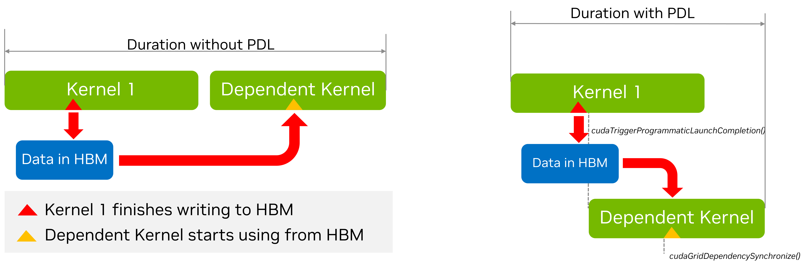

# 3.1. 高级 CUDA API 与特性

本节将介绍更高级的 CUDA API 和特性的使用。这些主题涵盖的技术或特性通常不需要修改 CUDA 内核，但仍能从主机端影响应用程序级别的行为，包括 GPU 工作执行、性能以及 CPU 端性能。

## 3.1.1. cudaLaunchKernelEx

在早期版本的 CUDA 中引入[三括号表示法](../02-basics/intro-to-cuda-cpp.html#intro-cpp-launching-kernels-triple-chevron)时，内核的[执行配置](../05-appendices/cpp-language-extensions.html#execution-configuration)仅有四个可编程参数：

*   线程块维度
*   网格维度
*   动态共享内存（可选，未指定时为 0）
*   流（未指定时使用默认流）

某些 CUDA 特性可以受益于内核启动时提供的额外属性和提示。`cudaLaunchKernelEx` 允许程序通过 `cudaLaunchConfig_t` 结构设置上述执行配置参数。此外，`cudaLaunchConfig_t` 结构允许程序传入零个或多个 `cudaLaunchAttributes` 来控制或建议内核启动的其他参数。例如，本章后面讨论的 `cudaLaunchAttributePreferredSharedMemoryCarveout`（参见[配置 L1/共享内存平衡]()）就是通过 `cudaLaunchKernelEx` 指定的。本章后面讨论的 `cudaLaunchAttributeClusterDimension` 属性用于指定内核启动所需的簇大小。

支持的属性及其含义的完整列表请参见 [CUDA 运行时 API 参考文档](https://docs.nvidia.com/cuda/cuda-runtime-api/group__CUDART__TYPES.html#group__CUDART__TYPES_1gfc5ed48085f05863b1aeebb14934b056)。

## 3.1.2. 启动簇

前面章节介绍的[线程块簇](../chapter-1-CUDA简介/1.2-编程模型.md#12211-thread-block-clusters-线程块簇)是计算能力 9.0 及更高版本中可选的线程块组织层级，它使应用程序能够保证一个簇中的线程块在单个 GPC 上同时执行。这使得比单个 SM 所能容纳的更大的线程组能够相互交换数据和同步。

[第 2.1.10.1 节](../chapter-2-CUDA%20GPU编程/2.1-CUDA%20C++%20入门.md)展示了如何使用三括号表示法指定和启动使用簇的内核。在该节中，使用 `__cluster_dims__` 注解来指定启动内核时必须使用的簇维度。当使用三括号表示法时，簇的大小是隐式确定的。

### 3.1.2.1. 使用 cudaLaunchKernelEx 启动簇

与[使用三括号表示法启动簇内核](../chapter-2-CUDA%20GPU编程/2.1-CUDA%20C++%20入门.md)不同，线程块簇的大小可以在每次启动时配置。下面的代码示例展示了如何使用 `cudaLaunchKernelEx` 启动一个簇内核。

```c++
// Kernel definition
// No compile time attribute attached to the kernel
__global__ void cluster_kernel(float *input, float* output)
{

}

int main()
{
    float *input, *output;
    dim3 threadsPerBlock(16, 16);
    dim3 numBlocks(N / threadsPerBlock.x, N / threadsPerBlock.y);

    // Kernel invocation with runtime cluster size
    {
        cudaLaunchConfig_t config = {0};
        // The grid dimension is not affected by cluster launch, and is still enumerated
        // using number of blocks.
        // The grid dimension should be a multiple of cluster size.
        config.gridDim = numBlocks;
        config.blockDim = threadsPerBlock;

        cudaLaunchAttribute attribute[1];
        attribute[0].id = cudaLaunchAttributeClusterDimension;
        attribute[0].val.clusterDim.x = 2; // Cluster size in X-dimension
        attribute[0].val.clusterDim.y = 1;
        attribute[0].val.clusterDim.z = 1;
        config.attrs = attribute;
        config.numAttrs = 1;

        cudaLaunchKernelEx(&config, cluster_kernel, input, output);
    }
}
```

与线程块簇相关的 `cudaLaunchAttribute` 类型有两种：`cudaLaunchAttributeClusterDimension` 和 `cudaLaunchAttributePreferredClusterDimension`。

属性 id `cudaLaunchAttributeClusterDimension` 指定执行簇所需的维度。该属性的值 `clusterDim` 是一个三维值。网格的相应维度（x、y、z）必须能被指定簇维度的相应维度整除。设置此属性类似于在编译时在内核定义上使用 `__cluster_dims__` 属性（如[使用三括号表示法启动簇](../02-basics/intro-to-cuda-cpp.html#intro-cpp-launching-cluster-triple-chevron)所示），但可以在运行时为同一内核的不同启动而更改。

在计算能力为 10.0 及更高版本的 GPU 上，另一个属性 id `cudaLaunchAttributePreferredClusterDimension` 允许应用程序额外指定一个首选的簇维度。首选维度必须是内核上的 `__cluster_dims__` 属性或 `cudaLaunchKernelEx` 的 `cudaLaunchAttributeClusterDimension` 属性所指定的最小簇维度的整数倍。也就是说，除了首选簇维度之外，还必须指定一个最小簇维度。网格的相应维度（x、y、z）必须能被指定的首选簇维度的相应维度整除。

所有线程块都将以至少为最小簇维度的簇执行。在可能的情况下，将使用首选维度的簇，但不能保证所有簇都以首选维度执行。所有线程块都将以最小或首选簇维度之一执行。使用首选簇维度的内核必须被编写为在最小或首选簇维度下都能正确运行。

### 3.1.2.2. 作为簇的块

当使用 `__cluster_dims__` 注解定义内核时，网格中的簇数是隐含的，并且可以通过将网格大小除以指定的簇大小来计算。

```c++
__cluster_dims__((2, 2, 2)) __global__ void foo();

// 8x8x8 clusters each with 2x2x2 thread blocks.
foo<<<dim3(16, 16, 16), dim3(1024, 1, 1)>>>();
```

在上面的示例中，内核以 16x16x16 个线程块的网格启动，这意味着使用了 8x8x8 个簇的网格。

内核也可以使用 `__block_size__` 注解，该注解在定义内核时同时指定所需的块大小和簇大小。当使用此注解时，三括号启动中的第一个参数变成以簇为单位的网格维度，而不是线程块，如下所示。

```c++
// Implementation detail of how many threads per block and blocks per cluster
// is handled as an attribute of the kernel.
__block_size__((1024, 1, 1), (2, 2, 2)) __global__ void foo();

// 8x8x8 clusters.
foo<<<dim3(8, 8, 8)>>>();
```

`__block_size__` 需要两个字段，每个字段都是一个包含 3 个元素的元组。第一个元组表示块维度，第二个元组表示簇大小。如果未传递第二个元组，则假定为 `(1,1,1)`。当在内核启动期间指定动态共享内存大小和/或流时，`<<<>>>` 中的第二个参数必须是占位符 `1`。任何其他值都会导致未定义行为。

注意，同时指定 `__block_size__` 的第二个元组和 `__cluster_dims__` 是非法的。使用带有空 `__cluster_dims__` 的 `__block_size__` 也是非法的。当指定了 `__block_size__` 的第二个元组时，意味着启用了“作为簇的块”，并且编译器会将 `<<<>>>` 中的第一个参数识别为簇的数量而不是线程块。

## 3.1.3. 关于流和事件的更多内容

[CUDA 流](../chapter-2-CUDA%20GPU编程/2.5-异步执行.md)介绍了 CUDA 流的基础知识。默认情况下，在给定 CUDA 流上提交的操作是串行化的：一个操作必须在前一个操作完成后才能开始执行。唯一的例外是最近添加的[编程式依赖启动和同步]()功能。拥有多个 CUDA 流是实现并发执行的一种方式；另一种方式是使用 [CUDA 图]()。这两种方法也可以结合使用。

在不同 CUDA 流上提交的工作在特定情况下*可能*并发执行，例如，如果没有事件依赖关系、没有隐式同步、有足够的资源等。

如果在不同 CUDA 流的独立操作之间提交了任何在 NULL 流上的 CUDA 操作，则这些操作不能并发运行，除非这些流是非阻塞 CUDA 流。这些流是使用 `cudaStreamCreateWithFlags()` 运行时 API 并带有 `cudaStreamNonBlocking` 标志创建的。为了提高 GPU 工作并发执行的潜力，建议用户创建非阻塞 CUDA 流。

还建议用户选择对其问题而言足够的最通用的同步选项。
例如，如果要求 CPU 等待（阻塞）特定 CUDA 流上的所有工作完成，则对该流使用 `cudaStreamSynchronize()` 会比使用 `cudaDeviceSynchronize()` 更好，因为后者会不必要地等待设备上所有 CUDA 流的 GPU 工作完成。
如果要求 CPU 以非阻塞方式等待，则在轮询循环中使用 `cudaStreamQuery()` 并检查其返回值可能更可取。

使用 CUDA 事件（[CUDA 事件](../chapter-2-CUDA%20GPU编程/2.5-异步执行.md)）也可以实现类似的同步效果，例如，在该流上记录一个事件并调用 `cudaEventSynchronize()` 以阻塞方式等待该事件捕获的工作完成。同样，这比使用 `cudaDeviceSynchronize()` 更可取且更聚焦。调用 `cudaEventQuery()` 并检查其返回值（例如在轮询循环中）将是一种非阻塞的替代方案。

显式同步方法的选择在该操作发生在应用程序关键路径中时尤为重要。[表 4](#table-streams-event-sync-summary) 提供了与主机相关的各种同步选项的高级摘要。

<div class="pst-scrollable-table-container">
<table class="small table table-center" id="table-streams-event-sync-summary">
<caption><span class="caption-number">表 4 </span><span class="caption-text">与主机的显式同步选项摘要</span></caption>
<thead>
<tr class="row-odd"><th class="head"></th>
<th class="head"><p>等待特定流</p></th>
<th class="head"><p>等待特定事件</p></th>
<th class="head"><p>等待设备上的所有工作</p></th>
</tr>
</thead>
<tbody>
<tr class="row-even"><td><p>非阻塞（需要轮询循环）</p></td>
<td><p>cudaStreamQuery()</p></td>
<td><p>cudaEventQuery()</p></td>
<td><p>不适用</p></td>
</tr>
<tr class="row-odd"><td><p>阻塞</p></td>
<td><p>cudaStreamSynchronize()</p></td>
<td><p>cudaEventSynchronize()</p></td>
<td><p>cudaDeviceSynchronize()</p></td>
</tr>
</tbody>
</table>
</div>

为了在 CUDA 流之间同步（即表达依赖关系），建议使用非计时的 CUDA 事件，如 [CUDA 事件]()中所述。
用户可以调用 `cudaStreamWaitEvent()` 来强制将来在特定流上提交的操作等待先前记录的事件（例如，在另一个流上）完成。
请注意，对于任何等待或查询事件的 CUDA API，用户有责任确保已经调用了 cudaEventRecord API，因为未记录的事件将始终返回成功。

CUDA 事件默认携带计时信息，因为它们可以在 `cudaEventElapsedTime()` API 调用中使用。
然而，仅用于表达跨流依赖关系的 CUDA 事件不需要计时信息。
对于这种情况，建议创建禁用计时信息的事件以提高性能。这可以通过使用 `cudaEventCreateWithFlags()` API 并带有 `cudaEventDisableTiming` 标志来实现。

### 3.1.3.1. 流优先级

流的相对优先级可以在创建时使用 `cudaStreamCreateWithPriority()` 指定。允许的优先级范围（按 [最高优先级, 最低优先级] 排序）可以使用 `cudaDeviceGetStreamPriorityRange()` 函数获取。在运行时，GPU 调度器利用流优先级来确定任务执行顺序，但这些优先级是作为提示而不是保证。当选择要启动的工作时，高优先级流中的待处理任务优先于低优先级流中的任务。高优先级任务不会抢占已经在运行的低优先级任务。GPU 不会在任务执行期间重新评估工作队列，提高流的优先级也不会中断正在进行的工作。流优先级影响任务执行，但不强制执行严格的顺序，因此用户可以利用流优先级来影响任务执行，而不依赖于严格的顺序保证。

以下代码示例获取当前设备的允许优先级范围，并创建具有最高和最低可用优先级的两个非阻塞 CUDA 流。

```c++
// get the range of stream priorities for this device
int leastPriority, greatestPriority;
cudaDeviceGetStreamPriorityRange(&leastPriority, &greatestPriority);

// create streams with highest and lowest available priorities
cudaStream_t st_high, st_low;
cudaStreamCreateWithPriority(&st_high, cudaStreamNonBlocking, greatestPriority));
cudaStreamCreateWithPriority(&st_low, cudaStreamNonBlocking, leastPriority);
```

### 3.1.3.2. 显式同步

如前所述，有多种方式可以让流与其他流同步。以下提供了不同粒度级别的常用方法：

*   `cudaDeviceSynchronize()` 等待直到所有主机线程的所有流中所有先前命令完成。
*   `cudaStreamSynchronize()` 接受一个流作为参数，并等待直到给定流中所有先前命令完成。它可以用于将主机与特定流同步，允许其他流在设备上继续执行。
*   `cudaStreamWaitEvent()` 接受一个流和一个事件作为参数（有关事件的描述，请参见 [CUDA 事件]()），并使在调用 `cudaStreamWaitEvent()` 之后添加到给定流的所有命令延迟执行，直到给定事件完成。
*   `cudaStreamQuery()` 为应用程序提供了一种了解流中所有先前命令是否已完成的方法。

### 3.1.3.3. 隐式同步

如果主机线程在它们之间发出了以下任何操作，则来自不同流的两个命令不能并发运行：

*   页锁定主机内存分配
*   设备内存分配
*   设备内存设置
*   同一设备内存中两个地址之间的内存复制
*   任何到 NULL 流的 CUDA 命令
*   L1/共享内存配置之间的切换

需要依赖检查的操作包括同一流中与正在检查的启动相关的任何其他命令，以及对该流的任何 `cudaStreamQuery()` 调用。因此，应用程序应遵循以下准则以提高其并发内核执行的潜力：

*   所有独立操作应在依赖操作之前发出。
*   任何类型的同步都应尽可能延迟。

## 3.1.4. 编程式依赖内核启动

正如我们之前讨论的，CUDA 流的语义是内核按顺序执行。这样，如果我们有两个连续的内核，其中第二个内核依赖于第一个内核的结果，程序员可以确信当第二个内核开始执行时，依赖的数据将可用。然而，可能发生的情况是，第一个内核可能已经将后续内核所依赖的数据写入全局内存，但它仍有更多工作要做。同样，依赖的第二个内核在需要第一个内核的数据之前可能有一些独立的工作。在这种情况下，可以部分重叠两个内核的执行（假设硬件资源可用）。重叠还可以重叠第二个内核的启动开销。除了硬件资源的可用性之外，可以实现的叠加程度取决于内核的具体结构，例如：

*   第一个内核在执行过程中何时完成第二个内核所依赖的工作？
*   第二个内核在执行过程中何时开始处理来自第一个内核的数据？

由于这在很大程度上取决于具体的内核，因此很难完全自动化，因此 CUDA 提供了一种机制，允许应用程序开发人员指定两个内核之间的同步点。这是通过一种称为编程式依赖内核启动的技术完成的。这种情况如下图所示。

<figure class="align-center" id="figure-programmatic-dependent-launch">

</figure>

PDL 有三个主要组成部分。

i.  第一个内核（所谓的*主内核*）需要调用一个特殊函数来指示它已经完成了后续依赖内核（也称为*次内核*）所需的所有工作。这是通过调用函数 `cudaTriggerProgrammaticLaunchCompletion()` 来完成的。
ii. 相应地，依赖的次内核需要指示它已经到达了其工作中独立于主内核的部分，并且它现在正在等待主内核完成它所依赖的工作。这是通过函数 `cudaGridDependencySynchronize()` 来完成的。
iii. 第二个内核需要使用特殊属性 `cudaLaunchAttributeProgrammaticStreamSerialization` 启动，并将其 `programmaticStreamSerializationAllowed` 字段设置为 `1`。

以下代码片段展示了如何实现这一点的示例。

```c
__global__ void primary_kernel() {
    // Initial work that should finish before starting secondary kernel

    // Trigger the secondary kernel
    cudaTriggerProgrammaticLaunchCompletion();

    // Work that can coincide with the secondary kernel
}

__global__ void secondary_kernel()
{
    // Initialization, Independent work, etc.

    // Will block until all primary kernels the secondary kernel is dependent on have
    // completed and flushed results to global memory
    cudaGridDependencySynchronize();

    // Dependent work
}

// Launch the secondary kernel with the special attribute

// Set Up the attribute
cudaLaunchAttribute attribute[1];
attribute[0].id = cudaLaunchAttributeProgrammaticStreamSerialization;
attribute[0].val.programmaticStreamSerializationAllowed = 1;

// Set the attribute in a kernel launch configuration
 
cudaLaunchConfig_t config = {0};

// Base launch configuration
config.gridDim = grid_dim;
config.blockDim = block_dim;
config.dynamicSmemBytes= 0;
config.stream = stream;

// Add special attribute for PDL
config.attrs = attribute;
config.numAttrs = 1;

// Launch primary kernel
primary_kernel<<<grid_dim, block_dim, 0, stream>>>();

// Launch secondary (dependent) kernel using the configuration with
// the attribute
cudaLaunchKernelEx(&config, secondary_kernel);
```

## 3.1.5. 批量内存传输

CUDA 开发中的一个常见模式是使用批处理技术。批处理我们粗略地指将多个（通常很小的）任务组合成一个（通常更大的）操作。批处理中的组件不一定完全相同，尽管它们通常是相同的。这种想法的一个例子是 cuBLAS 提供的批量矩阵乘法操作。

通常，与 CUDA 图和 PDL 一样，批处理的目的是减少单独分派各个批处理任务所带来的开销。在内存传输方面，启动一次内存传输可能会产生一些 CPU 和驱动程序开销。此外，常规的 `cudaMemcpyAsync()` 函数在其当前形式下不一定为驱动程序提供足够的信息来优化传输，例如，有关源和目标的提示。在 Tegra 平台上，可以选择使用 SM 或复制引擎 (CE) 来执行传输。目前选择哪个由驱动程序中的启发式算法决定。这可能很重要，因为使用 SM 可能会导致更快的传输，但会占用一些可用的计算能力。另一方面，使用 CE 可能会导致传输速度较慢，但整体应用程序性能更高，因为它使 SM 可以自由地执行其他工作。

这些考虑促使了 `cudaMemcpyBatchAsync()` 函数（及其相关函数 `cudaMemcpyBatch3DAsync()`）的设计。这些函数允许优化批量内存传输。除了源指针和目标指针列表之外，该 API 还使用内存复制属性来指定顺序的期望，并提供源和目标位置的提示，以及是否希望将传输与计算重叠（目前仅在具有 CE 的 Tegra 平台上支持）。

让我们首先考虑一个简单的情况，即从固定主机内存到固定设备内存的简单批量传输。

```cpp
std::vector<void *> srcs(batch_size);
std::vector<void *> dsts(batch_size);
std::vector<size_t> sizes(batch_size);

// Allocate the source and destination buffers
// initialize with the stream number
for (size_t i = 0; i < batch_size; i++) {
    cudaMallocHost(&srcs[i], sizes[i]);
    cudaMalloc(&dsts[i], sizes[i]);
    cudaMemsetAsync(srcs[i], sizes[i], stream);
}

// Setup attributes for this batch of copies
cudaMemcpyAttributes attrs = {};
attrs.srcAccessOrder = cudaMemcpySrcAccessOrderStream;

// All copies in the batch have same copy attributes.
size_t attrsIdxs = 0;  // Index of the attributes

// Launch the batched memory transfer
cudaMemcpyBatchAsync(&dsts[0], &srcs[0], &sizes[0], batch_size,
    &attrs, &attrsIdxs, 1 /*numAttrs*/, nullptr /*failIdx*/, stream);
```

`cudaMemcpyBatchAsync()` 函数的前几个参数看起来比较直观。它们包含源指针和目标指针的数组，以及传输大小。每个数组必须有 `batch_size` 个元素。新信息来自属性。该函数需要一个指向属性数组的指针，以及一个对应的属性索引数组。原则上，也可以传递一个 `size_t` 数组，其中可以记录失败传输的索引，但在这里传递 `nullptr` 是安全的，在这种情况下，失败索引将不会被记录。

关于属性，在这个实例中，传输是同构的。所以我们只使用一个属性，它将应用于所有传输。这是由 `attrIndex` 参数控制的。原则上，这可以是一个数组。数组的第 *i* 个元素包含属性数组的第 *i* 个元素所应用的第一个传输的索引。在本例中，`attrIndex` 被视为单元素数组，值为 `0` 表示 `attribute[0]` 将应用于索引为 0 及以上的所有传输，换句话说，就是所有传输。

最后，我们注意到我们将 `srcAccessOrder` 属性设置为 `cudaMemcpySrcAccessOrderStream`。这意味着源数据将以常规的流顺序访问。换句话说，memcpy 将阻塞，直到之前处理这些源和目标指针中任何数据的内核完成。

在下一个示例中，我们将考虑一个更复杂的异构批量传输情况。

```c
std::vector<void *> srcs(batch_size);
std::vector<void *> dsts(batch_size);
std::vector<size_t> sizes(batch_size);

// Allocate the src and dst buffers
for (size_t i = 0; i < batch_size - 10; i++) {
    cudaMallocHost(&srcs[i], sizes[i]);
    cudaMalloc(&dsts[i], sizes[i]);
}

int buffer[10];

for (size_t i = batch_size - 10; i < batch_size; i++) {
    srcs[i] = &buffer[10 - (batch_size - i];
    cudaMalloc(&dsts[i], sizes[i]);
}

// Setup attributes for this batch of copies
cudaMemcpyAttributes attrs[2] = {};
attrs[0].srcAccessOrder = cudaMemcpySrcAccessOrderStream;
attrs[1].srcAccessOrder = cudaMemcpySrcAccessOrderDuringApiCall;

size_t attrsIdxs[2];
attrsIdxs[0] = 0;
attrsIdxs[1] = batch_size - 10;

// Launch the batched memory transfer
cudaMemcpyBatchAsync(&dsts[0], &srcs[0], &sizes[0], batch_size,
    &attrs, &attrsIdxs, 2 /*numAttrs*/, nullptr /*failIdx*/, stream);
```

这里我们有两种传输：`batch_size-10` 次从固定主机内存到固定设备内存的传输，以及 10 次从主机数组到固定设备内存的传输。此外，`buffer` 数组不仅在主机上，而且只在当前作用域中存在——它的地址就是所谓的*短暂指针*。这个指针在 API 调用完成后可能不再有效（它是异步的）。为了使用这种短暂指针执行复制，属性中的 `srcAccessOrder` 必须设置为 `cudaMemcpySrcAccessOrderDuringApiCall`。

我们现在有两个属性，第一个应用于所有索引从 0 开始且小于 `batch_size-10` 的传输。第二个应用于所有索引从 `batch_size-10` 开始且小于 `batch_size` 的传输。

如果我们不是从栈上分配 `buffer` 数组，而是使用 `malloc` 从堆上分配，那么数据就不再是短暂的了。它将一直有效，直到指针被显式释放。在这种情况下，如何暂存复制的最佳选项将取决于系统是否具有硬件管理内存或通过地址转换对主机内存的一致性 GPU 访问（这种情况下最好使用流排序），或者是否没有（这种情况下立即暂存传输最有意义）。在这种情况下，应该对属性的 `srcAccessOrder` 使用值 `cudaMemcpyAccessOrderAny`。

`cudaMemcpyBatchAsync` 函数还允许程序员提供关于源和目标位置的提示。这是通过设置 `cudaMemcpyAttributes` 结构的 `srcLocation` 和 `dstLocation` 字段来完成的。`srcLocation` 和 `dstLocation` 字段都是 `cudaMemLocation` 类型，该结构包含位置类型和位置 ID。这与在使用 `cudaMemPrefetchAsync()` 时可用于向运行时提供预取提示的 `cudaMemLocation` 结构相同。我们在下面的代码示例中说明如何为从设备到主机的特定 NUMA 节点的传输设置提示：

```c
// Allocate the source and destination buffers
std::vector<void *> srcs(batch_size);
std::vector<void *> dsts(batch_size);
std::vector<size_t> sizes(batch_size);

// cudaMemLocation structures we will use tp provide location hints
// Device device_id
cudaMemLocation srcLoc = {cudaMemLocationTypeDevice, dev_id};

// Host with numa Node numa_id
cudaMemLocation dstLoc = {cudaMemLocationTypeHostNuma, numa_id};

// Allocate the src and dst buffers
for (size_t i = 0; i < batch_size; i++) {
    cudaMallocManaged(&srcs[i], sizes[i]);
    cudaMallocManaged(&dsts[i], sizes[i]);

    cudaMemPrefetchAsync(srcs[i], sizes[i], srcLoc, 0, stream);
    cudaMemPrefetchAsync(dsts[i], sizes[i], dstLoc, 0, stream);
    cudaMemsetAsync(srcs[i], sizes[i], stream);
}

// Setup attributes for this batch of copies
cudaMemcpyAttributes attrs = {};

// These are managed memory pointers so Stream Order is appropriate
attrs.srcAccessOrder = cudaMemcpySrcAccessOrderStream;

// Now we can specify the location hints here.
attrs.srcLocHint = srcLoc;
attrs.dstlocHint = dstLoc;

// All copies in the batch have same copy attributes.
size_t attrsIdxs = 0;

// Launch the batched memory transfer
cudaMemcpyBatchAsync(&dsts[0], &srcs[0], &sizes[0], batch_size,
    &attrs, &attrsIdxs, 1 /*numAttrs*/, nullptr /*failIdx*/, stream);
```

最后要介绍的是用于提示我们是否希望使用 SM 或 CE 进行传输的标志。
该字段是 `cudaMemcpyAttributesflags::flags`，可能的值为：

*   `cudaMemcpyFlagDefault` – 默认行为
*   `cudaMemcpyFlagPreferOverlapWithCompute` – 提示系统应优先使用 CE 进行传输，以将传输与计算重叠。此标志在非 Tegra 平台上被忽略。

总之，关于“cudaMemcpyBatchAsync”的要点如下：

*   `cudaMemcpyBatchAsync` 函数（及其 3D 变体）允许程序员指定一批内存传输，从而分摊传输设置开销。
*   除了源指针、目标指针和传输大小之外，该函数还可以接受一个或多个内存复制属性，提供有关所传输内存类型的信息、源指针相应的流排序行为、源和目标位置的提示，以及是否更倾向于将传输与计算重叠（如果可能）或使用 SM 进行传输的提示。
*   基于上述信息，运行时可以尝试最大程度地优化传输。

## 3.1.6. 环境变量

CUDA 提供了各种环境变量（参见[第 5.2 节]()），它们可以影响执行和性能。
如果未显式设置，CUDA 会为其使用合理的默认值，但根据具体情况可能需要特殊处理，例如用于调试目的或获得更好的性能。

例如，增加 `CUDA_DEVICE_MAX_CONNECTIONS` 环境变量的值可能是必要的，以减少来自不同 CUDA 流的独立工作因虚假依赖而被串行化的可能性。当使用相同的底层资源时，可能会引入此类虚假依赖。
建议从使用默认值开始，仅在出现性能问题（例如，无法归因于其他因素（如 SM 资源不足）的跨 CUDA 流独立工作意外串行化）时探索此环境变量的影响。
值得注意的是，在 MPS 的情况下，此环境变量具有不同的（较低的）默认值。

类似地，对于延迟敏感的应用程序，将 `CUDA_MODULE_LOADING` 环境变量设置为 `EAGER` 可能更可取，以便将所有因模块加载而产生的开销移到应用程序初始化阶段，并移出其关键阶段。当前的默认模式是惰性模块加载。
在这种默认模式下，可以通过在应用程序初始化阶段添加各种内核的“预热”调用来实现类似于急切模块加载的效果，以强制模块加载更早发生。

请参阅 [CUDA 环境变量]()以获取有关各种 CUDA 环境变量的更多详细信息。
建议您在启动应用程序*之前*将环境变量设置为新值；尝试在应用程序内设置它们可能没有效果。
