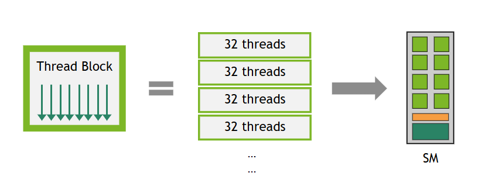

# 3.2. 高级核函数编程

本章将首先深入探讨 NVIDIA GPU 的硬件模型，然后介绍 CUDA 核函数代码中可用于提高核函数性能的一些更高级的特性。本章将介绍与线程作用域、异步执行以及相关同步原语相关的一些概念。这些概念性的讨论为核函数代码中一些高级性能特性提供了必要的基础。

其中一些特性的详细描述包含在本编程指南下一部分中专门介绍这些特性的章节中。

*   本章介绍的[高级同步原语](#324-高级同步原语)在[第 4.9 节 异步屏障]()和[第 4.10 节 流水线]()中有完整介绍。
*   本章介绍的[异步数据拷贝](#325-异步数据拷贝)，包括张量内存加速器 (TMA)，在[第 4.11 节 异步拷贝]()中有完整介绍。

## 3.2.1. 使用 PTX

*并行线程执行* (PTX) 是 CUDA 用于抽象硬件 ISA 的虚拟机指令集架构 (ISA)，在[第 1.3.3 节](../chapter-1-CUDA简介/1.3-CUDA平台.md#133-parallel-thread-executionptx-并行线程执行)中介绍过。直接用 PTX 编写代码是一种非常高级的优化技术，对大多数开发人员来说并非必需，应被视为最后的手段。尽管如此，在某些情况下，直接编写 PTX 所能实现的细粒度控制可以在特定应用中提升性能。这些情况通常出现在应用中对性能非常敏感的部分，其中每一小部分百分比的性能提升都有显著的好处。所有可用的 PTX 指令都在 [PTX ISA 文档](https://docs.nvidia.com/cuda/parallel-thread-execution/index.html)中。

**`cuda::ptx` 命名空间**

在代码中直接使用 PTX 的一种方法是使用来自 [libcu++](https://nvidia.github.io/cccl/unstable/libcudacxx/) 的 `cuda::ptx` 命名空间。该命名空间提供了直接映射到 PTX 指令的 C++ 函数，简化了它们在 C++ 应用程序中的使用。有关更多信息，请参阅 [`cuda::ptx` 命名空间](https://nvidia.github.io/cccl/unstable/libcudacxx/ptx_api.html)文档。

**内联 PTX**

在代码中包含 PTX 的另一种方法是使用内联 PTX。此方法在相应的[文档](https://docs.nvidia.com/cuda/inline-ptx-assembly/index.html)中有详细描述。这非常类似于在 CPU 上编写汇编代码。

## 3.2.2. 硬件实现

流式多处理器或 SM（参见[GPU 硬件模型](../chapter-1-CUDA简介/1.2-编程模型.md#122-gpu-hardware-model-gpu硬件模型)）旨在同时执行数百个线程。为了管理如此大量的线程，它采用了一种称为*单指令多线程*或 *SIMT* 的独特并行计算模型，该模型在[SIMT 执行模型](#3221-simt-执行模型)中描述。指令是流水线化的，利用单个线程内的指令级并行性，以及通过[硬件多线程](#3222-硬件多线程)中详述的同步硬件多线程实现的广泛线程级并行性。与 CPU 核心不同，SM 按顺序发出指令，不执行分支预测或推测执行。

[SIMT 执行模型](#3221-simt-执行模型)和[硬件多线程](#3222-硬件多线程)部分描述了所有设备共有的 SM 架构特性。[计算能力]()部分提供了不同计算能力设备的具体信息。

NVIDIA GPU 架构使用小端表示。

### 3.2.2.1. SIMT 执行模型

每个 SM 以 32 个并行线程为一组（称为 *warp*）来创建、管理、调度和执行线程。组成 warp 的单个线程从相同的程序地址开始，但它们有自己的指令地址计数器和寄存器状态，因此可以自由地分支和独立执行。术语 *warp* 源于编织，即第一种并行线程技术。*半 warp* 是 warp 的前半部分或后半部分。*四分之一 warp* 是 warp 的第一、第二、第三或第四季度。

一个 warp 一次执行一条公共指令，因此当 warp 的所有 32 个线程在其执行路径上一致时，可以实现完全效率。如果 warp 的线程通过数据相关的条件分支发散，则 warp 会执行每个采用的分支路径，并禁用不在该路径上的线程。分支发散仅发生在 warp 内部；不同的 warp 独立执行，无论它们执行的是公共代码路径还是不相交的代码路径。

SIMT 架构类似于 SIMD（单指令多数据）向量组织，因为单个指令控制多个处理元素。一个关键区别是 SIMD 向量组织向软件暴露 SIMD 宽度，而 SIMT 指令指定单个线程的执行和分支行为。与 SIMD 向量机相比，SIMT 使程序员能够为独立的标量线程编写线程级并行代码，以及为协调的线程编写数据并行代码。就正确性而言，程序员基本上可以忽略 SIMT 行为；然而，通过注意代码很少要求 warp 中的线程发散，可以实现显著的性能改进。在实践中，这类似于缓存行的作用：在设计正确性时可以安全地忽略缓存行大小，但在为峰值性能设计代码结构时必须加以考虑。另一方面，向量架构要求软件将加载合并为向量并手动管理发散。

#### 3.2.2.1.1. 独立线程调度

在计算能力低于 7.0 的 GPU 上，warp 使用单个程序计数器（由 warp 中所有 32 个线程共享）以及一个指定 warp 活动线程的活动掩码。因此，来自同一 warp 的线程在发散区域或不同执行状态下无法相互发送信号或交换数据，并且需要由锁或互斥量保护的细粒度数据共享的算法可能导致死锁，具体取决于竞争线程来自哪个 warp。

在计算能力为 7.0 及更高版本的 GPU 中，*独立线程调度*允许线程之间的完全并发，无论 warp 如何。借助独立线程调度，GPU 维护每个线程的执行状态，包括程序计数器和调用栈，并可以以每个线程的粒度放弃执行，以便更好地利用执行资源或允许一个线程等待另一个线程生成数据。调度优化器确定如何将来自同一 warp 的活动线程分组到 SIMT 单元中。这保留了与先前 NVIDIA GPU 中一样的 SIMT 执行高吞吐量，但具有更大的灵活性：线程现在可以以子 warp 粒度发散和重新汇聚。

独立线程调度可能会破坏依赖于先前 GPU 架构中隐式 warp 同步行为的代码。*Warp 同步*代码假定同一 warp 中的线程在每个指令上以锁步方式执行，但线程以子 warp 粒度发散和重新汇聚的能力使得此类假设无效。这可能导致参与执行代码的线程集与预期不同。任何为 CC 7.0 之前的 GPU 开发的 warp 同步代码（例如，无同步的 intra-warp 规约）都应重新审视以确保兼容性。开发人员应使用 `__syncwarp()` 显式同步此类代码，以确保在所有 GPU 代际中行为正确。

> **注意**
> 参与当前指令的 warp 线程称为*活动*线程，而未在当前指令上的线程称为*非活动*（禁用）线程。线程可能因多种原因变为非活动状态，包括比其 warp 中的其他线程更早退出、采用了与 warp 当前执行的分支路径不同的分支路径，或者是其线程数不是 warp 大小倍数的块中的最后线程。
> 如果一个 warp 执行的非原子指令从 warp 的多个线程写入全局或共享内存中的同一位置，则发生到该位置的串行写入次数可能因设备的计算能力而异。但是，对于所有计算能力，哪个线程执行最终写入是未定义的。

> 如果一个 warp 执行的[原子]()指令从 warp 的多个线程读取、修改和写入全局内存中的同一位置，则对该位置的每次读取/修改/写入都会发生并且它们都被串行化，但发生的顺序是未定义的。

### 3.2.2.2. 硬件多线程

当一个 SM 被分配一个或多个线程块执行时，它会将它们划分为 warp，并且每个 warp 由 *warp 调度器* 调度执行。块划分为 warp 的方式总是相同的；每个 warp 包含具有连续、递增线程 ID 的线程，第一个 warp 包含线程 0。[线程层次结构]()描述了线程 ID 如何与块中的线程索引相关联。

块中 warp 的总数定义如下：

$\text{ceil}\left( \frac{T}{W_{size}}, 1 \right)$

*   *T* 是每个块的线程数，
*   *Wsize* 是 warp 大小，等于 32，
*   ceil(x, y) 等于 x 向上取整到 y 的最近倍数。

<figure class="align-center" id="hardware-multithreading-warps-in-a-block">

<figcaption>
<p><span class="caption-number">图 22 </span><span class="caption-text">一个线程块被划分为 32 个线程的 warp。</span></p>
</figcaption>
</figure>

SM 处理的每个 warp 的执行上下文（程序计数器、寄存器等）在 warp 的整个生命周期内都在片上维护。因此，在 warp 之间切换不会产生成本。在每个指令发出周期，warp 调度器选择一个具有准备好执行其下一条指令的线程（warp 的[活动线程](#3221-simt-执行模型)）的 warp，并将指令发出给这些线程。

每个 SM 都有一组 32 位寄存器，这些寄存器在 warp 之间分配，以及一个在线程块之间分配的[共享内存]()。对于给定的核函数，可以在 SM 上驻留和同时处理的块和 warp 数量取决于核函数使用的寄存器和共享内存量，以及 SM 上可用的寄存器和共享内存量。每个 SM 还有最大常驻块数和 warp 数。这些限制以及 SM 上可用的寄存器和共享内存量取决于设备的计算能力，并在[计算能力]()中指定。如果每个 SM 没有足够的资源来处理至少一个块，核函数将启动失败。为一个块分配的寄存器和共享内存总数可以通过[占用率]()部分中记录的几种方法来确定。

### 3.2.2.3. 异步执行特性

近几代 NVIDIA GPU 包含了异步执行能力，以允许在 GPU 内更多地重叠数据移动、计算和同步。这些能力使得从 GPU 代码调用的某些操作能够与同一线程块中的其他 GPU 代码异步执行。这种异步执行不应与[第 2.5 节]()中讨论的异步 CUDA API 混淆，后者使 GPU 核函数启动或内存操作能够彼此或与 CPU 异步操作。

计算能力 8.0（NVIDIA Ampere GPU 架构）引入了从全局内存到共享内存的硬件加速异步数据拷贝和异步屏障（参见 [NVIDIA A100 Tensor Core GPU 架构](https://images.nvidia.com/aem-dam/en-zz/Solutions/data-center/nvidia-ampere-architecture-whitepaper.pdf)）。

计算能力 9.0（NVIDIA Hopper GPU 架构）通过[张量内存加速器 (TMA)]() 单元扩展了异步执行特性，该单元可以将大块数据和多维张量从全局内存传输到共享内存，反之亦然，以及异步事务屏障和异步矩阵乘加操作（有关详细信息，请参见 [Hopper 架构深度解析](https://developer.nvidia.com/blog/nvidia-hopper-architecture-in-depth/) 博客文章）。

CUDA 提供了可以由设备代码中的线程调用以使用这些特性的 API。异步编程模型定义了异步操作相对于 CUDA 线程的行为。

异步操作是由 CUDA 线程发起但由另一个线程（我们称之为*异步线程*）异步执行的操作。在格式良好的程序中，一个或多个 CUDA 线程与异步操作同步。发起异步操作的 CUDA 线程不一定是同步线程之一。异步线程始终与发起操作的 CUDA 线程相关联。

异步操作使用同步对象（可以是屏障或流水线）来发出完成信号。这些同步对象在[高级同步原语]()中有详细解释，并且它们在执行异步内存操作中的作用在[异步数据拷贝]()中得到了演示。

#### 3.2.2.3.1. 异步线程和异步代理

异步操作可能以与常规操作不同的方式访问内存。为了区分这些不同的内存访问方法，CUDA 引入了*异步线程*、*通用代理*和*异步代理*的概念。常规操作（加载和存储）通过通用代理进行。一些异步指令，如 [LDGSTS]() 和 [STAS/REDAS]()，使用在通用代理中操作的异步线程进行建模。其他异步指令，如使用 TMA 的批量异步拷贝和一些张量核心操作（tcgen05.*, wgmma.mma_async.*），使用在异步代理中操作的异步线程进行建模。

**在通用代理中操作的异步线程**。当异步操作被发起时，它与一个异步线程相关联，该线程不同于发起该操作的 CUDA 线程。对同一地址的*先前*通用代理（常规）加载和存储保证在异步操作之前排序。然而，对同一地址的*后续*常规加载和存储不保证保持其顺序，可能在异步线程完成之前引发竞争条件。

**在异步代理中操作的异步线程**。当异步操作被发起时，它与一个异步线程相关联，该线程不同于发起该操作的 CUDA 线程。对同一地址的*先前和后续*常规加载和存储不保证保持其顺序。需要一个代理栅栏来在不同的代理之间同步它们，以确保正确的内存顺序。[第 4.11.3 节 使用张量内存加速器 (TMA)]() 演示了在执行 TMA 异步拷贝时使用代理栅栏来确保正确性。

有关这些概念的更多详细信息，请参见 [PTX ISA](https://docs.nvidia.com/cuda/parallel-thread-execution/index.html?highlight=proxy#proxies) 文档。

## 3.2.3. 线程作用域

CUDA 线程形成了一个[线程层次结构]()，使用这个层次结构对于编写正确且高性能的 CUDA 核函数至关重要。在此层次结构中，内存操作的可见性和同步范围可能有所不同。为了考虑这种非均匀性，CUDA 编程模型引入了*线程作用域*的概念。线程作用域定义了哪些线程可以观察线程的加载和存储，并指定哪些线程可以使用同步原语（如原子操作和屏障）相互同步。每个作用域在内存层次结构中都有一个相关联的一致性点。

线程作用域在 [CUDA PTX](https://docs.nvidia.com/cuda/parallel-thread-execution/index.html?highlight=thread%2520scopes#scope) 中暴露，并且也可作为 [libcu++](https://nvidia.github.io/cccl/unstable/libcudacxx/extended_api/memory_model.html#thread-scopes) 库中的扩展使用。下表定义了可用的线程作用域：

| CUDA C++ 线程作用域 | CUDA PTX 线程作用域 | 描述 | 内存层次结构中的一致性点 |
| :--- | :--- | :--- | :--- |
| `cuda::thread_scope_thread` | | 内存操作仅对本地线程可见。 | – |
| `cuda::thread_scope_block` | `.cta` | 内存操作对同一线程块中的其他线程可见。 | L1 |
| | `.cluster` | 内存操作对同一线程块簇中的其他线程可见。 | L2 |
| `cuda::thread_scope_device` | `.gpu` | 内存操作对同一 GPU 设备中的其他线程可见。 | L2 |
| `cuda::thread_scope_system` | `.sys` | 内存操作对同一系统（CPU、其他 GPU）中的其他线程可见。 | L2 + 连接的缓存 |

[高级同步原语]()和[异步数据拷贝]()部分演示了线程作用域的使用。

## 3.2.4. 高级同步原语

本节介绍三组同步原语：

*   [作用域原子操作]()，它将 C++ 内存排序与 CUDA 线程作用域配对，以在块、簇、设备或系统作用域（参见[线程作用域]()）内安全地进行线程间通信。
*   [异步屏障]()，它将同步分为到达和等待阶段，并可用于跟踪异步操作的进度。
*   [流水线]()，它将工作分阶段并协调多缓冲生产者-消费者模式，通常用于将计算与[异步数据拷贝]()重叠。

### 3.2.4.1. 作用域原子操作

[第 5.4.5 节]()概述了 CUDA 中可用的原子函数。在本节中，我们将重点介绍通过 [libcu++](https://nvidia.github.io/cccl/unstable/libcudacxx/extended_api/synchronization_primitives.html) 库或编译器内建函数提供的支持 [C++ 标准原子内存](https://en.cppreference.com/w/cpp/atomic/memory_order.html)语义的*作用域*原子操作。作用域原子操作提供了在 CUDA 线程层次结构的适当级别进行高效同步的工具，从而在复杂的并行算法中实现正确性和性能。

#### 3.2.4.1.1. 线程作用域和内存排序

作用域原子操作结合了两个关键概念：

*   **线程作用域**：定义哪些线程可以观察到原子操作的效果（参见[线程作用域]()）。
*   **内存排序**：定义相对于其他内存操作的排序约束（参见 [C++ 标准原子内存语义](https://en.cppreference.com/w/cpp/atomic/memory_order.html)）。


```C++
// CUDA C++ `cuda::atomic`
#include <cuda/atomic>

__global__ void block_scoped_counter() {
    // Shared atomic counter visible only within this block
    __shared__ cuda::atomic<int, cuda::thread_scope_block> counter;

    // Initialize counter (only one thread should do this)
    if (threadIdx.x == 0) {
        counter.store(0, cuda::memory_order_relaxed);
    }
    __syncthreads();

    // All threads in block atomically increment
    int old_value = counter.fetch_add(1, cuda::memory_order_relaxed);

    // Use old_value...
}
```

```C++
// 内建原子函数
__global__ void block_scoped_counter() {
    // Shared counter visible only within this block
    __shared__ int counter;

    // Initialize counter (only one thread should do this)
    if (threadIdx.x == 0) {
        __nv_atomic_store_n(&counter, 0,
                            __NV_ATOMIC_RELAXED,
                            __NV_THREAD_SCOPE_BLOCK);
    }
    __syncthreads();

    // All threads in block atomically increment
    int old_value = __nv_atomic_fetch_add(&counter, 1,
                                          __NV_ATOMIC_RELAXED,
                                          __NV_THREAD_SCOPE_BLOCK);

    // Use old_value...
}
```

此示例实现了一个*块作用域原子计数器*，演示了作用域原子操作的基本概念：

*   **共享变量**：使用 `__shared__` 内存在块中的所有线程之间共享单个计数器。
*   **原子类型声明**：`cuda::atomic<int, cuda::thread_scope_block>` 创建了一个具有块级可见性的原子整数。
*   **单次初始化**：只有线程 0 初始化计数器，以防止设置期间的竞争条件。
*   **块同步**：`__syncthreads()` 确保所有线程在继续之前看到已初始化的计数器。
*   **原子增量**：每个线程原子地增加计数器并接收先前的值。

这里选择 `cuda::memory_order_relaxed` 是因为我们只需要原子性（不可分割的读-修改-写），而不需要不同内存位置之间的排序约束。由于这是一个简单的计数操作，增量的顺序对正确性无关紧要。

对于生产者-消费者模式，获取-释放语义确保正确的排序：


```C++
// CUDA C++ `cuda::atomic`
__global__ void producer_consumer() {
    __shared__ int data;
    __shared__ cuda::atomic<bool, cuda::thread_scope_block> ready;

    if (threadIdx.x == 0) {
        // Producer: write data then signal ready
        data = 42;
        ready.store(true, cuda::memory_order_release);  // Release ensures data write is visible
    } else {
        // Consumer: wait for ready signal then read data
        while (!ready.load(cuda::memory_order_acquire)) {  // Acquire ensures data read sees the write
            // spin wait
        }
        int value = data;
        // Process value...
    }
}
```

```C++
// 内建原子函数
__global__ void producer_consumer() {
    __shared__ int data;
    __shared__ bool ready; // Only ready flag needs atomic operations

    if (threadIdx.x == 0) {
        // Producer: write data then signal ready
        data = 42;
        __nv_atomic_store_n(&ready, true,
                            __NV_ATOMIC_RELEASE,
                            __NV_THREAD_SCOPE_BLOCK);  // Release ensures data write is visible
    } else {
        // Consumer: wait for ready signal then read data
        while (!__nv_atomic_load_n(&ready,
                                   __NV_ATOMIC_ACQUIRE,
                                   __NV_THREAD_SCOPE_BLOCK)) {  // Acquire ensures data read sees the write
            // spin wait
        }
        int value = data;
        // Process value...
    }
}
```

#### 3.2.4.1.2. 性能注意事项

*   *使用尽可能窄的作用域*：块作用域原子操作比系统作用域原子操作快得多。
*   *优先使用较弱的内存排序*：仅在正确性需要时使用更强的排序。
*   *考虑内存位置*：共享内存原子操作比全局内存原子操作更快。

### 3.2.4.2. 异步屏障

异步屏障与典型的单阶段屏障（`__syncthreads()`）不同，线程通知它已到达屏障（“到达”）的操作与等待其他线程到达屏障（“等待”）的操作是分离的。这种分离通过允许线程执行与屏障无关的额外操作来提高执行效率，从而更有效地利用等待时间。异步屏障可用于实现 CUDA 线程的生产者-消费者模式，或通过使拷贝操作在完成时在屏障上“到达”来启用内存层次结构内的异步数据拷贝。

异步屏障在计算能力为 7.0 或更高版本的设备上可用。计算能力为 8.0 或更高版本的设备为共享内存中的异步屏障提供硬件加速，并通过允许块内任何 CUDA 线程子集的硬件加速同步，在同步粒度方面取得了重大进步。以前的架构仅在 whole-warp（`__syncwarp()`）或 whole-block（`__syncthreads()`）级别加速同步。

CUDA 编程模型通过 `cuda::std::barrier` 提供异步屏障，这是 [libcu++](https://nvidia.github.io/cccl/unstable/libcudacxx/extended_api/synchronization_primitives/barrier.html) 库中可用的符合 ISO C++ 标准的屏障。除了实现 [std::barrier](https://en.cppreference.com/w/cpp/thread/barrier.html) 之外，该库还提供了 CUDA 特定的扩展，以选择屏障的线程作用域来提高性能，并暴露了更低级的 [cuda::ptx](https://nvidia.github.io/cccl/unstable/libcudacxx/ptx_api.html) API。`cuda::barrier` 可以通过使用友元函数 `cuda::device::barrier_native_handle()` 检索屏障的本机句柄并将其传递给 `cuda::ptx` 函数来与 `cuda::ptx` 互操作。CUDA 还提供了用于线程块作用域共享内存中异步屏障的[原语 API]()。

下表概述了可用于在不同线程作用域进行同步的异步屏障。

> | 线程作用域 | 内存位置 | 到达屏障 | 等待屏障 | 硬件加速 | CUDA APIs |
> | :--- | :--- | :--- | :--- | :--- | :--- |
> | block | 本地共享内存 | 允许 | 允许 | 是 (8.0+) | `cuda::barrier`, `cuda::ptx`, 原语 |
> | cluster | 本地共享内存 | 允许 | 允许 | 是 (9.0+) | `cuda::barrier`, `cuda::ptx` |
> | cluster | 远程共享内存 | 允许 | 不允许 | 是 (9.0+) | `cuda::barrier`, `cuda::ptx` |
> | device | 全局内存 | 允许 | 允许 | 否 | `cuda::barrier` |
> | system | 全局/统一内存 | 允许 | 允许 | 否 | `cuda::barrier` |

**同步的时间分离**

如果没有异步到达-等待屏障，线程块内的同步是使用 `__syncthreads()` 或使用[协作组]()时的 `block.sync()` 来实现的。

```c++
#include <cooperative_groups.h>

__global__ void simple_sync(int iteration_count) {
    auto block = cooperative_groups::this_thread_block();

    for (int i = 0; i < iteration_count; ++i) {
        /* code before arrive */

         // Wait for all threads to arrive here.
        block.sync();

        /* code after wait */
    }
}
```

线程在同步点（`block.sync()`）被阻塞，直到所有线程都到达同步点。此外，保证在同步点之前发生的内存更新在同步点之后对块中的所有线程可见。

这种模式有三个阶段：

*   同步**之前**的代码执行内存更新，这些更新将在同步**之后**被读取。
*   同步点。
*   同步**之后**的代码，可以看到同步**之前**发生的内存更新。

使用异步屏障，时间分离的同步模式如下。


```C++
// CUDA C++ `cuda::barrier`
#include <cuda/barrier>
#include <cooperative_groups.h>

__device__ void compute(float *data, int iteration);

__global__ void split_arrive_wait(int iteration_count, float *data)
{
  using barrier_t = cuda::barrier<cuda::thread_scope_block>;
  __shared__ barrier_t bar;
  auto block = cooperative_groups::this_thread_block();

  if (block.thread_rank() == 0)
  {
    // Initialize barrier with expected arrival count.
    init(&bar, block.size());
  }
  block.sync();

  for (int i = 0; i < iteration_count; ++i)
  {
    /* code before arrive */

    // This thread arrives. Arrival does not block a thread.
    barrier_t::arrival_token token = bar.arrive();

    compute(data, i);

    // Wait for all threads participating in the barrier to complete bar.arrive().
    bar.wait(std::move(token));

    /* code after wait */
  }
}
```

```C++
// CUDA C++ `cuda::ptx`
#include <cuda/ptx>
#include <cooperative_groups.h>

__device__ void compute(float *data, int iteration);

__global__ void split_arrive_wait(int iteration_count, float *data)
{
  __shared__ uint64_t bar;
  auto block = cooperative_groups::this_thread_block();

  if (block.thread_rank() == 0)
  {
    // Initialize barrier with expected arrival count.
    cuda::ptx::mbarrier_init(&bar, block.size());
  }
  block.sync();

  for (int i = 0; i < iteration_count; ++i)
  {
    /* code before arrive */

    // This thread arrives. Arrival does not block a thread.
    uint64_t token = cuda::ptx::mbarrier_arrive(&bar);

    compute(data, i);

    // Wait for all threads participating in the barrier to complete mbarrier_arrive().
    while(!cuda::ptx::mbarrier_try_wait(&bar, token)) {}

    /* code after wait */
  }
}
```

```C++
// CUDA C 原语
#include <cuda_awbarrier_primitives.h>
#include <cooperative_groups.h>

__device__ void compute(float *data, int iteration);

__global__ void split_arrive_wait(int iteration_count, float *data)
{
  __shared__ __mbarrier_t bar;
  auto block = cooperative_groups::this_thread_block();

  if (block.thread_rank() == 0)
  {
    // Initialize barrier with expected arrival count.
    __mbarrier_init(&bar, block.size());
  }
  block.sync();

  for (int i = 0; i < iteration_count; ++i)
  {
    /* code before arrive */

    // This thread arrives. Arrival does not block a thread.
    __mbarrier_token_t token = __mbarrier_arrive(&bar);

    compute(data, i);

    // Wait for all threads participating in the barrier to complete __mbarrier_arrive().
    while(!__mbarrier_try_wait(&bar, token, 1000)) {}

    /* code after wait */
  }
}
```

在这种模式中，同步点被分成一个到达点（`bar.arrive()`）和一个等待点（`bar.wait(std::move(token))`）。线程通过第一次调用 `bar.arrive()` 开始参与 `cuda::barrier`。当一个线程调用 `bar.wait(std::move(token))` 时，它将被阻塞，直到参与线程完成预期次数的 `bar.arrive()`，该预期次数是传递给 `init()` 的预期到达计数参数。保证在参与线程调用 `bar.arrive()` 之前发生的内存更新在参与线程调用 `bar.wait(std::move(token))` 之后可见。注意，调用 `bar.arrive()` 不会阻塞线程，它可以继续执行不依赖于其他参与线程调用 `bar.arrive()` 之前发生的内存更新的其他工作。

*到达和等待*模式有五个阶段：

*   到达**之前**的代码执行将在等待**之后**被读取的内存更新。
*   具有隐式内存栅栏的到达点（即，等效于 `cuda::atomic_thread_fence(cuda::memory_order_seq_cst, cuda::thread_scope_block)`）。
*   到达和等待**之间**的代码。
*   等待点。
*   等待**之后**的代码，可以看到到达**之前**执行的更新。

有关如何使用异步屏障的全面指南，请参见[异步屏障]()。

### 3.2.4.3. 流水线

CUDA 编程模型提供了流水线同步对象作为一种协调机制，用于将异步内存拷贝排序到多个阶段，从而促进双缓冲或多缓冲生产者-消费者模式的实现。流水线是一个具有*头*和*尾*的双端队列，以先进先出 (FIFO) 顺序处理工作。生产者线程将工作提交到流水线的头部，而消费者线程从流水线的尾部拉取工作。

流水线通过 [libcu++](https://nvidia.github.io/cccl/unstable/libcudacxx/extended_api/synchronization_primitives/pipeline.html) 库中的 `cuda::pipeline` API 以及[原语 API](../05-appendices/device-callable-apis.html#pipeline-primitives-interface) 暴露。下表描述了这两个 API 的主要功能。

| `cuda::pipeline` API | 描述 |
| :--- | :--- |
| `producer_acquire` | 获取流水线内部队列中的一个可用阶段。 |
| `producer_commit` | 提交在 `producer_acquire` 调用之后在流水线当前获取的阶段上发出的异步操作。 |
| `consumer_wait` | 等待流水线中最旧阶段的异步操作完成。 |
| `consumer_release` | 将流水线中最旧的阶段释放给流水线对象以供重用。释放的阶段然后可以被生产者获取。 |

| 原语 API | 描述 |
| :--- | :--- |
| `__pipeline_memcpy_async` | 请求从全局内存到共享内存的内存拷贝，以提交进行异步评估。 |
| `__pipeline_commit` | 提交在调用之前在当前流水线阶段发出的异步操作。 |
| `__pipeline_wait_prior(N)` | 等待流水线中除了最后 N 次提交之外的所有异步操作完成。 |

`cuda::pipeline` API 具有更丰富的接口和更少的限制，而原语 API 仅支持跟踪具有特定大小和对齐要求的从全局内存到共享内存的异步拷贝。原语 API 提供了与具有 `cuda::thread_scope_thread` 的 `cuda::pipeline` 对象等效的功能。

有关详细的使用模式和示例，请参见[流水线](../04-special-topics/pipelines.html#pipelines)。

## 3.2.5. 异步数据拷贝

内存层次结构中的高效数据移动是在 GPU 计算中实现高性能的基础。传统的同步内存操作迫使线程在数据传输期间空闲等待。GPU 本质上通过并行性来隐藏内存延迟。也就是说，SM 在内存操作完成时切换到执行另一个 warp。即使通过并行性实现了这种延迟隐藏，内存延迟仍然可能成为内存带宽利用率和计算资源效率的瓶颈。为了解决这些瓶颈，现代 GPU 架构提供了硬件加速的异步数据拷贝机制，允许内存传输独立进行，同时线程继续执行其他工作。

异步数据拷贝通过将启动内存传输与等待其完成解耦，实现了计算与数据移动的重叠。这样，线程可以在内存延迟期间执行有用的工作，从而提高整体吞吐量和资源利用率。

> **注意**
> 虽然本节中的概念和原理与前面关于[异步执行](../02-basics/asynchronous-execution.html#asynchronous-execution)的章节中讨论的类似，但该章节涵盖了核函数和内存传输（如由 `cudaMemcpyAsync` 调用的）的异步执行。这可以被视为应用程序不同组件之间的异步。
> 本节中描述的异步是指启用 GPU 的 DRAM（即全局内存）和片上 SM 内存（如共享内存或张量内存）之间的数据传输，而不会阻塞 GPU 线程。这是单个核函数启动执行内部的异步。

为了理解异步拷贝如何提高性能，检查一种常见的 GPU 计算模式会有所帮助。CUDA 应用程序通常采用一种 *拷贝和计算* 模式，该模式：

*   从全局内存获取数据，
*   将数据存储到共享内存，以及
*   对共享内存数据执行计算，并可能将结果写回全局内存。

此模式的*拷贝*阶段通常表示为 `shared[local_idx] = global[global_idx]`。这种从全局到共享内存的拷贝被编译器扩展为从全局内存读取到寄存器，然后从寄存器写入共享内存。

当这种模式出现在迭代算法中时，每个线程块需要在 `shared[local_idx] = global[global_idx]` 赋值之后同步，以确保在计算阶段开始之前所有对共享内存的写入都已完成。线程块还需要在计算阶段之后再次同步，以防止在所有线程完成计算之前覆盖共享内存。这种模式在以下代码片段中说明。

```c++
#include <cooperative_groups.h>

__device__ void compute(int* global_out, int const* shared_in) {
    // Computes using all values of current batch from shared memory.
    // Stores this thread's result back to global memory.
}

__global__ void without_async_copy(int* global_out, int const* global_in, size_t size, size_t batch_sz) {
  auto grid = cooperative_groups::this_grid();
  auto block = cooperative_groups::this_thread_block();
  assert(size == batch_sz * grid.size()); // Exposition: input size fits batch_sz * grid_size

  extern __shared__ int shared[]; // block.size() * sizeof(int) bytes

  size_t local_idx = block.thread_rank();

  for (size_t batch = 0; batch < batch_sz; ++batch) {
    // Compute the index of the current batch for this block in global memory.
    size_t block_batch_idx = block.group_index().x * block.size() + grid.size() * batch;
    size_t global_idx = block_batch_idx + threadIdx.x;
    shared[local_idx] = global_in[global_idx];

    // Wait for all copies to complete.
    block.sync();

    // Compute and write result to global memory.
    compute(global_out + block_batch_idx, shared);

    // Wait for compute using shared memory to finish.
    block.sync();
  }
}
```

使用异步数据拷贝，从全局内存到共享内存的数据移动可以异步进行，以便在等待数据到达时更有效地利用 SM。

```c++
#include <cooperative_groups.h>
#include <cooperative_groups/memcpy_async.h>

__device__ void compute(int* global_out, int const* shared_in) {
    // Computes using all values of current batch from shared memory.
    // Stores this thread's result back to global memory.
}

__global__ void with_async_copy(int* global_out, int const* global_in, size_t size, size_t batch_sz) {
  auto grid = cooperative_groups::this_grid();
  auto block = cooperative_groups::this_thread_block();
  assert(size == batch_sz * grid.size()); // Exposition: input size fits batch_sz * grid_size

  extern __shared__ int shared[]; // block.size() * sizeof(int) bytes

  size_t local_idx = block.thread_rank();

  for (size_t batch = 0; batch < batch_sz; ++batch) {
    // Compute the index of the current batch for this block in global memory.
    size_t block_batch_idx = block.group_index().x * block.size() + grid.size() * batch;

    // Whole thread-group cooperatively copies whole batch to shared memory.
    cooperative_groups::memcpy_async(block, shared, global_in + block_batch_idx, block.size());

    // Compute on different data while waiting.

    // Wait for all copies to complete.
    cooperative_groups::wait(block);

    // Compute and write result to global memory.
    compute(global_out + block_batch_idx, shared);

    // Wait for compute using shared memory to finish.
    block.sync();
  }
}
```

[cooperative_groups::memcpy_async](../05-appendices/device-callable-apis.html#cg-api-async-memcpy) 函数将 `block.size()` 个元素从全局内存拷贝到 `shared` 数据。此操作如同由另一个线程执行，该线程在拷贝完成后与当前线程对 [cooperative_groups::wait](../05-appendices/device-callable-apis.html#cg-api-async-wait) 的调用同步。在拷贝操作完成之前，修改全局数据或读取/写入共享数据会引入数据竞争。

此示例说明了所有异步拷贝操作背后的基本概念：它们将内存传输的启动与完成解耦，允许线程在数据在后台移动时执行其他工作。CUDA 编程模型提供了多个 API 来访问这些功能，包括[协作组](../05-appendices/device-callable-apis.html#cg-api-async-memcpy)和 [libcu++](https://nvidia.github.io/cccl/unstable/libcudacxx/extended_api/asynchronous_operations/memcpy_async.html) 库中提供的 `memcpy_async` 函数，以及更低级的 `cuda::ptx` 和原语 API。这些 API 共享类似的语义：它们从源拷贝对象到目标，如同由另一个线程执行，拷贝完成后可以使用不同的完成机制进行同步。

现代 GPU 架构为异步数据移动提供了多种硬件机制。

*   LDGSTS（计算能力 8.0+）允许从全局内存到共享内存的高效小规模异步传输。
*   张量内存加速器（TMA，计算能力 9.0+）扩展了这些功能，提供了针对大型多维数据传输优化的批量异步拷贝操作。
*   STAS 指令（计算能力 9.0+）支持从寄存器到簇内分布式共享内存的小规模异步传输。

这些机制支持不同的数据路径、传输大小和对齐要求，允许开发人员根据其特定的数据访问模式选择最合适的方法。下表概述了 GPU 内异步拷贝支持的数据路径。

<div class="pst-scrollable-table-container">
<table class="small table table-center" id="table-async-source-dest-state-spaces">
<caption><span class="caption-number">表 5 </span><span class="caption-text">具有可能的源和目标内存空间的异步拷贝。空单元格表示不支持源-目标对。</span></caption>
<thead>
<tr class="row-odd"><th class="head" colspan="2"><p>方向</p></th>
<th class="head" colspan="2"><p>拷贝机制</p></th>
</tr>
<tr class="row-even"><th class="head"><p>源</p></th>
<th class="head"><p>目标</p></th>
<th class="head"><p>异步拷贝</p></th>
<th class="head"><p>批量异步拷贝</p></th>
</tr>
</thead>
<tbody>
<tr class="row-odd"><td><p>global</p></td>
<td><p>global</p></td>
<td></td>
<td></td>
</tr>
<tr class="row-even"><td><p>shared::cta</p></td>
<td><p>global</p></td>
<td></td>
<td><p>支持 (TMA, 9.0+)</p></td>
</tr>
<tr class="row-odd"><td><p>global</p></td>
<td><p>shared::cta</p></td>
<td><p>支持 (LDGSTS, 8.0+)</p></td>
<td><p>支持 (TMA, 9.0+)</p></td>
</tr>
<tr class="row-even"><td><p>global</p></td>
<td><p>shared::cluster</p></td>
<td></td>
<td><p>支持 (TMA, 9.0+)</p></td>
</tr>
<tr class="row-odd"><td><p>shared::cluster</p></td>
<td><p>shared::cta</p></td>
<td></td>
<td><p>支持 (TMA, 9.0+)</p></td>
</tr>
<tr class="row-even"><td><p>shared::cta</p></td>
<td><p>shared::cta</p></td>
<td></td>
<td></td>
</tr>
<tr class="row-odd"><td><p>registers</p></td>
<td><p>shared::cluster</p></td>
<td><p>支持 (STAS, 9.0+)</p></td>
<td></td>
</tr>
</tbody>
</table>
</div>

[第 4.11.2 节 使用 LDGSTS]()、[第 4.11.3 节 使用张量内存加速器 (TMA)]() 和 [第 4.11.4 节 使用 STAS]() 将更详细地介绍每种机制。

## 3.2.6. 配置 L1/共享内存平衡

如[L1 数据缓存]()中所述，SM 上的 L1 和共享内存使用相同的物理资源，称为统一数据缓存。在大多数架构上，如果核函数使用很少或根本不使用共享内存，统一数据缓存可以配置为提供架构允许的最大 L1 缓存量。

为共享内存保留的统一数据缓存可以在每个核函数的基础上进行配置。应用程序可以通过在启动核函数之前调用的 [cudaFuncSetAttribute](https://docs.nvidia.com/cuda/cuda-runtime-api/group__CUDART__EXECUTION.html#group__CUDART__EXECUTION_1g317e77d2657abf915fd9ed03e75f3eb0) 函数来设置 `carveout`（即首选的共享内存容量）。

```c++
cudaFuncSetAttribute(kernel_name, cudaFuncAttributePreferredSharedMemoryCarveout, carveout);
```

应用程序可以将 `carveout` 设置为该架构支持的最大共享内存容量的整数百分比。除了整数百分比之外，还提供了三个方便的枚举作为 carveout 值。

*   `cudaSharedmemCarveoutDefault`
*   `cudaSharedmemCarveoutMaxL1`
*   `cudaSharedmemCarveoutMaxShared`

最大支持的共享内存和受支持的 carveout 大小因架构而异；详细信息请参见[按计算能力划分的共享内存容量](../05-appendices/compute-capabilities.html#compute-capabilities-table-shared-memory-capacity-per-compute-capability)。

当选择的整数百分比 carveout 不能完全映射到支持的共享内存容量时，将使用下一个更大的容量。例如，对于计算能力为 12.0 的设备（最大共享内存容量为 100KB），将 carveout 设置为 50% 将导致 64KB 的共享内存，而不是 50KB，因为计算能力为 12.0 的设备支持 0、8、16、32、64 和 100 的共享内存大小。

传递给 `cudaFuncSetAttribute` 的函数必须使用 `__global__` 说明符声明。`cudaFuncSetAttribute` 被驱动程序解释为提示，如果执行核函数需要，驱动程序可能会选择不同的 carveout 大小。

> **注意**
> 另一个 CUDA API `cudaFuncSetCacheConfig` 也允许应用程序调整核函数的 L1 和共享内存之间的平衡。但是，此 API 对核函数启动的共享/L1 平衡设置了硬性要求。因此，交错使用具有不同共享内存配置的核函数会不必要地在共享内存重新配置背后[串行化启动]()。首选 `cudaFuncSetAttribute`，因为如果执行函数或避免抖动，驱动程序可能会选择不同的配置。

依赖每块超过 48 KB 共享内存分配的核函数是特定于架构的。因此，它们必须使用[动态共享内存]()而不是静态大小的数组，并且需要使用 `cudaFuncSetAttribute` 显式选择加入，如下所示。

```c++
// Device code
__global__ void MyKernel(...)
{
  extern __shared__ float buffer[];
  ...
}

// Host code
int maxbytes = 98304; // 96 KB
cudaFuncSetAttribute(MyKernel, cudaFuncAttributeMaxDynamicSharedMemorySize, maxbytes);
MyKernel <<<gridDim, blockDim, maxbytes>>>(...);