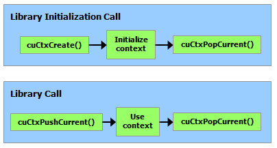

# 3.3. CUDA 驱动 API

本指南前面的章节涵盖了 CUDA 运行时。如 [CUDA 运行时 API 和 CUDA 驱动 API]() 中所述，CUDA 运行时构建在较低层的 CUDA 驱动 API 之上。本节将介绍 CUDA 运行时和驱动 API 之间的一些差异，以及如何混合使用它们。大多数应用程序无需与 CUDA 驱动 API 交互即可实现完全性能。然而，有时新接口在驱动 API 中的可用时间早于运行时 API，并且一些高级接口（如[虚拟内存管理]()）仅在驱动 API 中公开。

驱动 API 实现在 `cuda` 动态库（`cuda.dll` 或 `cuda.so`）中，该库在设备驱动程序安装期间复制到系统上。其所有入口点都以 `cu` 为前缀。

它是一个基于句柄的命令式 API：大多数对象通过不透明的句柄引用，这些句柄可以传递给函数以操作对象。

驱动 API 中可用的对象在[表 6](#driver-api-objects-available-in-cuda-driver-api) 中总结。

以下是该表格的 Markdown 格式版本：

| 对象 | 句柄 | 描述 |
| :--- | :--- | :--- |
| 设备 | CUdevice | 支持 CUDA 的设备 |
| 上下文 | CUcontext | 大致相当于 CPU 进程 |
| 模块 | CUmodule | 大致相当于动态库 |
| 函数 | CUfunction | 核函数 |
| 堆内存 | CUdeviceptr | 指向设备内存的指针 |
| CUDA 数组 | CUarray | 设备上一维或二维数据的不透明容器，可通过纹理或表面引用读取 |
| 纹理对象 | CUtexref | 描述如何解释纹理内存数据的对象 |
| 表面引用 | CUsurfref | 描述如何读取或写入 CUDA 数组的对象 |
| 流 | CUstream | 描述 CUDA 流的对象 |
| 事件 | CUevent | 描述 CUDA 事件的对象 |

在调用驱动 API 的任何函数之前，必须使用 `cuInit()` 初始化驱动 API。然后必须创建一个 CUDA 上下文，该上下文附加到特定设备并成为调用主机线程的当前上下文，详见[上下文]()。

在 CUDA 上下文中，核函数由主机代码显式加载为 PTX 或二进制对象，如[模块]()所述。因此，用 C++ 编写的核函数必须单独编译为 *PTX* 或二进制对象。核函数使用 API 入口点启动，如[核函数执行]()所述。

任何希望在将来设备架构上运行的应用程序都必须加载 *PTX*，而不是二进制代码。这是因为二进制代码是特定于架构的，因此与将来的架构不兼容，而 *PTX* 代码在加载时由设备驱动程序编译为二进制代码。

以下是来自[核函数]()的示例程序的使用驱动 API 编写的主机代码：

```c++
int main()
{
    int N = ...;
    size_t size = N * sizeof(float);

    // Allocate input vectors h_A and h_B in host memory
    float* h_A = (float*)malloc(size);
    float* h_B = (float*)malloc(size);

    // Initialize input vectors
    ...

    // Initialize
    cuInit(0);

    // Get number of devices supporting CUDA
    int deviceCount = 0;
    cuDeviceGetCount(&deviceCount);
    if (deviceCount == 0) {
        printf("There is no device supporting CUDA.\n");
        exit (0);
    }

    // Get handle for device 0
    CUdevice cuDevice;
    cuDeviceGet(&cuDevice, 0);

    // Create context
    CUcontext cuContext;
    cuCtxCreate(&cuContext, 0, cuDevice);

    // Create module from binary file
    CUmodule cuModule;
    cuModuleLoad(&cuModule, "VecAdd.ptx");

    // Allocate vectors in device memory
    CUdeviceptr d_A;
    cuMemAlloc(&d_A, size);
    CUdeviceptr d_B;
    cuMemAlloc(&d_B, size);
    CUdeviceptr d_C;
    cuMemAlloc(&d_C, size);

    // Copy vectors from host memory to device memory
    cuMemcpyHtoD(d_A, h_A, size);
    cuMemcpyHtoD(d_B, h_B, size);

    // Get function handle from module
    CUfunction vecAdd;
    cuModuleGetFunction(&vecAdd, cuModule, "VecAdd");

    // Invoke kernel
    int threadsPerBlock = 256;
    int blocksPerGrid =
            (N + threadsPerBlock - 1) / threadsPerBlock;
    void* args[] = { &d_A, &d_B, &d_C, &N };
    cuLaunchKernel(vecAdd,
                   blocksPerGrid, 1, 1, threadsPerBlock, 1, 1,
                   0, 0, args, 0);

    ...
}
```

完整代码可以在 `vectorAddDrv` CUDA 示例中找到。

## 3.3.1. 上下文

CUDA 上下文类似于 CPU 进程。驱动 API 中执行的所有资源和操作都封装在 CUDA 上下文中，当上下文被销毁时，系统会自动清理这些资源。除了模块和纹理或表面引用等对象之外，每个上下文都有自己独立的地址空间。因此，来自不同上下文的 `CUdeviceptr` 值引用不同的内存位置。

一个主机线程一次只能有一个当前设备上下文。当使用 `cuCtxCreate()` 创建上下文时，它会成为调用主机线程的当前上下文。在上下文中操作的 CUDA 函数（大多数不涉及设备枚举或上下文管理的函数）如果线程没有有效的当前上下文，将返回 `CUDA_ERROR_INVALID_CONTEXT`。

每个主机线程都有一个当前上下文栈。`cuCtxCreate()` 将新上下文压入栈顶。可以调用 `cuCtxPopCurrent()` 将上下文从主机线程分离。然后该上下文变为“浮动”状态，可以被推送为任何主机线程的当前上下文。`cuCtxPopCurrent()` 还会恢复之前的当前上下文（如果有的话）。

每个上下文还维护一个使用计数。`cuCtxCreate()` 创建的使用计数为 1 的上下文。`cuCtxAttach()` 增加使用计数，`cuCtxDetach()` 减少使用计数。当调用 `cuCtxDetach()` 或 `cuCtxDestroy()` 时，如果使用计数变为 0，则销毁上下文。

驱动 API 与运行时可以互操作，并且可以通过 `cuDevicePrimaryCtxRetain()` 从驱动 API 访问运行时管理的主上下文（参见[运行时初始化](../02-basics/intro-to-cuda-cpp.html#intro-cpp-runtime-initialization)）。

使用计数有助于在相同上下文中操作的第三方编写代码之间的互操作性。例如，如果三个库被加载以使用相同的上下文，则每个库将调用 `cuCtxAttach()` 来增加使用计数，并在库使用完上下文后调用 `cuCtxDetach()` 来减少使用计数。对于大多数库，预期应用程序在加载或初始化库之前已经创建了上下文；这样，应用程序可以使用自己的启发式方法创建上下文，而库只需操作传递给它的上下文。希望创建自己的上下文（而其 API 客户端可能已创建自己的上下文也可能没有）的库将使用 `cuCtxPushCurrent()` 和 `cuCtxPopCurrent()`，如下图所说明。

<figure class="align-center" id="library-context-management">

<figcaption>
<p><span class="caption-number">图 23 </span><span class="caption-text">库上下文管理</span></p>
</figcaption>
</figure>

## 3.3.2. 模块

模块是设备代码和数据的动态可加载包，类似于 Windows 中的 DLL，由 nvcc 输出（参见[使用 NVCC 编译]()）。所有符号的名称，包括函数、全局变量和纹理或表面引用，都在模块范围内维护，以便由独立第三方编写的模块可以在同一个 CUDA 上下文中互操作。

此代码示例加载一个模块并检索某个核函数的句柄：

```c++
CUmodule cuModule;
cuModuleLoad(&cuModule, "myModule.ptx");
CUfunction myKernel;
cuModuleGetFunction(&myKernel, cuModule, "MyKernel");
```

此代码示例从 PTX 代码编译并加载一个新模块，并解析编译错误：

```c++
#define BUFFER_SIZE 8192
CUmodule cuModule;
CUjit_option options[3];
void* values[3];
char* PTXCode = "some PTX code";
char error_log[BUFFER_SIZE];
int err;
options[0] = CU_JIT_ERROR_LOG_BUFFER;
values[0]  = (void*)error_log;
options[1] = CU_JIT_ERROR_LOG_BUFFER_SIZE_BYTES;
values[1]  = (void*)BUFFER_SIZE;
options[2] = CU_JIT_TARGET_FROM_CUCONTEXT;
values[2]  = 0;
err = cuModuleLoadDataEx(&cuModule, PTXCode, 3, options, values);
if (err != CUDA_SUCCESS)
    printf("Link error:\n%s\n", error_log);
```

此代码示例从多个 PTX 代码编译、链接并加载一个新模块，并解析链接和编译错误：

```c++
#define BUFFER_SIZE 8192
CUmodule cuModule;
CUjit_option options[6];
void* values[6];
float walltime;
char error_log[BUFFER_SIZE], info_log[BUFFER_SIZE];
char* PTXCode0 = "some PTX code";
char* PTXCode1 = "some other PTX code";
CUlinkState linkState;
int err;
void* cubin;
size_t cubinSize;
options[0] = CU_JIT_WALL_TIME;
values[0] = (void*)&walltime;
options[1] = CU_JIT_INFO_LOG_BUFFER;
values[1] = (void*)info_log;
options[2] = CU_JIT_INFO_LOG_BUFFER_SIZE_BYTES;
values[2] = (void*)BUFFER_SIZE;
options[3] = CU_JIT_ERROR_LOG_BUFFER;
values[3] = (void*)error_log;
options[4] = CU_JIT_ERROR_LOG_BUFFER_SIZE_BYTES;
values[4] = (void*)BUFFER_SIZE;
options[5] = CU_JIT_LOG_VERBOSE;
values[5] = (void*)1;
cuLinkCreate(6, options, values, &linkState);
err = cuLinkAddData(linkState, CU_JIT_INPUT_PTX,
                    (void*)PTXCode0, strlen(PTXCode0) + 1, 0, 0, 0, 0);
if (err != CUDA_SUCCESS)
    printf("Link error:\n%s\n", error_log);
err = cuLinkAddData(linkState, CU_JIT_INPUT_PTX,
                    (void*)PTXCode1, strlen(PTXCode1) + 1, 0, 0, 0, 0);
if (err != CUDA_SUCCESS)
    printf("Link error:\n%s\n", error_log);
cuLinkComplete(linkState, &cubin, &cubinSize);
printf("Link completed in %fms. Linker Output:\n%s\n", walltime, info_log);
cuModuleLoadData(cuModule, cubin);
cuLinkDestroy(linkState);
```

可以使用多线程来加速模块链接/加载过程的某些部分，包括加载 cubin 时。此代码示例使用 `CU_JIT_BINARY_LOADER_THREAD_COUNT` 来加速模块加载。

```c++
#define BUFFER_SIZE 8192
CUmodule cuModule;
CUjit_option options[3];
void* values[3];
char* cubinCode = "some cubin code";
char error_log[BUFFER_SIZE];
int err;
options[0] = CU_JIT_ERROR_LOG_BUFFER;
values[0]  = (void*)error_log;
options[1] = CU_JIT_ERROR_LOG_BUFFER_SIZE_BYTES;
values[1]  = (void*)BUFFER_SIZE;
options[2] = CU_JIT_BINARY_LOADER_THREAD_COUNT;
values[2]  = 0; // Use as many threads as CPUs on the machine
err = cuModuleLoadDataEx(&cuModule, cubinCode, 3, options, values);
if (err != CUDA_SUCCESS)
    printf("Link error:\n%s\n", error_log);
```

完整代码可以在 `ptxjit` CUDA 示例中找到。

## 3.3.3. 核函数执行

`cuLaunchKernel()` 使用给定的执行配置启动核函数。

参数作为指针数组（`cuLaunchKernel()` 的倒数第二个参数）传递，其中第 n 个指针对应于第 n 个参数并指向从中复制参数的内存区域，或者作为额外选项之一（`cuLaunchKernel()` 的最后一个参数）传递。

当参数作为额外选项（`CU_LAUNCH_PARAM_BUFFER_POINTER` 选项）传递时，它们作为指向单个缓冲区的指针传递，其中假定参数通过匹配设备代码中每种参数类型的对齐要求而彼此正确偏移。

设备代码中内置向量类型的对齐要求列在[表 43]() 中。对于所有其他基本类型，设备代码中的对齐要求与主机代码中的对齐要求匹配，因此可以使用 `__alignof()` 获得。唯一的例外是当主机编译器将 `double` 和 `long long`（以及 64 位系统上的 `long`）对齐到一个字边界而不是两字边界时（例如，使用 `gcc` 的编译标志 `-mno-align-double`），因为在设备代码中这些类型始终对齐到两字边界。

`CUdeviceptr` 是一个整数，但表示一个指针，因此其对齐要求为 `__alignof(void*)`。

以下代码示例使用宏（`ALIGN_UP()`）来调整每个参数的偏移量以满足其对齐要求，并使用另一个宏（`ADD_TO_PARAM_BUFFER()`）将每个参数添加到传递给 `CU_LAUNCH_PARAM_BUFFER_POINTER` 选项的参数缓冲区中。

```c++
#define ALIGN_UP(offset, alignment) \
      (offset) = ((offset) + (alignment) - 1) & ~((alignment) - 1)

char paramBuffer[1024];
size_t paramBufferSize = 0;

#define ADD_TO_PARAM_BUFFER(value, alignment)                   \
    do {                                                        \
        paramBufferSize = ALIGN_UP(paramBufferSize, alignment); \
        memcpy(paramBuffer + paramBufferSize,                   \
               &(value), sizeof(value));                        \
        paramBufferSize += sizeof(value);                       \
    } while (0)

int i;
ADD_TO_PARAM_BUFFER(i, __alignof(i));
float4 f4;
ADD_TO_PARAM_BUFFER(f4, 16); // float4's alignment is 16
char c;
ADD_TO_PARAM_BUFFER(c, __alignof(c));
float f;
ADD_TO_PARAM_BUFFER(f, __alignof(f));
CUdeviceptr devPtr;
ADD_TO_PARAM_BUFFER(devPtr, __alignof(devPtr));
float2 f2;
ADD_TO_PARAM_BUFFER(f2, 8); // float2's alignment is 8

void* extra[] = {
    CU_LAUNCH_PARAM_BUFFER_POINTER, paramBuffer,
    CU_LAUNCH_PARAM_BUFFER_SIZE,    &paramBufferSize,
    CU_LAUNCH_PARAM_END
};
cuLaunchKernel(cuFunction,
               blockWidth, blockHeight, blockDepth,
               gridWidth, gridHeight, gridDepth,
               0, 0, 0, extra);
```

结构的对齐要求等于其字段对齐要求的最大值。包含内置向量类型、`CUdeviceptr` 或非对齐的 `double` 和 `long long` 的结构，其对齐要求可能在设备代码和主机代码之间有所不同。这样的结构也可能有不同的填充。例如，以下结构在主机代码中完全没有填充，但在设备代码中在字段 `f` 之后填充了 12 个字节，因为字段 `f4` 的对齐要求为 16。

```c++
typedef struct {
    float  f;
    float4 f4;
} myStruct;
```

## 3.3.4. 运行时和驱动 API 之间的互操作性

应用程序可以混合使用运行时 API 代码和驱动 API 代码。

如果通过驱动 API 创建并设为当前上下文，则后续运行时调用将使用此上下文，而不是创建新上下文。

如果运行时已初始化，`cuCtxGetCurrent()` 可用于检索初始化期间创建的上下文。此上下文可用于后续的驱动 API 调用。

运行时隐式创建的上下文称为主上下文（参见[运行时初始化]()）。可以使用[主上下文管理](https://docs.nvidia.com/cuda/cuda-driver-api/group__CUDA__PRIMARY__CTX.html)函数从驱动 API 管理它。

设备内存可以使用任一 API 分配和释放。`CUdeviceptr` 可以转换为常规指针，反之亦然：

```c++
CUdeviceptr devPtr;
float* d_data;

// Allocation using driver API
cuMemAlloc(&devPtr, size);
d_data = (float*)devPtr;

// Allocation using runtime API
cudaMalloc(&d_data, size);
devPtr = (CUdeviceptr)d_data;
```

特别是，这意味着使用驱动 API 编写的应用程序可以调用使用运行时 API 编写的库（例如 cuFFT、cuBLAS 等）。

参考手册中设备和版本管理部分的所有函数都可以互换使用。