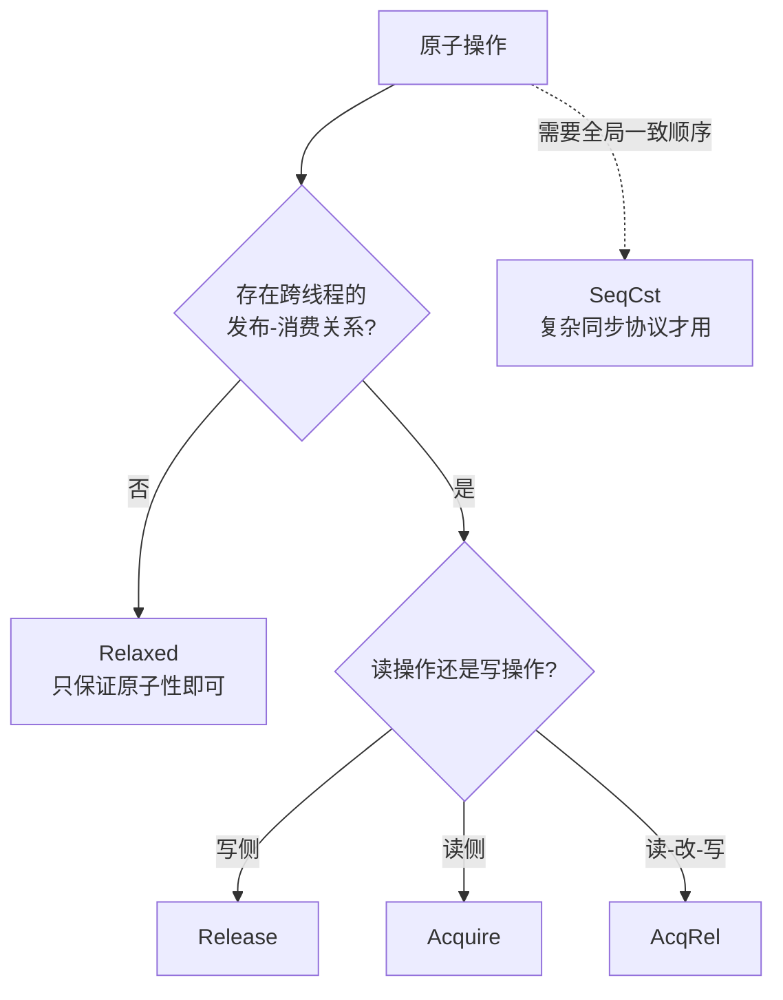

# 原子操作（Atomic）与内存序（Memory Ordering）详解

本目录中的 kernel 演示了 CUDA **原子操作**的多种用法（`fetch_add/sub`、`compare_exchange`、
`swap`、`fetch_or/and/xor`、`fetch_min/max`、`store/load`），覆盖 `u32/i32/u64/i64/f32/f64`
类型，以及不同的**作用域**与**内存序**。本文档解释原子操作的原理，以及 `AtomicOrdering`
（内存序）的作用与各取值的区别。

## 一、为什么需要原子操作？

多个线程并发读写**同一个内存位置**时，普通的 `读-改-写`（如 `counter += 1`）不是原子的：

```
线程 A: 读取 counter → 计算 +1 → 写回
线程 B: 读取 counter → 计算 +1 → 写回
```

若 A、B 同时执行，可能都读到 `0`，各自写回 `1`，最终结果 `1` 而不是 `2` ——
这就是**竞争条件（race condition）**。

**原子操作（atomic）** 保证这种"读-改-写"在硬件层面**不可分割**：

```ptx
atom.global.add.u32 %r, [addr], 1;   // 读取、加 1、写回，一气呵成
```

## 二、原子操作的两个维度

原子操作同时提供两种保证，容易混淆，必须分开理解：

| 保证 | 含义 | 由谁控制 |
|------|------|---------|
| **原子性** | 读-改-写不可分割 | 原子操作本身（所有原子操作都保证） |
| **内存序** | 对周围普通内存访问的排序/可见性约束 | `AtomicOrdering` 参数 |

> 本目录的 kernel 用了多种内存序（`Relaxed`、`Acquire`、`AcqRel`、`SeqCst`），
> 正是为了演示"内存序"这个维度。

## 三、内存序（AtomicOrdering）：是什么，为什么需要

### 3.1 核心问题：重排（reordering）

CPU 和 GPU 都会对内存访问进行**重排**——编译器优化、硬件乱序执行、缓存层次都会导致
指令的实际执行/可见顺序与代码书写顺序不一致。

考虑经典的生产者-消费者场景：

```
// 线程 A（生产者）
data[0] = 42;            // ① 普通写
ready.store(true, ...);  // ② 原子写标志

// 线程 B（消费者）
while (!ready.load(...)) {}
use(data[0]);            // ③ 希望看到 42
```

如果 ② 用 `Relaxed`，编译器/硬件**可以把 ① 重排到 ② 之后**（或 ② 已对 B 可见但 ① 尚未
落定）。于是 B 看到 `ready == true` 却读到 `data[0]` 的旧值——程序出错。

**`AtomicOrdering` 就是告诉编译器/硬件：在哪些内存访问之间必须保持顺序。**
它不做魔法，只是给重排划上边界。

### 3.2 在 PTX 中的映射

`AtomicOrdering` 映射为 `atom` 指令的 `.sem` 限定符：

```ptx
atom.relaxed.global.add.u32   // Relaxed
atom.acquire.global.add.u32   // Acquire
atom.acq_rel.global.add.u32   // AcqRel
atom.sc.global.add.u32        // SeqCst
```

## 四、`AtomicOrdering` 的取值（从弱到强）

### 1. `Relaxed`（最弱）

**只保证原子性，不保证任何顺序/可见性**，允许自由重排。

```rust
counter.fetch_add(1, AtomicOrdering::Relaxed);  // 纯计数，无依赖
```

✅ 适用：计数器、统计、`fetch_or` 置位、任何**不依赖其他内存访问顺序**的场景。
❌ 不适用：用它做"发布数据 + 标志"的同步。

### 2. `Release`（释放）

**写侧**约束：本操作**之前**的所有内存写，必须在本次原子写**之前**对其他线程可见。

```rust
data[0] = 42;                                  // 写数据
ready.store(true, AtomicOrdering::Release);    // 释放：保证 data 先可见
```

### 3. `Acquire`（获取）

**读侧**约束：本操作**之后**的所有内存读，必须看到本次原子读**之前**发布的数据。

```rust
while (!ready.load(AtomicOrdering::Acquire)) {}  // 获取
use(data[0]);   // 保证能看到生产者写好的 data
```

> `Release`（写侧）与 `Acquire`（读侧）**成对出现**，形成"发布-获取（release-acquire）"
> 同步——让一个线程的写入对另一个线程可见的**最常用、最轻量**的正确方式。

### 4. `AcqRel`（获取-释放）

**读-改-写操作**（`fetch_add`、`compare_exchange`、`swap` 等）同时具备 Acquire + Release
两种语义：

```rust
atomic_counter.compare_exchange(0, 1, AtomicOrdering::AcqRel, AtomicOrdering::Relaxed);
```

✅ 适用：**所有 RMW 原子操作**（RMW 既读又写）。本目录中 CAS/swap 用 `AcqRel` 正合适。

### 5. `SeqCst`（顺序一致，最强）

在 Acquire/Release 基础上，额外保证所有使用 `SeqCst` 的原子操作之间存在**一个全局统一
的总顺序**（所有线程看到的执行顺序一致）。

✅ 适用：复杂的多线程同步协议，需要全局一致的观察顺序。
⚠️ 代价：性能最差（需要更强的内存屏障）。

### 对比表

| 取值 | PTX | 语义 | 相对性能 | 典型用途 |
|------|-----|------|---------|---------|
| `Relaxed` | `.relaxed` | 只保证原子性，无排序 | 最快 | 计数器、位操作、无依赖统计 |
| `Release` | `.release` | 本操作前的写先可见 | 快 | 发布数据的**写侧** |
| `Acquire` | `.acquire` | 本操作后的读看到发布 | 快 | 消费数据的**读侧** |
| `AcqRel` | `.acq_rel` | Acquire + Release | 中 | 所有 RMW 操作（CAS/swap/fetch_*） |
| `SeqCst` | `.sc` | 最强，全局统一顺序 | 最慢 | 复杂同步协议 |

```
强 度：  Relaxed < Release = Acquire < AcqRel < SeqCst
顺序：   ────────────────────────────────────────▶
性能：   快 ───────────────────────────────────▶ 慢
```

## 五、什么时候用哪种内存序（决策速查）



## 六、作用域（Scope）：`DeviceAtomic*` vs `BlockAtomic*`

内存序解决"顺序"，**作用域**解决"对谁保证"。

| | `DeviceAtomic*` | `BlockAtomicU32` |
|---|---|---|
| PTX 作用域 | `.gpu` | `.cta` |
| 跨 block 原子性 | ✅ **规范保证** | ❌ **不保证**（仅块内） |
| 典型场景 | 多 block 共享的全局计数器 | 单 block 独占的共享状态 |

> ⚠️ `.cta` 作用域对**同一个全局计数器**的跨 block 原子性**不由规范保证**，结果正确依赖
> 硬件 L2 原子单元的串行化（实现细节）。多 block 共享计数器的正确写法应使用 `DeviceAtomic*`。

## 七、本目录 kernel 参考

| kernel | 操作 | 内存序 | 要点 |
|--------|------|--------|------|
| `atomic_fetch_add_u32` | fetch_add | Relaxed | 无依赖计数，Relaxed 足够 |
| `atomic_load_store_u32` | store/load | Relaxed + Acquire | 发布-获取 + `sync_threads` |
| `atomic_cas_u32` | compare_exchange | AcqRel | 选举唯一获胜者 |
| `atomic_fetch_add_acqrel_u32` | fetch_add | AcqRel | 演示内存序影响 |
| `atomic_fetch_add_seqcst_u32` | fetch_add | SeqCst | 最强内存序 |
| `atomic_i32` / `atomic_i64` | fetch_add + CAS | Relaxed + AcqRel | 有符号 / 64 位 |
| `atomic_fetch_sub_u32` | fetch_sub | Relaxed | 自减计数器 |
| `atomic_bitwise_u32` | or/and/xor | Relaxed | 位运算（OR 置位凑全 1） |
| `atomic_swap_u32` / `atomic_swap_f32` | swap | AcqRel | 交换 + 读取 |
| `atomic_minmax_i32` / `atomic_unsigned_minmax_u32` | min/max | Relaxed | 有符号 / 无符号 |
| `atomic_fetch_add_f32` / `atomic_fetch_add_f64` | fetch_add | Relaxed | 浮点原子 |
| `atomic_block_scope_fetch_add_u32` | fetch_add（.cta） | Relaxed | 跨 block 不保证 |
| `atomic_block_scope_per_block_counter` | fetch_add（.cta） | Relaxed | 每块独立计数器，.cta 语义正确 |

## 八、一句话总结

> **原子操作保证"读-改-写不可分割"；`AtomicOrdering` 决定它对周围内存访问的排序与可见性
> 约束，防止编译器/硬件把关键访问重排到错误位置。** 没有数据依赖用 `Relaxed`（最快）；
> 有"发布-获取"关系用 `Release`/`Acquire`/`AcqRel` 成对；需要全局一致顺序才用 `SeqCst`。
