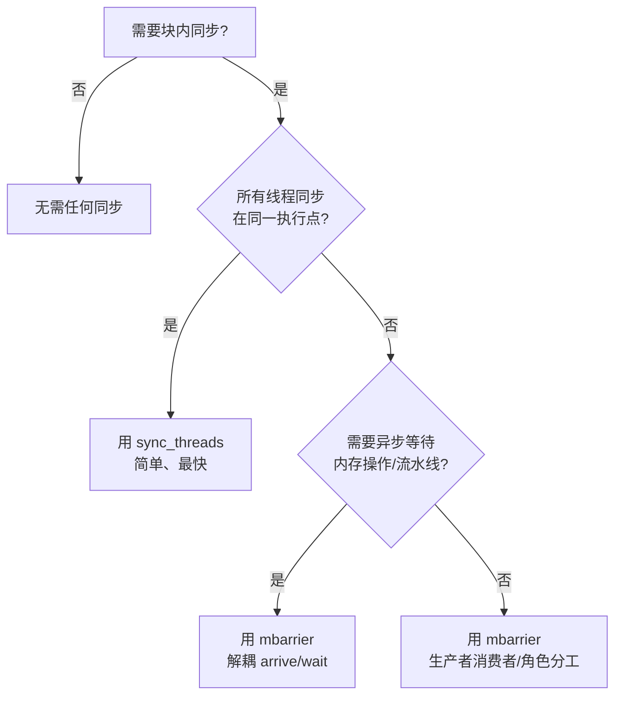

# mbarrier（内存屏障）详解

本目录中的两个 kernel（`barrier_sync`、`barrier_shared_data`）演示了 CUDA 中
**mbarrier（memory barrier）** 的用法。本文档解释 mbarrier 的原理，以及它与
`thread::sync_threads()`（即 `__syncthreads()`）的区别和适用场景。

## 一、为什么需要同步？

GPU 中 block 内的线程是**并发执行、速度各不相同**的。当多个线程需要读写彼此的
共享内存数据时，存在"生产-消费"依赖：

```
线程 0 写入 DATA[0]  →  线程 255 要读 DATA[0]（因为 (255+1)%256 = 0）
线程 1 写入 DATA[1]  →  线程 0 要读 DATA[1]
...
```

若线程 i 去读 `DATA[(i+1) % N]` 时，线程 i+1 还没写入，就会读到垃圾数据——
这就是**竞争条件（race condition）**。

同步原语同时提供两种保证：

| 保证 | 含义 |
|------|------|
| **同步点** | 所有线程到达这里后，才允许任何线程继续往下走 |
| **内存可见性** | 一个线程写共享内存后，同步释放时其他线程能看到该写入（内存屏障/冲刷） |

使用模式必须是：**写入数据 → 同步 → 读取数据**。如果顺序反了，同步就失去意义。

## 二、`thread::sync_threads()` vs mbarrier

`thread::sync_threads()` 就是 CUDA 的 `__syncthreads()`，而 mbarrier 是更底层、
更灵活的硬件原语。两者都能做 block 内同步，但设计哲学不同。

### 核心区别：arrive 和 wait 是否绑定

| | `sync_threads()` | mbarrier |
|---|---|---|
| **机制** | 单个硬件屏障指令 | arrive / test_wait 分离的原语 |
| **到达与等待** | **绑定**：到达即等待，不可分离 | **解耦**：可以先 arrive 干别的，稍后再 wait |
| **参与线程** | 所有线程必须到达**同一个** `__syncthreads()` | 可以不同线程在不同时间/不同代码点 arrive |
| **条件分支** | 分支内使用是 **UB**（divergence） | 无此限制，灵活 |
| **阶段复用** | 无状态，天然可复用 | 需 token + phase 管理 |
| **内存操作等待** | 只能等线程到达 | 可以等待 `cp.async` 等**异步内存操作**完成 |
| **作用域** | 仅 block 内 | 支持 **cluster** 级同步 |
| **开销** | 极小（一条指令） | 较大（初始化、token、自旋读内存） |
| **典型用途** | 简单"加载→同步→计算" | 流水线、生产者-消费者、异步拷贝 |

### `sync_threads()` 的典型用法

`shared_single` 是标准场景：

```rust
unsafe {
    TILE[tid] = data[gid];        // 阶段1：写入共享内存
}
thread::sync_threads();            // 阶段2：同步
unsafe {
    *out_elem = TILE[neighbor_idx]; // 阶段3：读取
}
```

### mbarrier 的典型用法

本目录 kernel 的写法：

```rust
if tid == 0 {
    mbarrier_init(&raw mut BAR, block_size);  // 线程0初始化，期望到达数=block_size
}
thread::sync_threads();                        // 确保所有线程看到初始化

// 写共享内存 ...

let token = mbarrier_arrive(&raw const BAR);   // 每个线程 arrive，拿到 token
while !mbarrier_test_wait(&raw const BAR, token) {}  // 自旋等待全部到达

// 安全读取其他线程写入的数据 ...

if tid == 0 {
    mbarrier_inval(&raw mut BAR);              // 线程0失效清理
}
```

> 注意：这个写法实际上是**用 mbarrier 模拟 `__syncthreads()`**——每个线程都
> arrive 又立即等待，没有用到 mbarrier 的解耦优势。它更适合**学习/验证 mbarrier
> API**，而非替代 `sync_threads()` 的最优实践。

## 三、什么时候用 `sync_threads()`（推荐）

- 简单的"**写 → 同步 → 读**"阶段化模式（加载 tile、归约等）
- 所有线程无脑同步在同一执行点
- 代码简单、无复杂依赖、追求最低开销

> 它是 GPU 上做块内同步的**默认首选**，编译成一条 `bar.sync` 指令，代价极小。

## 四、什么时候用 mbarrier（推荐）

mbarrier 的价值在**解耦 arrive 和 wait**，典型场景：

### 1. 生产者-消费者（不同线程不同角色）

```rust
// 生产者只 arrive，不等
if (is_producer) { mbarrier_arrive(&bar); }
// 消费者只 wait，不 arrive
else { mbarrier_test_wait(&bar, token); }
```

`sync_threads()` 做不到——它要求所有线程到达同一个屏障。

### 2. 提前 arrive + 流水线重叠

```rust
// 提前 arrival，token 保留
let token = mbarrier_arrive(&bar);
// 这里可以做其他不依赖 barrier 的独立计算
do_independent_work();
// 之后再等待
mbarrier_test_wait(&bar, token);
```

这允许**计算和同步重叠**，是软件流水线（software pipelining）的基础。

### 3. 等待异步内存拷贝（`cp.async.bulk`）

```rust
cp_async_bulk(dst, src);          // 异步拷贝
mbarrier_arrive(&bar);            // 用 mbarrier 跟踪内存到达
mbarrier_wait(&bar);              // 等拷贝真正完成
```

`sync_threads()` 只保证线程到达，**不保证**异步内存写完成——这正是 TMA/异步拷贝
场景必须用 mbarrier 的原因。

### 4. cluster（线程块集群）同步

- 跨 block 同步必须用 cluster + mbarrier，`sync_threads()` 只能在单个 block 内。

## 五、决策速查



## 六、一句话总结

> **`sync_threads()`：简单、快，适合"全体线程同步到同一点"；mbarrier：灵活、
> 可解耦，适合角色分工、异步等待、流水线和 cluster 同步。**
> 能用 `sync_threads()` 就别用 mbarrier；需要 mbarrier 的场景它又是不可替代的。
