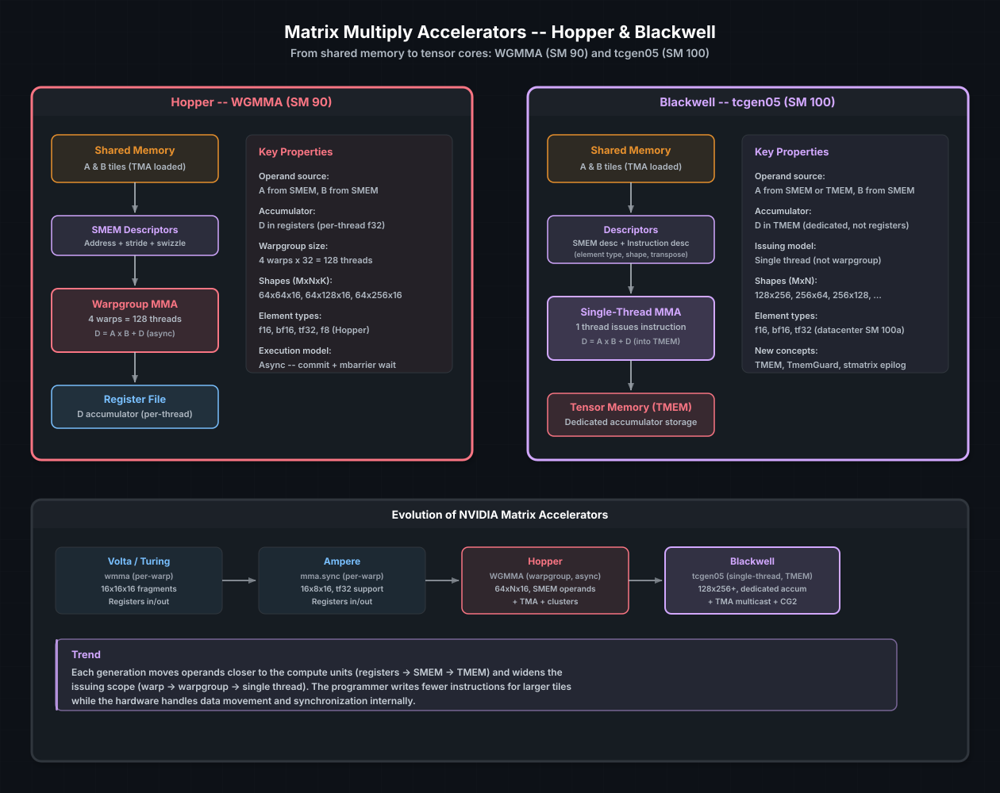

# 矩阵乘法加速器

现代 NVIDIA GPU 包含了用于矩阵乘法-累加（MMA）操作的专用硬件 —— 通常称为 **Tensor Core**。这些单元在小矩阵 tile 上计算 `D = A × B + C`，吞吐远超标准浮点 ALU 所能达到的水平。一块 Hopper H100 的 FP16 MMA 可提供超过 1000 TFLOPS，而同一芯片的标量 FP16 吞吐大约只有 200 TFLOPS。如果你的工作负载涉及矩阵乘法 —— 大多数深度学习、HPC 和信号处理负载都是如此 —— 那么性能就藏在 Tensor Core 里。

cuda-oxide 提供了对两代矩阵加速器的访问：Hopper（SM 90）上的 **WGMMA**，以及 Blackwell（SM 100）上的 **tcgen05**。本章介绍二者、它们的编程模型，以及它们如何与前面几章中的 TMA 和屏障机制衔接。

> **参见**
>
> [CUDA Programming Guide — Warpgroup Level Matrix Operations](https://docs.nvidia.com/cuda/cuda-programming-guide/#warpgroup-level-matrix-operations)，其中有 WGMMA 形状、元素类型和同步要求的硬件规格说明。

---

## 全局图景



*Hopper WGMMA 与 Blackwell tcgen05 的数据通路。两者都通过描述符从共享内存读取操作数。WGMMA 累加到每线程寄存器中（warpgroup 集合操作）。tcgen05 累加到专用的张量内存（TMEM）中，由单个线程发出。*

跨代的演进遵循一个清晰的趋势：操作数越来越靠近计算单元，发起范围越来越宽，程序员为更大的 tile 写更少的指令。cuda-oxide 用分代的 API 来跟踪这一演进，而不是提供一个一刀切的抽象。

---

## WGMMA —— Hopper（SM 90）

WGMMA（**W**arp**G**roup **M**atrix **M**ultiply-**A**ccumulate）是一个 **warpgroup 集合操作**：4 个 warp（128 个线程）协作计算一个矩阵 tile。操作数 A 和 B 通过 SMEM 描述符从共享内存读取，结果累加到每线程寄存器中。

### 编程模型

1. **TMA 加载**把 A 和 B 的 tile 载入共享内存（参见 [Tensor Memory Accelerator](tensor-memory-accelerator.md)）。
2. **SMEM 描述符**编码每个操作数的基地址、步长和 swizzle 模式。
3. **WGMMA 指令**消费这些描述符并产生累加器更新。该指令是异步的 —— 它把完成提交给一个屏障。
4. **屏障等待**确保在读累加器之前 MMA 已经完成。

### 硬件支持的形状

WGMMA 的 M 始终为 64（行数），N 和 K 取决于元素类型：

| 元素类型 | K  | N 可选值      |
| :----------- | :- | :------------- |
| f16、bf16    | 16 | 64、128、256   |
| tf32         | 8  | 64、128、256   |

每条指令计算一个 64×N×K 的 tile。对于更大的 K 维度，你在循环中发出多条 WGMMA 指令，累加到同一个寄存器 tile 上。

### cuda-oxide API 概貌

cuda-oxide 通过直接映射到硬件指令的底层内建函数暴露 WGMMA。典型用法：

```rust
use cuda_device::wgmma::{
    make_smem_desc, wgmma_commit_group, wgmma_fence, wgmma_mma_m64n64k16_f32_bf16, wgmma_wait_group,
};

// 在 TMA 已把 A、B 的 tile 载入共享内存之后……

// 为已加载的 tile 构建 SMEM 描述符
let a_desc = unsafe { make_smem_desc(tile_a_ptr as *const u8) };
let b_desc = unsafe { make_smem_desc(tile_b_ptr as *const u8) };

// 累加器（每线程 32 个 float = 整个 warpgroup 上的 64×64 tile）
let mut acc = [[0.0f32; 8]; 4];

unsafe {
    wgmma_fence();
    wgmma_mma_m64n64k16_f32_bf16(&mut acc, a_desc, b_desc);
    wgmma_commit_group();
    wgmma_wait_group::<0>();
}

// 现在可以安全地观察 `acc`。
```

BF16 的 m64n128 完全排空（full-drain）变体使用相同的同步契约，但每线程的累加器有 64 个值：

```rust
use cuda_device::wgmma::wgmma_mma_m64n128k16_f32_bf16;

let mut wide_acc = [[0.0f32; 8]; 8];
unsafe {
    wgmma_fence();
    wgmma_mma_m64n128k16_f32_bf16(&mut wide_acc, a_desc, b_desc);
    wgmma_commit_group();
    wgmma_wait_group::<0>();
}
```

对于 TF32，请使用 `wgmma_mma_m64n64k8_f32_tf32`。K=16 的 TF32 兼容入口点仍不受支持，因为 Hopper 的 TF32 WGMMA 硬件形状使用 K=8。

### cuda-oxide 当前的 WGMMA 降级（lowering）

编译器对 `m64n64k16.f32.bf16.bf16` 支持三种保守的降级形状，对 `m64n64k16.f32.f16.f16` 支持规范的线性完全排空区域和计数式 K 循环区域，对 `m64n64k8.f32.tf32.tf32` 仅支持规范的线性完全排空区域，对 `m64n128k16.f32.bf16.bf16` 也仅支持规范的线性完全排空区域。在每一种被接受的场景中，整个异步累加器生命周期都留在同一条收敛（convergent）的内联 PTX 语句内，这样在一个 WGMMA 组尚未完成时 LLVM 无法插入溢出边界。

**m64n64 线性完全排空。** 一个规范的 `[[f32; 8]; 4]` 累加器在 WGMMA 区域之前被加载到 32 个 SSA `f32` 值中，并在最后的 `wait_group<0>` 之后一次性写回。BF16、F16 和 TF32 都使用这种值线程化（value-threaded）的载体。不受支持的 BF16 完全排空指针形状保留原有的延迟指针形式降级；F16 和 TF32 没有指针形式的回退方案。

**m64n128 BF16 线性完全排空。** 一个规范的 `[[f32; 8]; 8]` 累加器以 64 个绑定的 SSA `f32` 值的形式，穿过一条或多条同构的 `m64n128k16.f32.bf16.bf16` 指令、一次提交以及最后的 `wait_group<0>`。累加器元素地址在融合的内联 PTX 作用域之后重新计算，而不是在整个作用域内保持活跃。这个形状没有指针形式回退、没有计数式循环降级，也没有部分等待流水线降级。

**规范计数式 K 循环。** 对于编译期可计数的 BF16 或 F16 m64n64 循环，每次迭代一条 MMA 且描述符满足仿射 `u64` 递推关系时，cuda-oxide 把循环控制和描述符运算移入与 WGMMA 指令相同的收敛 PTX 区域。因此累加器在 K 循环之前加载一次、在最后一次等待之后写回一次，而不是每次迭代都来回搬运。

**静态部分等待流水线。** BF16 m64n64 的 `wait_group<N>` 在 `N > 0` 时使用 `N + 1` 个独立的累加器槽位。各组分别提交，只有在部分等待使得最旧的槽位安全之后，槽位才按轮转方式被复用。例如，可以让两个组保持重叠：

```text
wgmma_fence
mma acc0
commit_group
mma acc1
commit_group
wait_group<1>
wait_group<0>
```

更长的流水线会重复这套槽位调度与部分等待，然后才复用某个累加器。在任何累加器值离开融合区域之前，最后的 `wait_group<0>` 都是必须的。

这一选择是刻意采用"失败即关闭"（fail-closed）策略的。动态部分等待、不受支持的控制流、畸形的累加器调度、F16 的部分等待形状、TF32 的计数式循环或部分等待形状、m64n128 的计数式循环或部分等待形状、F16/TF32/m64n128 的非规范累加器，以及遗留的 K=16 TF32 兼容入口点，都会被拒绝，而不是把一个仍在飞行中的累加器暴露给 LLVM。

> **提示**
>
> WGMMA 通常与**多级流水线**搭配：当 Tensor Core 处理 tile *k* 时，TMA 把 tile *k+1* 载入第二个共享内存缓冲区。TMA 与 MMA 的屏障是分开的，从而让数据搬运与计算完全重叠。

---

## tcgen05 —— Blackwell（SM 100）

Blackwell 引入了一种截然不同的矩阵加速器：**tcgen05**。关键创新有：

1. **单线程发起。** 不再是 warpgroup 集合指令，而是由一个线程发出 MMA。硬件在内部完成工作分配。
2. **张量内存（TMEM）。** 一块专用于累加器的片上内存，与寄存器堆彼此独立。TMEM 更大，且访问特性与寄存器不同。
3. **更大的 tile。** tcgen05 支持最大 256×256 的形状，而 WGMMA 是 64×256。

### TMEM —— 张量内存

TMEM 是内存层次中的一个新层级，它与寄存器堆并列，但专用于矩阵累加。它必须被显式地分配和释放：

```rust
use cuda_device::SharedArray;
use cuda_device::tcgen05::{TmemGuard, TmemReady, TmemUninit};

static mut TMEM_ADDR: SharedArray<u32, 1> = SharedArray::UNINIT;

// 分配 TMEM（warp 集合操作）
let tmem: TmemGuard<TmemReady, 128> = unsafe {
    TmemGuard::<TmemUninit, 128>::from_static(TMEM_ADDR.as_mut_ptr())
        .alloc()
};

// ……使用 tmem 做 MMA……

// 释放（warp 集合操作，kernel 退出前必须完成）
unsafe { tmem.dealloc(); }
```

`TmemGuard` 使用类型状态：`TmemUninit` → `alloc()` → `TmemReady` →
`dealloc()` → `TmemDeallocated`。类型系统会阻止你在分配之前使用 TMEM，或忘记释放 —— 后者会泄漏硬件资源并导致错误。

`N_COLS` const 参数决定 TMEM tile 的宽度。常见配置：

| `N_COLS` | 每个 warp 的 TMEM       | 用途                      |
| :------- | :------------------ | :---------------------------- |
| 64       | 最小分配 | 窄 tile                  |
| 128      | 默认             | 标准 GEMM tile           |
| 256      | 最大             | 宽 tile、更高吞吐 |

### 指令描述符与 SMEM 描述符

tcgen05 每条 MMA 指令使用两个描述符：

**指令描述符** —— 编码 MMA 配置：

```rust
use cuda_device::tcgen05::{Tcgen05ElementType, Tcgen05InstructionDescriptor, Tcgen05MmaShape};

let idesc = Tcgen05InstructionDescriptor::builder()
    .shape(Tcgen05MmaShape::M128_N128)
    .a_type(Tcgen05ElementType::F16)
    .b_type(Tcgen05ElementType::F16)
    .build();
```

**SMEM 描述符** —— 指向共享内存中的操作数 tile：

```rust
use cuda_device::tcgen05::{Tcgen05SmemDescriptor, Tcgen05SwizzleMode};

let a_desc = Tcgen05SmemDescriptor::for_k_major(
    smem_a_addr,
    m, k,
    2, // 每个元素的字节数（f16）
    Tcgen05SwizzleMode::Swizzle128B,
);
```

### 发出 MMA

由一个线程发出 MMA 指令，然后所有线程在屏障上等待：

```rust
use cuda_device::tcgen05::{tcgen05_commit, tcgen05_mma_f16};

if thread::threadIdx_x() == 0 {
    unsafe {
        tcgen05_mma_f16(
            tmem.raw_address(),
            a_desc.raw(),
            b_desc.raw(),
            idesc.raw(),
            true, // 启用累加到 D
        );
        tcgen05_commit(mma_barrier_ptr);
    }
}

// 所有线程等待 MMA 完成
mma_barrier.wait(token);
```

### 尾声（Epilog）—— 从 TMEM 读回结果

MMA 循环结束后，累加器位于 TMEM 中。要把它搬到共享内存（以便随后用 TMA 存回全局），你需要从 TMEM 加载到寄存器，然后用 `stmatrix` 写入共享内存：

```rust
use cuda_device::convert::cvt_bf16x2_f32;
use cuda_device::tcgen05::{
    TmemF32x4, stmatrix_m8n8_x2, tcgen05_ld_16x256b_pure, tcgen05_load_wait,
};

unsafe {
    // 从 TMEM 加载一个 16×256 位的切片到寄存器
    let regs: TmemF32x4 = tcgen05_ld_16x256b_pure(tmem.raw_address());
    tcgen05_load_wait();

    // 把四个 f32 累加器转换成两个打包 bf16 值的寄存器。
    let packed0 = cvt_bf16x2_f32(regs[0], regs[1]);
    let packed1 = cvt_bf16x2_f32(regs[2], regs[3]);

    // 从寄存器写出两个 8×8 矩阵（warp 集合操作）。
    stmatrix_m8n8_x2(smem_ptr, packed0, packed1);
}
```

`stmatrix` 是 warp 集合操作 —— 全部 32 个线程都参与，每个线程贡献自己的寄存器切片，共同拼成共享内存中的 tile。

### CTA-group-2（CG2）

Blackwell 还支持 **CG2 模式**：来自同一个集群的两个 CTA 成对协作发出 MMA 指令。这使有效 tile 宽度翻倍，需要 `_cg2` 系列的 API 变体：

```rust
use cuda_device::tcgen05::{tcgen05_alloc_cg2, tcgen05_mma_f16_cg2};
```

CG2 与 CG1（标准）不能混用在同一个 kernel 中。

> **提示**
>
> tcgen05 只在 **Blackwell 数据中心** GPU（SM 100a）上可用。消费级 Blackwell（SM 120）使用较旧的 `mma.sync` 指令集。在使用 tcgen05 API 之前，请先确认目标架构。

---

## 如何选择合适的加速器

| 特性           | WGMMA（Hopper）          | tcgen05（Blackwell DC）  | mma.sync（Ampere/消费级） |
| :---------------- | :---------------------- | :---------------------- | :------------------------- |
| 发起模型       | Warpgroup（128 线程） | 单线程           | Warp（32 线程）          |
| 累加器       | 寄存器               | TMEM（专用）        | 寄存器                  |
| 最大 tile（M×N）    | 64×256                  | 256×256                 | 16×8                       |
| 异步执行   | 是（commit + 屏障）    | 是（commit + 屏障）    | 同步                |
| TMA 集成   | 原生                  | 原生 + 多播 CG2  | 手动加载               |
| 集群支持   | 是                     | 是 + CG2               | 否                         |
| 最低 SM        | 90（Hopper）             | 100a（Blackwell DC）     | 80（Ampere）                |

对大多数用户来说，选择由目标 GPU 决定。如果你在写一个面向多种架构的库，就需要编译期的特性门控或运行时的架构检测来选择合适的代码路径。

---

## GEMM 的演进路径

这些加速器并不是孤立存在的。一个高性能 GEMM kernel 会把本章以及前面几章的所有技术结合起来：

1. **TMA** 把 tile 从全局内存载入共享内存（没有线程加载）
2. **屏障**按阶段追踪 TMA 的完成情况
3. **MMA 指令**（WGMMA 或 tcgen05）从共享内存消费 tile
4. **多级流水线**让 tile *k+1* 的加载与 tile *k* 上的 MMA 重叠
5. **warp 特化**让一部分 warp 专职加载、另一部分专职 MMA
6. **尾声**（tcgen05）从 TMEM 加载、转换精度、通过 TMA 存回

这就是 cuBLAS 和 CUTLASS 内部使用的 kernel 结构。借助 cuda-oxide，你可以在 Rust 中构建同样的结构 —— 用 `SharedArray` 管理 tile，用 `ManagedBarrier` 做同步，用 MMA API 做计算。

[`gemm_sol` 示例](https://github.com/NVlabs/cuda-oxide/tree/main/cuda-oxide/crates/rustc-codegen-cuda/examples/gemm_sol)
是完整的参考实现。它的 4 级 `cta_group::2` 流水线在 B200（148 SM）上达到
**4096³ 下 868 TFLOPS —— 相当于 `cublasLtMatmul` SoL 的 57.8%**。
在规模更小的 Blackwell 数据中心 SKU 上，绝对吞吐随 SM 数量缩放（例如在 80 SM 的型号上，同一个 kernel 跑到约 204 TFLOPS / 约 46% SoL —— 两种配置的逐阶段表格见该示例的 README）。该示例通过 `bench/cublaslt_bench` 实时测量 cublasLt 基线，因此它的"% of SoL"列始终是相对宿主 GPU 的 cublasLt 峰值，而不是固定的 B200 数值。

> **参见**
>
> - [共享内存与同步](shared-memory-and-synchronization.md) —— MMA 操作数的 tile 管理
> - [Tensor Memory Accelerator](tensor-memory-accelerator.md) —— 把 tile 喂给 Tensor Core
> - [集群编程](cluster-programming.md) —— 用于多 CTA MMA 的 CG2 模式与多播
