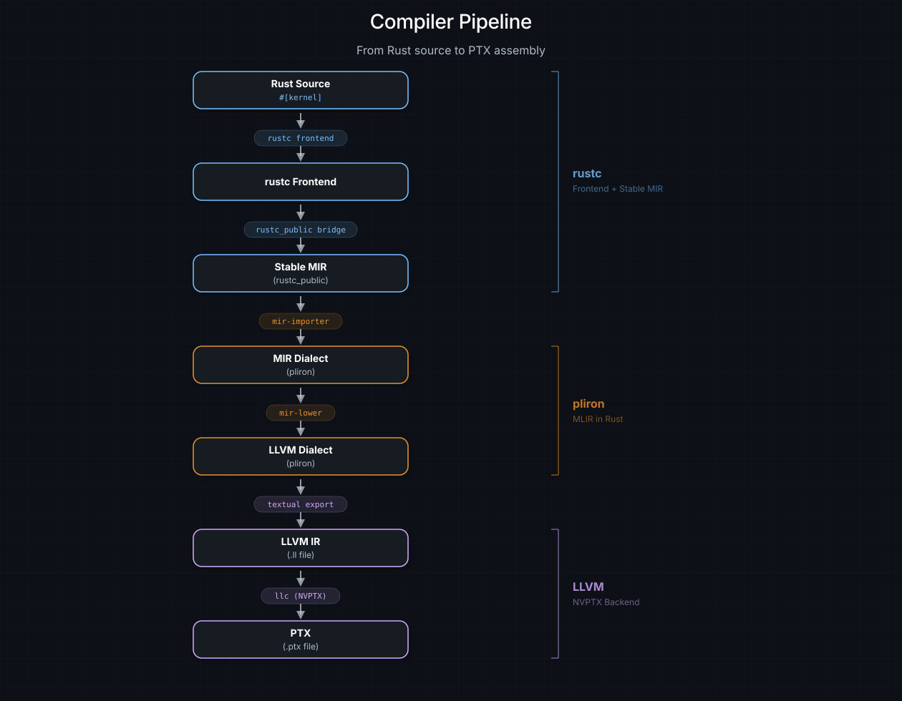
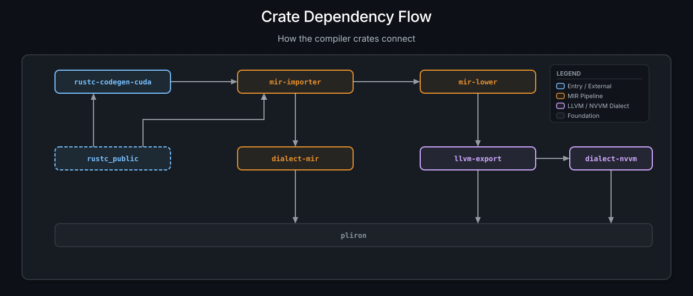
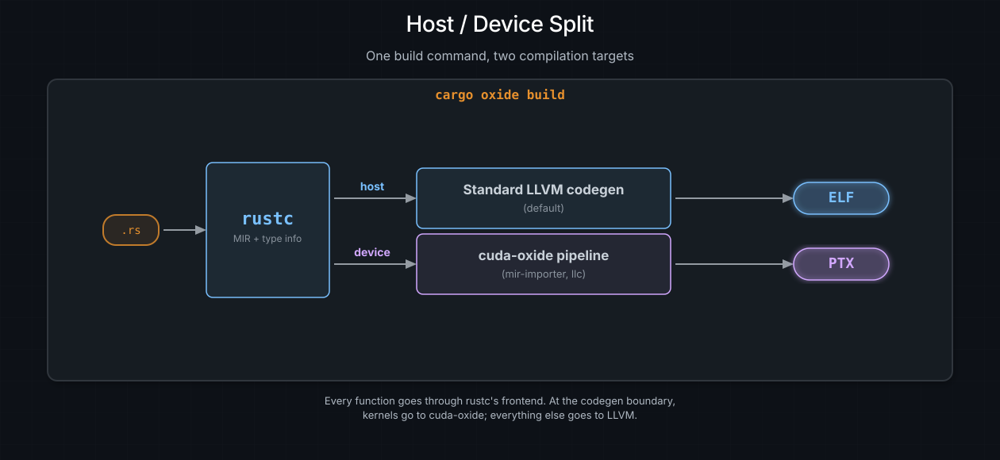

# 架构总览

你在 Rust 里写了一个 `#[kernel]` 函数。它能通过类型检查，也能通过
借用检查。现在它需要变成能在 GPU 上运行的 PTX。本章解释 cuda-oxide
是如何把它送到那一步的 —— 每一个阶段、每一个 crate，以及每个选择背后
的理由。

如果你只是想写 kernel，那你永远不需要读这一页。但如果你想折腾编译器、
贡献一个 pass，或者只是想满足"它*到底*是怎么工作的？"这种好奇心，欢迎。
去拿杯咖啡吧。

---

## 设计哲学

指导原则短到可以写在一张便利贴上：

> **为每个阶段挑选最好的工具 —— 但要掌控整条流水线。**

编译器是分层蛋糕。每一层的工作截然不同，不同的工具各有所长。cuda-oxide
为每个阶段挑选最强的方案，而不是一切都从零开始造：

- **前端：`rustc` + `rustc_public`（Stable MIR）。**
  既然史上最好的类型检查器之一已经存在，何必重写一个？
  Rust 编译器负责解析、名称解析、类型推断、借用检查、trait 求解、
  单态化以及 MIR 优化。这些我们全都免费获得。

- **中端：`pliron`（Pliron IR，类 MLIR）。**
  我们需要一个地方，把 Rust MIR 变成 LLVM 形态的东西。pliron 是一个受
  LLVM 的 MLIR 启发、可扩展的 IR 框架，但完全用纯 Rust 写成。
  没有 C++ 依赖，没有 CMake，没有 tablegen —— 只需 `cargo build`。我们
  在这里定义两个自定义方言（一个用于 MIR，一个用于 NVIDIA GPU 内联函数），
  并从上游的 `pliron-llvm` crate 消费 LLVM 方言。

- **后端：LLVM NVPTX。**
  NVIDIA 在 LLVM 的 NVPTX 后端上倾注了多年心血。它了解每一个寄存器类别、
  每一条指令编码、每一个调度怪癖。我们以文本形式输出 LLVM IR，再交给
  `llc`。站在巨人的肩上，胜过重新发明 PTX 汇编器。

回报是：整个编译器都用 Rust 写成（除了最后调用 `llc` 那一下）。没有向
C++ 中端的黑盒交接。你可以在任意一个变换 pass 里下断点，用 `println!`
把 IR 一路打出来，如果你够胆，还可以把整个过程跑在 Miri 下。自始至终
都是标准的 Rust 工具链。

> **注意**
>
> `llc` 是唯一的外部二进制文件。固定版本 Rust 工具链的 `llvm-tools`
> 组件自带启用了 NVPTX 后端的 `llc`，所以在全新克隆的仓库上，
> `rustup component add llvm-tools`（`rust-toolchain.toml` 里已列出）
> 就是唯一需要的步骤。系统安装的 LLVM 21+ 也能用，并作为兜底方案。
> 光有 CUDA Toolkit 不够 —— 它不包含 `llc`。cuda-oxide 直到输出 LLVM IR
> 为止的所有阶段都用 Rust 实现；在后端写出 `.ll` 文件之后，它会调用外部
> LLVM 的 `llc` 来生成 PTX。

---

## 流水线一览

下面是一个 `#[kernel]` 函数从源码到硅片的完整旅程：



*完整的编译流水线。Rust 源码进入 rustc 前端，经过 Stable MIR，被翻译成 `dialect-mir`（由 `mem2reg` 把 alloca 提升回 SSA），应用带注解的循环展开，下降到 LLVM 方言，导出文本形式的 LLVM IR，最终编译为 PTX。*

逐阶段来看：

1. **Rust 源码。**
   你写一个函数，给它拍上 `#[kernel]`，然后继续过你的日子。proc macro
   把它重命名进保留的 `cuda_oxide_kernel_<hash>_<name>` 命名空间，好让
   后端之后能认出它。确切的前缀位于工作区内部的
   `reserved-oxide-symbols` crate 中；`<hash>` 让意外碰撞不可能发生。

2. **rustc 前端。**
   rustc 负责解析、类型检查、借用检查、对泛型做单态化，并运行 MIR
   优化 pass（内联、常量传播、死代码消除）。所有苦活都在这里完成。

3. **Stable MIR。**
   代码生成后端接收 rustc 的内部 MIR，并把它桥接到 `rustc_public` 的
   稳定类型上。这给了我们一个带版本、稳定的 MIR 视图，不会在下一个
   nightly 上崩掉。

4. **`dialect-mir`（pliron）。**
   `mir-importer` 把 Stable MIR 翻译成 `dialect-mir` —— 一个建模 Rust MIR
   语义（place、projection、`Rvalue`、`BinOp` 等）的 pliron 方言。初始形态
   为每个 local 使用 `mir.alloca` 槽位，并用 `mir.load`/`mir.store` 承载
   跨基本块的数据流；随后 `pliron::opts::mem2reg` 把这些槽位提升回 SSA 值。
   [编译器优化](compiler-optimizations.md)从带注解的循环展开开始，在下降
   之前作用于这一 SSA 形式。

5. **LLVM 方言（pliron-llvm）。**
   `mir-lower` 把 `dialect-mir` 操作变换为 LLVM 方言操作：`llvm.alloca`、
   `llvm.load`、`llvm.store`、`llvm.getelementptr`、`llvm.call` 之类。
   Rust 层面的概念正是在这里被展平成面向机器的 IR。LLVM 方言本身由上游
   的 `pliron-llvm` crate 提供。

6. **LLVM IR（.ll 文件）。**
   NVVM 构建首先使用 `nvvm-transforms`，把现代 LLVM 操作转换成所选 libNVVM
   方言接受的形式。普通 PTX 构建会跳过这个变换。接着 `llvm-export` 打印器
   写出文本形式的 LLVM IR，便于检视，也便于在不同编译器版本之间 diff。

7. **GPU 产物。**
   普通构建用 `llc` 把 `.ll` 文件编译成 PTX。NVVM 构建使用 libNVVM 和
   nvJitLink 生成 LTOIR，然后是 cubin。

---

## crate 地图

cuda-oxide 被拆分成多个职责聚焦的 crate。以下是每一个及其角色：

| crate                | 角色                                                                                   |
| :------------------- | :--------------------------------------------------------------------------------------|
| `rustc-codegen-cuda` | 自定义 rustc 代码生成后端 —— 拦截 `codegen_crate()`，拆分宿主/设备代码  |
| `mir-importer`       | 把 Stable MIR 翻译成 `dialect-mir`，编排整条流水线               |
| `dialect-mir`        | 建模 Rust MIR 语义（place、rvalue、terminator）的 pliron 方言              |
| `mir-transforms`     | 在下降之前分析并优化 `dialect-mir`；目前提供循环展开 |
| `nvvm-transforms`    | 把下降后的 LLVM 操作转换成所选 NVVM 方言接受的形式     |
| `llvm-export`        | 重新导出 `pliron-llvm` 的 LLVM 方言 + cuda-oxide 的文本 `.ll` 导出器          |
| `dialect-nvvm`       | 用于 NVIDIA GPU 内联函数的 pliron 方言（`tid`、`ntid`、barrier、TMA）        |
| `mir-lower`          | 把 `dialect-mir` 下降到 LLVM 方言 —— 主要的变换 pass               |
| `cargo-oxide`        | CLI 工具：`cargo oxide build`、`cargo oxide run`、`cargo oxide pipeline`               |
| `cuda-device`        | 设备侧 API：内联函数、`DisjointSlice`、barrier、共享内存、warp 操作        |
| `cuda-macros`        | Proc macro：`#[kernel]`、`#[device]`                                                  |
| `cuda-host`          | 宿主侧带类型的模块加载与启动辅助                                      |
| `cuda-core`          | 与 cutile-rs 共享：安全的 Driver API 绑定；SIMT 接口位于 `cuda_core::simt`   |
| `cuda-core-derive`   | 与 cutile-rs 共享：`cuda-core` 的 `#[derive(DeviceCopy)]` proc macro              |
| `cuda-async`         | 与 cutile-rs 共享：`DeviceOperation` 模型与 `cuda_async::simt` 下的组合子 |
| `cuda-bindings`      | 与 cutile-rs 共享：到 CUDA driver 的 FFI；`libcuda` 在运行时加载         |
| `cuda-intrinsics`    | 生成的底层 CUDA 内联函数声明                                        |
| `cuda-intrinsics-gen`| 内联函数的提取器与确定性源码生成器                        |
| `cuda-artifact-finalizer` | 与 driver 无关的 NVVM IR、LTOIR 与 PTX 收尾处理                           |
| `oxide-artifacts`    | 架构中立的嵌入式设备产物元数据                                 |
| `dialect-iket`       | 建模 kernel 内事件追踪的 pliron 方言                                       |
| `iket-lower`         | `dialect-iket` 的剖析 + 插桩下降                                     |
| `dialect-ptx`        | 建模结构化 PTX 的 pliron 方言                                                |
| `ptx-parse`          | PTX 源文本上的无损结构化视图                                         |
| `ptx-schedule`       | PTX 调度扰动 fuzzing（nanosleep 注入活动）                      |
| `cuda-oxide-codegen` | 不依赖 rustc 的 PTX 后端                                                          |
| `libnvvm-sys`        | 到 libNVVM 的 `dlopen` 绑定（由 `cuda-host::ltoir` 使用）                              |
| `cuda-target-spec`   | 共享的 CUDA target 解析与记录的 LLVM PTX 下限策略                         |
| `nvjitlink-sys`      | 到 nvJitLink 的 `dlopen` 绑定（由 `cuda-host::ltoir` 使用）                             |
| `reserved-oxide-symbols` | 工作区私有的 `cuda_oxide_*` 符号名约定                              |
| `fuzzer`             | 差分代码生成 fuzzer 支持（rustlantis 适配器）                               |

### 依赖流

编译器 crate 构成一条清晰的流水线：



*编译器各 crate 如何连接。流水线从左到右贯穿代码生成后端、importer 与下降 pass。方言 crate 位于下方，全部构建在 pliron 之上。*

`pliron` 位于各方言 crate 之下，作为共享的 IR 框架 —— 它提供
`Context`、`Module`、`Region`、`Block`、`Operation`、`Type` 与 `Attribute`
这套基础设施。LLVM 方言来自 `pliron-llvm`（同样构建在 pliron 之上）；
`llvm-export` 重新导出它，并加上文本形式的 `.ll` 导出器。`rustc_public`
提供 `mir-importer` 从 rustc 读取的稳定 MIR 类型。面向用户的 crate
（`cuda-device`、`cuda-macros`、`cuda-host`、`cuda-core`、`cuda-async`）
独立于编译器内部实现，彼此之间才互相依赖。

---

## 两个关键依赖

有两个外部项目让 cuda-oxide 成为可能。它们都不是可选项，在随后的深入章节
之前，两者都值得简短介绍。

### pliron —— Pliron IR（类 MLIR）

[pliron](https://github.com/vaivaswatha/pliron) 是一个可扩展的编译器 IR
框架，受 LLVM 的 MLIR 启发，但完全用 Rust 写成。它提供同样的核心抽象
—— 方言、操作、类型、属性、region 与 block —— 而不需要 C++ 工具链、
CMake 或 tablegen。

cuda-oxide 选择 pliron 而不是上游 MLIR，出于一个务实的理由：我们希望整个
编译器都能用 `cargo` 构建。依赖 MLIR 意味着要拖进 LLVM 单体仓库、一套
C++ 构建系统，以及 Rust-C++ FFI 胶水 —— 这些都会增加构建复杂度、拖慢 CI，
并让新贡献者上手痛苦。有了 pliron，方言用标准 Rust trait 和 derive macro
定义即可，IR 也可以用任何 Rust 调试器检视。

cuda-oxide 在 pliron 之上定义了四个方言。两个承载下降路径：`dialect-mir`
（建模 Rust MIR）与 `dialect-nvvm`（NVIDIA GPU 内联函数）。另外两个在旁
边：`dialect-iket`（kernel 内事件追踪）与 `dialect-ptx`（结构化终端 PTX）。
LLVM 方言来自上游的 `pliron-llvm` crate；cuda-oxide 的 `llvm-export` crate
重新导出它，并加上文本形式的 `.ll` 导出器。

> **参见**
>
> 关于 pliron 架构的深入剖析，见
> [Pliron —— Rust 中的 MLIR](pliron.md)。

### rustc_public —— Stable MIR

`rustc_public`（历史上称为 Stable MIR 或 `stable_mir`）是 Rust 官方的
稳定接口，用来访问编译器内部结构。MIR —— 中级中间表示 —— 正是借用检查、
生命周期校验以及大多数优化发生的地方。它也是一种保留了类型信息的丰富
高层表示，因此是 GPU 后端的理想起点。

问题在于：MIR 是一种*内部*表示。它的数据结构在各个 nightly 之间变化，
没有任何稳定性保证。直接读取内部 MIR 的后端，每次 `rustc` 重命名字段或
重排枚举变体时都会崩掉 —— 而这比你希望的要频繁得多。`rustc_public` 通过
提供带版本的稳定 API 解决了这个问题，它把内部类型桥接到一个公开接口上。
cuda-oxide 挂在 `CodegenBackend::codegen_crate()` 入口点，把内部类型桥接到
稳定的 MIR 类型，然后把结果交给 `mir-importer` 去翻译。

> **参见**
>
> 关于 rustc_public 的深入剖析，见
> [rustc_public —— Stable MIR](rustc-public.md)。

---

## 宿主/设备拆分

cuda-oxide 是一个单源编译器。宿主代码与设备代码住在同一个 `.rs` 文件里，
一条构建命令同时编译两者。下面是它逐步骤的工作方式：

**1. cargo-oxide 用自定义后端调用 rustc。**

```bash
cargo oxide run vecadd
```

在底层，这会设置 `-Z codegen-backend=librustc_codegen_cuda.so`，告诉 rustc
把代码生成路由到 cuda-oxide 的后端，而不是默认的 LLVM 后端。

**2. rustc 为依赖树中的每个 crate 调用 `codegen_crate()`。**

这一步并非 cuda-oxide 特有 —— rustc 本来就这么工作。对于每个正在编译的
crate（你的二进制、`cuda-device`、任何其它依赖），rustc 都会调用代码生成
后端。

**3. 后端扫描 kernel 入口点。**

它寻找那些名字里含有保留前缀 `cuda_oxide_kernel_<hash>_` 的单态化函数。
这些就是 `#[kernel]` 创建出来的函数。

**4. 如果找到了 kernel：构建设备调用图并输出 PTX。**

从每个 kernel 出发，后端遍历调用图，收集该 kernel 间接调用的每一个设备
函数。这组函数被交给 `mir-importer`，由它运行整条流水线（`dialect-mir`
-> LLVM 方言 -> `.ll` -> PTX）。结果是一个写在宿主二进制旁边的 `.ptx`
文件。

**5. 永远如此：把宿主代码交给标准 LLVM 后端。**

无论是否找到 kernel，宿主代码都按常规方式编译。对于所有非设备代码，
cuda-oxide 的后端都委托给 rustc 默认的 LLVM 代码生成。你的 `main()`、
你的 CLI 解析、你的异步运行时 —— 全部按通常方式编译。

**6. 结果：一次构建得到一个宿主二进制 + 一个 `.ptx` 文件。**

```text
target/debug/vecadd          ← 宿主二进制（运行时加载 PTX）
target/debug/vecadd.ptx      ← 设备代码（由 CUDA driver 加载）
```

> **注意**
>
> 来自依赖（如 `cuda-device`）的设备代码是惰性编译的。只有当你的 crate
> 中的某个 kernel 间接调用它们时，外部 crate 的函数才会被编译成 PTX。
> MIR 可以从 `.rlib` 元数据中获取，所以不需要从源码重新编译依赖 ——
> 后端按需读取它们的 Stable MIR。

### 一个简化的心智模型



*一条构建命令，两个编译目标。每个函数都经过 rustc 前端。在代码生成的边界上，kernel 走 cuda-oxide；其它一切走 LLVM。*

每个函数都经过 rustc 前端。在代码生成的边界上，后端看着每个函数问：
"你是 kernel，还是被 kernel 调用的？" 如果是，你往右走（cuda-oxide
流水线）。如果不是，你往左走（标准 LLVM）。有些函数两边都走 —— 一个在
宿主与设备上都用到的泛型辅助函数会被编译两次，每个目标各一次。

---

## rustc 免费给了我们什么

基于 `rustc` 构建、而不是发明一门新语言，最美好的一点就是我们*不必*做的
工作量之大。以下是 cuda-oxide 看到代码之前 rustc 已经处理好的东西：

| 内容              | 对 GPU 代码的价值                                                                   |
| :---------------- | :------------------------------------------------------------------------------------|
| 类型检查     | 在 GPU 编译之前就抓到错误 —— 不会出现晦涩难解的 PTX 汇编器失败             |
| 生命周期追踪 | 跨越宿主/设备边界的安全保证                                 |
| 借用检查   | 强制常规的 Rust 别名规则；GPU 范围的写入需要额外的 `DisjointSlice` 与启动证明 |
| 单态化  | 泛型在 GPU 上"直接可用" —— `map<f32, _>` 变成一个具体的 PTX kernel       |
| MIR 优化  | 内联、常量传播、死代码消除 —— 全部在我们开始之前就已应用 |
| trait 求解  | trait 对象被求解掉，vtable 消失，一切都是静态分发          |
| 模式匹配  | `match` 分支被下降为优化过的 `SwitchInt` MIR terminator                    |

这些我们一个都不重新实现。rustc 干重活，我们在最后接过完全优化好、已完成
单态化与借用检查的 MIR。我们的工作"只是"翻译 —— 公平地说，这仍然是不少
工作量。但比起从零构建一门 GPU 语言，这个问题要小得多。

> **注意**
>
> 这也意味着 Rust 的错误信息照常工作。如果你在 kernel 里犯了类型错误，
> 你会得到和任何其它 Rust 代码中一样的、有用的 `rustc` 诊断 —— 包含建议、
> span 高亮以及"你是不是想写？"的提示。没有另一套 GPU 编译器错误格式要学。

---

## 接下来读什么

本章余下的部分会逐个放大架构中的每一块：

- **[Pliron —— Pliron IR（类 MLIR）](pliron.md)** —— 把整条流水线维系在
  一起的 IR 框架。
- **[rustc_public —— Stable MIR](rustc-public.md)** —— 我们如何在不被每个
  nightly 弄崩的前提下读取 MIR。
- **[代码生成器：rustc-codegen-cuda](rustc-codegen-cuda.md)** —— 拦截
  rustc 的代码生成后端。
- **[MIR Importer](mir-importer.md)** —— 把 Stable MIR 翻译成 pliron。
- **[编译器优化](compiler-optimizations.md)** —— `mir-transforms` 如何分析
  并改写 `dialect-mir`。
- **[Pliron 方言](mlir-dialects.md)** —— 三个自定义方言及其操作集。
- **[下降流水线](lowering-pipeline.md)** —— 从 `dialect-mir` 到 LLVM 方言，
  逐 pass 讲解。
- **[添加新的内联函数](adding-new-intrinsics.md)** —— 扩展编译器的贡献者
  指南。
