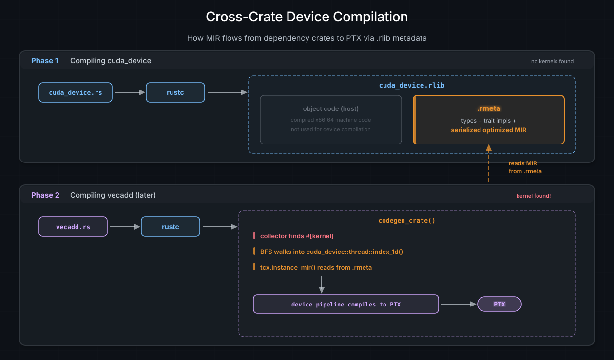
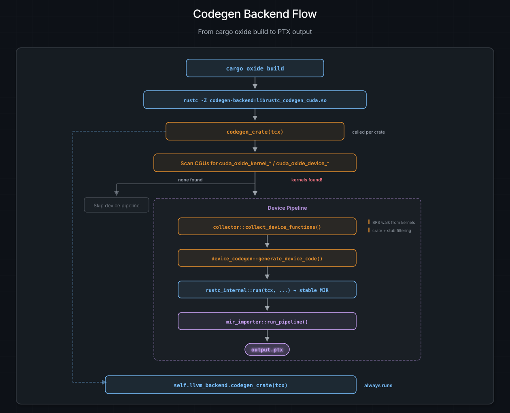

# 代码生成器：rustc-codegen-cuda

每一个 Rust 程序最终都会抵达代码生成后端 —— 也就是编译器中把优化后的
MIR 变成机器码的那部分。通常，这个后端是 LLVM。cuda-oxide 换上了自己的
后端 `rustc-codegen-cuda`，它拦截这一过程以提取设备代码，并让设备代码走
cuda-oxide 流水线，然后把其他所有内容原样交还给 LLVM，仿佛什么都没发生。

本页解释该后端如何加载、当 rustc 调用它时它做了什么，以及它如何找到每一个
属于 GPU 的函数。

---

## rustc 如何加载自定义后端

rustc 有一个大多数人从未见过的标志：

```bash
rustc -Z codegen-backend=path/to/libfoo.so
```

当你传入这个标志时，rustc 会执行以下操作：

1. 对共享库调用 `dlopen`。
2. 调用 `dlsym("__rustc_codegen_backend")` 以找到入口点。
3. 期待该函数返回一个 `Box<dyn CodegenBackend>`。

就这样。没有插件注册表，没有配置文件，没有握手协议。一个符号，一个 trait
对象，你就拥有了整条代码生成流水线。

cuda-oxide 提供了这个入口点：

```rust
#[unsafe(no_mangle)]
pub fn __rustc_codegen_backend() -> Box<dyn CodegenBackend> {
    let config = CudaCodegenConfig::from_env();
    let llvm_backend = rustc_codegen_llvm::LlvmCodegenBackend::new();
    Box::new(CudaCodegenBackend { config, llvm_backend })
}
```

这里发生了两件事。首先，`CudaCodegenConfig::from_env()` 读取环境变量
（`CUDA_OXIDE_VERBOSE`、`CUDA_OXIDE_DUMP_MIR` 等等 —— 见下文
[环境变量](#rustc-codegen-environment-variables)）来配置后端的行为。其次，
它创建标准的 LLVM 后端并将其存放在 `CudaCodegenBackend` 内部。正是这种包装
模式让整个架构得以运作：cuda-oxide 并不*替换* LLVM 后端，而是*包装*它。

> **注意**
>
> `cargo oxide build` 会替你设置 `-Z codegen-backend` 标志。除非你恰好喜欢
> 那种写法，否则你永远不需要自己敲出 `dlopen` 咒语。

---

## 拦截点：codegen_crate()

`CodegenBackend` trait 有几个方法，但真正重要的是 `codegen_crate(tcx)`。
在这里，rustc 交付出整个经过类型检查、借用检查并完成单态化的 crate，并说
"把它变成机器码"。

当 rustc 调用 `CudaCodegenBackend::codegen_crate(tcx)` 时，会发生以下情况：

### 第 1 步：收集单态化的条目

```rust
let (items, cgus) = tcx.collect_and_partition_mono_items(());
```

这给了我们 crate 中每一个单态化的函数，并按**代码生成单元**（CGU）分组。
CGU 是 rustc 的并行代码生成单位 —— 可以把它想象成一组将成为单个目标文件的
函数。

### 第 2 步：扫描设备入口点

后端遍历每个 CGU 中的每一个函数，检查那些魔法的名称前缀：

- `cuda_oxide_kernel_<hash>_` —— 由 `#[kernel]` 设置
- `cuda_oxide_device_<hash>_` —— 由 `#[device]` 设置

这些前缀就是过程宏与后端通信的方式。没有特殊的属性元数据，没有旁路通道 ——
只是一个在人群中格外醒目的名字。确切的前缀字符串（以及用于匹配和剥离它们的
辅助函数）位于工作区内部的 `reserved-oxide-symbols` crate 中；宏一侧和收集器
一侧都从那里导入，因此约定只存在于一个地方。8 个十六进制字符的 `<hash>` 使
意外碰撞实际上不可能发生：没有人会碰巧写出
`cuda_oxide_codegen_v1_cuda_oxide_kernel_246e25db_foo` 这种名字。

### 第 3 步：如果找到了设备代码，就构建并编译

如果找到了任何 kernel 或设备函数，会依次发生两件事：

**a) 收集设备调用图。**
`collector::collect_device_functions()` 从每个 kernel 入口点开始执行广度优先
遍历，发现所有从设备代码传递性调用到的函数。更多内容见
[设备函数收集](#rustc-codegen-device-function-collection)。

**b) 生成设备代码。**
`device_codegen::generate_device_code()` 把收集到的函数桥接到稳定 MIR，并运行
完整的 cuda-oxide 流水线（`dialect-mir` -> `mem2reg` -> 带注解的循环展开 ->
LLVM 方言 -> `.ll` -> PTX）。

### 第 4 步：始终编译宿主代码

无论是否找到设备代码：

```rust
self.llvm_backend.codegen_crate(tcx)
```

被包装的 LLVM 后端编译所有宿主代码 —— `main()`、你的 CLI 解析器、你的异步
运行时，一切。设备流水线只是一条支线；宿主流水线始终运行。

### 其他 trait 方法

`CodegenBackend` trait 还要求实现 `join_codegen()` 和 `link()`。它们分别负责
等待并行的代码生成线程和调用链接器。在 cuda-oxide 中，两者都只是纯粹的委托：

```rust
fn join_codegen(&self, ongoing: Box<dyn Any>, sess: &Session) -> ... {
    self.llvm_backend.join_codegen(ongoing, sess)
}

fn link(&self, sess: &Session, codegen: ..., outputs: &OutputFilenames) -> ... {
    self.llvm_backend.link(sess, codegen, outputs)
}
```

没有拦截，没有修改。LLVM 后端完全按它平常的方式处理链接。

> **注意**
>
> 对于依赖树中的大多数 crate —— `core`、`cuda-core`、各种工具 crate —— 都
> 找不到 kernel，后端只是委托给 LLVM。设备流水线只会为真正包含 `#[kernel]`
> 函数的那个 crate 激活。对于一个典型的项目，这意味着几十个 crate 中只有一个
> 会触发设备编译。

---

<a id="rustc-codegen-device-function-collection"></a>

## 设备函数收集

找到 kernel 入口点是容易的部分。困难的部分是弄清那些 kernel 调用的*其他一切*。
一个 kernel 可能调用一个辅助函数，该辅助函数调用一个 `cuda-device` 内联函数，
后者又调用一个 `core` 数学函数 —— 而所有这些都需要出现在 PTX 中。

`collector` 模块通过对 MIR 调用图进行广度优先遍历来处理这一点。

### 工作列表算法

```text
worklist = [all kernel entry points]
visited  = {}
collected = []

while worklist is not empty:
    fn = worklist.pop()
    if fn in visited: continue
    visited.add(fn)

    mir = tcx.instance_mir(fn)
    collected.push(fn)

    for basic_block in mir:
        for terminator in [Call, Drop]:
            callee = resolve_callee(terminator)
            if should_collect(callee):
                worklist.push(callee)
```

对于每个函数，收集器通过 `tcx.instance_mir()` 获取其 MIR，然后扫描每个
基本块的终结符。`Call` 和 `Drop` 终结符会引用被调用者，如果它们通过了
crate 过滤规则，就会被加入工作列表。

输出是一个 `Vec<CollectedFunction>`，其中每个条目携带：

- 单态化的 `Instance`（完全解析、无泛型的函数）。
- 一个 `is_kernel` 标志（用于在 PTX 元数据中标记 GPU 入口点）。
- `export_name`（最终 PTX 中可见的符号名）。

### 导出名称与 FQDN 对齐

收集器必须产生与 MIR 翻译器为调用目标生成的导出名称相匹配的导出名称。
两边都使用**完全限定域名（FQDN）**—— 例如
`helper_fn::cuda_oxide_device_<hash>_vecadd_device`，而不是裸的
`vecadd_device`。

`rustc_public` API 的 `CrateDef::name()` 返回包含 crate 名称的 FQDN。在收集器
一侧，`def_path_str()` 对本地条目会省略 crate 名称，因此需要一个小辅助函数
（`fqdn()`）为本地定义前置 crate 名称，以产生相同的字符串。

下降过程中，定义侧和调用侧都会把 `::` 转换为 `__`，产生合法的 LLVM/PTX
标识符（例如 `helper_fn__vecadd_device`）。

对于泛型或复杂的名称（尖括号、闭包），则改用名称修饰后的符号名 —— 它是唯一的，
并且本身已是合法标识符。

Kernel 入口点走一条单独的路径：`compute_kernel_export_name` 取 `#[kernel]` 宏的
基名，并对泛型与闭包泛型的实例化追加 `_TID_<hex32>`，其中 `<hex32>` 是 rustc
对具体生成的 kernel 函数条目计算的 128 位类型 ID 哈希。那个 `FnDef` 包含有序的
类型参数和常量参数。宿主启动器通过 `core::intrinsics::reflection::type_id`
内联函数（由 `cuda_host::type_id_u128_of_val` 包装）计算相同的哈希，因此在
一次统一构建中两侧逐字节一致。非泛型 kernel 保留其裸基名。

> **注意**
>
> 当框架升级后，这种 FQDN 对齐策略将被 pliron 的 `Legaliser` 取代。
> `Legaliser` 提供带碰撞检测的系统化名称净化，使手工把 `::` 替换为 `__`
> 变得不再必要。

### Crate 过滤规则

依赖树中并非每个函数都属于 GPU。收集器强制执行关于哪些 crate 被允许出现在
设备代码中的规则：

| Crate                 | 状态                     | 备注                                        |
| :-------------------- | :----------------------- | :------------------------------------------- |
| 本地 crate            | 允许                     | 你的 kernel 代码                             |
| `cuda_device`         | 允许                     | GPU 内联函数（桩会被过滤 —— 见下文）         |
| `core`                | 允许                     | `no_std` 标准库                              |
| 其他 `no_std` crate   | 允许                     | 依赖树中的任何 crate                         |
| `std`                 | **禁止**                 | 编译期错误                                   |
| `alloc`               | 允许（若有 GPU 分配器）  | 需要一个 GPU 分配器                          |

规则很简单：如果一个 crate 有可能在 GPU 上运行（没有操作系统依赖，没有文件
I/O，没有网络），它就被允许。如果它牵入了 `std`，就不允许。

### 错误消息

当有人意外地在设备代码中使用 `std` 时 —— 也许是调试时留下的一句多余的
`println!` —— 收集器会产生一条清晰的错误，而不是让构建在三个阶段之后以一条
难以理解的 PTX 汇编器消息失败：

```text
CUDA-OXIDE: FORBIDDEN CRATE IN DEVICE CODE
Device code calls: std::io::_print
From crate: 'std'
Only these crates are allowed in device code:
  - Local crate (your kernel code)
  - cuda_device (GPU intrinsics)
  - core (no_std standard library)
```

这是在调用图层面捕获问题、而不是指望 LLVM 产生有用的诊断信息所带来的好处之一。
（它不会。）

### 内联函数桩过滤

`cuda_device` 包含像 `threadIdx_x()` 这样函数体只是 `unreachable!()` 的函数。
这些是桩 —— 为了让 rustc 能对设备代码进行类型检查而存在的占位符，但它们从未
打算被编译成真实函数。它们稍后在流水线中会被 `dialect-nvvm` 操作替换（例如，
`threadIdx_x()` 会变成 `nvvm.read_ptx_sreg_tid_x`）。

收集器识别这些桩 —— 它们来自 `cuda_device`，除了单个 `unreachable` 终结符
之外没有有意义的 MIR —— 并跳过它们。如果你在想"但如果函数体是
`unreachable!()`，难道它不会在运行时 panic 吗？"：不会，因为 `mir-importer`
在任何代码生成发生之前就把对这些函数的调用替换为相应的 GPU 硬件指令。桩的
函数体永远不会执行。

---

## 跨 crate 设备编译

这里有一个听起来简单、细想却不简单的问题：当你从一个 kernel 中调用
`cuda_device::thread::index_1d()` 时，编译器如何得到那个函数的 MIR？你的 crate
并没有它的源代码。`cuda_device` 是几小时前编译的，可能还是在另一台机器上。

答案在于 rustc 如何存储元数据。

### .rlib 流程

当 rustc 编译 `cuda_device` 时，该 crate 中没有任何 `#[kernel]` 函数。cuda-oxide
后端找不到可拦截的东西，于是完全委托给 LLVM。输出是一个标准的 `.rlib` 归档，
其中包含：

- **编译好的机器码** —— 宿主侧的目标文件。
- **`.rmeta` 元数据 blob** —— 类型信息、trait 实现，以及至关重要的、某些函数
  的**序列化优化 MIR**。

稍后，当你编译 `vecadd` crate 时，收集器发现一个 kernel 入口点并开始 BFS
遍历。它遇到一个对 `cuda_device::thread::index_1d()` 的调用。此时，
`tcx.instance_mir()` 深入 `cuda_device` 的 `.rmeta` blob，取回该函数的 MIR ——
完全优化过、单态化、可供翻译。



*跨 crate 设备编译。第 1 阶段把 cuda_device 编译成一个 .rlib，其 .rmeta blob 中包含序列化 MIR。第 2 阶段编译 vecadd —— 收集器发现一个 kernel，BFS 遍历进入 cuda_device，从 .rmeta 读取 MIR，并把所有内容编译到 PTX。*

来自依赖 crate 的设备代码是**惰性**编译到 PTX 的 —— 只有当你的 crate 中的某个
kernel 传递性地引用它时才会发生。如果你从不调用某个函数，它就永远不会出现在
PTX 中，即使它存在于依赖里。

### 哪些函数的 MIR 会被编码进 .rmeta？

并非每个函数的 MIR 都会保留到 `.rmeta` blob 中。rustc 对什么会被序列化有规则：

| 类别                          | 为什么会被序列化                                              |
| :---------------------------- | :------------------------------------------------------------ |
| 泛型函数                      | 必须在下游单态化 —— MIR 就是"模板"                             |
| `#[inline]` 函数              | 明确要求跨 crate 内联                                         |
| `#[inline(always)]` 函数      | 同上，但更坚持                                                |
| 小的叶子函数                  | 启发式：没有调用，语句很少 —— 内联成本低                       |

大多数 `cuda_device` 函数至少落入其中一类。GPU 内联函数很小。辅助函数是
`#[inline]`。针对元素类型的泛型函数是……泛型的。结果是，几乎所有设备侧库代码
都有可供跨 crate 编译使用的 MIR。

> **注意**
>
> 这不是 cuda-oxide 的功能 —— 这是 rustc 的标准行为，旨在支持跨 crate 内联和
> 泛型实例化。cuda-oxide 只是恰好从中获益巨大，因为让 rustc 能跨 crate 内联
> `Vec::push` 调用的同一机制，也让我们能把 `cuda_device::thread::index_1d()`
> 调用编译成 PTX。

---

## 通往稳定 MIR 的桥梁

收集器完成后，我们得到一个 `Vec<CollectedFunction>`，其中包含作为 rustc 内部
`Instance` 的每个设备函数。但 `mir-importer` 不讲 rustc 内部表示 —— 它使用
`rustc_public` 提供的稳定 MIR API。我们需要一座桥梁。

`device_codegen` 模块处理这一转换：

```rust
rustc_internal::run(tcx, || {
    let stable_instances: Vec<_> = collected
        .iter()
        .map(|f| rustc_internal::stable(f.instance))
        .collect();
    mir_importer::run_pipeline(&stable_instances, &config)
})
```

这里发生了两件事：

1. **`rustc_internal::run(tcx, || { ... })`** 建立 `rustc_public` 所需的
   线程局部上下文。在这个闭包内部，稳定 MIR 查询可以工作。在它外部，这些查询
   会 panic —— 稳定 API 需要访问编译器会话，而这个函数提供了它。

2. **`rustc_internal::stable(f.instance)`** 把每个内部
   `rustc_middle::ty::Instance` 转换为其稳定等价物
   `stable_mir::mir::mono::Instance`。这是一次单向转换 —— 内部类型可以变成
   稳定类型，但反过来不行。

转换完成后，`mir_importer::run_pipeline()` 接手。它读取每个实例的稳定 MIR，
将其翻译为 pliron 的 MIR 方言，并运行完整的下降流水线直到 PTX。该过程在
[The MIR Importer](mir-importer.md) 中介绍。

---

<a id="rustc-codegen-environment-variables"></a>

## 环境变量

`CudaCodegenConfig::from_env()` 读取以下环境变量来控制后端的行为。全部都是
可选的 —— 默认值会产生一个安静的、面向生产的构建。

| 变量                        | 作用                                                                                   |
| :-------------------------- | :------------------------------------------------------------------------------------- |
| `CUDA_OXIDE_VERBOSE`        | 打印编译进度（找到了哪些 kernel、流水线阶段、耗时）                                     |
| `CUDA_OXIDE_DUMP_MIR`       | 导入后（以及 `mem2reg` 后）把 `dialect-mir` 模块转储到 stderr                           |
| `CUDA_OXIDE_DUMP_LLVM`      | 下降后把 LLVM 方言模块转储到 stderr                                                     |
| `CUDA_OXIDE_PTX_DIR`        | 覆盖 `.ptx` 文件的输出目录（默认：宿主二进制文件旁边）                                   |
| `CUDA_OXIDE_TARGET`         | 覆盖 GPU 目标架构（例如 Hopper 的 `sm_90a`）                                            |
| `CUDA_OXIDE_SHOW_RUSTC_MIR` | 在翻译为 pliron 之前转储原始 rustc MIR（对调试导入 bug 有用）                            |

这些被有意设计为环境变量而非命令行标志。代码生成后端从 rustc 的参数解析器那里
获得的信息非常有限 —— 环境变量是在不与编译器驱动器的标志管道较劲的前提下传递
配置的最简单方式。

`CUDA_OXIDE_TARGET` 位于 `cargo oxide` 所遵循的优先级链的中间：显式的
`--arch` 优先，然后是 `CUDA_OXIDE_TARGET`，然后是 `cargo oxide run` 的
宿主编译器自动探测（仅对 `run`，不适用于 `build` 或 `pipeline`），最后是
后端基于 feature 的默认值。

> **注意**
>
> `CUDA_OXIDE_VERBOSE=1 cargo oxide build` 是你调试编译器时的最好朋友。
> 它会准确显示收集到了哪些函数、它们来自哪些 crate，以及每个流水线阶段
> 花费了多长时间。

---

## 汇总

以下是从 `cargo oxide build` 到一个 `.ptx` 文件的完整流程，从代码生成后端的
视角来看：



*完整的代码生成后端流程。当 codegen_crate 被调用时，会扫描 CGU 中的 kernel/device 符号。如果找到，收集器会进行 BFS 遍历，设备代码生成桥接层转换为稳定 MIR，mir_importer 产生 PTX。LLVM 宿主后端始终会运行。*

包装模式的美妙之处在于，cuda-oxide 对编译流水线的其余部分而言是不可见的。
链接器看到的是普通的目标文件。构建系统看到的是普通的产物。唯一表明发生了
不寻常之事的证据是一个静置在宿主二进制文件旁边的 `.ptx` 文件，随时等待
CUDA 驱动在运行时加载。

---

## 接下来去哪

有了收集到的设备函数和手中的稳定 MIR，下一阶段是翻译 —— 见
[The MIR Importer](mir-importer.md)。
