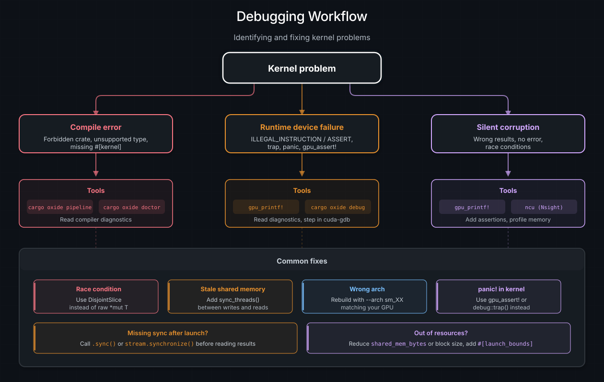

# 错误处理与调试

GPU kernel 的失败方式与 CPU 代码不同。CUDA 工具链目前不支持异常或栈展开，kernel 输出中
没有调用栈，也没有 `println!`。出错时，结果要么是静默的数据损坏，要么是硬件 trap，要么
是宿主上晦涩的驱动错误。本章介绍 cuda-oxide 用于诊断和修复 kernel 问题的工具。

## kernel 出错时会发生什么

GPU 错误分为四类：

| 失败模式              | 你会看到什么                                  | 示例                                                   |
|:----------------------|:----------------------------------------------|:-------------------------------------------------------|
| **静默损坏**          | 结果错误，但没有报错                          | 竞态条件、索引差一（off-by-one）                       |
| **硬件 trap**         | 同步时出现 `CUDA_ERROR_ILLEGAL_INSTRUCTION`   | `debug::trap()`、无消息的 `gpu_assert!`、panic、越界   |
| **设备断言**          | 断言诊断信息，外加 `CUDA_ERROR_ASSERT`        | `gpu_assert!(condition, "message")`                    |
| **启动失败**          | 立即返回 `DriverError`                        | grid 维度错误、模块缺失、资源不足                      |

CUDA 工具链目前不提供异常或栈展开机制。硬件 trap 会在没有结构化断言元数据的情况下终止
kernel。CUDA 的设备侧 `__assertfail` 系统调用同样会终止执行，但会在同步返回
`CUDA_ERROR_ASSERT` 之前报告断言消息和调用点元数据。

两类失败都是异步的设备错误，通常会在流或上下文被同步时暴露出来。两者也都会让 CUDA
上下文变得不可用，但恢复方式不同：在设备断言（`CUDA_ERROR_ASSERT`）之后，销毁并重建
上下文即可继续使用 CUDA；而在硬件 trap（`CUDA_ERROR_ILLEGAL_INSTRUCTION`）之后，CUDA
文档说明整个进程已被污染，因此应终止并重新启动它。

## `gpu_printf!` —— 从 GPU 打印

`gpu_printf!` 让你能从设备代码打印值，以便快速调试。它使用 CUDA 内置的 `vprintf`
机制：

```rust
use cuda_device::{DisjointSlice, gpu_printf, kernel, thread};

#[kernel]
pub fn debug_kernel(data: &[f32], mut out: DisjointSlice<f32>) {
    let idx = thread::index_1d();
    if idx.get() < 4 {
        gpu_printf!("Thread {} sees value {}\n", idx.get(), data[idx.get()]);
    }
    if let Some(out_elem) = out.get_mut(idx) {
        *out_elem = data[idx.get()] * 2.0;
    }
}
```

### 重要细节

- **刷新需要同步。** 输出在 GPU 上缓冲，只有在流或设备同步（例如 `to_host_vec` 或
  `ctx.synchronize()`）之后才会出现在宿主上。
- **缓冲区大小。** 默认 printf 缓冲区为 1 MiB。如果很多 thread 打印，输出可能被截断。
  可用 `cudaDeviceSetLimit(cudaLimitPrintfFifoSize, size)` 增大。
- **thread 顺序。** 不同 thread 的输出以任意顺序出现。
- **性能。** Printf 在 thread 之间串行化 —— 避免在热路径中使用。把它用于调试，而不是
  日志记录。
- **格式转换。** 该宏在编译期把 Rust 的 `{}` 格式说明符转换为等价的 C printf 形式
  （`%d`、`%f` 等）。

### 为什么不用 `println!` 或 `Debug`？

标准 Rust 格式化（`fmt::Display`、`fmt::Debug`、`format!`、`println!`）需要动态分派、
字符串分配和 I/O —— 这些在 GPU 上都不存在。`gpu_printf!` 通过直接下降为 CUDA `vprintf`
调用来绕过这一切。

## `gpu_assert!`、`__assertfail` 与 `trap()`

要在设备上进行致命错误检查，请使用 `gpu_assert!` 或 `debug::trap()`：

```rust
use cuda_device::{DisjointSlice, debug, gpu_assert, kernel, thread};

#[kernel]
pub fn checked_kernel(data: &[f32], len: u32, mut out: DisjointSlice<f32>) {
    let idx = thread::index_1d();

    // 无消息形式：下降为 trap()
    gpu_assert!(idx.get() < len as usize);

    // 字符串字面量消息形式：下降为 CUDA 的 __assertfail
    gpu_assert!(
        data[idx.get()] >= 0.0,
        "expected non-negative input"
    );

    if let Some(out_elem) = out.get_mut(idx) {
        *out_elem = data[idx.get()];
    }
}
```

| 操作                                | 设备行为                                | 宿主端影响                           |
| :---------------------------------- | :-------------------------------------- | :----------------------------------- |
| `gpu_assert!(condition)`            | 若为假则执行 `trap()`                   | `CUDA_ERROR_ILLEGAL_INSTRUCTION`     |
| `gpu_assert!(condition, "message")` | 调用 CUDA 的设备侧 `__assertfail`       | 诊断信息加 `CUDA_ERROR_ASSERT`       |
| `debug::trap()`                     | 执行无条件 trap                         | `CUDA_ERROR_ILLEGAL_INSTRUCTION`     |
| `debug::breakpoint()`               | 发出 `brkpt`                            | 在 cuda-gdb 中暂停；无调试器时失败   |

传给 `gpu_assert!` 的消息必须是字符串字面量。目前不支持带格式化的断言消息。

### 先启动、后同步的模式

设备失败通常会在流同步时被报告：

```rust
// 启动 kernel。
// 安全性：config 与 vecadd 的一维索引及所有缓冲区边界相匹配。
unsafe { module.vecadd(&stream, config, &a, &b, &mut c) }
    .expect("Launch failed");

// 暴露异步 trap 或设备断言。
stream.synchronize().expect("Kernel failed on the device");
```

对于 `gpu_assert!(condition, "message")`，CUDA 驱动会在同步返回 `CUDA_ERROR_ASSERT`
之前打印消息、源文件、源码行和模块上下文。

无消息形式不携带断言元数据。当确定哪一个检查失败很重要时，请使用带消息的形式；当还需要
检查运行时值时，请使用 `gpu_printf!`。

普通 Rust 的 `assert!`、`debug_assert!` 和 `panic!` 路径保持不变，继续使用现有的基于
trap 的行为。

## 宿主侧错误处理

### `DriverError`

同步启动路径返回 `Result<(), DriverError>`。`DriverError` 包装了 CUDA 驱动的结果码：

```rust
// 安全性：config 与 vecadd 的一维索引及所有缓冲区边界相匹配。
match unsafe { module.vecadd(&stream, config, &a, &b, &mut c) } {
    Ok(()) => { /* 启动成功 */ }
    Err(e) => eprintln!("Launch failed: {e}"),
}
```

### `DeviceError`

异步路径（`{kernel}_async` / `DeviceOperation`）使用 `DeviceError`，它把驱动错误与
上下文和调度失败一起包装：

```rust
use cuda_async::simt::error::DeviceError;

let result: Result<Vec<f32>, DeviceError> = operation.sync();
```

`DeviceError` 的变体包括 `Driver`、`Context`、`KernelCache`、`Scheduling`、`Launch`
和 `Internal`。

### `CudaContext::check_err`

在一系列操作之后，对上下文调用 `check_err()`，以暴露可能已被记录的任何异步错误：

```rust
ctx.check_err().expect("Asynchronous GPU error detected");
```

## `cargo oxide debug` —— cuda-gdb 集成

`cargo oxide debug` 会带调试信息构建你的 kernel，并启动 cuda-gdb：

```bash
cargo oxide debug vecadd          # 标准 GDB
cargo oxide debug vecadd --tui    # 带 TUI 的 GDB
cargo oxide debug vecadd --cgdb   # cgdb 前端
```

默认情况下，它给你**源码级调试**：cuda-gdb 可以停在 Rust 源文件中并显示有用的调用栈。
局部变量检查是一个独立的、更重的模式，在你需要时再选择启用。

### 调试信息模式

cuda-oxide 有三种设备调试模式：

| 模式 | 如何启用 | 你能得到什么 | 代价 |
|:-----|:-----------------|:-------------|:-----|
| Off（关闭） | 普通 `build` / `run` 的默认值 | 生成最快的 PTX，无源码映射 | 无 |
| Line tables（行号表） | `--lineinfo`、`cargo oxide debug` 或 `CUDA_OXIDE_DEBUG=line-tables` | 源码断点、单步执行、调用栈 | 低 |
| Full（完整） | `--device-debug` 或 `CUDA_OXIDE_DEBUG=full` | 行号表，外加基础的参数/局部变量检查 | 较高 |

可以这样理解行号表：它是从机器指令回到源码行的一张映射：

```text
PTX 指令  ──调试行号表──>  src/main.rs:39
```

完整调试还会加入变量记录：

```text
源码局部变量 `tid`
      |
      v
LLVM/DWARF 表示："tid 存放在这个栈槽中"
      |
      v
cuda-gdb 可以尝试：print tid
```

对于局部变量，调试器还需要当前指令位于与该变量相同的词法作用域内：

```text
function
  └─ if-let block
      └─ loop block
          └─ 当前指令
```

如果你停得太早，例如在 kernel 启动处或第一次辅助函数调用处，变量可能会诚实地打印为
`<optimized out>`，因为它尚未被加载到寄存器中。要检查变量，最好选择该值被使用之后的
源码行：

```text
break src/main.rs:412
run
info args
info locals
```

看到一个变量显示为 `<optimized out>` 并不自动意味着编译器有 bug；它可能表示"在这个
确切的 PC 上，该值没有活跃的机器位置"。调试信息是一张地图，不是时间机器。

对于被内联的辅助函数调用，cuda-oxide 还会保留每个参数原本的归属。这很重要，因为两个
不同的函数可能都有编号为 `1` 的参数：

```text
kernel(data) 调用 helper(self)

data -> kernel 调试作用域中的参数 #1
self -> helper 调试作用域中的参数 #1，并带有"内联自" kernel 调用点的信息
```

如果没有这种作用域切分，LLVM 会认为这些元数据相互矛盾并将其丢弃。调试信息就是这么
挑剔；它要的是完整家谱，而不只是姓氏。

先用行号表。它们足以回答大多数"执行走到哪里去了？"的问题，而且避免了更慢的 CUDA 调试
目标模式。当你特别想要 `print idx`、`print ptr` 或类似的局部变量检查时，再使用完整
调试。调试器可以很爱打听；但它们并不总是能很快。

`CUDA_OXIDE_DEBUG` 覆盖项对 `build`、`run`、`pipeline` 和 `debug` 都有效：

```bash
CUDA_OXIDE_DEBUG=line-tables cargo oxide pipeline vecadd
CUDA_OXIDE_DEBUG=full cargo oxide debug vecadd
```

每种模式也都有一个标志，环境变量只是它的简写。`--lineinfo` 选择行号表，`--device-debug`
选择完整调试，分别对应 `nvcc -lineinfo` 和 `nvcc -G`；两者都被 `build`、`run`、
`pipeline`、`test`、`sanitize`、`inspect` 和 `emit-ltoir` 接受：

```bash
cargo oxide build vecadd --lineinfo
cargo oxide run vecadd --device-debug        # 等同于 CUDA_OXIDE_DEBUG=full
```

两条规则决定了它们组合时会发生什么。`--device-debug` 会取代 `--lineinfo`，因此同时传入
两者会得到完整调试。而*同时省略*两者并不意味着"关闭"：这些标志仅在它们有所要求时才为
构建导出 `CUDA_OXIDE_DEBUG`，所以标志缺失时，会保留周围环境已设置的级别，而不是悄悄
选择退出。存在标志时则确实会导出，因而胜过继承来的值。

有用的别名：

| 值 | 含义 |
|:------|:--------|
| `off`、`none`、`0` | 无设备调试元数据 |
| `line-tables`、`line`、`lines`、`1` | 仅源行号表 |
| `full`、`2` | 行号表，外加基础变量元数据 |

### 完整调试对优化的影响

完整调试会把受支持的局部变量保留在 cuda-gdb 可读取的稳定内存位置中。

```text
rustc MIR                         cuda-oxide / LLVM
------------------------------    ------------------
ScalarReplacement...: off    ->   mem2reg: off
SingleUseConsts: off              循环展开: off
ReferencePropagation: on           opt -O2: off
general inlining: on*              llc: -O0

* 只有 DisjointSlice::get_mut 会被单独抽出
```

`ReferencePropagation` 可能会用 `AssignRef` 调试事件替换指针赋值。完整模式对受支持的
slice 索引形式这样处理：

```text
ptr = &slice[index] -> AssignRef -> 调试器栈槽 -> cuda-gdb
```

指向固定大小数组的直接不可变引用使用同样的有界栈槽桥接：

```text
&array[index]
    -> AssignRef
    -> 调试器栈槽
    -> cuda-gdb
```

多值 `DIArgList` 形式可以在 LLVM IR 中表示该地址计算式，但本产出方（producer）没有
使用它，因为由此产生的运行时索引指针位置在 `ptxas` 之后无法被可靠地检查。因此，最初的
数组扩展只接受对直接固定大小数组的一个运行时 `usize` 索引，并且只在完整调试模式下
具体化重建出的引用；周围的字段/解引用链仍不受支持。

不支持的事件会省略该调试绑定，而不是发出一个部分值。这些栈槽存储只存在于完整调试构建
中。我们不使用 `-Zmir-opt-level=0`，因为它会暴露 importer 目前还无法翻译的 MIR 形式。
如果某个局部变量被 rustc 移除且没有等效的调试事件，就无法在流水线后期恢复它。

你不需要设置 `CUDA_OXIDE_NO_OPT=1`；完整模式已经禁用了上面显示的下游优化阶段。

| 设置 | 含义 |
| :------ | :------ |
| `CUDA_OXIDE_DEBUG=off` | 无设备调试元数据；完全优化的 PTX |
| `CUDA_OXIDE_DEBUG=line-tables` | 仅源码行；仍然优化 |
| `CUDA_OXIDE_DEBUG=full` | 源码行加受支持的局部变量/参数；选择性 MIR 控制；关闭下游优化 |

行号表保留在优化流水线上，因为行号映射在优化后仍能很好地存活。完整模式保留选择性的
MIR 兼容策略，但会退出 cuda-oxide 后期的优化阶段，以便受支持的局部变量保持具体化。

> Pliron `mem2reg` 所执行的、感知提升（promotion-aware）的 `mir.dbg_value` 挽救，是未来
> *优化*调试层级（局部变量经过 `opt -O2`，尽力而为）的构建块。它并不是 `full` 今天所
> 使用的东西。

### 当前可用的功能

行号表模式支持：

- 按 kernel 名称设置断点，例如 `break vecadd`
- 源码单步执行和调用栈
- 来自其他文件的辅助/内联源码位置，例如从你的 kernel 单步进入
  `cuda-device/src/thread.rs`

完整模式（`-G`）支持检查：

- rustc 通过 `var_debug_info` 暴露的局部变量和参数
- 标量类型（`bool`、整数、浮点数）、裸指针和引用
- 结构体、元组和固定大小数组，其字段显示在正确（真实布局）的偏移处，例如
  `out = DisjointSlice {ptr: 0x..., len: 1}` 和 `idx = ThreadIndex {raw: 0}`

对于设备静态变量，让 cuda-gdb 保持在 Rust 模式，并使用 crate 限定的名称：

```text
set language auto
print device_global::DEVICE_COUNTER
print constant_memory_simple::kernels::SCALE
```

```text
device_global::DEVICE_COUNTER          -> @global u64
constant_memory_simple::kernels::SCALE -> ConstantMemory<f32>, AS4
```

常量内存校验器还会检查 cubin 中的 `DW_AT_address_class 4`。

端到端行为（断点绑定、调用栈、`info args`/`info locals`）由
`cuda-oxide/scripts/debug-smoketest.sh` 在真实硬件上检查。

覆盖范围仍然不完整。不支持的用例包括：在 ABI 边界被拆成 `(ptr, len)` 对的裸 slice
参数、重复解引用、子 slice、多个运行时索引、带周围字段/解引用链的运行时索引投影、
解引用加索引/向下转型链，以及非字段的复合片段。支持的有：静态结构体/元组字段、固定
数组的常量索引、枚举载荷向下转型、一次瘦指针/引用解引用，以及被语句调试引用用于指向
固定大小数组的一个直接运行时 `usize` 索引。其他内联辅助帧中的局部变量可能仍比 kernel
局部变量更稀疏；请选择拥有该源码绑定的帧。

### 断点工作流

1. 带调试信息构建：`cargo oxide debug <example>`
2. 在你的 kernel 上设置断点：`break vecadd`
3. 运行：`run`
4. 检查 thread：`cuda thread`、`cuda block`、`cuda warp`
5. 打印变量：`print idx`、`print *c_elem`

`cargo oxide debug` 从 Cargo 的构建产物元数据中选择可执行文件，而不是假定
`target/release/<example>`。这样，在自定义二进制名称、`package.default-run`、配置过的
target 目录、宿主 target triple 以及虚拟工作区下调试仍能工作。当一个 package 有多个
二进制且没有无歧义的默认值时，请使用 `--bin <name>`。

要以编程方式设置断点，在 kernel 代码中使用 `debug::breakpoint()`。当 cuda-gdb 命中
`brkpt` 指令时，它会暂停执行并让你检查 GPU 状态。

> **提示**
> 如果没有附加调试器，`debug::breakpoint()` 会**让 kernel 崩溃**。请用编译期标志加以
> 保护，或只在调试会话期间使用它。

## `cargo oxide sanitize` —— Compute Sanitizer

对于内存和同步正确性检查，在 NVIDIA Compute Sanitizer 下运行同样的构建路径：

```bash
cargo oxide sanitize vecadd
cargo oxide sanitize sharedmem --tool racecheck
cargo oxide sanitize debug --tool synccheck -- --kernel-name kns=clock
cargo oxide sanitize my_app -- --leak-check full -- --app-flag value
```

`memcheck` 是默认工具。用 `racecheck` 检查共享内存隐患，用 `initcheck` 检查未初始化的
全局内存读取，用 `synccheck` 检查无效的同步用法。`--` 之后的额外参数会在可执行文件之前
直接传给 `compute-sanitizer`；用第二个 `--` 在可执行文件之后把参数传给目标程序。

该命令默认启用优化后的设备行号表，以便检查结果能指明 Rust 源文件和行号。显式设置的
`CUDA_OXIDE_DEBUG` 进程或项目设置仍然优先。

Compute Sanitizer 即使在报告工具发现时通常也以状态零退出。因此 `cargo oxide sanitize`
默认提供 `--error-exitcode 86`，让发现的问题使脚本和 CI 失败。显式的 sanitizer 参数会
覆盖该默认值：

```bash
# 有意保持零退出状态并检查打印出的报告。
cargo oxide sanitize vecadd -- --error-exitcode 0
```

诸如 `--check-exit-code no` 和 `--require-cuda-init no` 之类的选项会削弱零状态所能证明
的东西。因此该包装器从不只凭进程状态宣布报告干净；它报告完成情况，并保留 sanitizer
输出供检查。

`--no-fmad` CLI 标志会通过普通构建和 interop 构建两条路径转发。它保持普通的乘法与
加/减运算相互独立，每次运算只舍入一次。`f32::mul_add` 这类显式的融合运算仍然保持融合。

NVVM IR 和 LTOIR 构建还会产生 `.options` 和带版本的 `.target` 附属文件（sidecar）。
请把这些文件与产物一起保留，以便后续的 libNVVM 和 nvJitLink 步骤保持相同的 FMA 策略。

调查内存安全时先运行 `memcheck`。其他工具是互补的，并不执行完整的内存访问检查。

## `cargo oxide doctor` —— 环境校验

在调试 kernel 失败之前，先确认你的环境配置正确：

```bash
cargo oxide doctor
```

Doctor 检查：

| 检查项            | 它验证什么                                     |
|:------------------|:-----------------------------------------------|
| Rust 工具链       | 带有必需组件的 nightly 编译器                  |
| 代码生成后端      | 已构建的 `librustc_codegen_cuda.so`            |
| CUDA 头文件       | 工具链根目录下存在 `cuda.h`                    |
| CUDA toolkit      | 找到 `nvcc` 且版本兼容                         |
| libNVVM           | `libnvvm.so` 可加载（libdevice 数学 kernel）   |
| nvJitLink         | `libnvJitLink.so` 可加载（同上）               |
| libdevice         | `libdevice.10.bc` 可发现（同上）               |
| LLVM              | 有可用于生成 PTX 的 `llc`（21+）               |
| 驱动 / GPU        | `nvidia-smi` 报告了 GPU 及其计算能力           |
| cuda-gdb          | 可选；只有 `cargo oxide debug` 需要            |
| compute-sanitizer | 可选；只有 `cargo oxide sanitize` 需要         |

libNVVM / nvJitLink / libdevice 这几项检查只有在 kernel 调用 CUDA libdevice 数学
函数（`sin`、`cos`、`exp`、`pow`、`sqrt` 等）时才会触发。如果你的 kernel 是纯算术的，
这三项失败无伤大雅。它们都随 CUDA Toolkit 一起发布 —— 无需单独下载。如果任一检查
失败，doctor 会打印该组件的标准安装位置。

Doctor 本身既不需要 CUDA toolkit 也不需要驱动，而且它从不先构建任何东西，因此在什么
都还没安装的机器上也能工作。有两项检查是信息性的而非致命的：代码生成后端（缺少 `.so`
只意味着"运行 `cargo oxide setup`"；`run`/`build` 反正会按需构建它）以及驱动 / GPU
检查（只有 `cargo oxide run` 需要 GPU；`build` 和 `pipeline` 没有 GPU 也能工作）。

## `cargo oxide inspect` —— 显示生成的 PTX

当你只需要最终的设备汇编（而不是中间转储）时，使用 `inspect`：

```bash
cargo oxide inspect vecadd
```

`inspect` 以与 `cargo oxide build` 相同的方式构建示例，然后打印生成的 PTX。做快速的
"后端到底生成了什么？"检查时优先用它。当还需要 MIR / LLVM 方言 / `.ll` 阶段时，使用
`pipeline`（见下）。`inspect` 严格来说只是 PTX 视图：当环境中有非 PTX 输出模式生效时
（`CUDA_OXIDE_MATERIALIZE_CUBIN` 或 `CUDA_OXIDE_EMIT_NVVM_IR`），它会以错误退出。

## `cargo oxide clean` —— 删除本地构建产物

`clean` 会删除当前工作区或独立项目下项目本地的 Cargo `target/` 目录，以及生成的
cuda-oxide 设备产物（`.ptx`、`.ll`、`.opt.ll`、`.ltoir`、`.cubin`，外加 `.target` /
`.options` / `.cubin.target` 附属文件）。它会（以报错的方式）拒绝删除符号链接的
`target/` 目录或产物，并且**不会**清除 `~/.cargo/cuda-oxide/` 下的共享代码生成后端
缓存。

```bash
cargo oxide clean
```

## `cargo oxide pipeline` —— 检查编译过程

当 kernel 产生错误结果但没有报错时，检查完整的编译流水线，看看究竟生成了什么代码：

```bash
cargo oxide pipeline vecadd
```

这会打印完整的流水线输出：

1. **MIR 收集** —— 收集器找到了哪些函数
2. **`dialect-mir`** —— 对 Rust MIR 建模的 pliron IR（`mem2reg` 之前和之后）
3. **LLVM 方言** —— 对 LLVM IR 建模的 pliron IR，由 `pliron-llvm` 提供（`mir-lower`
   之后）
4. **文本 LLVM IR** —— 序列化出的 `.ll` 文件
5. **最终 PTX** —— 生成的汇编

### 环境变量

用于更有针对性的检查：

| 变量                           | 作用                              |
|:-------------------------------|:----------------------------------|
| `CUDA_OXIDE_VERBOSE=1`         | 详细的编译器输出                  |
| `CUDA_OXIDE_SHOW_RUSTC_MIR=1`  | 在导入前转储 rustc MIR            |
| `CUDA_OXIDE_DEBUG=line-tables` | 发出源码行号表元数据              |
| `CUDA_OXIDE_DEBUG=full`        | 为基础局部变量和参数发出完整元数据 |

## 使用 Nsight Compute 进行性能分析

对于性能调试，NVIDIA 的 **Nsight Compute**（`ncu`）提供 roofline 分析、内存吞吐量和
占用率指标：

```bash
ncu --set full ./target/release/my_example
```

cuda-oxide kernel 可以使用 `debug::prof_trigger::<N>()` 发出 profiler 触发标记，它会
生成一条 `pmevent` 指令，Nsight Compute 和 Nsight Systems 可以捕获它以做时间线标注。

> **参见**
> [Nsight Compute 文档](https://docs.nvidia.com/nsight-compute/)，了解完整的性能分析
> 工具集。

## 常见陷阱

| 陷阱                            | 症状                                       | 修复                                                             |
|:---------------------------------|:-------------------------------------------|:-----------------------------------------------------------------|
| 输出缓冲区上的竞态条件          | 结果错误、不确定                           | 使用 `DisjointSlice` 加匹配的 prepared 启动几何配置             |
| 缺少 `sync_threads()`           | 读到过期的共享内存                         | 在写与读之间加 barrier                                           |
| `shared_mem_bytes` 错误         | `LAUNCH_OUT_OF_RESOURCES` 或垃圾数据       | 让 `LaunchConfig` 与实际 `DynamicSharedArray` 用法相匹配         |
| 使用裸指针时越界                | trap 或静默损坏                            | 使用 `DisjointSlice::get_mut` 做边界检查                         |
| kernel 中 `panic!("message")`   | thread trap，消息从不出现                  | 预期行为：GPU 上没有 panic 运行时。在检查之前用 `gpu_printf!` 查看数值 |
| 启动后忘记同步                  | 宿主读到过期数据                           | 调用 `to_host_vec`、`stream.synchronize()` 或 `.sync()`          |
| PTX 针对错误的架构构建          | `NO_BINARY_FOR_GPU`                        | 用 `cargo oxide build --arch sm_XX` 重新构建                     |



*调试决策树：kernel 问题分为三个分支（编译错误、运行时设备失败、静默损坏），每个分支使用不同的诊断工具。常见修复显示在底部。*
