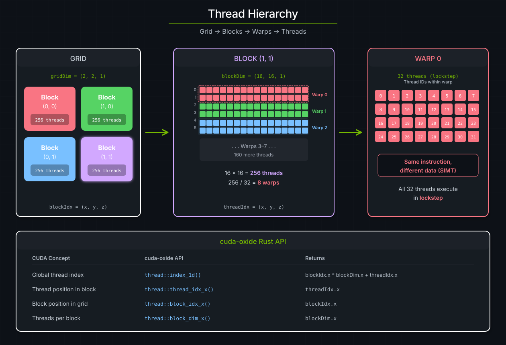
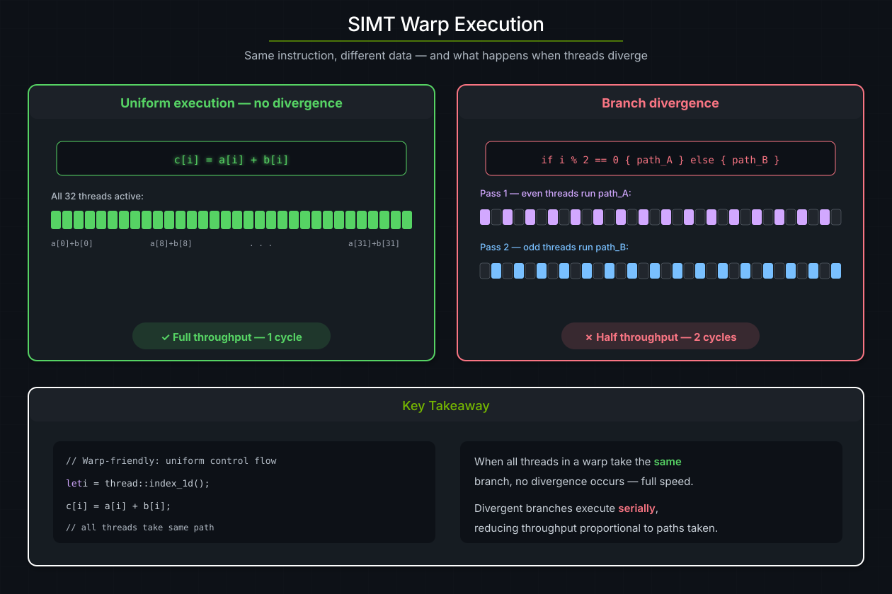
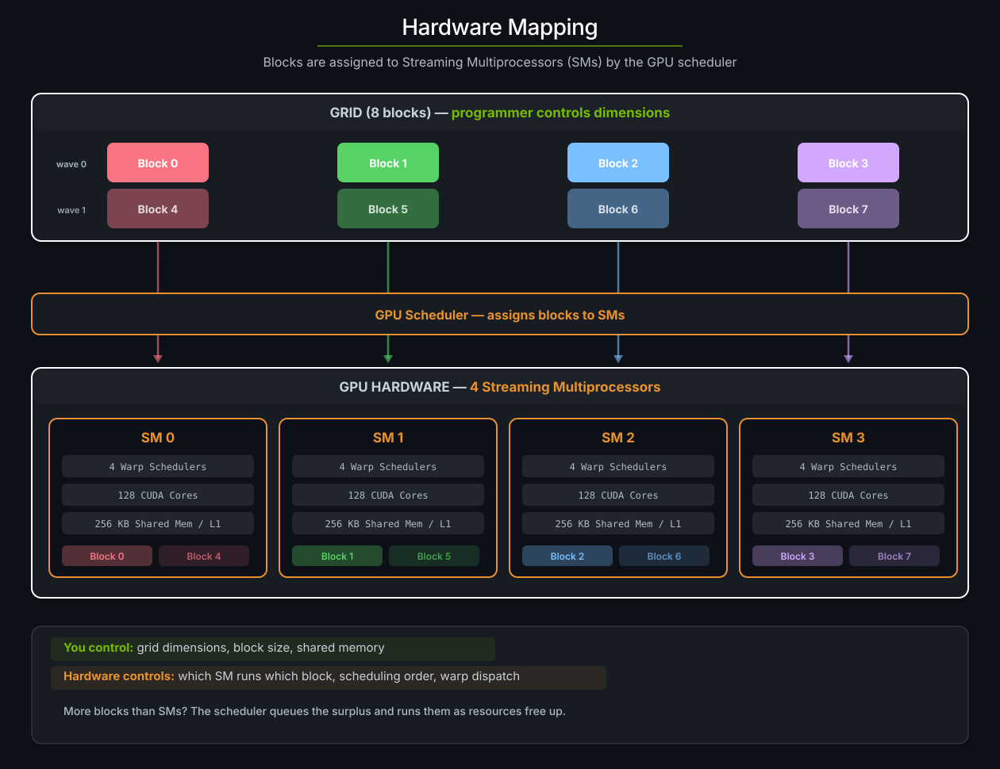

# CUDA 执行模型

本章介绍 CUDA 的 SIMT 执行模型 —— 工作如何被组织成线程、warp、block 和 grid —— 以及 cuda-oxide 如何用安全、符合习惯的 Rust API 暴露每一个层级。

> **参见**：[CUDA Programming Guide -- Programming Model](https://docs.nvidia.com/cuda/cuda-programming-guide/#programming-model)，CUDA 执行模型的权威参考。

## 线程、block 与 grid

每次 kernel 启动都会创建一个由**线程块（thread block）**构成的 **grid**。这个三层层次结构是 GPU 编程的基础：

| 层级 | 它是什么 | 规模 | 关键性质 |
|:----------|:---------------------------------------|:-------------------------------------|:----------------------------------------|
| **Grid（网格）** | 一次 kernel 调用所启动的全部 block | 每个维度最多 2³¹ - 1 个 block | 各 block 独立执行 |
| **Block（线程块）** | 一组可以协作的线程 | 最多 1024 个线程 | 线程共享快速的片上内存 |
| **Warp** | block 内连续的 32 个线程 | 固定为 32 | 以锁步方式执行指令（SIMT） |

一次 kernel 启动要指定两件事：grid 里有多少个 block（**grid 维度**），以及每个 block 里有多少线程（**block 维度**）。随后硬件会自动把每 32 个连续线程归为一个 warp —— 你永远不会显式创建 warp。



*三级 CUDA 线程层次结构。一个 2×2 的 block 网格，每个 block 含 256 个线程，组织成 8 个 32 线程的 warp。底部图例把 CUDA 概念映射到它们在 cuda-oxide API 中的对应物。*

## cuda-oxide 中的线程索引

在 kernel 内部，每个线程都需要知道它应该处理**哪一个**元素。CUDA 提供了内建变量（`threadIdx`、`blockIdx`、`blockDim`、`gridDim`）；cuda-oxide 把它们包装在 `cuda_device::thread` 模块中：

```rust
use cuda_device::{DisjointSlice, kernel, thread};

#[kernel]
pub fn vecadd(a: &[f32], b: &[f32], mut c: DisjointSlice<f32>) {
    let idx = thread::index_1d();
    if let Some(c_elem) = c.get_mut(idx) {
        *c_elem = a[idx.get()] + b[idx.get()];
    }
}
```

`thread::index_1d()` 计算 `blockIdx.x * blockDim.x + threadIdx.x`。当 grid 与 block 的 Y/Z 维度都是 1 时，它把线程映射到互不相同的数组元素上。这是一维数据并行 kernel 的常见形态；一次 `domain = 1` 的 prepared 启动就能证明这一点。

在需要访问各个分量时，cuda-oxide 暴露了原始的访问器：

| cuda-oxide API | 等价的 CUDA C++ | 返回 |
|:-------------------------|:-----------------------------------------|:-----------------------------------|
| `thread::index_1d()` | `blockIdx.x * blockDim.x + threadIdx.x` | 全局一维线程索引 |
| `thread::threadIdx_x()` | `threadIdx.x` | 线程在其 block 内的位置 |
| `thread::blockIdx_x()` | `blockIdx.x` | block 在 grid 内的位置 |
| `thread::blockDim_x()` | `blockDim.x` | 每个 block 的线程数（x 方向） |

> **提示**：对于多维索引（例如二维矩阵运算），把 `threadIdx_y()`、`blockIdx_y()` 和 `blockDim_y()` 与 `_x` 系列一起用，即可算出行/列索引。

## warp 与 SIMT 执行

**warp** 是 NVIDIA GPU 上最基本的调度单位。block 中每 32 个连续线程组成一个 warp，一个 warp 里的全部 32 个线程在**同一时刻**执行**同一条指令** —— 但作用于**不同的数据**。这个模型称为 **SIMT**（Single Instruction, Multiple Thread，单指令多线程）。

当 warp 内所有线程走同一条控制流路径时，该 warp 能跑满吞吐。当线程发生分歧（不同线程进入不同的 `if` 分支）时，硬件会把各条路径串行化：先屏蔽掉一部分线程执行一支分支，再执行另一支，然后重新汇合。这称为**分支分歧（branch divergence）**，它会直接降低吞吐。



*左：统一执行，全部 32 个线程在一个周期内跑同一条指令。右：分支分歧，偶数与奇数线程走不同路径，需要两趟串行执行。*

### 为什么这很重要

要写出**正确**的 kernel，你并不需要思考 warp —— cuda-oxide 会处理细节。但理解 SIMT 有助于你写出**快**的 kernel：

- **优先保证控制流统一。** 当 warp 内所有线程对同一个分支求值结果相同时，就没有分歧代价。
- **依赖数据的分支没问题**，只要邻近的线程（同一 warp 内的那些）倾向于走同一条路径。
- **避免基于线程 ID 的分支**，例如在热点循环里写 `if thread::threadIdx_x() % 2 == 0` —— 这保证每个 warp 都会分歧。

> **参见**：[CUDA Programming Guide -- SIMT Architecture](https://docs.nvidia.com/cuda/cuda-programming-guide/#simt-architecture)，warp 执行与重新汇合的完整硬件规范。

## 硬件映射

当你启动一个 kernel 时，GPU 的硬件调度器会把每个 block 分配到一个**流式多处理器**（SM）上。多个 block 可以在同一个 SM 上并发运行 —— 具体数量取决于该 block 的资源占用（寄存器、共享内存、线程）。

关键洞察在于：**你控制 grid 与 block 的维度；其余一切由硬件控制。** 你永远不需要指定哪个 SM 运行哪个 block，也不需要指定 block 的执行顺序。正是这种分离，让同一个 kernel 既能跑在只有几个 SM 的笔记本 GPU 上，也能扩展到拥有 100+ SM 的数据中心 GPU 上。



*GPU 调度器把 8 个 block 分配到 4 个 SM 上。每个 SM 有自己的 warp 调度器、CUDA 核心以及共享内存/L1 缓存。Block 4-7（虚线箭头）在 block 0-3 完成之后运行，或者如果资源允许，与它们一起排队。*

### 什么限制了并发

每个 SM 都有固定的资源池。只有当 SM 同时满足**以下所有**资源需求时，一个 block 才会被分配上去：

| 资源 | 典型上限（Ampere） | 由谁控制 |
|:--------------|:-----------------------------|:--------------------|
| 线程 | 每个 SM 2048 个 | `block_dim` |
| 寄存器 | 每个 SM 65536 个 | 编译器分配 |
| 共享内存 | 每个 SM 164 KB（可配置） | `shared_mem_bytes` |
| block 槽位 | 每个 SM 32 个 | grid 大小 |

当一个 block 完成时，它的资源被释放，调度器立即把一个排队中的 block 分配到该 SM 上。这就是为什么启动**多于** GPU SM 数量的 block 不仅没问题，而且是正常且符合预期的模式。

> **参见**：[CUDA Programming Guide -- Hardware Implementation](https://docs.nvidia.com/cuda/cuda-programming-guide/#hardware-implementation)，各架构的 SM 资源上限与占用率计算。

## 启动配置

在宿主侧，`LaunchConfig` 告诉运行时如何塑造 grid：

```rust
use cuda_core::simt::LaunchConfig;

// Quick 1D launch: 256 threads per block, enough blocks to cover N elements
let cfg = LaunchConfig::for_num_elems(N as u32);
```

`for_num_elems` 使用 256 的 block 大小，并通过向上取整除法计算 grid 大小 —— 对大多数逐元素 kernel 来说这是正确的默认值。需要更多控制时，直接构造 `LaunchConfig`：

```rust
let cfg = LaunchConfig {
    grid_dim: (4, 4, 1),      // 4×4 = 16 blocks
    block_dim: (16, 16, 1),   // 16×16 = 256 threads per block
    shared_mem_bytes: 0,       // no dynamic shared memory
};
```

然后把它传给生成的裸启动方法。这个调用是 unsafe 的，因为 `LaunchConfig` 本身并不能证明隐藏的 Y/Z 维度未被使用：

```rust
// SAFETY: `for_num_elems` is 1D and all three buffers contain N elements.
unsafe {
    module.vecadd(
        &stream,
        LaunchConfig::for_num_elems(N as u32),
        &a_dev,
        &b_dev,
        &mut c_dev,
    )
}
.expect("Kernel launch failed");
```

或者用异步 API：

```rust
// SAFETY: this is 1D, buffers contain N elements, and module/scheduler share a context.
unsafe {
    module.vecadd_async(
        LaunchConfig::for_num_elems(N as u32),
        &a_dev,
        &b_dev,
        &mut c_dev,
    )
}?
.sync()?;
```

<a id="execution-choosing-block-size"></a>
### 选择 block 大小

block 大小是最重要的单个调优旋钮：

- **256 个线程**是安全的默认值。它在占用率（每个 SM 多个 block）与大多数架构上的寄存器压力之间取得平衡。
- **2 的幂**（128、256、512）天然与 warp 边界对齐，不会浪费线程。
- **太小**（< 128）可能让 warp 调度器得不到充分利用。
- **太大**（1024）会用满 block 的线程上限，这可能减少每个 SM 上的并发 block 数。

grid 大小由 block 大小和问题规模决定：`grid_x = (N + block_x - 1) / block_x`。这正是 `LaunchConfig::for_num_elems` 所计算的。

### 边界检查

由于 grid 大小是向上取整的，有些线程的索引会超出数组长度。cuda-oxide 的 `DisjointSlice` 会安全地处理这一点 —— `get_mut` 对越界索引返回 `None`，所以那些线程什么都不做：

```rust
#[kernel]
pub fn vecadd(a: &[f32], b: &[f32], mut c: DisjointSlice<f32>) {
    let idx = thread::index_1d();
    if let Some(c_elem) = c.get_mut(idx) {   // out-of-bounds threads skip
        *c_elem = a[idx.get()] + b[idx.get()];
    }
}
```

这是对 CUDA C++ 的一处有意偏离 —— 在 CUDA C++ 里，边界检查是程序员的责任。cuda-oxide 的做法以一条分支为代价（除了最后一个 block 之外，它在整个 warp 内都是统一的），换来了整类越界内存 bug 的消除。
