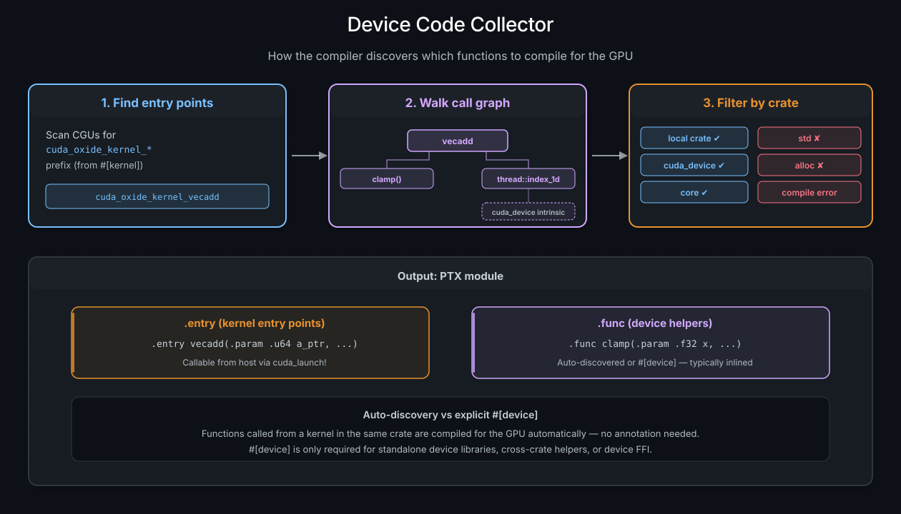

# kernel 与设备函数

**kernel** 是运行在 GPU 上的函数 —— 宿主会在成千上万个线程上启动它，它就是入口点。**设备函数**同样运行在 GPU 上，但只能被另一个设备函数或 kernel 调用，永远不能从宿主调用。本章覆盖这两者，以及设备代码中（不）受支持的 Rust 模式。

> **参见**：[CUDA Programming Guide -- Kernels](https://docs.nvidia.com/cuda/cuda-programming-guide/#kernels)，kernel 与设备函数的权威 CUDA C++ 参考。

## `#[kernel]` —— GPU 入口点

用 `#[kernel]` 标注一个函数，就是告诉 cuda-oxide 把它编译成 GPU 入口点。该函数必须返回 `()` —— kernel 通过写入输出缓冲区来传达结果，而不是通过返回值。

```rust
use cuda_device::{DisjointSlice, kernel, thread};

#[kernel]
pub fn vecadd(a: &[f32], b: &[f32], mut c: DisjointSlice<f32>) {
    let idx = thread::index_1d();
    if let Some(c_elem) = c.get_mut(idx) {
        *c_elem = a[idx.get()] + b[idx.get()];
    }
}
```

在底层，`#[kernel]` 做三件事：

1. **重命名**函数，放入保留的 `cuda_oxide_kernel_<hash>_<name>` 命名空间，好让编译器的收集器识别出它是一个设备入口点。确切的前缀由工作区内部的 `reserved-oxide-symbols` crate 掌握；`<hash>` 后缀让这个命名空间对用户代码不可猜测。
2. **加上 `#[no_mangle]`**，以在生成的 PTX 中保留符号名。
3. **生成宿主查找元数据**，让带类型的启动代码能找到正确的 PTX 入口。泛型 kernel 还会得到一个可读的辅助函数，例如 `scale_ptx_name::<f32>()`；生成的标记类型属于内部管线。

在生成的 PTX 中，kernel 会变成一个 `.entry` 指令 —— GPU 世界的 `main`：

```text
.entry vecadd(.param .u64 a, .param .u64 a_len, ...) { ... }
```

### 参数约束

kernel 参数经由**参数标量化**跨越宿主/设备 ABI 边界（详见[内存与数据搬运](memory-and-data-movement.md)一章）。关键规则：

- **切片**（`&[T]`、`DisjointSlice<T>`）会变成一个指针 + 长度对。
- **标量**（`u32`、`f32` 等）直接传入。
- **按值传递的结构体与闭包**以单个 byval `.param` 传输。逐字段展平仍然适用于内部的设备到设备调用，但 kernel 边界本身会把整个聚合体作为**一个**值接收，以匹配宿主启动器推入的单个数据包槽位。
- **不能用堆分配类型**（`Vec`、`String`、`Box`）—— 编译器允许 `alloc` crate 通过，但目前没有配置设备侧的 `#[global_allocator]`。就算配了，设备上的 `malloc` 也极慢。

### grid 常量参数

当 kernel 需要拿到启动时提供的某个只读值的**地址**时，在不可变引用上使用 `#[grid_constant]`：

```rust
#[repr(C, align(64))]
#[derive(Clone, Copy)]
struct Descriptor { bytes: [u8; 128] }

#[cuda_module]
mod kernels {
    use super::*;

    #[kernel]
    pub fn consume(#[grid_constant] descriptor: &Descriptor) {
        // Pass descriptor's address to a device helper or a TMA operation.
    }
}
```

生成的宿主启动器按值接收 `Descriptor`。驱动会把它的 128 字节拷进 kernel 参数存储区，每个设备线程在这次启动期间都借用同一块存储：

```text
host Descriptor -> one by-value launch argument -> shared read-only device &Descriptor
```

取地址并不会为每个线程创建一份私有的 descriptor 副本。这对 TMA tensor map 很有用：descriptor 可以随本次启动一起走，而不需要单独做一次设备分配和上传。它并不承诺特定的加速；请对你自己应用中在意的那部分 kernel 和启动工作负载做测量。现有的 `tma_copy` 示例用一个真实的 tensor map 演示了这一点。

被指向的值必须是有大小的（sized）、大小非零，并且内部没有可变性（`UnsafeCell`，包括 `Cell` 和原子类型，都会被拒绝）。它的外层引用必须使用省略的生命周期或 `'_`；具名或 `'static` 生命周期无法描述那种在启动结束时就失效的存储。不要修改该参数的任何部分，也不要在那次启动之后使用它的地址。存储在 descriptor **内部**的指针仍然需要指向 GPU 可访问的内存。生成的带类型启动器还要求该取值是 `Copy`，这与其它按值 kernel 参数一致。常规的按值布局限制依然适用。含有设备共享内存指针的取值会被拒绝，因为那些指针在受支持的各后端上存储宽度不同；普通的泛型指针或全局指针没有这个限制。

对于 grid 常量参数，生成的宿主启动方法**始终**是 `unsafe` 的，包括 prepared 与 async 方法，即使设备 kernel 本身是一个安全函数。`Copy` 和只读的参数存储并不能证明值内部存储的引用或指针在 GPU 上有效。在启动时，调用者必须确保 kernel 访问的每一处分配都可被设备访问、对齐正确且已初始化、存活到 GPU 工作完成，并满足 Rust 的别名与同步规则。prepared 启动会检查几何配置与资源；它不证明这些内存属性。这个要求同样适用于只含数据的载荷；当前的类型约束无法把它们与带指针的取值区分开。

使用手动的 unsafe 启动时，请把整个被指向的值作为一个参数提供，并使用它的 Rust 大小与对齐。给这个参数传一个 8 字节的设备指针并不匹配它的 ABI。普通的未标注指针参数保持原有的指针 ABI；如果 descriptor 位于全局内存中或需要在全局内存里更新，请使用那种形式。grid 常量参数要求计算能力 7.0 或更新。LLVM NVPTX 与 libNVVM 两条路径都会保留它们按值传递的大小与对齐。

## 设备辅助函数

并非所有 GPU 代码都属于 kernel 本身。你可以把逻辑抽到辅助函数里，编译器同样会为 GPU 编译它们。

### 自动发现的辅助函数

最简单的做法：写一个普通的 Rust 函数，然后在 kernel 里调用它。编译器的**收集器**会从每个 `#[kernel]` 入口点出发遍历调用图，自动为 GPU 编译每一个可达函数 —— 不需要任何标注：

```rust
fn clamp(x: f32, lo: f32, hi: f32) -> f32 {
    if x < lo { lo } else if x > hi { hi } else { x }
}

#[kernel]
pub fn apply_clamp(input: &[f32], mut out: DisjointSlice<f32>) {
    let idx = thread::index_1d();
    if let Some(out_elem) = out.get_mut(idx) {
        *out_elem = clamp(input[idx.get()], 0.0, 1.0);
    }
}
```

`clamp` 函数会被编译成一个 PTX `.func`（设备函数），并且通常被编译器内联，所以没有调用开销。

### 什么时候需要 `#[device]`

在三个特定场景下自动发现不够用，必须使用 `#[device]`：

| 场景 | 为什么需要 `#[device]` |
|:---------------------------------|:--------------------------------------------------------------------------------------|
| **独立的设备库** | crate 里没有 `#[kernel]`，收集器没有可遍历的入口点 |
| **跨 crate 的设备函数** | 该函数与 kernel 位于不同的 crate |
| **设备 FFI** | 该函数以 `#[device] extern "C"` 暴露，用于通过 LTOIR 与 CUDA C++ 链接 |

```rust
use cuda_device::device;

#[device]
pub fn magnitude(x: f32, y: f32) -> f32 {
    (x * x + y * y).sqrt()
}
```

### `#[kernel]` 与 `#[device]`

| 特性 | `#[kernel]` | `#[device]` | 自动发现 |
|:-------------------------|:------------------------|:------------------------------------|:-----------------------|
| PTX 指令 | `.entry` | `.func` | `.func`（或被内联） |
| 可从宿主启动 | 可以，经由带类型的模块 | 否 | 否 |
| 可以返回值 | 不可以（必须是 `()`） | 可以 | 可以 |
| 可从设备代码调用 | 可以 | 可以 | 可以 |
| 需要标注 | 总是需要 | 仅在独立/跨 crate/FFI 时需要 | 从不需要 |

## 设备上哪些 Rust 可用

cuda-oxide 通过 `rustc` 编译标准 Rust —— 它不是一门子集语言。话虽如此，GPU 代码运行在没有配置设备侧堆分配器的 `no_std` 环境中，因此某些 Rust 特性目前不可用。以下是当前的支持矩阵：

### 受支持

| 特性 | 说明 |
|:-------------------------------------------------------|:-----------------------------------------------|
| 基础类型（`u8`..`u64`、`f32`、`f64`、`bool`） | 完全支持 |
| 结构体与元组 | 在 ABI 边界处被分解 |
| 枚举（`Option<T>`、`Result<T,E>`、自定义） | 包括 `match` |
| `match` / `if` / `if let` | 多路分支 |
| `for` 循环与 `while` 循环 | 基于区间与基于迭代器 |
| 迭代器（`.iter()`、`.enumerate()`） | 经 MIR 脱糖 |
| `break` 与 `continue` | 循环内部 |
| 数组（`[T; N]`） | 读、写、索引 |
| 切片（`&[T]`） | 只读；可变写入通过 `DisjointSlice` |
| 闭包（在设备代码内部） | 正常的 Rust 语义 |
| 泛型函数 | 按调用点单态化 |
| `unsafe` 块与裸指针 | 用于进阶模式 |

### 不受支持

| 特性 | 原因 | 替代方案 |
|:----------------------------------|:--------------------------------------------------------------------|:-------------------------------------|
| `String`、`Vec`、`Box` | 需要堆分配器（目前没有设备侧 `#[global_allocator]`） | 使用定长数组或切片 |
| `format!`、`println!` | 需要格式化机制 + I/O | 使用 `gpu_printf!` |
| `std` 的 I/O、网络、文件系统 | GPU 上没有操作系统 | 通过缓冲区通信 |
| trait 对象（`dyn Trait`） | 需要虚表派发 | 使用泛型（单态化） |

> **提示**：如果你不小心用到了不受支持的特性，编译器会给出清晰的错误：`"CUDA-OXIDE: FORBIDDEN CRATE IN DEVICE CODE"`，并附上允许的 crate 列表（`core`、`alloc`、`cuda_device` 以及你自己的本地 crate）。

## 条件编译

`#[cfg(...)]` 在设备代码中的行为与在 Rust 其它地方完全一致。缺的是可以用来做**判断依据**的东西：编译器不提供任何由目标派生的 `cfg`，所以 kernel 无从询问自己正在为哪个架构编译。架构需求写在文档注释里，由调用者负责保证 —— 这就是为什么某个需要 `redux.sync` 的示例会在宿主侧检查 `ctx.compute_capability()` 并跳过，而不是对 kernel 做特化。

`--device-cfg NAME` 就是你自己提供一个的办法。它可以重复，每一次出现都会在本次构建的 rustflags 中变成一个 `--cfg NAME`：

```bash
# From the crate directory, not with an example name -- see below.
cargo oxide build --device-cfg ampere_up
```

```rust
// One instruction where the target allows it, a shuffle tree everywhere else.
#[cfg(ampere_up)]
let total = warp::redux_sync_add(u32::MAX, value);

#[cfg(not(ampere_up))]
let total = {
    let mut acc = value;
    let mut offset = 16;
    while offset > 0 {
        acc = acc.wrapping_add(warp::shuffle_xor(acc, offset));
        offset /= 2;
    }
    acc
};
```

在动用它之前，有四件事值得知道。

**它不限于设备代码。** 这个标志是以 rustflag 的形式传递的，因此 cargo 为那次构建编译的每一个 crate 都能看到这个 `cfg`，宿主代码也不例外。

**它会把 `build` 切到直通模式。** 传了它就意味着 `build` 不再接受示例名，所以 `cargo oxide build my_example --device-cfg ampere_up` 会被拒绝；请改为从该 crate 自己的目录运行。（`test` 本来就是直通的，无所谓有没有这个标志。）如果这个开关可以放在 crate 的清单里，那么用一个普通的 Cargo feature（`#[cfg(feature = "ampere_up")]`）就能达到同样效果，还不必放弃按示例名调用；当你需要在不碰任何 Cargo.toml 的前提下注入一个 `cfg` 时，`--device-cfg` 才体现出价值。

**rustc 会对未声明的 `cfg` 名报警。** `unexpected_cfgs` lint 会把每一个 `#[cfg(...)]` 与已声明的集合比对，而被注入的 `--cfg ampere_up` 不在其中，所以每次使用都会打印一条 `unexpected cfg condition name` 警告。在 kernel 所在 crate 的清单里声明它即可消除：

```toml
[lints.rust]
unexpected_cfgs = { level = "warn", check-cfg = ["cfg(ampere_up)"] }
```

**没有任何机制把它与 `--arch` 绑定。** 如果这个 `cfg` 名代表某个架构，那么让两者保持一致是你的责任 —— 传 `--device-cfg ampere_up` 而不配对应的 `--arch`，会愉快地为所选的那个目标构建这条特化路径，然后被汇编器拒绝。

<a id="loop-unrolling"></a>
## 循环展开

在 `#[kernel]` 或 `#[device]` 函数内部，把 `#[unroll]` 直接放在循环次数在编译期已知的循环上。这请求编译器移除该循环、把它的循环体副本铺开：

```rust
#[kernel]
pub fn sum_four(mut out: DisjointSlice<u32>) {
    let tid = thread::index_1d();
    if let Some(out_elem) = out.get_mut(tid) {
        let mut sum = 0;
        let mut i = 0;
        #[unroll]
        while i < 4 {
            sum += i;
            i += 1;
        }
        *out_elem = sum;
    }
}
```

该 pass 目前能识别显式的计数式 `while` 循环。基于区间的 `for` 循环尚未被识别。

当循环次数只有到运行时才知道时，使用 `#[unroll(N)]`，其中 `N >= 2`。循环此时每趟做 `N` 次迭代的工作。残留的迭代由一个小的余数循环处理，因此 `n` 不必能被 `N` 整除：

```rust
let mut i = 0;
#[unroll(4)]
while i < n {
    process(i);
    i += 1;
}
```

被标注的循环内部可以包含其它循环。只有承载标注的那个循环会被展开；每个内层循环会被完整复制，仍然保持为循环。如果你想连内层循环也一起展开，就给它单独加一个标注。

含有多条 `continue` 路径的循环是受支持的。完整的 `#[unroll]` 还能保留 `break` 路径以及有多个出口目标的循环。

部分展开 `#[unroll(N)]` 目前要求循环条件必须是唯一出口。如果循环里有 `break` 或其它出口，编译器会警告并且不展开该循环。

部分展开还要求是递增计数的循环：计数器必须有正的步长、使用 `<` 或 `<=`，并且与一个在循环内部不变的限值比较。对于不受支持的请求，编译器会警告并且不展开。

为了让生成的代码规模可控，一次标注最多可以产生 1,024 份循环体副本、8,192 个克隆的基本块和 65,536 个克隆的操作。更大的请求会警告且不展开。完整的变量调试构建也会跳过展开，因为它们把循环变量留在内存中而不是 SSA 形式。

展开是以更大的生成代码换取更少的分支和更多的优化机会。请对小规模或性能关键的循环使用它，并测量结果。

> **参见**：编译器如何分析并重写被标注的循环（包括 stage-index 窥孔优化），见[编译器优化](../compiler/compiler-optimizations.md)。

## `#[launch_bounds]` —— 占用率提示

`#[launch_bounds]` 属性告诉编译器你打算每个 block 启动多少线程。这让 PTX 汇编器能做出更好的寄存器分配决策，并可能提升占用率：

```rust
#[kernel]
#[launch_bounds(256, 2)]
pub fn optimized_kernel(mut out: DisjointSlice<f32>) {
    // ...
}
```

| 参数 | 必需 | PTX 指令 | 说明 |
|:---------------|:---------|:----------------|:---------------------------------|
| `max_threads` | 是 | `.maxntid` | 每个 block 的最大线程数 |
| `min_blocks` | 否 | `.minnctapersm` | 每个 SM 的最小并发 block 数 |

生成的 PTX 会包含这些指令：

```text
.entry optimized_kernel .maxntid 256, 1, 1 .minnctapersm 2 { ... }
```

`.maxntid` 约束的是乘积 `x * y * z`，所以 256 线程的上限同时允许 `(256, 1, 1)`、`(16, 16, 1)` 和 `(4, 8, 8)`。当需要某一个确切的形状时，加上 `#[launch_contract(block = (x, y, z))]`。它会用 `.reqntid` 取代 `.maxntid`，由驱动逐轴强制执行：

```text
.entry exact_kernel .reqntid 256, 1, 1 .minnctapersm 2 { ... }
```

这两条指令互斥；ptxas 会拒绝同时声明两者的入口，所以带契约的 kernel 只发出 `.reqntid`。`.minnctapersm` 是占用率提示，与两者都可以组合。

> **提示**：`#[launch_bounds]` 必须放在 `#[kernel]` **之后**：
>
> ```rust
> #[kernel]
> #[launch_bounds(256, 2)]   // correct
> pub fn my_kernel(...) { }
> ```

### 当上限逼迫寄存器溢出

启动上限归根结底是每线程寄存器的上限：向 ptxas 承诺更多常驻线程，就意味着留给每个线程的寄存器更少。如果 kernel 需要的寄存器超过上限所允许的，ptxas 不会失败 —— 它会把多出的部分**溢出（spill）**到本地内存，于是这个上限换来的占用率，会在每一次访问被溢出的取值时被重新付出代价。

这很容易被忽略，因为构建是成功的。cuda-oxide 会改为在该 kernel 的定义跨度上给出警告：

```text
warning: kernel `cuda_oxide_kernel_a1b2c3d4_my_kernel` compiled with
         `#[launch_bounds(256, 2)]` and spills registers
  = note: ptxas reports 96 bytes spill stores and 96 bytes spill loads
  = note: ptxas allocated 40 registers per thread
  = help: relax `min_blocks_per_sm` or reduce register pressure
```

（字节数与寄存器总数就是你那个 kernel 上 ptxas 报告的值。）只有带 `#[launch_bounds]` 的 kernel 才会被检查 —— 没有上限，也就没有 ptxas 需要以寄存器为代价去满足的承诺。该警告只在会产出原生 cubin 的构建中触发（`--materialize-cubin`，或者任何会嵌入 cubin 的构建）：纯 PTX 构建从不运行 ptxas，因此没有资源报告可看。

通常的应对是提高 `max_threads`、去掉或放宽 `min_blocks`，或者削减 kernel 自身的寄存器压力。溢出并非自动就是错的：一个 kernel 在高占用率下轻微溢出，可能比低占用率下不溢出更快。这个警告存在的意义，是让这种取舍被有意做出，而不是偶然发生。

> **警告**：`#[allow(...)]` **不会**压制这些警告。它们是原始的跨度诊断而不是 lint，因此抑制属性对它们不适用。逃生通道是一个环境变量，面向那些已经测量过溢出并接受它的构建：
>
> ```bash
> CUDA_OXIDE_NO_SPILL_WARN=1 cargo oxide build my_kernels --materialize-cubin
> ```

## 收集器 —— 设备代码如何被发现

当你用 `cargo oxide` 构建时，`rustc-codegen-cuda` 后端会运行一个**收集器** pass，决定哪些函数需要为 GPU 编译：

1. 扫描所有编译单元，寻找位于保留命名空间 `cuda_oxide_kernel_<hash>_` 中的函数（由 `#[kernel]` 生成）。
2. 对每个 kernel **遍历调用图**，收集所有传递可达的函数。
3. **过滤**每个被调用者，对照允许的 crate 列表：

| crate | 是否允许 | 原因 |
|:-----------------|:--------|:-------------------------------------------------------------------------------------------|
| 你的本地 crate | 是 | 你的 kernel 与辅助代码 |
| `cuda_device` | 是 | GPU 内联函数（线程、warp、共享内存） |
| `core` | 是 | `no_std` 的 Rust 核心库 |
| `std` | 否 | 需要 GPU 上不具备的操作系统设施 |
| `alloc` | 允许 | 能通过收集器，但目前还没有接上设备侧的分配器。今天会在链接期报错。 |

如果收集器遇到一次对禁止 crate 的调用，它会报告一个编译期错误，而不是生成有问题的 PTX。



*设备代码收集器：从 #[kernel] 入口点出发，编译器遍历调用图以发现所有可达的设备函数，然后对照允许的 crate 列表（本地 crate、cuda_device、core）过滤每个被调用者。输出是一个带 .entry 与 .func 指令的 PTX 模块。*

## `no_std` 与 panic 行为

设备代码运行在一个隐式的 `#![no_std]` 环境中。你不需要自己加这个属性 —— 编译器后端会处理。

**panic 行为：** MIR 中所有展开（unwind）路径都被视为不可达。如果 panic 在运行时真的被触发（例如某次数组边界检查失败），GPU 会执行一条 **trap 指令**，导致宿主收到 `CUDA_ERROR_ILLEGAL_INSTRUCTION`。这在语义上等价于 `panic=abort`，但不需要任何特殊的编译器标志。

实践中这意味着：

- `unwrap()` 和 `expect()` 可用，但会在 `None`/`Err` 时让 GPU 陷入 trap。
- `assert!` 和 `debug_assert!` 可用，但失败时会 trap。
- `panic!("message")` 能编译，`panic!("{}", value)` 也能。panic 路径会下降为一条 trap，而**消息被丢弃**：没有 panic 运行时会去打印它，而那些本会用来构造它的语句在调用被丢弃之后就变成死代码了。需要看到取值时，请在检查之前用 `gpu_printf!`，或者用 `gpu_assert!` 做显式检查。

> **参见**：[错误处理与调试](error-handling-and-debugging.md)一章介绍了 `gpu_printf!`、`gpu_assert!` 以及用于诊断 kernel 失败的 `cargo oxide debug`。
