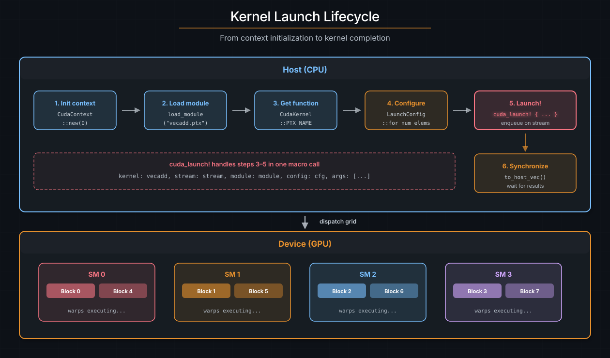

# 启动 kernel

编写 kernel 只是故事的一半。宿主必须加载设备代码、配置启动 grid、整理参数，并把工作派发到 GPU。cuda-oxide 的主要启动路径是 `#[cuda_module]`：它把生成的设备产物嵌入宿主二进制，并生成带类型的启动方法。当你需要显式的 sidecar 加载或自定义启动代码时，较低层的 `load_kernel_module` 与 `cuda_launch!` API 仍然可用；注意 `cuda_launch!` 是不安全的，必须包在 `unsafe { }` 中。

> **参见**：[CUDA Programming Guide -- Execution Configuration](https://docs.nvidia.com/cuda/cuda-programming-guide/#execution-configuration)，`<<<grid, block, smem, stream>>>` 语义的权威参考。

## 启动生命周期

每次 kernel 启动都遵循相同的顺序：

1. **初始化 CUDA 上下文** —— 绑定到某个 GPU 设备。
2. **加载设备模块** —— 通常来自内嵌的产物 bundle。
3. **查找 kernel 函数** —— 通过它的 PTX 入口点名字。
4. **配置 grid** —— block 维度、grid 维度、共享内存。
5. **启动** —— 在某个流上把 kernel 入队。
6. **同步** —— 等待结果（显式或隐式）。



*kernel 启动生命周期。宿主初始化上下文、加载设备模块、配置 grid，然后通过带类型的方法启动。GPU 调度器把 block 派发到 SM。*

实践中，`#[cuda_module]` 会在生成的 Rust API 背后处理步骤 2--5。你通常只会接触到上下文创建、`kernels::load`，以及一次带类型的方法调用。

## `#[cuda_module]` —— 带类型的参数

把 kernel 包进一个内联的 `#[cuda_module]` 模块，就会生成一个带类型的加载器，并为每个 `#[kernel]` 生成一个方法。生成的签名会检查 kernel 参数，但裸的 `LaunchConfig` 并不能证明 kernel 的索引形状或资源需求。因此原始的启动方法是 unsafe 的。

```text
裸 LaunchConfig     -> unsafe 启动
PreparedLaunch<K>   -> 恰好 K 项的安全启动
```

这里的“同步”指的是：你提供一个流并立即入队；在你同步之前，GPU 的执行仍然可能与宿主重叠。

```rust
use cuda_core::simt::LaunchConfig;
use cuda_core::{CudaContext, DeviceBuffer};
use cuda_device::{DisjointSlice, cuda_module, kernel, thread};

#[cuda_module]
mod kernels {
    use super::*;

    #[kernel]
    pub fn vecadd(a: &[f32], b: &[f32], mut c: DisjointSlice<f32>) {
        let idx = thread::index_1d();
        let i = idx.get();
        if let Some(c_elem) = c.get_mut(idx) {
            *c_elem = a[i] + b[i];
        }
    }
}

fn main() {
    let ctx = CudaContext::new(0).unwrap();
    let stream = ctx.default_stream();
    let module = kernels::load(&ctx).unwrap();

    let a = DeviceBuffer::from_host(&stream, &[1.0f32; 1024]).unwrap();
    let b = DeviceBuffer::from_host(&stream, &[2.0f32; 1024]).unwrap();
    let mut c = DeviceBuffer::<f32>::zeroed(&stream, 1024).unwrap();

    // SAFETY：这是一次 1D 启动，三个缓冲区都包含 1024 个元素。
    unsafe {
        module.vecadd(&stream, LaunchConfig::for_num_elems(1024), &a, &b, &mut c)
    }
    .expect("Kernel launch failed");

    let result = c.to_host_vec(&stream).unwrap();
    assert_eq!(result[0], 3.0);
}
```

### 逐项拆解

| 条目                  | 描述                         |
|:-----------------------|:------------------------------------|
| `#[cuda_module]`       | 生成加载器与启动方法 |
| `kernels::load(&ctx)`  | 加载内嵌的产物 bundle  |
| `module.vecadd(...)`   | 检查参数类型；裸配置需要 `unsafe` |
| `LaunchConfig`         | grid/block 维度与 smem      |

### 参数映射

生成的方法把 kernel 参数映射到宿主值：

| Kernel 参数        | 宿主参数               | GPU ABI          |
|:-------------------|:-----------------------|:-----------------|
| `&[T]`             | `&DeviceBuffer<T>`     | 指针 + 长度 |
| `&mut [T]`         | `&mut DeviceBuffer<T>` | 指针 + 长度 |
| `DisjointSlice<T>` | `&mut DeviceBuffer<T>` | 指针 + 长度 |
| 标量/裸指针        | 同一个值               | 直接传值   |

### 返回值

带类型的原始启动方法返回 `Result<(), DriverError>`。`Ok` 只表示 kernel 被成功**入队** —— 而不是它已经执行完毕。要检查运行时错误（例如越界 trap），之后需要同步流或上下文。

## 安全的 prepared 启动

当 kernel 的几何配置属于正确性的一部分时，把它声明出来：

```rust
use cuda_core::LaunchConfig1D;
use cuda_device::{DisjointSlice, cuda_module, kernel, launch_bounds, launch_contract, thread};

#[cuda_module]
mod contracted {
    use super::*;

    #[kernel]
    #[launch_bounds(256)]
    #[launch_contract(domain = 1, block = (256, 1, 1))]
    pub fn vecadd(a: &[f32], b: &[f32], mut c: DisjointSlice<f32>) {
        let idx = thread::index_1d();
        let i = idx.get();

        if let Some(c_elem) = c.get_mut(idx) {
            *c_elem = a[i] + b[i];
        }
    }
}

// SAFETY：这个 package 内嵌的产物正是由这个 `contracted` 模块编译出来的。
let module = unsafe { contracted::load(&ctx)? };
let config = LaunchConfig1D::new(4, 256, 0);
let prepared = module.prepare_vecadd(config)?;
module.vecadd(&stream, &prepared, &a, &b, &mut c)?;
```

加载一个带契约的模块是不安全的，因为调用者必须确保所选的产物正是由这个模块编译出来的。仅凭 package 或 kernel 名字匹配，并不能证明它的 ABI 与启动要求一致。一旦加载了正确的产物，prepare 过程会检查它声明的启动契约。

`prepare_vecadd` 会检查确切的 block 形状、设备限制、动态共享内存、上下文，以及任何 cluster/cooperative 要求。`LaunchConfig1D` 无法表示处于活动状态的 Y/Z 维度，而 `PreparedLaunch<vecadd>` 不能用于另一个 kernel。prepare 可能失败；一旦成功，这个被品牌化的（branded）启动就可以安全地重复使用。

Cluster 与 cooperative 属性可以一起声明（`#[cluster_launch(...)]` + `#[cooperative_launch]`）。prepare 会用 `cuOccupancyMaxActiveClusters` 证明 cluster 形状，然后要求整个 grid 都能装进那份并发 cluster 容量，这样 cooperative 的 `grid::sync()` 就不会因有 block 无法驻留而挂起。过大的 grid 会在 prepare 阶段以 `LaunchContractError::CooperativeGridTooLarge`（或相关的 cluster 驻留错误）失败，而不是提交一次不健全的启动。

对于带契约的 kernel，原始的逃生通道名为 `vecadd_unchecked`，它仍然是不安全的。不带契约的 kernel 只暴露不安全的原始启动方法。

## 编译期策略配置

kernel 策略是一组有名字的编译期选择。它可以描述 tile 形状、操作原子、launch bounds、循环展开因子，或者 kernel 库想暴露的任何其它配置。

策略由 Rust 类型表示，而不是运行时值。一个泛型 kernel 会为宿主用到的每一种具体策略类型各单态化一次：

```text
transform::<SmallTilePolicy> -> transform_TID_<A>
transform::<WideTilePolicy>  -> transform_TID_<B>
```

每个特化都有自己的 PTX 入口点和自己折叠后的常量。策略不作为 kernel 参数传递，生成的 kernel 中也不包含用于选择策略的运行时分支。

### 定义一个领域特定的策略

`cuda_device::config::Policy` 有意只包含一个稳定的标识符。kernel 库通过关联类型与常量来扩展它，让它们对自己的领域有意义：

```rust
use cuda_device::config::{
    Atom, AtomKind, AtomSpec, Block, Global, Policy, PolicyId, RowMajor, Shape1, Thread, Tile,
    TileSpec,
};

enum XorRotate {}
impl AtomKind for XorRotate {}

trait VectorPolicy: Policy {
    type BlockTile: TileSpec<
        Layout = RowMajor,
        MemorySpace = Global,
        Scope = Block,
    >;

    type ElementAtom: AtomSpec<
        Kind = XorRotate,
        Scope = Thread,
    >;

    const MAX_THREADS: u32;
    const MIN_BLOCKS: u32;
    const ITEMS_PER_THREAD: u32;
    const UNROLL: u32;
    const TAG: u32;
}
```

`Tile`、`Atom`、`Shape`、布局、内存空间以及作用域这些类型都只是元数据。它们不分配内存、不提供指针访问、不发出指令，也不同步线程。由领域特定的 trait 与 kernel 实现来决定这些描述意味着什么，以及哪些组合是有效的。

### 定义具体的策略

一个具体策略同时实现 `Policy` 与领域特定的策略 trait：

```rust
enum SmallTilePolicy {}

impl Policy for SmallTilePolicy {
    const ID: PolicyId =
        PolicyId::new(0x706f_6c69_6379_5f63, 1);
}

impl VectorPolicy for SmallTilePolicy {
    type BlockTile =
        Tile<Shape1<1024>, RowMajor, Global, Block>;

    type ElementAtom =
        Atom<XorRotate, Shape1<1>, Thread>;

    const MAX_THREADS: u32 = 64;
    const MIN_BLOCKS: u32 = 2;
    const ITEMS_PER_THREAD: u32 = 16;
    const UNROLL: u32 = 2;
    const TAG: u32 = 0x1357_9bdf;
}
```

第二个策略可以选择不同的 tile、launch bound 与展开因子，而不必复制 kernel：

```rust
enum WideTilePolicy {}

impl Policy for WideTilePolicy {
    const ID: PolicyId =
        PolicyId::new(0x706f_6c69_6379_5f63, 2);
}

impl VectorPolicy for WideTilePolicy {
    type BlockTile =
        Tile<Shape1<4096>, RowMajor, Global, Block>;

    type ElementAtom =
        Atom<XorRotate, Shape1<1>, Thread>;

    const MAX_THREADS: u32 = 256;
    const MIN_BLOCKS: u32 = 1;
    const ITEMS_PER_THREAD: u32 = 16;
    const UNROLL: u32 = 4;
    const TAG: u32 = 0x2468_ace0;
}
```

`PolicyId` 是一个显式的、面向库的身份标识。它的命名空间与取值由策略作者提供，并且在策略生成的行为保持不变期间必须保持稳定。它不是从 Rust 的 `TypeId`、编译器混淆名、类型名或编译器生成的哈希推导出来的。

cuda-oxide 不维护全局的策略 ID 注册表。策略库需要自己负责选择命名空间并防止 ID 重复。

### 在 kernel 中使用策略常量

策略的关联常量可以用于受支持的编译期属性：

```rust
use cuda_device::{cuda_module, kernel, launch_bounds, launch_contract, thread};

#[cuda_module]
mod kernels {
    use super::*;

    #[kernel]
    #[launch_bounds(P::MAX_THREADS, P::MIN_BLOCKS)]
    #[launch_contract(domain = 1)]
    pub unsafe fn transform<P: VectorPolicy>(
        input: *const u32,
        output: *mut u32,
        count: u32,
    ) {
        let base =
            thread::index_1d().get()
                * P::ITEMS_PER_THREAD as usize;

        let mut lane = 0;

        #[unroll(P::UNROLL)]
        while lane < count {
            let index = base + lane as usize;

            // SAFETY：调用者为每个活动线程提供可读可写的存储，
            // 并保证 count 不超过这个 tile。
            let value =
                unsafe { input.add(index).read_volatile() } ^ P::TAG;

            unsafe {
                output.add(index).write_volatile(value);
            }

            lane += 1;
        }
    }
}
```

rustc 会在单态化之后解析这些关联常量，因此 cuda-oxide 为每个特化看到的都是具体值：

```text
SmallTilePolicy:
  launch_bounds = (64, 2)
  unroll         = 2

WideTilePolicy:
  launch_bounds = (256, 1)
  unroll         = 4
```

`MAX_THREADS` 指定该特化可接受的最大 block 大小。它并不强制每次启动都恰好使用这么多线程。

`MIN_BLOCKS` 是由 PTX `.minnctapersm` 表示的编译器占用率提示。它不是 grid 或 block 维度，也不会作为启动几何配置被强制执行。

`UNROLL` 是一个部分展开因子。`UNROLL = 4` 表示每个变换后的循环体里合并四次循环迭代；它并不把循环限制为四次迭代。运行时边界与剩余迭代都会被保留。

无效或无法求值的策略表达式会产生编译错误，而不会静默地使用默认值。

### 准备一次策略特定的启动

泛型 kernel 会生成泛型的宿主方法，其策略参数用于选择具体的 kernel 特化：

```rust
use cuda_core::LaunchConfig1D;

let small_launch =
    module.prepare_transform::<SmallTilePolicy>(
        LaunchConfig1D::new(1, 64, 0),
    )?;

let wide_launch =
    module.prepare_transform::<WideTilePolicy>(
        LaunchConfig1D::new(1, 256, 0),
    )?;
```

生成的启动契约会针对每个特化单独求值：

* `SmallTilePolicy` 拒绝大于 64 个线程的 block。
* `WideTilePolicy` 拒绝大于 256 个线程的 block。

一次 prepared 启动会始终绑定到所选的那个 kernel 特化。为一个策略创建的 `PreparedLaunch` 不能传给另一个策略的启动方法。

策略会改变编译期代码生成与启动校验，但它并不证明裸指针的内存安全。接受裸指针的 kernel 依然是不安全的：

```rust
// SAFETY：这些指针覆盖完整的策略 tile，并且在流完成本次启动之前一直有效。
unsafe {
    module.transform::<SmallTilePolicy>(
        &stream,
        &small_launch,
        input,
        output,
        count,
    )?;
}
```

### 当前的限制

策略表达式目前优先支持：

* `#[launch_bounds(...)]`
* 部分循环 `#[unroll(...)]`

泛型常量表达式需要 Rust 的 `generic_const_exprs` 特性：

```rust
#![feature(generic_const_exprs)]
#![allow(incomplete_features)]
```

以下取值目前仍然只能是字面量，而不能来自策略：

* `launch_contract` 字段
* cluster 维度
* 动态共享内存大小

由策略派生的最大 launch bound 仍然可以与宿主启动契约结合使用。契约与策略最大值会针对每个单态化的特化分别检查。

任何被策略派生的 launch-bound 最大值引用的额外具名常量，都必须在模块作用域可见，因为宿主启动契约是生成在 kernel 函数旁边的。

### 完整示例

[`policy_config`](https://github.com/NVlabs/cuda-oxide/tree/main/cuda-oxide/crates/rustc-codegen-cuda/examples/policy_config)
示例为一个泛型 kernel 定义了两个策略，并验证它们会产生：

* 可在宿主侧寻址的、各不相同的 PTX 入口
* 各不相同的 `.maxntid` 与 `.minnctapersm` 指令
* 折叠后的策略特定常量
* 原始 LLVM IR 中不同的部分展开因子
* 策略特定的 prepared 启动校验

不需要 GPU 就能构建并检查生成的产物：

```bash
cargo oxide build policy_config

cargo run --release \
  --manifest-path cuda-oxide/crates/rustc-codegen-cuda/examples/policy_config/Cargo.toml \
  -- --verify-ptx
```

验证器请使用 `--release`，因为编译器生成的特化名字在不同构建 profile 之间可能不同。`PolicyId` 仍然是显式的、与 profile 无关的策略标识。

## `cuda_launch!` —— 不安全的较低层启动

`cuda_launch!` 是 `#[cuda_module]` 之下那个显式的、不安全的逃生通道。它的适用场景是那些在运行时按名字加载的模块（你自己挑选的 sidecar PTX/cubin/LTOIR 产物），此时不存在可供检查的编译期 kernel 签名。

由于这个宏无法校验参数列表，每次使用都必须位于 `unsafe { }` 块内。调用者承诺参数的数量、顺序和类型都匹配 kernel 的真实签名，并且指针参数是设备可访问的。一旦不匹配就是未定义行为：驱动会读过 args 数组的末尾，或者设备会解引用垃圾数据。

```rust
use cuda_host::{cuda_launch, load_kernel_module};

let module = load_kernel_module(&ctx, "vecadd").unwrap();

// SAFETY：参数与 vecadd 匹配，缓冲区都存活，
// 且这是 1D 配置，边界由 c.get_mut(idx) 保护。
unsafe {
    cuda_launch! {
        kernel: vecadd,
        stream: stream,
        module: module,
        config: LaunchConfig::for_num_elems(1024),
        args: [slice(a), slice(b), slice_mut(c)]
    }
}
.expect("Kernel launch failed");
```

`args` 里的包装器产生的宿主数据包与 `#[cuda_module]` 生成的方法相同：`slice(...)` 和 `slice_mut(...)` 推入 `(ptr, len)` 对，标量参数直接推入它的值，而闭包或按值的结构体作为单个 byval 值推入（kernel 边界把它当作一个 `.param` 接收，而不是按字段展平后的多个参数）。

## 产物策略

`#[cuda_module]` 是一个启动界面特性，而不是目标选择特性。它加载编译器放进宿主二进制的内嵌载荷。诸如 PTX 与 LTOIR 之别、cubin 与 fatbin 之别，或者单架构与多架构打包之类的决策，都属于编译器与产物/运行时加载器这两层。把这项策略分离出去，能让生成的 Rust 启动方法在载荷格式演进时保持稳定。

PTX 与 cubin 载荷直接加载。NVVM IR 会记录它的目标，因为 Blackwell 之前的 GPU 使用 LLVM 7 的类型化指针，而 Blackwell 及更新的 GPU 使用不透明指针。加载器在调用 libNVVM 时会使用所记录的那个目标。

NVVM IR 与 LTOIR 通常按它们的原始目标编译。对于像 `sm_86` 这样的标准 Blackwell 之前目标，加载器可以改为生成 PTX，让 CUDA 驱动在 Blackwell 上 JIT 它。带后缀的目标（例如 `sm_90a`）不支持这种做法，把较新 GPU 的产物拿到较旧 GPU 上运行也不支持。
驱动还必须支持所选工具包产生的 PTX 版本。CUDA 错误 222 意味着工具包对驱动的 PTX JIT 来说太新了；请选择兼容的工具包，或升级驱动。[安装指南](../getting-started/installation.md#installation-toolkit-driver-compatibility)解释了为什么这可能与常规的 LLVM 到 PTX 路径不同。

## `LaunchConfig`

`LaunchConfig` 指定 grid 形状：

```rust
use cuda_core::simt::LaunchConfig;

let config = LaunchConfig {
    grid_dim: (num_blocks, 1, 1),
    block_dim: (256, 1, 1),
    shared_mem_bytes: 0,
};
```

| 字段               | 类型              | 描述                     |
|:-------------------|:------------------|:--------------------------------|
| `grid_dim`         | `(u32, u32, u32)` | x、y、z 方向上的 block 数量     |
| `block_dim`        | `(u32, u32, u32)` | x、y、z 方向上每个 block 的线程数    |
| `shared_mem_bytes` | `u32`             | 每个 block 的动态共享内存 |

### `for_num_elems` 辅助函数

对于 1D 数据并行 kernel，常见模式是一个线程处理一个元素：

```rust
let config = LaunchConfig::for_num_elems(N as u32);
```

它使用每个 block 256 个线程，并用向上取整除法计算 grid 大小：`grid_x = (N + 255) / 256`。这是一个方便的 1D 形状，但它仍然只是裸数据；只有 prepare 才会把一份配置与某个 kernel 绑定起来。

### 2D 与 3D 配置

对于矩阵运算，使用 2D 的 block 与 grid 维度：

```rust
let config = LaunchConfig {
    grid_dim: ((cols + 15) / 16, (rows + 15) / 16, 1),
    block_dim: (16, 16, 1),
    shared_mem_bytes: 0,
};
```

在 kernel 内部，把 `threadIdx_x()` / `blockIdx_x()` 与它们的 `_y()` 对应版本结合起来，算出行的索引与列的索引。

### 选择 block 大小

block 大小是最重要的单项调优参数（细节见[执行模型](execution-model.md#execution-choosing-block-size)一章）。快速准则：

- **256** 是大多数 kernel 的安全默认值。
- **2 的幂**（128、256、512）与 warp 边界对齐。
- 用 `#[launch_bounds]` 向编译器提示你打算使用的 block 大小。

## 带类型的异步启动

启用 `cuda-host` 的 async 特性后，`#[cuda_module]` 还会生成借用版与所有权版的异步方法。它们返回惰性的 `DeviceOperation` 值，而不是立即入队。启动时不指定流 —— 调度策略会在该操作被执行时挑一个：

```rust
use cuda_async::simt::device_context::init_device_contexts;
use cuda_async::simt::device_operation::DeviceOperation;

init_device_contexts(0, 1)?;
let module = kernels::load_async(0)?;

// SAFETY：这是 1D 启动，缓冲区包含 1024 个元素，且 module 与调度器共享同一个上下文。
let op = unsafe {
    module.vecadd_async(
        LaunchConfig::for_num_elems(1024),
        &a_dev,
        &b_dev,
        &mut c_dev,
    )
}?;

// 执行并等待
op.sync()?;
```

当操作必须被 spawn，或需要作为 `'static` future 保存时，请使用所有权版：

```rust
use std::future::IntoFuture;

// SAFETY：这是 1D 启动，所有权版缓冲区包含 1024 个元素，且上下文一致。
let op = unsafe {
    module.vecadd_async_owned(
        LaunchConfig::for_num_elems(1024),
        a_dev,
        b_dev,
        c_dev,
    )
}?;

let (a_dev, b_dev, c_dev) = tokio::spawn(op.into_future()).await??;
```

### 异步缓冲区的生命周期

异步启动是惰性的，所以指针的生命周期很关键：

```text
裸指针形态：
  用 CUdeviceptr 构建 op
  丢弃缓冲区
  稍后运行 op  -> 悬垂指针

借用版带类型形态：
  用 &DeviceBuffer 构建 op
  Rust 让缓冲区保持被借用，直到 op 完成

所有权版带类型形态：
  把 DeviceBox 移动进 op
  被 spawn 的任务持有该分配，直到完成
```

对于带契约的 kernel，两种异步形式都接受 `&PreparedLaunch<K>`，并且是安全的。`cuda_launch_async!` 仍然是较低层的不安全迁移 API；它的调用必须位于 `unsafe` 块内。裸指针的异步启动只有在调用者能证明该分配比这个惰性操作活得更久时才是正确的。

### `.sync()` 与 `.await`

| 方法      | 它的作用                                                                          |
|:----------|:----------------------------------------------------------------------------------|
| `.sync()` | 按默认调度策略执行，阻塞当前线程直到完成 |
| `.await`  | 执行并让出当前异步任务（需要 Tokio 运行时）               |

## 组合 GPU 工作

`DeviceOperation` 支持函数式组合。用 `and_then` 串联操作，用 `zip!` 并行运行彼此独立的工作：

```rust
use cuda_async::zip;

let forward_pass = layer1_op
    .and_then(|output1| layer2_op(output1))
    .and_then(|output2| layer3_op(output2));

// 并发运行两个彼此独立的操作
let combined = zip!(branch_a, branch_b);
let (result_a, result_b) = combined.sync()?;
```

链上的每个操作只有在执行时才会被调度到某个流上。`and_then` 组合子把上一个操作的输出作为下一个操作的输入，形成一张惰性计算图。

> **参见**：[异步 GPU 编程](../async-programming/the-device-operation-model.md)一节深入介绍了 `DeviceOperation`、调度策略与流管理。

## Cluster 启动

线程块 cluster（Thread Block Cluster，Hopper 及更新架构）允许 block 通过**分布式共享内存**（DSMEM）在共享内存之外进行协作。要以 cluster 方式启动，给 kernel 加上 `#[cluster_launch]`，并在启动中包含 `cluster_dim`：

```rust
use cuda_device::{DisjointSlice, cluster, cluster_launch, kernel};

#[kernel]
#[cluster_launch(4, 1, 1)]
pub fn cluster_kernel(mut out: DisjointSlice<u32>) {
    let rank = cluster::block_rank();
    // block 0-3 可以通过 DSMEM 通信
}
```

在宿主侧，启动使用 `launch_kernel_ex`（扩展的启动 API）并带上 cluster 维度。`cuda_launch!` 通过 `cluster_dim` 字段支持这一点：

```rust
// SAFETY：参数/配置与 cluster_kernel 匹配，包括它 4 个 block 的 cluster；
// out_dev 在同步完成之前一直存活。
unsafe {
    cuda_launch! {
        kernel: cluster_kernel,
        stream: stream,
        module: module,
        config: config,
        cluster_dim: (4, 1, 1),
        args: [slice_mut(out_dev)]
    }
}
.expect("Cluster launch failed");
```

> **提示**：cluster 启动需要 **Hopper (sm_90)** 或更新架构。最大 cluster 大小通常是 16 个 block。用 `cargo oxide build --arch sm_90` 来面向 Hopper。

## Cooperative 启动

grid 范围的 barrier（`cuda_device::grid::sync()` 或 `this_grid().sync()`）只有在 grid 中每个 block 都同时驻留在设备上时才能工作。**cooperative 启动**会要求驱动保证这一点；没有它，尚未被调度的 block 永远无法到达 barrier，kernel 会死锁。

在带类型的 `#[cuda_module]` 路径上，用 `#[cooperative_launch]` 标注 kernel。此后每个生成的启动方法（sync、async 以及 owned-async）都会带上 `CU_LAUNCH_ATTRIBUTE_COOPERATIVE` 属性，通过 `cuLaunchKernelEx` 提交：

```rust
use cuda_device::{DisjointSlice, cooperative_launch, grid, kernel};

#[cuda_module]
mod kernels {
    use super::*;

    #[kernel]
    #[cooperative_launch]
    pub fn grid_sync_kernel(mut out: DisjointSlice<u32>) {
        // ... 每个 block 的工作 ...
        grid::sync();
        // ... barrier 之后 grid 范围的工作 ...
    }
}

let module = kernels::load(&ctx)?;
// SAFETY：该配置满足 kernel 的索引、驻留与输出边界要求。
unsafe { module.grid_sync_kernel(&stream, config, &mut out_dev) }?;
```

与 `#[cluster_launch]` 不同，这个属性不改变 PTX 中的任何东西；它只改变宿主提交启动的方式。这两个属性可以合并在同一个 kernel 上，此时两个启动属性都会进入同一次 `cuLaunchKernelEx` 调用。

传统的（调用方需担责的）`cuda_launch!` 宏通过它的 `cooperative: true` 字段提供相同的行为。

> **提示**：整个 grid 必须能在一波内全部驻留在设备上，否则驱动会以 `CUDA_ERROR_COOPERATIVE_LAUNCH_TOO_LARGE` 拒绝这次启动。拿不准时，请依据 `cuOccupancyMaxActiveBlocksPerMultiprocessor`（每个 SM 的 block 数 × SM 数量）来确定 grid 大小。

## 常见的启动错误

| 错误                                  | 可能原因                                           | 修复                                                                  |
|:---------------------------------------|:-------------------------------------------------------|:---------------------------------------------------------------------|
| `CUDA_ERROR_INVALID_VALUE`             | grid 或 block 维度为零，或超出限制     | 检查 `LaunchConfig` 的取值；block 最大为 1024 个线程               |
| `CUDA_ERROR_NOT_FOUND`                 | PTX 入口点名字不匹配                     | 确认 `#[kernel]` 的名字与所加载的模块一致                    |
| `CUDA_ERROR_LAUNCH_OUT_OF_RESOURCES`   | 共享内存过多，或每个 block 的寄存器太多 | 减少 `shared_mem_bytes` 或 block 大小；使用 `#[launch_bounds]`      |
| `CUDA_ERROR_ILLEGAL_INSTRUCTION`       | kernel 触发了 trap（panic、assert 失败、越界）         | 用 `cargo oxide debug` 或 `gpu_printf!` 调试                      |
| `CUDA_ERROR_NO_BINARY_FOR_GPU`         | PTX 是为错误的架构编译的                    | 用与你 GPU 匹配的 `--arch` 重新构建                              |
| `CUDA_ERROR_UNSUPPORTED_PTX_VERSION` (222) | 驱动无法编译模块中的 PTX 版本 | 选择一个兼容的 `CUDA_TOOLKIT_PATH`，或升级驱动        |
| `CUDA_ERROR_NOT_INITIALIZED`           | `libcuda` 缺失，或驱动的 CUDA 主版本比工具包的旧 | 安装 R580+ 驱动；错误文本会列出加载器尝试过的那些文件 |
| `CUDA_ERROR_NOT_FOUND`（来自非启动调用） | 所加载的 `libcuda` 中缺少驱动的符号     | 把驱动升级到与工具包相同的 CUDA 版本                       |

> **参见**：[错误处理与调试](error-handling-and-debugging.md)一章详细介绍了如何诊断并修复 kernel 失败。
