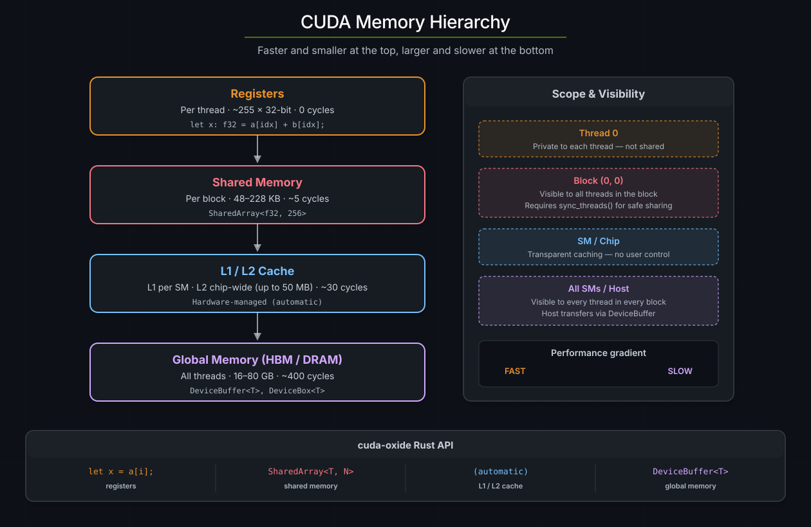
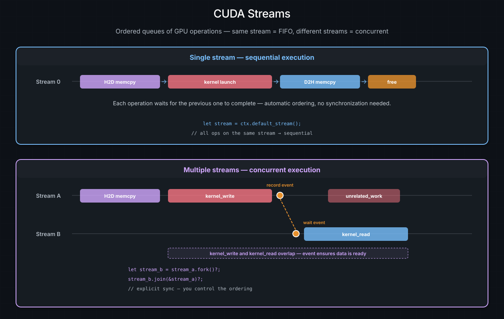
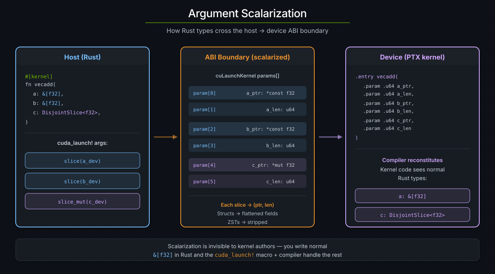

# 内存与数据搬运

GPU 拥有自己的内存，与宿主内存相互独立。把数据送进设备、再从设备取回——以及在数据就位后选择合适的内存类型——是每个 CUDA 程序的基础。本章介绍 cuda-oxide 的内存抽象，从宿主/设备传输到共享内存，再到 kernel ABI。

> **参见**
>
> [CUDA 编程指南 —— 设备内存](https://docs.nvidia.com/cuda/cuda-programming-guide/#device-memory-accesses)，了解 CUDA 内存层次结构与访问模式的权威参考。

## CUDA 内存层次结构

NVIDIA GPU 提供多个层级的内存，每层在容量、时延和作用域上各不相同：

| 内存                       | 作用域      | 典型大小                     | 时延             | cuda-oxide API                       |
|:---------------------------|:------------|:-----------------------------|:-----------------|:-------------------------------------|
| **寄存器**                 | 每 thread   | ~255 × 32 位                 | 0 个周期         | 局部变量                             |
| **共享内存**               | 每 block    | 48--228 KB（依架构而定）     | ~5 个周期        | `SharedArray`、`DynamicSharedArray`  |
| **L1 缓存**                | 每 SM       | 与共享内存共用               | 硬件管理         | 自动                                 |
| **常量内存**               | 所有 thread | 64 KB，设备上只读            | 广播缓存         | 通过 `#[constant]` 使用 `ConstantMemory` |
| **L2 缓存**                | 全芯片      | 最高 50 MB（Hopper）         | ~30 个周期       | 自动                                 |
| **全局内存（DRAM）**       | 所有 thread | 16--80 GB（HBM）             | ~400 个周期      | `DeviceBuffer`、`DeviceBox`          |

指导原则是：把频繁访问的数据搬到更快、更近的内存中。寄存器最快，但属于每个 thread；共享内存很快，且对整个 block 可见；全局内存容量大但速度慢。



*CUDA 内存层次结构，从最快（寄存器，每 thread）到最大（全局 DRAM，所有 thread）。每一层都以容量换取时延。右侧面板展示了每个级别的作用域以及对应的 cuda-oxide API。*

## 上下文与流

在深入内存 API 之前，需要先介绍每个代码示例中都会出现的两个宿主侧概念：**上下文**和**流**。

**CUDA 上下文**（`CudaContext`）把宿主线程绑定到某个特定的 GPU。它拥有该设备上的全部资源——模块、流、内存分配。通常你在程序开始时创建一个：

```rust
use cuda_core::CudaContext;

let ctx = CudaContext::new(0).unwrap();   // 绑定到 GPU 0
```

**CUDA 流**（`CudaStream`）是一个有序的 GPU 操作队列。入队到**同一个**流上的操作按 FIFO 顺序执行——每个操作都能看到此前操作的所有副作用。**不同**流上的操作可以重叠并并发运行，彼此之间没有顺序保证。

```rust
let stream = ctx.default_stream();     // 隐式的、始终可用的流
let work_stream = stream.fork()?;      // 新流，接续父流的当前位置
```

每次内存传输和 kernel 启动都需要一个流。对于单流程序（本书大多数示例都属于此类），**默认流**就足够了——一切按顺序执行，天然正确。多流流水线可以解锁计算与数据搬运之间的重叠，但需要通过事件或 `join` 显式同步：

```text
Same stream:       [kernel_A] → [memcpy_B] → [kernel_C]     (automatic ordering)
Different streams: [kernel_A on stream 1] | [memcpy_B on stream 2]  (concurrent, needs events)
```



*上图：单流执行，其中操作按 FIFO 自动排序。下图：多流执行，流 A 与流 B 并发运行，并通过一个事件在 kernel_write 与 kernel_read 之间建立数据依赖。*

> **参见**
>
> [启动 kernel](launching-kernels.md) 一章介绍了启动宏中的流用法，[异步 GPU 编程](../async-programming/the-device-operation-model.md)一节介绍了可自动管理流的 `DeviceOperation`。

## `DeviceBuffer` —— 宿主/设备传输

`cuda_core` 中的 `DeviceBuffer<T>` 是分配设备内存并在宿主与 GPU 之间搬运数据的主要方式：

```rust
use cuda_core::{CudaContext, DeviceBuffer};

let ctx = CudaContext::new(0).unwrap();
let stream = ctx.default_stream();

// 宿主 → 设备：把宿主切片拷贝到 GPU 内存
let a_dev = DeviceBuffer::from_host(&stream, &host_data).unwrap();

// 分配已清零的设备内存
let mut c_dev = DeviceBuffer::<f32>::zeroed(&stream, 1024).unwrap();

// 设备 → 宿主：把结果读回
let results = c_dev.to_host_vec(&stream).unwrap();
```

### 关键方法

| 方法                              | 方向          | 说明                           |
|:--------------------------------- |:--------------|:-------------------------------|
| `from_host(&stream, &[T])`        | 宿主 → 设备   | 分配 + 阻塞式拷贝              |
| `zeroed(&stream, len)`            | --            | 分配 + 清零填充                |
| `to_host_vec(&stream)`            | 设备 → 宿主   | 异步拷贝 + 返回 `Vec<T>`       |
| `copy_to_host(&stream, &mut [T])` | 设备 → 宿主   | 拷贝到已有的切片中             |
| `cu_deviceptr()`                  | --            | 供 FFI 使用的原始 `CUdeviceptr` |

### 所有权与 drop

`DeviceBuffer` 在 drop 时通过 `cuMemFree` **同步**释放其分配。这是一个阻塞式驱动调用——它会在内部同步整个设备，以确保没有在途 kernel 仍在使用该内存。在实践中这意味着：

- **在 kernel 运行时 drop** 会让宿主线程停顿，直到 GPU 完全空闲，然后才释放内存。
- **在同步之后 drop**（例如在 `to_host_vec` 或 `stream.synchronize()` 之后）没有额外开销，因为设备已经空闲。

对于单流工作负载这没有问题——一切按 FIFO 顺序执行，所以当你读回结果时，所有 kernel 都已结束，释放是即时的。开销会在多流场景中显现：你希望让计算与内存操作重叠时，一条流上的同步释放可能会拖住其他所有流上的工作。

## `DeviceBox` —— 对异步友好的设备内存

`cuda_async` 中的 `DeviceBox<T>` 解决了同步释放的问题。在 drop 时，它通过 `cuMemFreeAsync` 在一个**专用释放流**上释放内存。这是一个流有序操作——释放被入队到该释放流上，只有在该流上所有先前工作完成后才执行。关键在于，它**不会**同步设备：

```rust
use cuda_async::simt::device_box::DeviceBox;
use cuda_async::simt::device_context::init_device_contexts;

init_device_contexts(0, 1)?;  // 初始化设备上下文映射（默认设备 0）

// DeviceBox 包装一个设备指针；在 drop 时异步释放
let dev_ptr: DeviceBox<f32> = /* 由 DeviceOperation 链分配 */;
// 当 dev_ptr 被 drop 时，会在释放流上调用 cuMemFreeAsync。
// 其他流继续运行，不会停顿。
```

### 如何在两者之间选择

|                     | `DeviceBuffer`                      | `DeviceBox`                            |
|:--------------------|:------------------------------------|:---------------------------------------|
| **所属 crate**      | `cuda_core`                         | `cuda_async`                           |
| **drop 时释放**     | `cuMemFree`（同步——使设备停顿）     | `cuMemFreeAsync`（异步——不停顿）       |
| **配合使用**        | 类型化同步启动                      | 类型化异步启动                         |
| **宿主回读**        | `to_host_vec()`                     | 通过显式的 memcpy 操作                 |
| **最适用于**        | 单流、阻塞式工作负载                | 多流、流水线化工作负载                 |

> **提示**
>
> 对于多流流水线中对时延敏感的拆除操作，优先使用 `DeviceBox`。对于直白的单流示例，`DeviceBuffer` 更简单，而且同步释放实际上是零开销的。

<a id="memory-argument-scalarization"></a>

## 参数标量化

当你编写一个接受 `&[f32]` 的 kernel 时，宿主与设备对 Rust 切片在内存中的表示方式并不一致——结构体布局在宿主的 x86 ABI 与 NVPTX ABI 之间可能不同。cuda-oxide 通过在 kernel 边界处**标量化**聚合类型来解决这个问题：把聚合类型分解为两侧解释方式完全相同的原始值。

| kernel 参数类型                | 宿主实际传递的内容             |
|:-------------------------------|:-------------------------------|
| `&[T]`                         | `ptr: *const T` + `len: u64`   |
| `DisjointSlice<T>`             | `ptr: *mut T` + `len: u64`     |
| `T`（标量）                    | 直接传 `T`                     |
| `#[grid_constant] value: &T`    | 一个按值传递的 `T`；设备借用启动存储；宿主启动时不安全 |
| 结构体 `{ a: u32, b: f32 }`    | 一个 byval 值（整个结构体）    |
| 闭包（含 N 个捕获）            | 一个 byval 值（整个结构体）    |
| 零尺寸类型                     | 完全剥离                       |

这就是为什么类型化的 `#[cuda_module]` 方法对 `&[T]` 接受 `&DeviceBuffer<T>`、对可写类切片参数接受 `&mut DeviceBuffer<T>`。生成的方法会为你提取指针和长度。在 kernel 内部，编译器从标量参数重新构建切片结构体，因此你的 kernel 代码看到的是普通的 `&[T]` 类型。



*参数标量化：宿主通过 ABI 边界以 (ptr, len) 对的形式传递 Rust 切片。设备端 kernel 接收扁平的标量参数，编译器在 kernel 内部重建原始的 Rust 类型。*

> **提示**
>
> 在普通 kernel 代码中标量化是完全不可见的。你在签名中写 `&[f32]`，然后把它当作普通切片使用。生成的启动方法和编译器会处理其余一切。

## `DisjointSlice` —— 安全的并行写入

在 CUDA C++ 中，并行输出的标准做法是使用一个原始 `__global__` 指针，每个 thread 都对其进行索引。这本质上是不安全的——没有什么能阻止两个 thread 写入同一位置。

cuda-oxide 提供了 `DisjointSlice<T, IndexSpace>` 作为安全的替代方案。它包装一个可变切片，且只允许通过 `IndexSpace` 与其自身匹配的 `ThreadIndex` 进行写入。配合匹配的已准备启动几何（prepared launch geometry），这确保了每个 thread 访问的是唯一的元素：

```rust
use cuda_device::{DisjointSlice, kernel};

#[kernel]
pub fn double(input: &[f32], mut out: DisjointSlice<f32>) {
    if let Some((out_elem, idx)) = out.get_mut_indexed() {
        *out_elem = input[idx.get()] * 2.0;
    }
}
```

- `get_mut_indexed()` 是单次调用形式：它一次性铸造每 thread 的凭证（witness）并将其解析为 `&mut T`。`None` 同时覆盖了超出 grid 的 thread（例如 2D 情况下 `col >= ROW_STRIDE`）和超出切片范围的索引。
- 当你需要该索引以便在多个切片之间做并行算术时，也可以使用显式的两步形式 `let idx = thread::index_1d(); out.get_mut(idx)`。
- 对于归约这类多个 thread 有意写入同一位置的模式，`get_unchecked_mut`（unsafe）提供了逃生舱口。

### 为什么 `ThreadIndex` 能保证安全

`DisjointSlice` 安全性的关键在于 `ThreadIndex<'kernel, IndexSpace>`——一个不透明的凭证，没有公开的构造函数。获得它的唯一途径是可信的索引函数，这些函数从硬件内建变量（`threadIdx`、`blockIdx`、`blockDim`）推导出该值：

```rust
let idx = thread::index_1d();          // ThreadIndex<'_, Index1D> —— 可以
let bad = ThreadIndex::new(42);        // 不存在 —— 构造函数是私有的
```

这之所以成立，是因为 CUDA 的 thread 索引是**由硬件提供的统一值**：block 中的每个 thread 都会从 GPU 的 warp 调度器获得唯一的 `threadIdx`。对于 1D grid（网格）启动（只使用 x 维度），由 `blockIdx.x * blockDim.x + threadIdx.x` 推导出的全局索引在整个 grid 中是唯一的。

最后这句话是有条件的：`index_1d()` 忽略 Y 和 Z。2D grid 会为每个 Y 坐标重复同一个由 X 推导的索引。

```text
PreparedLaunch(domain=1) -> Y/Z inactive -> safe DisjointSlice writes
raw LaunchConfig         -> caller proves Y/Z inactive -> unsafe launch
```

凭证证明了设备侧的索引空间；已准备的启动证明了宿主侧的几何结构。两者都需要，才能实现完全安全的启动。

该凭证同时是 `!Send + !Sync + !Copy + !Clone`，其 `'kernel` 生命周期借用自宏注入的一个栈上局部作用域——因此 thread 无法把自己的 `ThreadIndex` 放进共享内存让邻居稍后取用，凭证也无法比 kernel 函数体活得更久。再结合 `IndexSpace` 参数（`Index1D`、`Index2D<S>`、`Runtime2DIndex`），类型系统还能在编译期拒绝不匹配的 2D 步长——数据竞争隐患由此变成类型错误。

## 共享内存

**共享内存**是 block 内所有 thread 都可见的片上快速内存。它是在 block 内进行 thread 间通信和数据复用的主要工具，在速度和作用域上都介于寄存器（每 thread）与全局内存（所有 thread）之间。

### 静态共享内存 —— `SharedArray`

当大小在编译期已知时，使用 `SharedArray<T, N>`：

```rust
use cuda_device::{DisjointSlice, SharedArray, kernel, thread};

static mut TILE: SharedArray<f32, 256> = SharedArray::UNINIT;

#[kernel]
pub fn smem_example(input: &[f32], mut out: DisjointSlice<f32>) {
    let idx = thread::index_1d();
    let tid = thread::threadIdx_x() as usize;

    // 从全局内存加载到共享内存
    unsafe { TILE[tid] = input[idx.get()]; }
    thread::sync_threads();

    // 从共享内存读取相邻元素（比全局内存快得多）
    let neighbor = if tid > 0 {
        unsafe { TILE[tid - 1] }
    } else {
        0.0
    };
    thread::sync_threads();

    if let Some(out_elem) = out.get_mut(idx) {
        *out_elem = unsafe { TILE[tid] } + neighbor;
    }
}
```

每个 `static mut SharedArray` 在 PTX 中映射为一个独立的 `.shared` 分配。`sync_threads()` 屏障确保所有 thread 都已写完，之后任何 thread 才去读取。

### 动态共享内存 —— `DynamicSharedArray`

当大小取决于运行时参数时，使用 `DynamicSharedArray<T>` 并通过 `LaunchConfig::shared_mem_bytes` 指定分配大小：

```rust
use cuda_device::{DisjointSlice, DynamicSharedArray, kernel, thread};

#[kernel]
pub fn dynamic_smem_example(input: &[f32], mut out: DisjointSlice<f32>) {
    let smem = DynamicSharedArray::<f32>::get();
    let tid = thread::threadIdx_x() as usize;

    unsafe { *smem.add(tid) = input[thread::index_1d().get()]; }
    thread::sync_threads();
    // ... 使用 smem ...
}
```

在宿主侧，启动时设置大小：

```rust
let config = LaunchConfig {
    grid_dim: (num_blocks, 1, 1),
    block_dim: (256, 1, 1),
    shared_mem_bytes: 256 * std::mem::size_of::<f32>() as u32,
};
```

多个动态数组可以通过 `DynamicSharedArray::offset(byte_offset)` 分区，共用同一块分配。

### 对齐

| 类型                          | 默认对齐           | 说明                         |
|:------------------------------|:-------------------|:-----------------------------|
| `SharedArray<T, N>`           | `align_of::<T>()`  | 标准对齐                     |
| `SharedArray<T, N, 128>`      | 128 字节           | TMA 操作所必需               |
| `DynamicSharedArray<T>`       | 16 字节            | 与 nvcc 兼容的默认值         |
| `DynamicSharedArray<T, 128>`  | 128 字节           | TMA 所必需                   |

### 常见陷阱

- **缺少 `sync_threads()`：** 如果共享内存的写入与读取之间没有屏障，thread 可能读到陈旧或未初始化的数据。
- **超出 SM 限制：** 请求过多共享内存会导致 `CUDA_ERROR_LAUNCH_OUT_OF_RESOURCES`。请检查你所针对架构的限制。

> **参见**
>
> [CUDA 编程指南 —— 共享内存](https://docs.nvidia.com/cuda/cuda-programming-guide/#shared-memory)，了解 bank 冲突、广播以及最优访问模式的细节。

## 常量内存 —— `#[constant]`

常量内存是一小块只读窗口，宿主在两次启动之间写入，grid 中的每个 thread 都可以读取。它由一块为**广播**而构建的缓存来服务：当一个 warp 的所有 lane 想要同一地址时，只需一次事务；当它们想要不同地址时，这些访问会依次得到服务。

在 `#[cuda_module]` 中把它声明为 `static`：

```rust
#[cuda_module]
mod kernels {
    use cuda_device::{ConstantMemory, DisjointSlice, constant, kernel, thread};

    #[constant]
    static SCALE: ConstantMemory<f32> = ConstantMemory::UNINIT;

    #[kernel]
    pub fn multiply(mut out: DisjointSlice<f32>) {
        let s = SCALE.get();
        let idx = thread::index_1d();
        let i = idx.get();
        if let Some(e) = out.get_mut(idx) {
            *e = (i as f32) * s;
        }
    }
}
```

该宏会为每个常量生成两个宿主 setter，命名为 `set_` 加上该静态变量名的小写形式，因此 `SCALE` 变成 `set_scale`，`TABLE_CONST` 变成 `set_table_const`。普通形式是流有序的；而 `set_<name>_blocking` 这一同胞形式则改为执行一次同步的一次性拷贝：

```rust
let module = kernels::load(&ctx)?;
module.set_scale(&stream, &3.0)?;
```

`ConstantMemory<T>` 接受 `T: ConstantMemoryValue`，这是一个 unsafe 标记，为原始整数与浮点类型、`*const T` / `*mut T`、最多八个元素的元组，以及这些类型的数组实现。它编码的要求是：全零位模式必须是合法的 `T`，因为 `ConstantMemory::UNINIT` 初始为零——这也是引用和 `NonZero*` 类型被排除在外的原因，也解释了为什么自定义结构体在加入之前需要显式的 `#[repr(C)]` 布局。

### `get()` 与 `get_ref()`

在把它用于标量以外的任何用途之前，这是唯一值得了解的事情。

`get()` 返回按值拷贝。值没有地址，因此在运行时索引下对 `ConstantMemory<[f32; N]>` 的拷贝做索引，会迫使整个数组先溢出到该 thread 的本地存储——每个元素一次存储，且发生在*每个* thread 中——随后的查表读取的是 thread 私有内存。`get_ref()` 则是借用存储，因此索引保持在常量空间中，读取只需一条 `ld.const`。

`constant_memory_table` 示例将两者与第三种方案做了对比测量：一个普通的 `const T: [f32; N]`，物化为不可变的设备全局变量。在 A10G（sm_86）上测量，256 项的 `f32` 表，每个 thread 64 次依赖查表，共 8388608 个 thread，所有变体的结果逐位相同：

| 索引         | `get()` | `get_ref()` | `const [f32; N]`（全局）  |
|:-------------|--------:|------------:|--------------------------:|
| 发散         | 16048us |      7616us |                 **322us** |
| warp 一致    | 16065us |   **258us** |                     322us |

两个结论。在发散索引上 `get_ref` 比 `get` 快 2.1 倍，在 warp 一致的索引上快 62 倍，所以只要比标量大就优先用它。而且常量内存并非简单地就是"更快的内存"：在发散索引上，它比普通数组常量慢 23.7 倍，因为一个 warp 对小表的发散读取会合并访存并驻留在 L1 中，而常量缓存则按顺序依次服务这些不同地址。当索引是 warp 一致时用 `#[constant]`；不是时就用普通的 `const` 数组。

读取不会跨启动被折叠掉：`UnsafeCell` 的内部结构让存储在编译器看来始终可变，因此两次启动之间的 `set_<name>` 保持可见。在同一次启动*内部*对同一项的重复读取仍可能被合并，这是健全的，因为宿主只在两次启动之间写入。

> **参见**
>
> [CUDA 编程指南 —— `__constant__`](https://docs.nvidia.com/cuda/cuda-programming-guide/#constant)，了解此处所对应的硬件限制与缓存规则。

## 统一内存与 HMM

默认情况下，GPU 与 CPU 运行在**独立的地址空间**中。GPU 无法解引用普通的宿主指针——该地址在 GPU 的页表中根本没有映射。因此传统的 CUDA 工作流要求在设备内存中显式分配，然后显式拷贝：

```text
┌──────────────────┐              ┌──────────────────┐
│   CPU 内存       │    PCIe /    │   GPU 内存       │
│   （宿主 DRAM）  │◄────────────►│   （设备 HBM）   │
│                  │   NVLink     │                  │
└──────────────────┘    拷贝      └──────────────────┘
   独立的地址空间 —— GPU 无法解引用宿主指针
```

CUDA 提供了一些机制来放宽这一限制，让 GPU 透明地访问宿主内存，代价是首次访问时的缺页延迟。

### 内存访问模式一览

| 模式                 | GPU 可访问的内容     | 是否需分配             | 首次访问开销                 | 硬件要求                  |
|:---------------------|:---------------------|:-----------------------|:-----------------------------|:--------------------------|
| **显式拷贝**         | 仅设备内存           | `DeviceBuffer`         | 无（数据提前拷贝）           | 任意 CUDA GPU             |
| **锁页（映射）**     | 特定的宿主缓冲区     | `cudaHostAlloc`        | 高（每次访问约 10--20 µs）   | 任意 CUDA GPU             |
| **统一内存**         | 托管分配             | `cudaMallocManaged`    | 中（页迁移）                 | Kepler+（sm_30+）         |
| **HMM**              | *任意*宿主内存       | 无                     | 中（缺页 + 取回）            | Turing+，Linux 上         |

cuda-oxide 主要使用**显式拷贝**（`DeviceBuffer`、`DeviceBox`）处理批量数据，并使用 **HMM** 处理非 move 闭包捕获和小型配置数据。

### 统一内存

统一内存是 CUDA 的托管内存分配器（`cudaMallocManaged`）。得到的指针在 CPU 和 GPU 上都有效——CUDA 运行时会跟踪每个页由哪个处理器"拥有"，并按需迁移它。当 GPU 访问一个当前驻留在宿主 DRAM 中的页时，运行时会先把该页透明地拷贝到设备内存，kernel 随后才读取数据。这种迁移对你的代码不可见，但并非免费：来自"错误"一侧的首次访问会引发缺页，并通过互连进行一次 DMA 传输。对同一页的后续访问则命中 GPU 的本地缓存。

cuda-oxide 目前没有直接包装 `cudaMallocManaged`。对于托管内存工作流，你可以通过原始绑定使用 CUDA 驱动 API。在实践中，`DeviceBuffer::from_host`（显式拷贝）覆盖了大多数用例，并且性能可预测。

### HMM（异构内存管理）

HMM 是一项 Linux 内核特性，它把统一内存的按需分页模型扩展到**所有系统内存**——堆分配、`mmap` 区域，甚至栈变量。启用 HMM 后，GPU 无需特殊的 CUDA 分配器即可解引用任何合法的宿主指针：

```rust
let factor = 5i32;                           // 普通的栈变量
let scale = |x: i32| x * factor;            // 捕获 &factor（非 move）
// SAFETY：参数与 kernel 的签名匹配；&factor 通过 HMM 保持存活。
unsafe { cuda_launch! { kernel: scale, args: [...] } }  // GPU 通过 HMM 读取 &factor
```

与统一内存不同，HMM 不需要特殊的分配 API——指针就是普通的宿主地址。当硬件一致的平台（如 Grace Hopper）上具备 ATS（地址转换服务）时，它会取代 HMM，并在缓存行粒度上提供硬件一致性；此时 HMM 会被自动禁用。

### 发生缺页时会发生什么

当 kernel 从一个页不驻留在设备内存中的地址加载数据时，硬件与驱动会协同把它取回：

1. SM 为一个虚拟地址执行全局加载（`ld.global`）。
2. **GPU MMU** 在 TLB 中查找该地址。未命中时，它会遍历设备页表。
3. 如果页表中没有映射，GPU 会引发一次**缺页**。发生缺页的 warp 停顿；同一 SM 上的其他 warp 可以继续执行。
4. **CUDA 驱动的缺页处理器**确定该页的来源：
   - *统一内存* —— CUDA 运行时识别出该托管分配并发起迁移。
   - *HMM* —— Linux 内核的 HMM 层解析宿主虚拟地址，锁定宿主页，然后要么迁移它，要么建立远程映射。
5. 一次通过 PCIe 或 NVLink 的 **DMA 传输**把该页从宿主 DRAM 拷贝到设备 HBM。GPU 内存控制器负责写入数据；宿主内存控制器负责服务读取。
6. GPU 页表被更新，TLB 被重新填充，**warp 恢复执行**。该页现在是本地的并缓存在 L2 中；后续访问只需数百个周期。

第 5 步的时延取决于互连：

| 互连                   | 带宽       | 缺页时延      | 说明                                   |
|:-----------------------|:-----------|:--------------|:---------------------------------------|
| PCIe 4.0 x16           | ~25 GB/s   | ~10--20 µs    | 大多数桌面 / 工作站 GPU                |
| PCIe 5.0 x16           | ~50 GB/s   | ~5--15 µs     | Ada Lovelace 及更新的平台              |
| NVLink 4.0             | ~900 GB/s  | ~1--5 µs      | 数据中心 GPU（H100、B100）             |
| Grace Hopper C2C       | ~900 GB/s  | <1 µs         | 硬件一致 —— 使用 ATS，而非 HMM         |

由于缺页以页为粒度（4 KB 或 2 MB）发生，单次缺页可以满足许多 thread。warp 级的合并访存也有帮助：32 个 thread 读取连续的 4 字节元素最多只触及一到两个页，而不是 32 个。在 PCIe 系统上，单次缺页的开销大致相当于一次小型 `cudaMemcpy`——按需分页的优势在于你只为实际触及的页付费。

### cuda-oxide 如何使用 HMM

cuda-oxide 从两个方面利用 HMM：

1. **非 move 闭包捕获。** 当把非 `move` 闭包传给 kernel 时，被捕获的变量留在宿主栈上，GPU 通过 HMM 指针访问它们。这避免了对 kernel 只读取一次或偶尔读取的数据进行拷贝。

2. **支持动态布局的结构体 ABI。** cuda-oxide 在设备侧匹配 Rust 实际的结构体布局（包括 `#[repr(Rust)]` 的字段重排），因此通过 HMM 访问的宿主结构体无需 `#[repr(C)]` 或手动指定布局即可被正确读取。编译器会向 `rustc` 查询字段偏移，并构建带显式填充的匹配 LLVM 结构体类型。

### HMM 系统要求

| 要求             | 最低值                               |
|:-----------------|:-------------------------------------|
| GPU 架构         | Turing（计算能力 7.5+）              |
| Linux 内核       | 6.1.24+、6.2.11+ 或 6.3+             |
| CUDA 驱动        | 535+，并使用开放内核模块             |

检查你的系统上 HMM 是否已启用：

```bash
nvidia-smi -q | grep Addressing
# Addressing Mode : HMM  ← HMM 已启用
```

### 何时使用 HMM、何时使用显式拷贝

| 场景                                        | 推荐做法                                   |
|:--------------------------------------------|:-------------------------------------------|
| 由许多 thread 处理的大数组                  | `DeviceBuffer::from_host`（显式拷贝）      |
| 小型只读配置数据                            | HMM（传指针，让 GPU 引发缺页）             |
| 在 CPU 与 GPU 之间迭代共享的数据            | 配合双缓冲的显式拷贝                       |
| 原型开发 / 快速实验                         | HMM（最简单——无需拷贝）                    |

> **提示**
>
> HMM 是一种便利，而非性能策略。对于带宽敏感的 kernel，显式拷贝到设备内存始终会更快，因为它避免了缺页开销并使用了完整的内存总线宽度。

> **参见**
>
> [CUDA 编程指南 —— 统一内存](https://docs.nvidia.com/cuda/cuda-programming-guide/04-special-topics/unified-memory.html)
> 以及 [NVIDIA 博客 —— 用 HMM 简化 GPU 开发](https://developer.nvidia.com/blog/simplifying-gpu-application-development-with-heterogeneous-memory-management/)，了解页迁移、预取和系统要求的完整细节。
