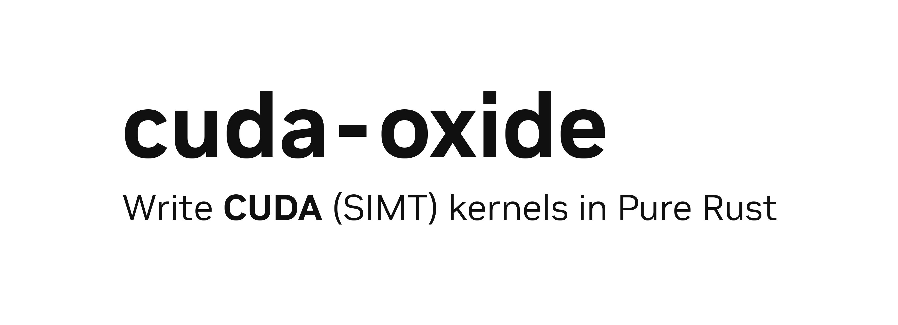

# The cuda-oxide Book



**cuda-oxide** 是一个 Rust 到 CUDA 的编译器，让你能用（相对）安全、符合习惯的 Rust 编写（SIMT）GPU kernel。它把标准 Rust 代码直接编译成 PTX —— 没有 DSL，没有外语绑定，就是 Rust。

> **注意**：本书假定你熟悉 Rust 编程语言，包括所有权、trait 和泛型。后面关于异步 GPU 编程的章节还假定你了解 `async`/`.await` 以及 tokio 之类的运行时。
>
> 需要复习的话，见 [The Rust Programming Language](https://doc.rust-lang.org/book/)、[Rust by Example](https://doc.rust-lang.org/rust-by-example/) 或 [Async Book](https://rust-lang.github.io/async-book/)。

---

## 项目状态

v0.1.0 是一个早期 alpha 版本：**请预期存在 bug、未完成的功能以及 API 破坏**，我们正在努力改进它。希望你能试用一下，并通过分享你的使用体验来帮助塑造它的方向。

---

## 🚀 快速开始

```rust
use cuda_core::{CudaContext, DeviceBuffer, LaunchConfig1D};
use cuda_device::{DisjointSlice, kernel, launch_bounds, launch_contract, thread};
use cuda_host::cuda_module;

#[cuda_module]
mod kernels {
    use super::*;

    #[kernel]
    #[launch_bounds(256)]
    #[launch_contract(domain = 1, block = (256, 1, 1))]
    pub fn vecadd(a: &[f32], b: &[f32], mut c: DisjointSlice<f32>) {
        let idx = thread::index_1d();
        let i = idx.get();
        if let Some(c_elem) = c.get_mut(idx) {
            *c_elem = a[i] + b[i];
        }
    }
}

fn main() {
    let ctx = CudaContext::new(0).unwrap();
    let stream = ctx.default_stream();

    // SAFETY: this package owns the embedded device bundle for `kernels`.
    let module = unsafe { kernels::load(&ctx).unwrap() };

    let a = DeviceBuffer::from_host(&stream, &[1.0f32; 1024]).unwrap();
    let b = DeviceBuffer::from_host(&stream, &[2.0f32; 1024]).unwrap();
    let mut c = DeviceBuffer::<f32>::zeroed(&stream, 1024).unwrap();

    let prepared = module
        .prepare_vecadd(LaunchConfig1D::new(1024u32.div_ceil(256), 256, 0))
        .unwrap();
    module
        .vecadd(&stream, &prepared, &a, &b, &mut c)
        .unwrap();

    let result = c.to_host_vec(&stream).unwrap();
    assert_eq!(result[0], 3.0);
}
```

装好[前置依赖](getting-started/installation.md)之后，用 `cargo oxide run vecadd` 构建并运行。这一套 launch-contract 模式正是 `cargo oxide new` 所生成的脚手架；见[编写你的第一个 kernel](getting-started/hello-gpu.md)。

> **注意**：`#[cuda_module]` 会把生成的设备产物嵌入宿主二进制，并生成一个带类型的 `kernels::load` 函数，以及每个 kernel 对应的一个启动方法。kernel 的参数会被类型检查。声明了 `#[launch_contract]` 之后，就能启用[启动 kernel](gpu-programming/launching-kernels.md)中描述的安全 `PreparedLaunch` 路径（`prepare_*` + 带类型的启动）。当契约没有覆盖你的一次性几何配置时，仍然可以使用裸 `LaunchConfig` 调用作为 unsafe 的逃生通道。当你需要加载特定的 sidecar 产物或构建自定义启动代码时，更底层的 `load_kernel_module` 与 unsafe 的 `cuda_launch!` API 也依然可用。

---

## 为什么选 cuda-oxide？

**🦀 GPU 上的 Rust**
用 Rust 的类型系统和所有权模型编写 GPU kernel。安全性是一等目标，但 GPU 有自己的微妙之处 —— 请阅读[安全模型](gpu-safety/the-safety-model.md)。

**💎 一个 SIMT 编译器**
不是 DSL。而是一个自定义的 rustc codegen 后端，把纯 Rust 编译成 PTX。

**⚡ 异步执行**
把 GPU 工作组合成惰性的 `DeviceOperation` 图。在流池之间调度。用 `.await` 等待结果。

---

## 目录

### 入门

1. [安装](getting-started/installation.md)
2. [Hello GPU](getting-started/hello-gpu.md)

### 编写 GPU 程序

1. [执行模型](gpu-programming/execution-model.md)
2. [kernel 与设备函数](gpu-programming/kernels-and-device-functions.md)
3. [内存与数据搬运](gpu-programming/memory-and-data-movement.md)
4. [虚拟内存与对等访问](gpu-programming/virtual-memory-and-peer-access.md)
5. [启动 kernel](gpu-programming/launching-kernels.md)
6. [kernel 家族](gpu-programming/kernel-families.md)
7. [闭包与泛型](gpu-programming/closures-and-generics.md)
8. [错误处理与调试](gpu-programming/error-handling-and-debugging.md)

### GPU 上的安全性

1. [安全模型](gpu-safety/the-safety-model.md)
2. [边界检查](gpu-safety/bounds-checks.md)

### 异步 GPU 编程

1. [DeviceOperation 模型](async-programming/the-device-operation-model.md)
2. [组合子与组合](async-programming/combinators-and-composition.md)
3. [调度与流](async-programming/scheduling-and-streams.md)
4. [并发执行](async-programming/concurrent-execution.md)
5. [重叠传输与计算](async-programming/overlapping-transfers-and-compute.md)

### 构建一个真正的应用程序

1. [异步 MLP 流水线](projects/async-mlp-pipeline.md)

### 进阶 GPU 特性

1. [共享内存与同步](advanced/shared-memory-and-synchronization.md)
2. [warp 级编程](advanced/warp-level-programming.md)
3. [张量内存加速器](advanced/tensor-memory-accelerator.md)
4. [矩阵乘法加速器](advanced/matrix-multiply-accelerators.md)
5. [集群编程](advanced/cluster-programming.md)

### 深入编译器

1. [架构概述](compiler/architecture-overview.md)
2. [pliron](compiler/pliron.md)
3. [rustc-public](compiler/rustc-public.md)
4. [rustc-codegen-cuda](compiler/rustc-codegen-cuda.md)
5. [MIR 导入器](compiler/mir-importer.md)
6. [编译器优化](compiler/compiler-optimizations.md)
7. [MLIR 方言](compiler/mlir-dialects.md)
8. [下降流水线](compiler/lowering-pipeline.md)
9. [添加新的内联函数](compiler/adding-new-intrinsics.md)
10. [生成式内联函数目录](compiler/catalog-generated-intrinsics.md)
11. [模糊测试与差异测试](compiler/fuzzing-and-differential-testing.md)

### 附录

1. [从源码构建](appendix/building-from-source.md)
2. [API 快速参考](appendix/api-quick-reference.md)
3. [支持的特性](appendix/supported-features.md)
4. [CUDA C++ 对比](appendix/cuda-cpp-comparison.md)
5. [生态系统](appendix/ecosystem.md)
6. [术语表](appendix/glossary.md)
