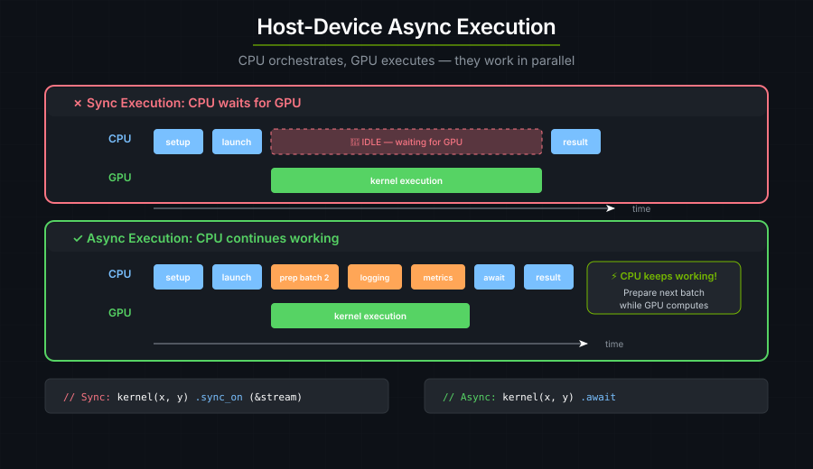
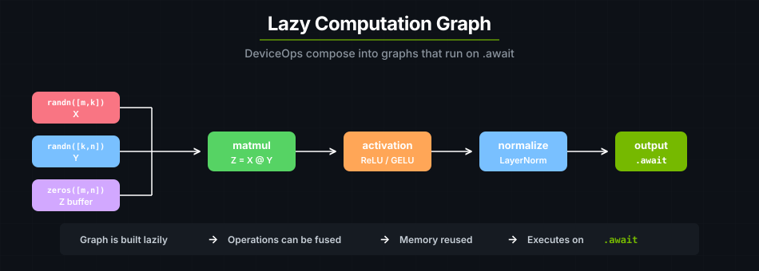

# 设备操作

`DeviceOp` 在宿主侧描述 GPU 工作。tensor 构造函数、kernel 启动器和内存拷贝都会返回这种操作，你可以用 `.then()`、`.shared()`、`zip!` 和 `unzip` 把它们组合起来。用 `.sync()` 或 `.await` 运行最终得到的图，或者用 `.graph()` 把它捕获下来以便重放。

---

## DeviceOp 模型

你的 Rust 代码运行在 CPU（**宿主**）上，并调度 GPU（**设备**）上的工作。`DeviceOp` 就是你表达这种调度的方式：宿主构造并组合操作，当运行时要求设备执行时，设备就并行执行它们。



`DeviceOp` 是对 GPU 工作的惰性描述 —— 在你明确要求之前，什么都不会运行：

```rust
let z = api::zeros(&[64, 64]);  // DeviceOp<Output=Tensor<f32>>。还没有 GPU 工作。
let result = z.await?;          // 现在才执行。
```

每个 `DeviceOp` 都实现了 `IntoFuture`，所以每个操作都可以被 await：

```rust
pub trait DeviceOp: Send + Sized + IntoFuture
where Self::Output: Send { /* ... */ }
```

当你 `.await` 时，转换路径是 `into_future()` → `schedule()` → `DeviceFuture` → 第一次 poll → `execute()` → GPU 工作。完整顺序如下：

```text
Your Code             Tokio Runtime            cuTile Rust            GPU
    |                       |                       |                   |
.await  ---------------> into_future()            |                   |
    |                   (immediate)               |                   |
    |                       |                       |                   |
    |                       | -------------------> schedule()          |
    |                       |                    DevicePolicy         |
    |                       |                       |                   |
    |                       | <------------------- DeviceFuture        |
    |                       |                       |                   |
    |                 first poll() ---------------> execute()           |
    |                       |                       |                   |
    |                       |                       | ----------------> GPU WORK!
    |                       |                       |                   |
    |              subsequent polls <-- - - - - -|- - - - - - -->| checking...
    |                       |                       |                   |
    |                       |                       |                   |
Returns <-------------- Ready! <------------------|------------------+
```

> **要点**：GPU 工作从 `execute()` 开始，而**不是**从 `.await` 开始！`execute()` 是在*第一次 poll* 时触发的。`.await` 本身很廉价；`DeviceFuture` 在 `into_future()` 时就立刻建好了，真正提交给 GPU 发生在运行时 poll 的时候。

在每个 kernel 之后都调用 `.sync()`，会在 CPU 等待完成、再提交下一次启动的过程中留下空隙：

```text
CPU:  [launch] [wait......] [launch] [wait......] [launch] [wait......]
GPU:           [kernel████]          [kernel████]          [kernel████]
                          ↑                      ↑
                     idle gap                idle gap
```

当 kernel 只需要几微秒时，这些空隙可能成为推理耗时的主要部分。一个 22 层的 transformer，每层 6 个 kernel，每个 token 就有 132 个 sync 空隙。把操作组合起来、只同步一次即可消除这些空隙：

```rust
let result = rms_norm(out1, hidden.clone(), weight.clone(), eps)
    .first()
    .unpartition()
    .shared();

let q = matvec(out2, result.clone(), wq.clone())
    .first()
    .unpartition()
    .shared();

let output = q.sync_on(&stream)?;
```

```text
CPU:  [build graph...] [launch all]  [wait]
GPU:                    [norm████][mv████][add████]
                         no gaps — work is pipelined
```

cuTile 提供三种运行已构造 `DeviceOp` 的执行模式：

**同步** —— `.sync()` 和 `.sync_on(&stream)` 会阻塞线程直到结果就绪。最适合脚本、调试和学习。

```rust
kernel(args...).sync()?;            // 默认设备，默认流策略
kernel(args...).sync_on(&stream)?;  // 显式指定流
```

**异步** —— 在异步上下文中，`.await` 是非阻塞的。惰性组合可实现重叠执行。

```rust
let result = kernel(args...).await?;

let result = step1(args)
    .then(|out| step2(out))
    .then(|out| step3(out))
    .await?;
```

**CUDA 图** —— `.graph()` / `.graph_on(stream.clone())` 把一个组合好的 `DeviceOp` 捕获成可复用的 `CudaGraph<T>`。最适合那些会反复运行同一条流水线的热点路径。捕获/重放模式见下面的 [CUDA 图](#cuda-graphs)。

---

## 组合 DeviceOp

`DeviceOp` 通过四种组合子构成计算图：`.then()`、`zip!`、`unzip` 和 `.shared()`。图是惰性构造、整体求值的，这既保留了顺序，又通过共享避免重复工作，还让相互独立的工作可以重叠。



**`.then()`** 按顺序串联操作 —— 一个的输出喂给下一个。被串联的操作共享同一条流，因此顺序是严格的。

```rust
let result = matmul(z, x, y)
    .then(|(z, _x, _y)| activation(z))
    .then(|(z,)| normalize(z));

let output = result.await?;
```

**`zip!`** 把多个相互独立的 `DeviceOp` 合并成一个元组取值的操作（汇聚）。**`unzip`** 是它的逆操作：把一个产生元组的操作拆成独立的分支（扇出）。

```text
  zip! (fan-in)                     unzip (fan-out)

    op_a ─┐                           ┌── branch_a
           ├─ zip! ─── (a, b)    (a, b) ── unzip ──┤
    op_b ─┘                           └── branch_b
```

当你 `unzip` 时，无论下游有多少个分支消费它，上游操作都**最多只运行一次**。内部有一个共享门闸，在第一个来 poll 的分支上执行它，并把结果缓存给其余分支：

```rust
let (z, x, y) = zip!(z_op, x_op, y_op)
    .then(my_kernel)
    .unzip();

let output = z.unpartition().to_host_vec().sync()?;  // kernel 只运行一次
```

**`.shared()`** 可以把任意 `DeviceOp` 转换成一个可 `Clone` 的 `SharedDeviceOp<T>`。所有克隆共享同一个结果的 `Arc`；底层操作只执行一次。当许多下游 kernel 都需要同一个输入时使用它。

```rust
let x = api::ones(&[32, 32]).shared();

let a = kernel_a(x.clone()).sync()?;  // x 在这里执行（仅一次）
let b = kernel_b(x.clone()).sync()?;  // 使用缓存的 Arc
let c = kernel_c(x).sync()?;          // 同样使用缓存的结果
```

菱形（先扇出再汇聚）和广播是两种常见的组合模式：

```text
Diamond (fan-out then fan-in):

  op_a ─┐              ┌─ transform_a ─┐
         ├── zip! ── unzip              ├── zip! ── result
  op_b ─┘              └─ transform_b ─┘

Broadcast (.shared() into parallel kernels):

                     ┌── kernel_a ── result_a
  x.shared() ──────┤
                     ├── kernel_b ── result_b
                     └── kernel_c ── result_c
```

"只执行一次"的机制假设的是单线程的顺序轮询，这也是 `cuda-async` 的正常模式。从不同的操作系统线程分别 poll 一个 `unzip` 的两侧是不安全的（该门闸使用的是非原子的 check-then-act）。设备上下文是线程局部的，所以常见的出错写法会更早失败；即便如此，也请避免那种跨线程扇出的设计。

---

## 流与调度

CUDA 流是 GPU 工作的有序队列。同一条流上的操作按提交顺序执行；不同流上的操作可能重叠。

默认情况下，cuTile 用轮转策略把操作分配到由 4 条流组成的池上，因此相互独立的操作会落到不同的流上并可以重叠：

```text
                         ┌─────────────────────────────────────────┐
  Your Code              │          GPU (4-stream pool)            │
 ─────────────           │                                         │
                         │  Stream 0: ████████                     │
  op_a.await  ──────────►│  Stream 1:    ████████                  │
  op_b.await  ──────────►│  Stream 2:       ████████               │
  op_c.await  ──────────►│  Stream 3:          ████████            │
  op_d.await  ──────────►│  Stream 0:             ████████         │
  op_e.await  ──────────►│                                         │
                         └─────────────────────────────────────────┘
```

有四种情况会导致操作串行化：回绕到同一条流上（默认池里每第 4 个操作）；用 `.then()` 串联（同一条流）；通过 `.sync_on(&stream)` 固定到某一条流；或者按顺序 await（宿主在两个 await 之间阻塞，所以下一个操作要等上一个完成才会被提交）。

当操作落在不同的流上，**并且**在宿主等待其中任何一个之前就都已提交时，它们才会重叠 —— 通常是通过 `zip!`、`tokio::join!`，或者由异步运行时并发轮询的直接惰性组合。

数据依赖由你自己负责。轮转策略并不跟踪它们。如果操作 B 要读取 A 的输出，你必须强制排序：

```rust
// 用 .then() 串联 —— 同一条流，自动保证顺序
let result = create_tensor().then(|t| process(t)).await?;

// 顺序 await —— 由宿主保证顺序
let tensor = create_tensor().await?;
let result = process(tensor).await?;

// 固定到同一条流 —— 由 CUDA 保证顺序
let stream = device.new_stream()?;
let tensor = create_tensor().sync_on(&stream)?;
let result = process(tensor).sync_on(&stream)?;
```

不安全的写法 —— 把 A 的输出喂给 B，却把它们当作相互独立的 future 提交、从而落到不同的流上 —— 可能读到过期或不完整的数据：

```rust
// ⚠️ 危险：如果 op_a 和 op_b 落到不同的流上，op_b 可能在 op_a 完成前就开始！
let future_a = op_a.into_future();                    // 提交到 Stream 0
let future_b = op_b_reads_a_output.into_future();     // 提交到 Stream 1
let (a, b) = tokio::join!(future_a, future_b);
```

### 执行方式对比

| 方式 | 流的分配 | 顺序保证 | 最适合 |
|-----------------------|-----------------------------|-----------------------------|------------------------------------|
| `.then()` | 共享父操作的流 | 严格：同一条流 | 有依赖关系的操作 |
| `.sync_on(&stream)` | 你显式指定的流 | 同一条流时严格 | 调试、确定性流水线 |
| `.sync()` | 由策略挑选（轮转） | 调用之间无保证 | 快速脚本 |
| `.await` | 由策略挑选（轮转） | await 之间无保证 | 异步代码 |
| `zip!` + `.then()` | 整个图用单条流 | 图内严格 | kernel 启动模式 |

> **提示**：顺序的 `.await` 调用从宿主视角看*似乎*是有序的（每个都要等前一个开始之后才开始），但每个 `.await` 的 GPU 工作实际运行在策略分配给它的那条流上。对于你确实希望重叠的、真正独立的操作，请使用 `zip!` 或 `tokio::join!`。

---

<a id="cuda-graphs"></a>
## CUDA 图

CUDA 图把一个组合好的 `DeviceOp` 捕获成预先编译好的可执行体。启动这个可执行体会用一次驱动调用提交整张图 —— 没有逐操作的派发开销 —— 并且同一张图可以重放很多次。这对逐 token 的推理循环之类热点路径很重要，那里单个 kernel 只跑几微秒，启动开销反而占主导。

有两种捕获 API，取决于你想怎样表达这条流水线：

```rust
// 组合子形式 —— 捕获一条 DeviceOp 链产生的东西。
let graph = pipeline(input).graph_on(stream.clone())?;

// 作用域形式 —— 当步骤之间需要 &mut 时，采用命令式捕获。
let graph = CudaGraph::scope(&stream, |s| {
    s.record(kernel_a((&mut out_a).partition([32]), x.clone()))?;
    s.record(kernel_b((&mut out_b).partition([32]), x))?;
    Ok(())
})?;
```

捕获之后，用 `graph.launch()` 重放，它返回一个 `DeviceOp`，你可以对它 sync、await，或者继续组合。对于带参数的重放 —— 也就是常见的"每步换一个输入"场景 —— `graph.update(new_op)` 会就地改写图的输入，而不重新实例化：

```rust
for token in tokens {
    graph.update(api::memcpy(&mut model.input, &token))?;
    graph.launch().sync_on(&stream)?;  // 无逐操作派发
}
```

只有实现了 `GraphNode` trait 的操作才能被记录：kernel 启动和 `memcpy`。分配类操作（`api::zeros`、`api::ones` 等）不是图安全的 —— 请在捕获闭包之外分配，再把 tensor 传进去。在 `scope` 函数体内，对任何 `DeviceOp` 调用 `.sync_on(...)`、`.sync()` 或 `.await` 都会返回 `DeviceError`：执行锁会拒绝在捕获期间嵌套执行。

完整演练见[教程 10：CUDA 图](../tutorials/10-cuda-graphs.md)，完整 API 参考见[宿主 API：CUDA 图集成](../reference/host-api.md#cuda-graph-integration)。

---

<a id="practical-patterns"></a>
## 传递 tensor 与读取结果

kernel 的 `&Tensor` 参数接受三种输入形式，`&mut Tensor` 参数接受两种分区形式。你放进什么类型，就拿回什么类型。

只读输入（`&Tensor`）：

```rust
// 拥有所有权 —— 一次性使用，没有 Arc 开销。
let x: Tensor<f32> = ones(&[32, 32]).sync_on(&stream)?;
let (_, x) = kernel(out, x).sync_on(&stream)?;

// 共享 —— 在多个 kernel 里使用同一个 tensor。
let x: Arc<Tensor<f32>> = ones(&[32, 32]).sync_on(&stream)?.into();
let z1 = kernel1(out1, x.clone()).sync_on(&stream)?;
let z2 = kernel2(out2, x.clone()).sync_on(&stream)?;

// 借用 —— 不分配，由借用检查器约束生命周期。
let x: Tensor<f32> = ones(&[32, 32]).sync_on(&stream)?;
let _ = kernel(out, &x).sync_on(&stream)?;
```

可变输出（`&mut Tensor`）：

```rust
// 拥有所有权的分区 —— 必须 unpartition() 才能拿回 tensor。
let z = zeros(&[32, 32]).sync_on(&stream)?.partition([4, 4]);
let (z, ..) = kernel(z, &x).sync_on(&stream)?;
let tensor = z.unpartition();

// 借用形式的分区 —— 就地写入，不需要 unpartition()。
let mut z = zeros(&[32, 32]).sync_on(&stream)?;
let _ = kernel((&mut z).partition([4, 4]), &x).sync_on(&stream)?;
```

借用的输入和借用的分区都不是 `'static` 的，所以 `tokio::spawn` 会在编译期拒绝它们 —— 想要放进 spawn 出来的任务里，请使用 `Arc` 和拥有所有权的分区。完整的模型见[宿主 API：所有权模型](../reference/host-api.md#ownership-model)。

宿主侧回读本身也是一个 `DeviceOp`。构造它是惰性的；在使用宿主数据之前，必须 sync 或 await 这个回读操作：

```rust
// 坏：构造了一个宿主拷贝操作，但从未执行它。
let z = kernel(x, y).first().sync_on(&stream)?;
let data_op = z.to_host_vec();

// 好：在读取 Vec 之前先执行这次拷贝。
let z = kernel(x, y).first().sync_on(&stream)?;
let data = z.to_host_vec().sync_on(&stream)?;
```

---

## 运行时说明

**执行锁。** cuTile 强制"每个线程同一时刻只有一个 `DeviceOp` 在执行"。在 `.then(...)` 闭包或 `CudaGraph::scope` 函数体内嵌套 `.sync_on(...)`、`.sync()` 或 `.await` 会返回 `DeviceError`。这把锁存在的目的是防止跨流数据竞争：在 `.then()` 处理器内部嵌套一个 `sync_on(&other_stream)` 会把工作提交到第二条流上，却没有和第一条流建立顺序关系。遇到极少数确实合法的情形，可以使用 `unsafe fn then_unchecked`。

**默认设备。** 每个 `DeviceOp` 落在哪台设备上是线程局部的。`set_default_device(id)` 会为当前线程改变它 —— 这是"一个线程对应一块 GPU"的 worker 池的常见做法。如果想按操作路由而不改动线程默认值，用 `global_policy(id)` 或 `with_device_policy(id, |policy| ...)` 拿到一个策略，再调用 `op.schedule(&policy)?`。

来自其他框架的句柄（cudarc、Candle、手写的 FFI）可以通过 `Device::borrow_raw` / `Stream::borrow_raw` 包装成 cuTile 的 `Device` 或 `Stream`，而无需转移所有权 —— 参见[互操作](interoperability.md)。

---

接下来阅读[性能](performance.md)了解优化技巧。完整的 `DeviceOp` API 见[宿主 API](../reference/host-api.md)。
