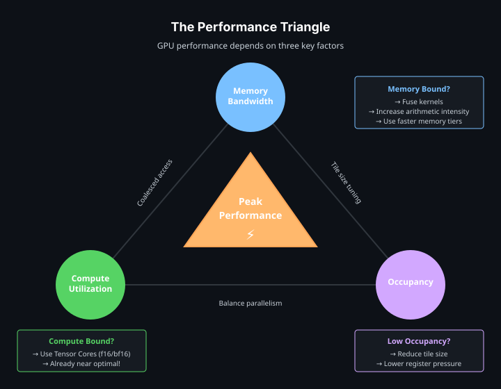

# 性能

GPU 性能通常受限于内存带宽、计算吞吐或占用率这三者之一。占用率指的是同一时刻能驻留在 GPU 上的工作量；占用率太低会让硬件处于闲置状态。tile 形状与访存模式会同时影响这三个限制。



## tile 形状

tile 的大小决定了每个 tile block 要做多少工作。更大的 tile 能提升数据复用、降低摊到每个元素上的启动开销，但也会消耗更多寄存器，可能拉低占用率。

从 2 的幂，或者与计算操作对齐的维度开始：

| 工作负载 | 起点建议 |
|---|---|
| 一维逐元素 | `[128]`、`[256]`、`[512]` |
| 二维逐元素 | `[16, 16]`、`[32, 32]`、`[64, 16]` |
| GEMM | 与 Tensor Core MMA 维度兼容的 tile 形状 |
| 归约 | 不会造成过大寄存器压力的轴尺寸 |

从这里开始用性能分析来调，或者用[自动调优](autotuning.md)自动搜索候选值。过小的 tile 会把太多时间花在开销上。过大的 tile 可能导致寄存器溢出，或者减少驻留的 tile block 数量。

## 访存流量与融合

把中间结果留在 tile 里，避免反复访问全局内存：

```rust
#[cutile::entry()]
fn fused<const BM: i32, const BN: i32>(
    z: &mut Tensor<f32, { [BM, BN] }>,
    x: &Tensor<f32, { [-1, -1] }>,
) {
    let tile = x.load_like(z);
    let centered = tile - reduce_max(tile, 1i32)
        .reshape(shape![BM, 1])
        .broadcast(shape![BM, BN]);
    let exp_x = exp(centered);
    let sum = reduce_sum(exp_x, 1i32)
        .reshape(shape![BM, 1])
        .broadcast(shape![BM, BN]);
    z.store(true_div(exp_x, sum));
}
```

kernel 融合就是把这种模式推广到整条流水线上。三个未融合的 kernel 往往会反复读写中间 tensor 好几次。而一个融合后的 kernel 可以把这些中间结果留在寄存器里。

## 算术强度

算术强度是每传输一字节所对应的计算量。强度越高，kernel 越可能是**计算受限**而不是**带宽受限**。

| 操作 | 典型强度 | 常见瓶颈 |
|---|---|---|
| 向量加法 | 低 | 内存带宽 |
| 逐元素激活 | 低到中 | 内存带宽 |
| 矩阵-向量乘法 | 中 | 内存带宽或计算 |
| 矩阵-矩阵乘法 | 高 | Tensor Core 吞吐 |
| 融合注意力 | 高 | 取决于形状，可能是计算、内存或占用率 |

提升算术强度的办法：复用已加载的 tile、融合相邻操作、避免不必要的宿主回读和中间 tensor。

## Tensor Core

矩阵乘法路径请使用 `mma` 和 `mmaf_scaled`。编译器会把受支持的 dtype 与形状组合下降到 Tensor Core 指令：

```rust
let mut acc = constant(0.0f32, shape![BM, BN]);
for k_tile in 0i32..k_tiles {
    let tile_x = part_x.load([pid_m, k_tile]);
    let tile_y = part_y.load([k_tile, pid_n]);
    acc = mma(tile_x, tile_y, acc);
}
z.store(acc);
```

对于 NVFP4、MXFP8 这类块缩放（block-scaled）格式，`mmaf_scaled` 同时消费低精度输入 tile 和逐块的缩放 tile。参见[教程 11：使用 NVFP4/MXFP8 做推理](../tutorials/11-nvfp4-inference.md)。

## 边界与映射分区

对于持久化或映射式遍历，首选安全且高效的路径是**映射输出分区**。输出分区产生有界且互不相交的索引；输入分区则用普通数组索引，编译器会从产生每个索引的循环与映射分量中推断出边界：

```rust
fn gemm_persistent<
    T: ElementType,
    const BM: i32,
    const BN: i32,
    const BK: i32,
    const MAP_SHAPE: [i32; 2],
>(
    mut z: MappedPartitionMut<T, { [BM, BN] }, MAP_SHAPE>,
    x: &Tensor<T, { [-1, -1] }>,
    y: &Tensor<T, { [-1, -1] }>,
) {
    let part_x = x.partition(shape![BM, BK]);
    let part_y = y.partition(shape![BK, BN]);

    for out_idx in z.iter_indices() {
        let (bid_m, bid_n) = out_idx.components();
        let mut acc: Tile<T, { [BM, BN] }> = constant(T::ZERO, shape![BM, BN]);
        for k_tile in 0i32..num_tiles(&part_x, 1) {
            acc = mma(part_x.load([bid_m, k_tile]), part_y.load([k_tile, bid_n]), acc);
        }
        z.store(acc, out_idx);
    }
}
```

`with_bounds(...)`、`Dim::new(...)` 和 `coord(...)` 自 0.3.0 起已废弃；剩余检查被放在哪里，见[边界检查的放置](bounds-check-placement.md)。

当程序员想要显式放弃运行时边界检查时，`unchecked_accesses = true` 仍然可用：

```rust
#[cutile::entry(unchecked_accesses = true)]
unsafe fn fast_kernel<const S: [i32; 2]>(...) {
    // 调用者必须保证每一次访问都在边界内。
}
```

只有在周围代码能够保证启动形状与 tensor 尺寸时，才使用这条 unsafe 路径。

## 编译期提示

优化提示用来引导针对某个目标架构的代码生成：

```rust
#[cutile::entry(
    optimization_hints = (
        sm_120 = (
            num_cta_in_cga = 2,
            occupancy = 2,
            max_divisibility = 16,
            num_worker_warps_per_cta = 4, // 字节码 13.3+；合法取值：1、2、4、8、16、32。
        ),
        sm_90 = (num_cta_in_cga = 1),
    )
)]
fn kernel<const S: [i32; 2]>(...) { ... }
```

运行时的 `CompileOptions` 可以覆盖入口级提示，这让它们成为一个可调维度：把候选值放进一个 `Config`，在调优器的 setup 闭包里应用它们（见[自动调优](autotuning.md)）。`occupancy`、`num_cta_in_cga` 和 `num_worker_warps_per_cta` 是架构相关的调度提示；`max_divisibility` 控制编译器所使用的整除性假设。`num_worker_warps_per_cta` 接受闭区间 `[1, 32]` 内 2 的幂，并要求字节码版本 13.3 或更高。由于编译选项是 JIT 缓存键的一部分，请只对一小组候选值做基准测试，而不是生成一大堆一次性的特化。

## 常见坑

- tile 形状太小：开销压过了有效工作。
- tile 形状太大：寄存器压力拉低占用率，或者造成溢出。
- 用错 dtype：在 `f16`、`bf16`、FP8 或块缩放格式可接受时却用 `f32`，会让 Tensor Core 吞吐闲置。
- 过度同步：每个操作后都 `.sync()` 会在 CPU 与 GPU 之间制造空隙。
- 未融合的流水线：中间 tensor 带来额外的全局内存流量。
- 跨越式访存模式：tile 加载本身合并得不错，但算法层面的跨步仍可能降低有效带宽。

每次改动前后都要做性能分析。[调试与性能分析](debugging-and-profiling.md)介绍了 Nsight Compute 和 Nsight Systems。

## 测量 kernel

`cutile::bench` 提供基于设备事件的计时，用于测量 kernel 以及做 A/B 对比：

```rust
use cutile::bench::{do_bench, do_bench_paired, BenchOptions};

let r = do_bench(&stream, &BenchOptions::default(), |s| {
    my_kernel(z.partition([128]), x.clone(), y.clone()).sync_on(s).map(|_| ()).map_err(Into::into)
})?;
println!("median {:.3} ms over {} reps", r.median_ms(), r.reps());
```

计时使用 CUDA 事件（设备时间线，而非宿主时钟），预热会吸收首次启动的 JIT 开销，每轮之间会清空 L2 缓存，结果报告的是中位数和分位数。比较两种配置时请使用 `do_bench_paired`。它会逐轮交替两组配置，因此时钟漂移和热漂移不会伪装成两者之间的差异。

## 自动调优（实验性）

`cutile::tune` 会测量候选配置，并保存试验记录与胜出配置。它需要启用 `experimental-tune` Cargo feature；API 见[自动调优](autotuning.md)。下面这个例子为 RMS 归一化 kernel 搜索块大小：

```sh
cargo run -p cutile-examples --example autotune --features experimental-tune
```

---

接下来阅读[互操作](interoperability.md)。
