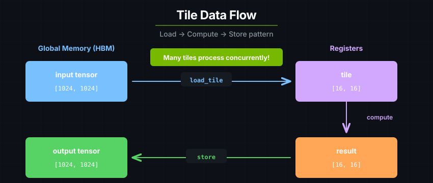

# 张量与 tile

cuTile Rust 的 kernel 通过把数据从 tensor 搬进 tile、在 tile 上计算、再把结果存回 tensor 来工作。

| 属性 | Tensor | Tile |
|---|---|---|
| 位置 | 全局内存（HBM） | 寄存器 |
| 可变性 | 可变或只读 | 不可变 |
| 形状 | 静态、动态或混合 | 静态 |
| 操作 | 加载与存储 | 算术、归约、矩阵乘法、形状操作 |
| 生命周期 | 跨 kernel 持续存在 | 仅存在于 kernel 内部 |
| 可取地址 | 是 | 否 |

```rust
#[cutile::entry()]
fn add<const S: [i32; 2]>(
    z: &mut Tensor<f32, S>,
    x: &Tensor<f32, { [-1, -1] }>,
    y: &Tensor<f32, { [-1, -1] }>,
) {
    let tile_x = x.load_like(z);
    let tile_y = y.load_like(z);
    z.store(tile_x + tile_y);
}
```

输出 tensor 是可变的，并且已经由宿主启动器切分好。输入 tensor 是只读的，可以加载成与输出分区形状匹配的 tile。

## Tensor、Partition 与 Tile

`Tensor<E, S>` 是全局内存在设备侧的视图。kernel 以参数形式接收 tensor。一个 tensor 可以被加载成 `Tile<E, S>`，也可以用来创建设备侧分区。

`Partition<E, S>` 是 tensor 的 tile 化视图。在宿主侧，对可变 tensor 做分区决定了要启动多少个 tile block，以及每个 block 写入哪一区域。在设备侧，对只读 tensor 做分区则让 kernel 能够按索引加载任意 tile。

`Tile<E, S>` 是驻留在寄存器中的不可变数组片段。tile 操作会生成新的 tile，而不是原地修改原值：

```rust
let tile = x.load_like(z);
let shifted = tile + 1.0f32;
let scaled = shifted * 2.0f32;
z.store(scaled);
```



```text
Tensor -> Partition -> Tile -> Compute -> Store
```

## 分区与网格

可变输出在启动前由宿主侧完成分区：

```rust
let mut z = api::zeros::<f32>(&[1024, 1024]).sync_on(&stream)?;
let _ = add((&mut z).partition([64, 64]), &x, &y).sync_on(&stream)?;
```

分区形状会成为 kernel 看到的静态形状。一个 `[1024, 1024]` 的 tensor 按 `[64, 64]` 分区，会生成一个 `(16, 16, 1)` 的逻辑 tile block 网格。每个 tile block 拿到一个可写的子 tensor。

只读输入不需要在宿主侧分区。在 kernel 内部，按算法需要的形状对它们分区：

```rust
let pid_m = program_id(0);
let part_x = x.partition(shape![BM, BK]);
let tile_x = part_x.load([pid_m, i]);
```

同一个只读 tensor 可以在一个 kernel 内以多种方式分区。这在矩阵乘法中很常见 —— 左侧和右侧输入使用不同的 tile 形状加载。

除非启动器显式指定，否则启动网格是从可变输出分区推断出来的：

```rust
kernel(z.partition([64, 64]), x).grid((16, 16, 1)).sync_on(&stream)?;
```

当一个 kernel 有多个可变输出时，它们推断出的网格必须一致。

## 静态形状与动态形状

静态维度是编译期常量。动态维度用 `-1` 表示，会在运行时根据 tensor 的实际形状解析出来。

```rust
#[cutile::entry()]
fn normalize<const S: [i32; 2]>(
    z: &mut Tensor<f32, S>,          // 来自分区的静态 tile 形状。
    x: &Tensor<f32, { [-1, -1] }>,   // 运行时的完整 tensor 形状。
) {
    let tile = x.load_like(z);
    z.store(tile);
}
```

静态形状让编译器能够检查操作并优化内存布局。动态维度则让同一个编译变体处理不同的完整 tensor 尺寸。常见做法是：输出用静态 tile 形状，只读输入用动态形状。

像 `const S: [i32; 2]` 和 `shape![BM, BK]` 这样的 const 泛型数组，把 tile 维度带进了类型系统。改变 const 泛型的取值可能会产生一个新的编译变体。

## 加载、计算、存储

`input.load_like(output)` 会加载与输出 tensor 的 tile 形状和 tile block 坐标相匹配的只读 tensor 区域。对于显式的设备侧分区，调用 `partition.load(index)`：

```rust
let part_x = x.partition(shape![BM, BK]);
let tile_x = part_x.load([pid_m, k_tile]);
```

可写 tensor 用来存储 tile 的结果：

```rust
let result = tile_x + tile_y;
z.store(result);
```

当 kernel 需要先读取输出的现有值再写入新值时，使用 `load_tile_mut`：

```rust
let acc = load_tile_mut(z);
z.store(acc + update);
```

<a id="operations-at-a-glance"></a>
## kernel 操作一览

| 类别 | 示例 |
|---|---|
| 加载与存储 | `load_like`（`load_tile_like` 的方法形式）、`load_tile_mut`、`Partition::load`、`Tensor::store` |
| 算术 | `+`、`-`、`*`、`/`、`fma`、`true_div` |
| 数学 | `exp`、`log`、`sqrt`、`rsqrt`、`sin`、`cos`、`tanh` |
| 归约与扫描 | `reduce_max`、`reduce_sum`、`reduce_min`、`scan` |
| 矩阵乘法 | `mma`、`mmaf_scaled` |
| 形状操作 | `reshape`、`broadcast`、`transpose`、`shape!` |
| 比较 | `gt_tile`、`ge_tile`、`lt_tile`、`le_tile`、`eq_tile`、`select` |
| 创建与转换 | `constant`、`iota`、`convert_tile`、`pack`、`unpack` |

关于元素类型、操作签名以及更底层的访存操作，请参见 [DSL API](../reference/dsl-api.md)。

## 广播与归约

广播（broadcast）把一个标量或较小的 tile 扩展成较大的 tile 形状。它遵循 NumPy 风格的对齐规则：从右侧开始对齐维度；每个维度要么相等，要么为 1。

```rust
let bias: Tile<f32, { [1, BN] }> = ...;
let x: Tile<f32, { [BM, BN] }> = ...;
let y = x + bias.broadcast(shape![BM, BN]);
```

归约会沿某一个轴把数据折叠。把归约结果 reshape 回来之后再广播：

```rust
fn softmax<const BM: i32, const BN: i32>(
    x: Tile<f32, { [BM, BN] }>,
) -> Tile<f32, { [BM, BN] }> {
    let max = reduce_max(x, 1i32)
        .reshape(shape![BM, 1])
        .broadcast(shape![BM, BN]);
    let stable = x - max;

    let exp_x = exp(stable);
    let sum = reduce_sum(exp_x, 1i32)
        .reshape(shape![BM, 1])
        .broadcast(shape![BM, BN]);

    true_div(exp_x, sum)
}
```

<a id="numerically-stable-softmax"></a>
### 数值稳定的 softmax

实现 softmax 时，在做 `exp` 之前先减去每一行的最大值。这样可以避免大正数输入导致溢出，也是融合 softmax 与注意力 kernel 里通用的做法。

<a id="tiled-matrix-multiply"></a>
## 分块矩阵乘法

矩阵乘法通过在 K 维度上反复累加 `mma` 调用来完成。每个 tile block 负责一个输出 tile。每次循环迭代从左侧输入加载一个 `[BM, BK]` tile，从右侧输入加载一个 `[BK, BN]` tile。

```rust
fn tiled_gemm<
    E: ElementType,
    const BM: i32,
    const BN: i32,
    const BK: i32,
>(
    z: &mut Tensor<f32, { [BM, BN] }>,
    x: &Tensor<E, { [-1, -1] }>,
    y: &Tensor<E, { [-1, -1] }>,
) {
    let pid_m = program_id(0);
    let pid_n = program_id(1);
    let k_tiles = x.shape()[1] / BK;

    let part_x = x.partition(shape![BM, BK]);
    let part_y = y.partition(shape![BK, BN]);

    let mut acc = constant(0.0f32, shape![BM, BN]);
    for k_tile in 0i32..k_tiles {
        let tile_x = part_x.load([pid_m, k_tile]);
        let tile_y = part_y.load([k_tile, pid_n]);
        acc = mma(tile_x, tile_y, acc);
    }

    z.store(acc);
}
```

输出的累加器通常使用比输入更宽的类型。例如 FP16 或 FP8 输入往往累加到 FP32。

## 类型安全与泛型

编译器会在代码运行之前捕获形状不匹配、元素类型不匹配以及非法的矩阵乘法形状：

```rust
let a: Tile<f32, { [16, 8] }> = ...;
let b: Tile<f32, { [16, 32] }> = ...;
let c = mma(a, b, acc); // 错误：内维不匹配。
```

元素类型不同时，使用显式转换：

```rust
let y_float: Tile<f32, { [4, 4] }> = convert_tile(y_int);
let z = x_float + y_float;
```

泛型 kernel 可以同时支持多种形状和元素类型：

```rust
#[cutile::entry()]
fn scale<E: ElementType, const S: [i32; 2]>(
    z: &mut Tensor<E, S>,
    x: &Tensor<E, { [-1, -1] }>,
    alpha: E,
) {
    let tile = x.load_like(z);
    z.store(tile * alpha);
}
```

每一种具体的元素类型和 const 泛型取值都可能产生一个独立的编译变体，而动态 tensor 维度不会。

---

接下来阅读[JIT 编译](jit-compilation.md)。
