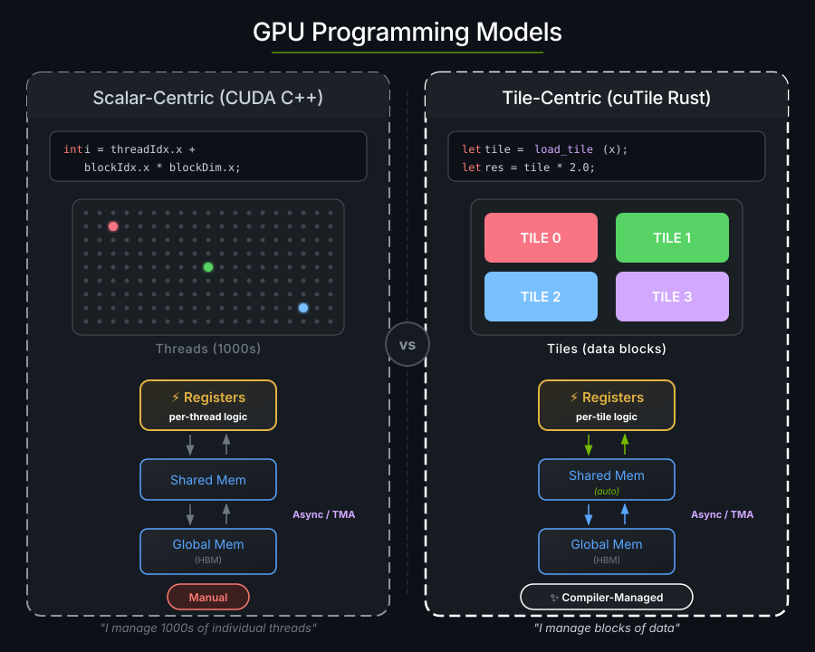
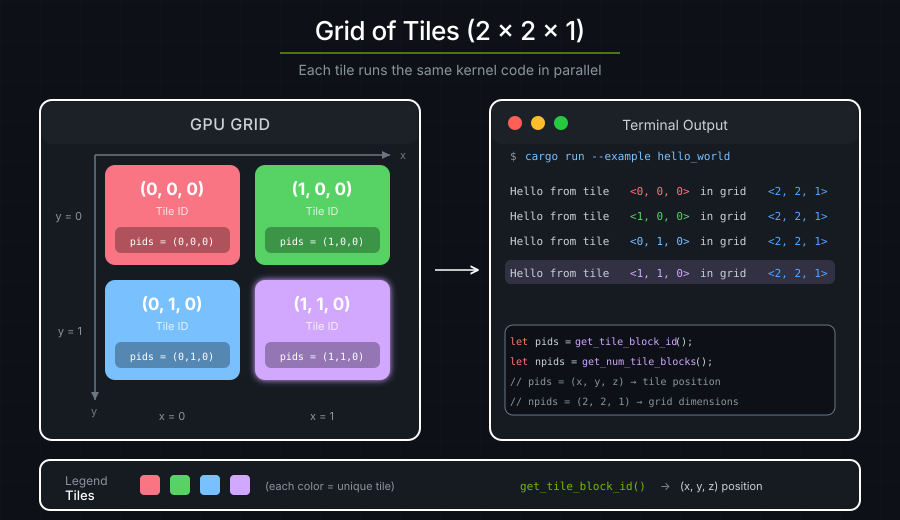
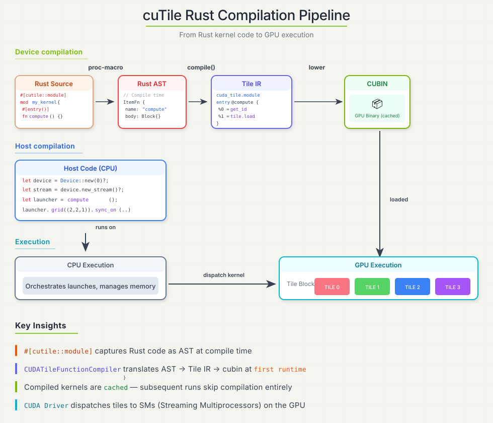

# 1. 你好，世界

启动一个 tile kernel，会把同一个函数并发地跑起 `N` 份拷贝。每一份拷贝就是一个 **tile 程序**（也叫 **tile block**）：一个作用于多维数据 tile 的单一逻辑线程。

> **注意**：tile 程序确实是并发运行的，但 CUDA 运行时未必会让它们全部同时运行。tile 程序之间的通信需要对 CUDA 运行时有细致的了解。



---

下面这个 kernel 从 GPU 打印 "hello"：

```rust
use cutile::error::Error;
use cutile::prelude::*;

#[cutile::module]
mod hello_world_module {
    use cutile::core::*;

    #[cutile::entry()]
    fn hello_world_kernel() {
        let pid0 = program_id(0);
        let pid1 = program_id(1);
        let pid2 = program_id(2);
        let n0 = num_programs(0);
        let n1 = num_programs(1);
        let n2 = num_programs(2);
        cuda_tile_print!(
            "Hello from program <{}, {}, {}> in a grid of <{}, {}, {}> programs!\n",
            pid0, pid1, pid2,
            n0, n1, n2
        );
    }
}

use hello_world_module::hello_world_kernel;

fn main() -> Result<(), Error> {
    let device = Device::new(0)?;
    let stream = device.new_stream()?;
    let launcher = hello_world_kernel();
    launcher.grid((2, 2, 1)).sync_on(&stream)?;
    Ok(())
}
```

**输出：**

```text
Hello from program <0, 0, 0> in a grid of <2, 2, 1> programs!
Hello from program <1, 0, 0> in a grid of <2, 2, 1> programs!
Hello from program <0, 1, 0> in a grid of <2, 2, 1> programs!
Hello from program <1, 1, 0> in a grid of <2, 2, 1> programs!
```

CUDA 运行时执行了四个 tile 程序，每一个都打印出自己的坐标。

---


## GPU 代码 vs. CPU 代码

`cutile-rs` 程序由两部分组成：运行在 GPU 上的代码，也就是**设备侧**；以及运行在 CPU 上的代码，也就是**宿主侧**。下面这段代码在宿主侧执行时，会被 JIT 编译到 GPU 上：

```rust
#[cutile::module]
mod hello_world_module {
    use cutile::core::*;

    #[cutile::entry()]
    fn hello_world_kernel() {
        // 这段代码运行在 GPU 上！
    }
}
```

- `#[cutile::module]` 把一个模块标记为包含 GPU 代码。
- `#[cutile::entry()]` 把一个函数标记为 kernel 入口点。

启动网格中的每一个坐标都会得到一个该 kernel 函数的实例。


下面这段宿主侧代码会启动设备侧代码：

```rust
fn main() -> Result<(), Error> {
    let device = Device::new(0)?;             // 连接 GPU
    let stream = device.new_stream()?;             // 创建一条工作队列
    let launcher = hello_world_kernel();   // 拿到 kernel 启动器
    launcher.grid((2, 2, 1)).sync_on(&stream)?; // 启动 2×2×1 = 4 个程序
    Ok(())
}
```

宿主侧代码负责准备 GPU、指定 kernel 的启动网格，并启动 kernel。

---

## 程序 ID

每个 tile 程序都会在三维启动网格的每个轴上被分配一个 ID，这与 Triton 的 `tl.program_id(axis)` / `tl.num_programs(axis)` 一致：

```rust
let pid0 = program_id(0);   // 本程序在网格轴 0 上的索引
let n0 = num_programs(0);   // 网格在轴 0 上的范围
```

对每个轴 `k` 都有 `0 <= program_id(k) < num_programs(k)`。元组形式的 `get_tile_block_id()` 和 `get_num_tile_blocks()` 会一次性返回全部三个坐标。



程序用它的坐标来决定要处理哪些数据。

---

## 底层发生了什么

1. **编译期：** `#[cutile::module]` 把你的 Rust 代码捕获成 AST。
2. **首次启动 kernel 时：** AST 被编译成 Tile IR 字节码 → cubin（GPU 二进制）。
3. **缓存：** 编译好的 kernel 会在进程余下的生命周期内缓存在内存中，因此之后启动同一个变体会跳过编译。跨进程的缓存（磁盘 cubin 缓存）是 opt-in 的；见[编译](../guide/jit-compilation.md)。
4. **启动：** 4 个 tile 程序被派发到 GPU 上。
5. **执行：** 四个 tile 程序并发运行，各自打印自己的坐标。



---

## 要点

| 概念 | 含义 |
|---------|---------------|
| **tile 程序并发运行** | 你启动 N 个 tile 程序，它们全部并发执行 |
| **tile 程序会被分配 ID** | 每个程序用它在各轴上的 ID 去处理不同的数据 |
| **宿主负责编排** | CPU 代码决定网格形状并启动工作 |
| **同一份代码，不同的数据** | kernel 只写一次，由许多 tile 程序执行 |

---

### 练习 1：改变网格大小

把网格改成 `(3, 3, 1)`。你会看到多少条消息？

```rust
launcher.grid((3, 3, 1)).sync_on(&stream)?;
```

> **答案**
>
> 你会看到 9 条消息（3 × 3 × 1 = 9 个 tile 程序）。

### 练习 2：使用 Z 维度

试试用 `(2, 2, 2)` 做一个三维网格。有什么变化？

> **答案**
>
> 你会看到 8 条消息。`z` 坐标现在会在 0 到 1 之间变化。

### 练习 3：计算程序总数

修改 kernel，让它同时打印出 tile 程序的总数。

> **答案**
>
> ```rust
> let total = n0 * n1 * n2;
> cuda_tile_print!(
>     "Program <{}, {}, {}> of {} total programs\n",
>     pid0, pid1, pid2, total
> );
> ```
