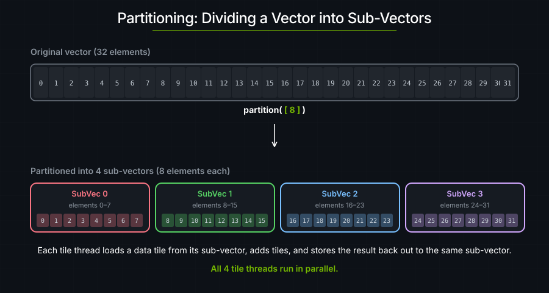
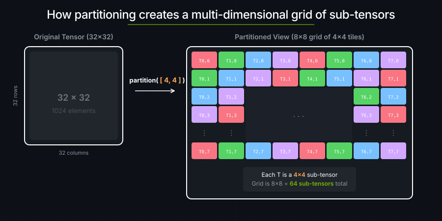
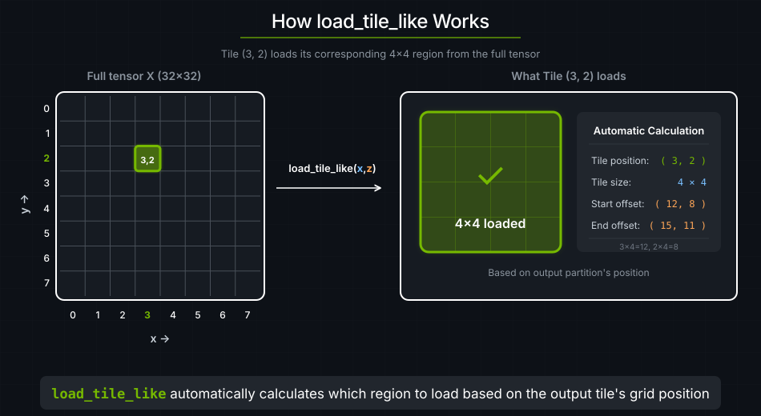

# 2. 向量加法

在 cutile 中，tile 程序并发运行，每个程序通过 `program_id(axis)` 知道自己的网格坐标。要让各个程序处理不同的数据，我们使用**分区（partitioning）** —— 把输出 tensor 切成若干子 tensor，让每个 tile 程序都只读写一块互不相同的区域。



---

```rust
use cuda_async::device_operation::DeviceOp;
use cuda_core::Device;
use std::sync::Arc;
use cutile;
use cutile::api::{ones, zeros};
use cutile::error::Error;
use cutile::tensor::{IntoPartition, Tensor, ToHostVec, Unpartition};
use cutile::tile_kernel::TileKernel;

#[cutile::module]
mod my_module {
    use cutile::core::*;

    #[cutile::entry()]
    fn add<const S: [i32; 2]>(
        z: &mut Tensor<f32, S>,          // 输出：具有静态形状 S（即 tile 形状）
        x: &Tensor<f32, {[-1, -1]}>,     // 输入：动态形状（完整 tensor）
        y: &Tensor<f32, {[-1, -1]}>      // 输入：动态形状（完整 tensor）
    ) {
        let tile_x = x.load_like(z);  // 按 z 的分区方式从 x 加载一个 tile
        let tile_y = y.load_like(z);  // 按 z 的分区方式从 y 加载一个 tile
        z.store(tile_x + tile_y);              // 相加并存储结果
    }
}

use my_module::add;

fn main() -> Result<(), Error> {
    let device = Device::new(0)?;
    let stream = device.new_stream()?;
    
    // 创建输入 tensor：两个填满 1.0 的 32×32 矩阵
    let x: Arc<Tensor<f32>> = ones(&[32, 32]).sync_on(&stream)?.into();
    let y: Arc<Tensor<f32>> = ones(&[32, 32]).sync_on(&stream)?.into();
    
    // 创建输出 tensor，并切分成 4×4 的子 tensor。
    let z = zeros(&[32, 32]).sync_on(&stream)?.partition([4, 4]);
    
    // 运行 kernel —— 每个子 tensor 对应一个 tile 线程，总共 64 个线程。
    let (z, _x, _y) = add(z, x, y).sync_on(&stream)?;
    
    // 验证结果。
    let z_host: Vec<f32> = z.unpartition().to_host_vec().sync_on(&stream)?;
    println!("z[0] = {} (expected 2.0)", z_host[0]);
    
    Ok(())
}
```

**输出：**

```text
z[0] = 2 (expected 2.0)
```

---

## 分区

分区把一个 tensor 切成一格一格的子区域，每一格由一个 tile block 处理。在 cuTile Rust 中，可变输出（`&mut Tensor`）与只读输入（`&Tensor`）的分区方式是不同的。

### 宿主侧分区（`&mut Tensor` 必需）

```rust
let z = zeros(&[32, 32]).sync_on(&stream)?.partition([4, 4]);
```

1. 创建一个初始化为全零的 32×32 输出 tensor。
2. 把它切成 4×4 的子 tensor。
3. 形成一个 8×8 的子 tensor 网格（每个维度上 32÷4 = 8）。



可变 tensor **必须**在 kernel 启动之前于宿主侧完成分区。这保证了每个 tile block 写入的都是一块互不相同的子区域 —— 从而满足 Rust 对可变内存的独占访问要求。宿主侧的 `Partition` 同时还决定了启动网格：cutile 会自动推断出 8×8 的分区意味着 64 个 tile block。

在宿主侧，生成的启动器要求每一个 `&mut Tensor` 参数都传入分区 —— 来自 `tensor.partition(...)` 的 `Partition<Tensor<T>>`，来自 `(&mut tensor).partition(...)` 的 `Partition<&mut Tensor<T>>`，或者一个映射分区 —— 所以你总是要在传入 tensor 之前调用 `.partition(...)`。

### 设备侧分区（`&Tensor` 可用）

只读输入在宿主侧以 `&Tensor<T>`、`Tensor<T>`、`Arc<Tensor<T>>` 或 `&TensorView<T>` 的形式传入 —— 不需要在宿主侧分区。多个 tile block 可以安全地读取同一块或相互重叠的区域，因此没有任何独占访问的约束需要强制。

取而代之的是，只读 tensor 可以在 **kernel 内部**用 `.partition(shape![M, N])` 进行分区：

```rust
// 设备侧：在 kernel 内部对只读 tensor 做分区。
let part_x = x.partition(shape![BM, BK]);
let tile = part_x.load([i, j]);
```

同一个 `&Tensor` 可以在一个 kernel 内使用不同的分区形状。例如 GEMM 就会对 `x` 和 `y` 使用不同的形状。

在本教程中，我们用 `x.load_like(z)` 而不是显式的设备侧分区。这个便捷函数会按与 `z` 相同的形状和坐标对 `x` 做分区，这正是逐元素操作的常见情形。后面的教程（从[矩阵乘法](./04-matrix-multiplication.md)开始）在输入需要不同访存模式时，会改用显式的设备侧分区。

<a id="putting-it-together"></a>
### 启动网格

调用 `add(z, x, y)` 会依据 `z` 的宿主侧分区启动一个 8×8×1 的网格。
64 个 tile block 各自处理一块 4×4 的数据。

---

## kernel

```rust
fn add<const S: [i32; 2]>(
    z: &mut Tensor<f32, S>,       // 输出子 tensor（4×4）
    x: &Tensor<f32, {[-1, -1]}>,  // 完整的输入 tensor
    y: &Tensor<f32, {[-1, -1]}>   // 完整的输入 tensor
) {
    let tile_x = x.load_like(z);
    let tile_y = y.load_like(z);
    z.store(tile_x + tile_y);
}
```

`x.load_like(z)` 按与 `z` 相同的 tile 形状（`S`=4×4）和坐标（tile 线程 id）从 `x` 加载一个 tile。



与 CUDA C++ 对比：

| 任务 | CUDA C++ | cuTile Rust |
|------|----------|-----------|
| 计算线程索引 | `int i = blockIdx.x * blockDim.x + threadIdx.x;` | 不需要 |
| 计算全局偏移 | 手动指针算术 | `x.load_like(z)` |
| 边界检查 | `if (i < n) { ... }` | 内置 |
| 合并访存 | 手动，容易出错 | 自动 |

---

## 加载/存储模式

几乎每个 kernel 都遵循这个模式：

```rust
fn my_kernel(...) {
    // 1. 加载：全局内存 → tile（寄存器）。
    let tile_a = load_something(...);
    let tile_b = load_something_else(...);
    
    // 2. 计算：在寄存器里对 tile 做运算。
    let result = tile_a + tile_b;
    
    // 3. 存储：tile（寄存器）→ 全局内存。
    output.store(result);
}
```

---

## 要点

| 概念 | 含义 |
|---------|---------------|
| **宿主侧分区** | 在宿主侧调用 `.partition([M, N])` —— 对 `&mut Tensor` 是必需的，用来保证独占写入并确定启动网格 |
| **设备侧分区** | 在 kernel 内调用 `.partition(shape![M, N])` —— 对 `&Tensor` 可用，访存模式更灵活 |
| **静态形状 `S`** | 编译变体中所携带的 tile 形状 |
| **动态形状 `[-1, -1]`** | 动态 tensor 形状；tensor 形状变化时不会产生新的编译变体 |
| **load_like** | 逐元素操作的便捷写法：按与输出相同的分区和映射从输入加载（也有对应的自由函数 `load_tile_like`）。输入的形状必须与**整个**输出 tensor 一致 —— 即宿主所分区的那个 tensor，而不是每个程序拿到的子 tensor —— 并且输出必须是已分区的可变 tensor |
| **加载/存储模式** | 加载 → 计算 → 存储，这就是 GPU kernel 的惯用法 |

---

### 练习 1：改变 tile 形状

把分区改成 `[8, 8]`：

```rust
let z = zeros(&[32, 32]).sync_on(&stream)?.partition([8, 8]);
```

- 会启动多少个 tile 线程？
- 每个 tile 线程处理多少个元素？

> **答案**
>
> - 每个维度上 32÷8 = 4 个 tile → 总共 4×4 = 16 个 tile。
> - 每个 tile 线程处理 8×8 = 64 个元素。

### 练习 2：三路相加

把 kernel 改成三个 tensor 相加：`z = x + y + w`。

> **提示**
>
> 再加一个输入参数，并加载三个 tile：
> ```rust
> let tile_w = w.load_like(z);
> z.store(tile_x + tile_y + tile_w);
> ```

### 练习 3：非正方形分区

试试 `partition([4, 8])` —— 矩形 tile。还能正常工作吗？

---

## 参见

- [张量与 tile](../guide/tensors-and-tiles.md) —— 分区、加载/存储以及 tile 算术
- [实用的心智模型](../guide/useful-mental-models.md) —— tile block 与网格几何
- [DSL API](../reference/dsl-api.md) —— 这里用到的 `load_like`、`store` 以及算术运算符的完整签名
