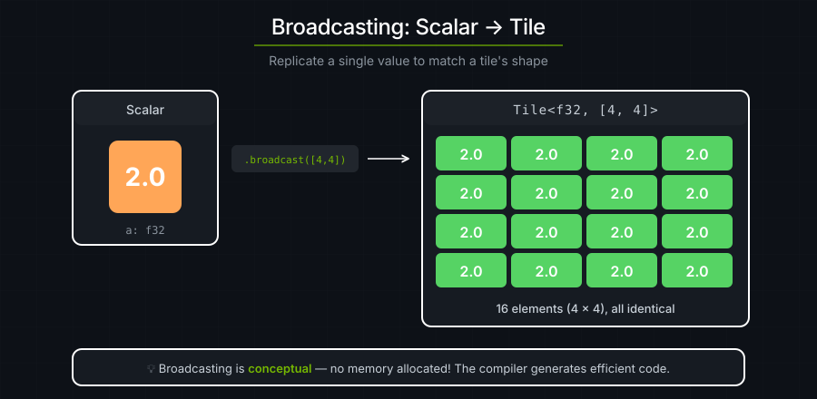
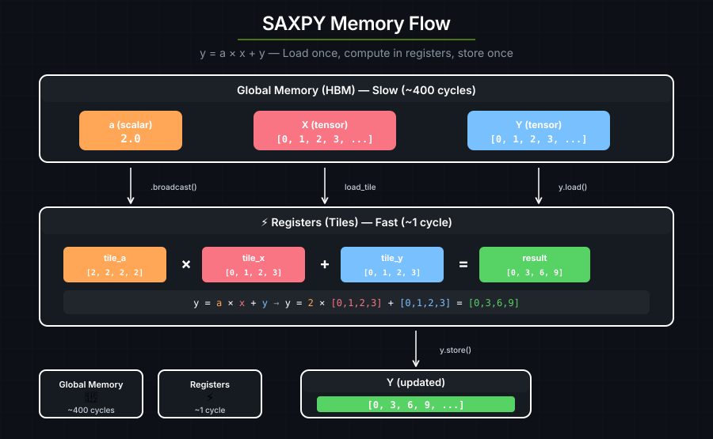

# 3. SAXPY

SAXPY 是 **S**ingle-precision **A**·**X** **P**lus **Y** 的缩写 —— 一个经典的数值计算操作：用一个标量乘以一个向量，再把结果加到另一个向量上：

```text
y = a * x + y    其中 a 是标量，x 和 y 是向量
```

cuTile 的算术是在 tile 上进行的。要用一个标量去乘一个 tile，需要把该标量**广播（broadcast）**到 tile 的形状。

---

## 广播

广播是把一个较小的值复制扩展，以匹配一个更大的形状：



编译器实现广播时并不会为这些副本分配内存。

---

```rust
use cuda_async::device_operation::DeviceOp;
use cuda_core::Device;
use std::sync::Arc;
use cutile;
use cutile::api::arange;
use cutile::error::Error;
use cutile::tensor::{IntoPartition, Reshape, Tensor, ToHostVec, Unpartition};

#[cutile::module]
mod my_module {
    use cutile::core::*;

    #[cutile::entry()]
    fn saxpy<const S: [i32; 2]>(
        y: &mut Tensor<f32, S>,            // 向量输入兼输出（就地更新）
        a: f32,                           // 标量输入
        x: &Tensor<f32, { [-1, -1] }>     // 向量输入
    ) {
        let tile_a = a.broadcast(y.shape());  // 标量 → tile
        let tile_x = x.load_like(y);
        let tile_y = y.load();                // 加载 y 的当前值
        y.store(tile_a * tile_x + tile_y);    // y = a*x + y
    }
}

use my_module::saxpy;

fn main() -> Result<(), Error> {
    let device = Device::new(0)?;
    let stream = device.new_stream()?;
    
    let a = 2.0f32;  // 我们的标量乘数
    
    // 把 x 和 y 创建为 [0, 1, 2, ..., 31] 并 reshape 成 4×8
    let input: Arc<Tensor<f32>> = arange(32usize).sync_on(&stream)?.into();
    let x: Arc<Tensor<f32>> = input.dup().sync_on(&stream)?.reshape(&[4, 8])?.into();
    let y = input.dup().sync_on(&stream)?.reshape(&[4, 8])?.partition([2, 2]);
    
    // 运行：y = 2.0 * x + y = 2*x + x = 3*x
    let (y, a, _x) = saxpy(y, a, x).sync_on(&stream)?;
    let y_host: Vec<f32> = y.unpartition().to_host_vec().sync_on(&stream)?;
    
    // 验证
    for i in 0..5 {
        println!("{} * {} + {} = {} (got {})", a, i, i, 3 * i, y_host[i]);
    }
    
    Ok(())
}
```

**输出：**

```text
2 * 0 + 0 = 0 (got 0)
2 * 1 + 1 = 3 (got 3)
2 * 2 + 2 = 6 (got 6)
2 * 3 + 3 = 9 (got 9)
2 * 4 + 4 = 12 (got 12)
```

---

## 就地操作

`y` 既是输入也是输出：

```rust
let tile_y = y.load();             // 读取 y 的当前值
y.store(tile_a * tile_x + tile_y); // 写回新的 y
```

这是一个**就地操作（in-place operation）** —— 更新 `y` 而不是创建一个新的 tensor。就地更新复用了已有的内存，省掉一次新分配的开销。SAXPY 传统上就是就地进行的，因为它在迭代式算法中反复更新 `y`。

---

## 内存流动



- 全局内存**慢**（访问需要数百个周期）。
- 寄存器**快**（单周期）。
- 中间结果在加载与存储之间一直留在寄存器里。

把多个操作合并进一个 kernel（**kernel 融合**）可以避免把中间结果写回全局内存。

---

## `y.shape()`

在 kernel 里：

```rust
let tile_a = a.broadcast(y.shape());
```

`y.shape()` 返回输出分区在编译期就已知的形状（本例中是 `[2, 2]`）。它明确告诉 broadcast 要创建多大尺寸的 tile。

---

## 要点

| 概念 | 含义 |
|---------|---------------|
| **广播** | 把一个标量/较小的值复制扩展以匹配更大的形状 |
| **就地操作** | 就地更新 tensor，而不是创建新的 |
| **内存层级** | 全局（慢）→ 寄存器（快）→ 全局 |
| **y.shape()** | 返回用于切分该 tensor 的静态形状 |

---

### 练习 1：改变标量

试试 `a = 0.5` 做缩小而不是放大。你期望得到什么结果？

### 练习 2：换成另一个操作

改成计算 `y = a * x - y`。第 3 个元素的期望结果是多少？

> **答案**
>
> `y = 2.0 * 3 - 3 = 3`

### 练习 3：两个标量

把 kernel 改成计算 `y = a * x + b * y`，其中 `a` 和 `b` 都是标量。

> **提示**
>
> ```rust
> fn saxpy_extended<const S: [i32; 2]>(
>     y: &mut Tensor<f32, S>,
>     a: f32, b: f32,
>     x: &Tensor<f32, {[-1, -1]}>
> ) {
>     let tile_a = a.broadcast(y.shape());
>     let tile_b = b.broadcast(y.shape());
>     let tile_x = x.load_like(y);
>     let tile_y = y.load();
>     y.store(tile_a * tile_x + tile_b * tile_y);
> }
> ```

---

## 参见

- [张量与 tile](../guide/tensors-and-tiles.md) —— 标量算术、`broadcast` 以及形状规则
- [DSL API](../reference/dsl-api.md) —— `broadcast`、`broadcast_scalar` 以及算术运算符的签名
