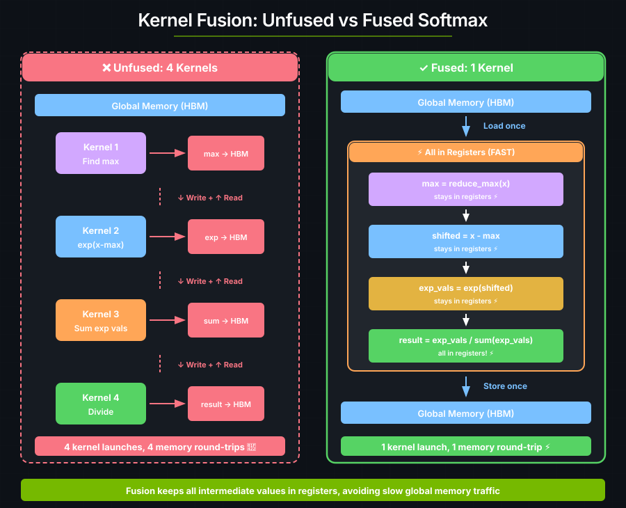
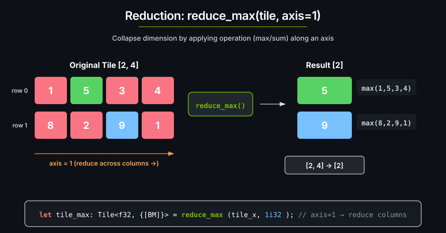

# 5. 融合 softmax

Softmax 是一个多步操作：

```text
softmax(x)_i = exp(x_i - max(x)) / Σ exp(x_j - max(x))
```

朴素实现会为每一步使用一个单独的 kernel。**kernel 融合**把所有步骤合并进一个 kernel，以避免多余的访存流量。每次 kernel 启动都有开销（约 10–20 微秒），而每次往返全局内存也很慢。



---

## 数值稳定性

在调用 `exp` 之前先减去每一行的最大值，可以防止溢出：

```text
x = [100, 101, 102]
exp(x) = [2.7×10⁴³, 7.3×10⁴³, 2.0×10⁴⁴]  ← 溢出了！在 float32 里这些是 inf
```

减去最大值之后：

```text
x = [100, 101, 102]
max = 102
x - max = [-2, -1, 0]
exp(x - max) = [0.135, 0.368, 1.0]  ← 安全的取值
```

结果在数学上完全相同：

```text
exp(x_i - max) / Σ exp(x_j - max)
= [exp(x_i) / exp(max)] / [Σ exp(x_j) / exp(max)]
= exp(x_i) / Σ exp(x_j)
```

---

<a id="the-code"></a>
## softmax kernel

```rust
use cuda_async::device_operation::DeviceOp;
use cuda_core::Device;
use cutile;
use cutile::api::arange;
use cutile::error::Error;
use cutile::tensor::{IntoPartition, Reshape, Tensor, ToHostVec, Unpartition};
use std::sync::Arc;

#[cutile::module]
mod my_module {
    use cutile::core::*;

    #[cutile::entry()]
    fn softmax<const BM: i32, const BN: i32>(
        y: &mut Tensor<f32, { [BM, BN] }>,
        x: &Tensor<f32, { [-1, -1] }>,
    ) {
        let tile_x: Tile<f32, { [BM, BN] }> = x.load_like(y);

        // 求每一行的最大值（为了数值稳定性）
        let tile_x_max: Tile<f32, { [BM] }> = reduce_max(tile_x, 1i32);
        let tile_x_max: Tile<f32, { [BM, BN] }> =
            tile_x_max.reshape(shape![BM, 1]).broadcast(y.shape());

        // 减去最大值并取指数
        let num: Tile<f32, { [BM, BN] }> = exp(tile_x - tile_x_max);

        // 求每一行的和
        let denom: Tile<f32, { [BM] }> = reduce_sum(num, 1);
        let denom = denom.reshape(shape![BM, 1]).broadcast(y.shape());

        // 相除
        y.store(num / denom);
    }
}

use my_module::softmax;

fn main() -> Result<(), Error> {
    let device = Device::new(0)?;
    let stream = device.new_stream()?;

    let (m, n) = (4usize, 8usize);
    let (bm, bn) = (2usize, n);

    let input: Arc<Tensor<f32>> = arange(m * n).sync_on(&stream)?.into();
    let x: Arc<Tensor<f32>> = input.dup().sync_on(&stream)?.reshape(&[m, n])?.into();
    let y = input.dup().sync_on(&stream)?.reshape(&[m, n])?.partition([bm, bn]);

    let (y, _x) = softmax(y, x).sync_on(&stream)?;
    let y_host: Vec<f32> = y.unpartition().to_host_vec().sync_on(&stream)?;

    // 每一行之和应当等于 1.0
    for i in (0..y_host.len()).step_by(n) {
        let row_sum: f32 = y_host[i..i+n].iter().sum();
        println!("softmax row sum = {} (expected 1.0)", row_sum);
    }

    Ok(())
}
```

**输出：**

```text
softmax row sum = 1 (expected 1.0)
softmax row sum = 1 (expected 1.0)
softmax row sum = 1 (expected 1.0)
softmax row sum = 1 (expected 1.0)
```

每一行之和都是 1.0 —— 一个概率分布。

---

## 归约操作

归约通过对某个维度施加一个操作来把它折叠掉：

```rust
let tile_x_max: Tile<f32, { [BM] }> = reduce_max(tile_x, 1i32);
```



归约之后，reshape 并广播，使它重新匹配原来的 tile：

```rust
// [BM] → [BM, 1] → [BM, BN]
let tile_x_max: Tile<f32, { [BM, BN] }> =
    tile_x_max
    .reshape(shape![BM, 1])   // [2] → [2, 1]
    .broadcast(y.shape());           // [2, 1] → [2, 8]
```

---

<a id="the-fusion-pattern"></a>
## 把中间值留在寄存器里

融合后的 kernel 把它的中间值都留在寄存器里：

```rust
// 1. 只加载一次
let tile = input.load_like(output);

// 2. 全部计算都在寄存器里完成
let step1 = reduce_max(tile, axis);
let step2 = tile - step1.broadcast(...);
let step3 = exp(step2);
let step4 = reduce_sum(step3, axis);
let result = step3 / step4.broadcast(...);

// 3. 只存储一次
output.store(result);
```

---

## 要点

| 概念 | 含义 |
|---------|---------------|
| **kernel 融合** | 把多个操作合并进一个 kernel，避免访存流量 |
| **数值稳定性** | 在 exp 之前减去最大值，防止溢出 |
| **归约操作** | 折叠一个维度：reduce_max、reduce_sum |
| **Reshape + Broadcast** | 归约之后 reshape，以便与原始数据配合使用 |

---

### 练习 1：按列 softmax

改成沿轴 0（列）而不是轴 1（行）计算 softmax：

```rust
let col_max: Tile<f32, { [BN] }> = reduce_max(tile_x, 0i32);
```

reshape 和 broadcast 的调用需要做哪些改动？

### 练习 2：温度缩放

加一个温度参数，让分布更平滑或更尖锐：

```rust
fn softmax_with_temp<const BM: i32, const BN: i32>(
    y: &mut Tensor<f32, {[BM, BN]}>,
    x: &Tensor<f32, {[-1, -1]}>,
    temperature: f32,  // 越大越均匀，越小越尖锐
) {
    let tile_x = x.load_like(y);
    let scaled = tile_x / temperature.broadcast(y.shape());
    // ... softmax 的其余部分 ...
}
```

### 练习 3：Log-Softmax

许多 ML 框架使用 log-softmax，因为它数值上更稳定。你能实现它吗？

> **提示**
>
> ```text
> log_softmax(x)_i = x_i - max(x) - log(Σ exp(x_j - max(x)))
> ```
> 这个同样可以融合进一个 kernel。

---

## 参见

- [张量与 tile](../guide/tensors-and-tiles.md#numerically-stable-softmax) —— `reduce_max`、`reduce_sum` 以及广播模式
- [性能](../guide/performance.md) —— kernel 融合与算术强度
- [DSL API](../reference/dsl-api.md#reduction-and-scan) —— 归约运算符的签名
