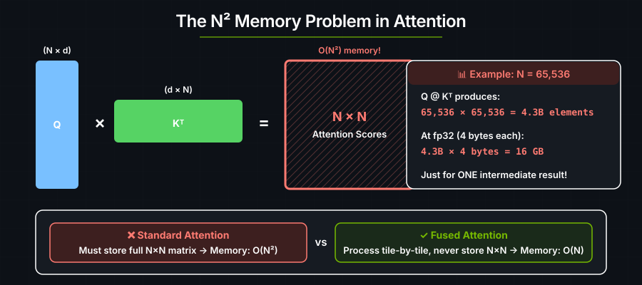
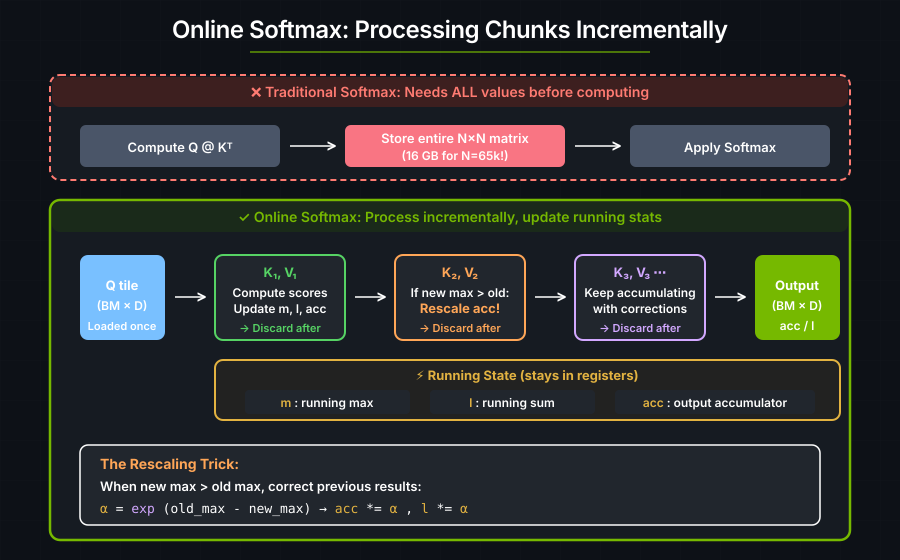
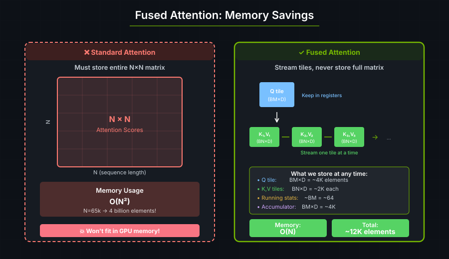

# 6. 融合多头注意力

注意力在整个序列上计算 value 的加权组合。在 BERT、GPT 这类 transformer 中，输入序列会产生 query（Q）、key（K）和 value（V）三组 tensor：

```
Attention(Q, K, V) = softmax(Q @ K^T / √d) @ V
```

其中：
- **Q**（Query）："我在找什么？"
- **K**（Key）："我包含什么？"
- **V**（Value）："我持有什么信息？"
- **d**：Q 和 K 的嵌入维度。它可能与 V 的维度不同。

softmax 产生的就是**注意力权重** —— 序列各位置上的一个概率分布。

这个融合多头注意力（FMHA）kernel 用在线 softmax 分块处理 Q、K、V。编译器负责共享内存中转、Tensor Core 映射、寄存器分配以及访存合并。在项目的其它地方，FMHA 也被称作 Flash Attention。

---

<a id="the-memory-problem"></a>
## 注意力分数矩阵的内存占用

中间的注意力分数矩阵在序列长度上是二次的：

```text
Q shape: (batch, heads, seq_len, head_dim) = (1, 1, N, 64)
K shape: (batch, heads, seq_len, head_dim) = (1, 1, N, 64)

Q @ K^T → shape: (1, 1, N, N)
```



当 N=65k 时，光是分数矩阵就需要 **40 亿个元素**。长序列在朴素注意力下根本放不进 GPU 内存。

---

<a id="the-softmax-challenge"></a>
## 逐行 softmax

Softmax 需要访问**一整行的所有取值**才能算出 `reduce_max` 和 `reduce_sum`：

```rust
let max_x = reduce_max(x, axis);
let exp_x = exp(x - max_x);
let sum_exp = reduce_sum(exp_x, axis);
let result = exp_x / sum_exp;
```

在标准注意力中，每一行有 N 个元素，所以在计算 softmax 之前必须先存下整个 N×N 矩阵。

---

## 在线 softmax

Softmax 可以**增量式**计算：一次处理一块，并维护滚动统计量。



当新的一块带来了更大的最大值时，之前的结果必须被校正：

```text
Before: We computed exp(x₁ - m₁) where m₁ was the old max.
After:  We need exp(x₁ - m₂) where m₂ is the new (larger) max.

Correction: exp(x₁ - m₂) = exp(x₁ - m₁) × exp(m₁ - m₂)
                            ^^^^^^^^^^^^   ^^^^^^^^^^^^^
                            what we had    correction factor (α)
```

该算法维护三个滚动值：
- `m`：滚动最大值。
- `l`：指数的滚动和。
- `acc`：滚动输出累加器。

当出现新的最大值时，此前所有结果都会按 `exp(old_max - new_max)` 重新缩放。

---

## 内存节省



在任意时刻，kernel 只需保存：
- 一个 Q tile：`BM × D` 个元素（例如 64 × 64 = 4,096）。
- 一个 K tile：`BN × D` 个元素（例如 32 × 64 = 2,048）。
- 一个 V tile：`BN × D` 个元素（例如 32 × 64 = 2,048）。
- 滚动统计量：最大值与和，各 `BM × 1`（约 64 个）。
- 输出累加器：`BM × D` 个元素（4,096）。

合计：每个 tile 约 12,000 个元素，与序列长度无关。

---

## 算法

```text
For each Q tile (row block of the output):
    Initialize: max = -∞, sum = 0, output = 0

    For each K,V tile (streaming through the sequence):
        1. Compute attention scores: scores = Q_tile @ K_tile^T
        2. Scale: scores = scores / √d
        3. Update running max: new_max = max(current_max, max(scores))
        4. Compute correction factor: α = exp(old_max - new_max)
        5. Rescale previous results: output *= α, sum *= α
        6. Compute new exponentials: P = exp(scores - new_max)
        7. Update sum: sum += sum(P)
        8. Accumulate: output += P @ V_tile
        9. Update max: current_max = new_max

    Normalize: output = output / sum
```

> **实现说明：** 下面的代码用 `exp2` 而不是 `exp`，这是一项性能优化 —— `exp2` 在 GPU 硬件上更快。为了补偿，缩放因子会除以 `ln(2)`，使得 `exp2(x / ln(2), ftz::Disabled) = exp(x)`。校正因子 `α` 和 softmax 分子 `P` 都用这个调整后的缩放因子配合 `exp2` 计算。

---

<a id="the-code"></a>
## FMHA kernel

```rust
use cuda_async::device_operation::DeviceOp;
use cuda_core::Device;
use std::sync::Arc;
use cutile;
use cutile::api::{randn, zeros};
use cutile::error::Error;
use cutile::tensor::{IntoPartition, Partition, Tensor, ToHostVec, Unpartition};
use cutile::tile_kernel::{PartitionOp, TileKernel, ToHostVecOp};

#[cutile::module]
mod fmha_module {
    use cutile::core::*;

    #[cutile::entry(print_ir=false)]
    fn fmha<
        const BM: i32,  // Q tile 大小（我们计算输出的行数）
        const BN: i32,  // K,V tile 大小（一次处理多少个 K,V）
        const D: i32,   // head 维度
    >(
        out: &mut Tensor<f32, { [1, BM, D] }>,
        q: &Tensor<f32, { [-1, -1, -1, -1] }>,   // (B, H, M, D)
        k: &Tensor<f32, { [-1, -1, -1, -1] }>,   // (B, H, N, D)
        v: &Tensor<f32, { [-1, -1, -1, -1] }>,   // (B, H, N, D)
        qk_scale: f32,
    ) {
        let pid0 = program_id(0);
        let h = q.shape()[1];
        let batch_idx = pid0 / h;
        let head_idx = pid0 % h;
        let q_m_idx = program_id(1);

        // 转成对 exp2 友好的缩放（exp2 在 GPU 上比 exp 快）
        let two: Tile<f32, { [] }> = constant(2.0f32, shape![]);
        let log2: f32 = tile_to_scalar(log(two));
        let qk_scale: f32 = qk_scale / log2;
        let qk_scale: Tile<f32, { [BM, BN] }> = qk_scale.broadcast(shape![BM, BN]);

        // 在线 softmax 状态
        let mut m_i: Tile<f32, { [BM, 1] }> = constant(f32::NEG_INFINITY, shape![BM, 1]);
        let mut l_i: Tile<f32, { [BM, 1] }> = constant(0.0f32, shape![BM, 1]);
        let mut acc: Tile<f32, { [BM, D] }> = constant(0.0f32, shape![BM, D]);

        // Q tile 只加载一次，对所有 K,V tile 复用
        let q_part: Partition<f32, { [1, 1, BM, D] }> = q.partition(shape![1, 1, BM, D]);
        let tq: Tile<f32, { [1, 1, BM, D] }> = q_part.load([batch_idx, head_idx, q_m_idx, 0i32]);
        let tq: Tile<f32, { [BM, D] }> = tq.reshape(shape![BM, D]);

        let n: i32 = k.shape()[2];
        let num_tiles: i32 = ceil_div(n, BN);

        let k_part = k.partition(shape![1, 1, BN, D]);
        let v_part = v.partition(shape![1, 1, BN, D]);

        // 流式遍历 K,V tile
        for j in 0i32..num_tiles {
            // Q @ K^T
            let k_tile: Tile<f32, { [BN, D] }> = k_part
                .load([batch_idx, head_idx, j, 0i32])
                .reshape(shape![BN, D]);
            let k_tile_trans: Tile<f32, { [D, BN] }> = k_tile.transpose();
            let qk: Tile<f32, { [BM, BN] }> = constant(0.0f32, shape![BM, BN]);
            let qk: Tile<f32, { [BM, BN] }> = mma(tq, k_tile_trans, qk);
            let qk: Tile<f32, { [BM, BN] }> = qk * qk_scale;

            // 更新滚动最大值
            let qk_max: Tile<f32, { [BM] }> = reduce_max(qk, 1);
            let qk_max: Tile<f32, { [BM, 1] }> = qk_max.reshape(shape![BM, 1]);
            let m_ij: Tile<f32, { [BM, 1] }> = max_tile(m_i, qk_max);
            let qk = qk - m_ij.broadcast(shape![BM, BN]);

            // softmax 分子与校正因子
            let p: Tile<f32, { [BM, BN] }> = exp2(qk, ftz::Disabled);
            let l_ij: Tile<f32, { [BM] }> = reduce_sum(p, 1);
            let l_ij: Tile<f32, { [BM, 1] }> = l_ij.reshape(shape![BM, 1]);
            let alpha: Tile<f32, { [BM, 1] }> = exp2(m_i - m_ij, ftz::Disabled);

            // 更新滚动和并重新缩放累加器
            l_i = l_i * alpha + l_ij;
            let alpha: Tile<f32, { [BM, D] }> = alpha.broadcast(shape![BM, D]);
            acc = acc * alpha;

            // 累加 P @ V
            let v_tile: Tile<f32, { [1, 1, BN, D] }> = v_part.load([batch_idx, head_idx, j, 0i32]);
            let v_tile: Tile<f32, { [BN, D] }> = v_tile.reshape(shape![BN, D]);
            acc = mma(p, v_tile, acc);
            m_i = m_ij;
        }

        // 最终归一化
        acc = true_div(acc, l_i.broadcast(shape![BM, D]));
        let acc = acc.reshape(shape![1, BM, D]);
        out.store(acc);
    }
}

use fmha_module::fmha;

fn main() -> Result<(), Error> {
    let device = Device::new(0)?;
    let stream = device.new_stream()?;

    let (batch, heads, seq_len, head_dim) = (2, 4, 128, 64);
    let (bm, bn) = (64, 32);

    let seed = 42u64;
    let q: Arc<Tensor<f32>> = randn(0., 1., [batch, heads, seq_len, head_dim], Some(seed))
        .sync_on(&stream)?.into();
    let k: Arc<Tensor<f32>> = randn(0., 1., [batch, heads, seq_len, head_dim], Some(seed + 1))
        .sync_on(&stream)?.into();
    let v: Arc<Tensor<f32>> = randn(0., 1., [batch, heads, seq_len, head_dim], Some(seed + 2))
        .sync_on(&stream)?.into();

    let out = zeros(&[batch * heads, seq_len, head_dim])
        .sync_on(&stream)?
        .partition([1, bm, head_dim]);

    let qk_scale = 1.0 / f32::sqrt(head_dim as f32);
    let generics = vec![bm.to_string(), bn.to_string(), head_dim.to_string()];

    let (out, _, _, _, _) = fmha(out, q, k, v, qk_scale)
        .generics(generics)
        .sync_on(&stream)?;

    let out_host: Vec<f32> = out.unpartition().to_host_vec().sync_on(&stream)?;
    println!("Output length: {}", out_host.len());

    Ok(())
}
```

**输出：**

```text
Output length: 65536
```

---

## 要点

| 概念 | 标准注意力 | 融合多头注意力 |
|---------|-------------------|---------------------------|
| 分数矩阵的内存 | O(N²) —— 存下整个矩阵 | O(BM × BN) —— 一次一个 tile |
| softmax 方式 | 先全部算完，再归一化 | 在线式：边算边更新 |
| 最大值变化时 | 不适用（已有全部取值） | 重新缩放此前的结果 |
| K,V 访存模式 | 一次性全部加载 | 逐 tile 流式加载 |
| 底层优化 | 手动（共享内存、warp、合并访存） | 由编译器处理 |

重新缩放带来了额外的计算，但避免了存下完整的注意力矩阵。这让更长的序列得以放进 GPU 内存。

---

<a id="full-production-example"></a>
## 参考实现

一个完整实现，支持多查询注意力（MQA）并带参考校验：

```bash
cargo run --example flash_attention
```

```text
out shape = [128, 1024, 64]
diff near zero? true: 5.96e-8
diff near zero? true: 2.98e-8
... (validates against reference for all batch×head combinations)
```

---

### 练习 1：算一算内存

计算以下两种情况的内存用量：
- 标准注意力，N=1024。
- 融合多头注意力，N=1024、BM=64、BN=32。

融合后的 kernel 省了多少倍内存？

### 练习 2：加入因果掩码

对于自回归模型（如 GPT），我们只关注**之前**的位置。修改 kernel，在 `key_position > query_position` 时跳过注意力分数的计算。

---

## 参见

- [张量与 tile](../guide/tensors-and-tiles.md) —— `mma`、归约与广播的组合
- [实用的心智模型](../guide/useful-mental-models.md) —— 为什么分块访存对带宽受限的 kernel 很关键
- [性能](../guide/performance.md) —— Tensor Core 利用率与 tile 尺寸选择
- [DSL API](../reference/dsl-api.md) —— 这里所用模式的算子参考
