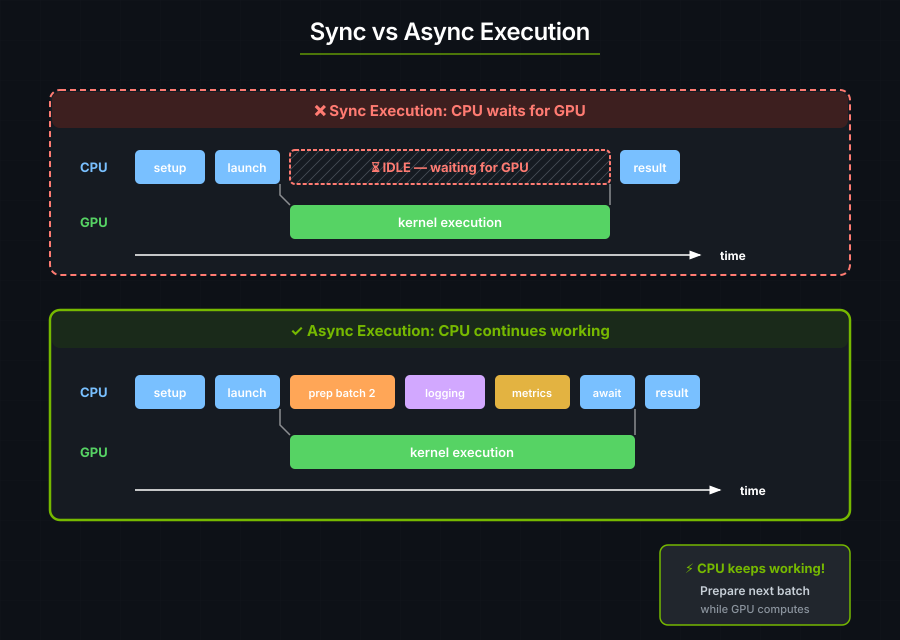

# 7. 异步执行入门

> **注意**：这些示例使用 `tokio`，但 cuTile 也能与其它异步运行时配合工作。

同步 API 会阻塞 CPU，直到 GPU 完成：

```rust
let launcher = hello_world_kernel();
launcher.grid((2, 2, 1)).sync_on(&stream)?;  // CPU 在这里等待！
// 直到 GPU 完成，CPU 一直被阻塞
```



在异步模式下，GPU 计算的同时 CPU 可以去做别的事：

- 当前批次在计算时，准备下一个批次。
- 把多个操作流水线化。
- 让数据传输与计算重叠。
- 多 GPU 协同。

---

## DeviceOp

`DeviceOp` 描述 GPU 工作但并不执行它。`.await` 或 `.sync_on(.)` 会执行该操作；`tokio::spawn` 可以运行由 `into_future()` 或 `.schedule(...)` 产生的 future。

```rust
// 这里创建了一个 DeviceOp，但还没有执行！
let tensor_op = api::ones(&[1024, 1024]);  // 返回 impl DeviceOp

// GPU 上到现在什么都还没发生……

// 现在才执行：
let tensor: Tensor<f32> = tensor_op.sync_on(&stream)?;  // 同步 API
// 或者
let tensor: Tensor<f32> = tensor_op.await?;             // 异步 API
```

---

## 同步 API vs 异步 API

在 cutile 中，一个 `DeviceOp` 既可以用同步 API、也可以用异步 API 执行。给定某个操作 `op`：

| API | 说明 |
|----------|-------------|
| `op.sync()` | 立即在默认 GPU 设备（设备 0）上执行 `op`。阻塞。可以在异步上下文之外调用。 |
| `op.sync_on(&stream)` | 立即在 `stream` 上执行 `op`。阻塞。可以在异步上下文之外调用。 |
| `op.await` | 立即执行 `op`，作为调用它的那个异步上下文的一部分。它会阻塞所在的异步上下文，但会释放执行线程，让运行时可以在这条线程上调度其它任务。只能在异步上下文内部调用。 |
| `tokio::spawn(op.into_future())` | 把该操作的 future 提交给异步运行时，返回一个之后可以 await 的句柄。非阻塞。只能在异步上下文内部调用。 |

> **注意**：异步上下文指的是用 `async` 关键字定义的块中的任何代码，例如 `async fn ...`、`async { ... }`、`async || { ... }`。

---

## 异步向量加法

```rust
use cutile::api::{ones, zeros};
use cutile::tensor::{Tensor, ToHostVec, Unpartition};
use cutile::tile_kernel::{PartitionOp, TileKernel, ToHostVecOp};
use cuda_async::device_operation::*;
use cuda_async::error::DeviceError;
use std::sync::Arc;

#[cutile::module]
mod async_add_module {
    use cutile::core::*;

    #[cutile::entry()]
    fn add<const S: [i32; 2]>(
        z: &mut Tensor<f32, S>,
        x: &Tensor<f32, {[-1, -1]}>,
        y: &Tensor<f32, {[-1, -1]}>
    ) {
        let tile_x = x.load_like(z);
        let tile_y = y.load_like(z);
        z.store(tile_x + tile_y);
    }
}

use async_add_module::add;

#[tokio::main]
async fn main() -> Result<(), DeviceError> {
    let x: Arc<Tensor<f32>> = ones(&[32, 32]).map(Into::into).await?;
    let y: Arc<Tensor<f32>> = ones(&[32, 32]).map(Into::into).await?;

    // 统一的启动器：直接传入输出分区和各个输入。
    let z_host: Vec<f32> = add(
        zeros(&[32, 32]).partition([4, 4]),  // 输出，已切分成 tile
        x,                                    // 输入 x（经 IntoDeviceOp 传入 Arc<Tensor>）
        y,                                    // 输入 y
    )
    .first()
    .unpartition()
    .to_host_vec()
    .await?;
    println!("z[0] = {} (expected 2.0)", z_host[0]);
    Ok(())
}
```

**输出：**

```text
z[0] = 2 (expected 2.0)
```

---

## 用 spawn 让工作重叠

`.await` 会挂起当前任务直到操作完成，从而把它所在的线程释放出来去跑其它任务。`tokio::spawn` 会启动一个独立任务并立刻返回句柄。需要结果时再 await 那个句柄。

```rust
#[tokio::main]
async fn main() -> Result<(), DeviceError> {
    let batch1_op = prepare_batch(1);  // 返回 DeviceOp
    let batch2_op = prepare_batch(2);  // 返回 DeviceOp

    let batch1 = batch1_op.await?;

    let result1_op = process_kernel(batch1);
    let result1_handle = tokio::spawn(result1_op.into_future());  // 非阻塞

    // 在 batch 1 的 kernel 运行时，可以准备 batch 2 的数据
    let batch2 = batch2_op.await?;

    let result2 = process_kernel(batch2).await?;

    let result1 = result1_handle.await.expect("task panicked")?;
    Ok(())
}
```

---

## 组合 DeviceOp

### 统一的 kernel 启动器

kernel 启动器既能直接接受 `DeviceOp`，也能直接接受普通值 —— 不需要 `zip!`：

```rust
// 直接传入输出分区和各个输入。
let result = kernel(output_op.partition([4, 4]), input1, input2)
    .first()           // 取出输出
    .unpartition()
    .await?;
```

### `zip!` —— 手动组合操作

在你需要显式控制的场合，`zip!` 可以把多个 DeviceOp 组合成一个元组：

```rust
use cuda_async::device_operation::*;

let combined = zip!(op_a, op_b, op_c);
let (a, b, c) = combined.await?;
```

---

## 在同步与异步之间选择

| 场景 | 用同步 | 用异步 |
|----------|----------|-----------|
| 简单脚本 | ✓ | |
| 交互式探索 | ✓ | |
| 生产流水线 | | ✓ |
| 多批次处理 | | ✓ |
| 多 GPU 工作负载 | | ✓ |
| 计算/传输重叠 | | ✓ |

从同步开始。等你确实有需要重叠的工作时，再改用异步。

---

<a id="borrowed-inputs-and-spawn-safety"></a>
## 借用输入与 spawn 的安全性

kernel 的 `&Tensor` 参数接受三种输入形式：`Tensor<T>`、`Arc<Tensor<T>>` 和 `&Tensor<T>`。借用的输入（`&Tensor<T>`）可以和 `.sync_on()`、`.await` 一起用，但编译器会拒绝把它们交给 `tokio::spawn`：

```rust
let weights: Tensor<f32> = api::ones(&[1024]).sync_on(&stream)?;

// 可以 —— 借用被限制在这次同步调用内部。
let result = my_kernel(out, &weights).sync_on(&stream)?;

// 可以 —— 借用检查器保证 weights 的生命周期长于这次 await。
let result = my_kernel(out, &weights).await?;

// 编译错误 —— &weights 不是 'static 的，因此这个 future 无法被 spawn。
let handle = tokio::spawn(my_kernel(out, &weights).into_future());
//                                       ^^^^^^^^ borrowed value does not live long enough
```

这是由 Rust 的生命周期系统在编译期强制的。如果你需要 spawn，就改用 `Arc<Tensor<T>>`：

```rust
let weights: Arc<Tensor<f32>> = api::ones(&[1024]).sync_on(&stream)?.into();
let handle = tokio::spawn(my_kernel(out, weights).into_future());  // 可以 —— Arc 是 'static 的
```

---

## 要点

| 概念 | 含义 |
|---------|---------------|
| **DeviceOp** | 对 GPU 工作的描述，尚未执行 |
| **.await** | 执行该操作并取得结果 |
| **异步带来重叠能力** | GPU 计算时 CPU 可以干活 |
| **统一启动器** | kernel 函数直接接受 DeviceOp 与普通值 |
| **zip!** | 把多个操作组合成一个元组 |
| **.then()** | 在同一条流上串联后续工作 |

---

### 练习 1：异步 SAXPY

把 SAXPY kernel 改成使用异步 API。

### 练习 2：并行创建 tensor

用 `zip!` 并行创建 4 个 tensor。

> **答案**
>
> ```rust
> let (a, b, c, d) = zip!(
>     ones(&[100, 100]).map(Into::into),
>     zeros(&[100, 100]).map(Into::into),
>     randn(0.0, 1.0, [100, 100], None).map(Into::into),
>     arange(10000).map(Into::into)
> ).await?;
> ```

### 练习 3：测量差异

对同步版本与带工作重叠的异步版本计时。用 `std::time::Instant` 来测量。

---

## 参见

- [设备操作](../guide/device-operations.md) —— `DeviceOp`、流与调度的完整讲解
- [宿主 API](../reference/host-api.md) —— 组合子签名（`.then()`、`.shared()`、`unzip`、`zip!`）以及完整的宿主侧 API
