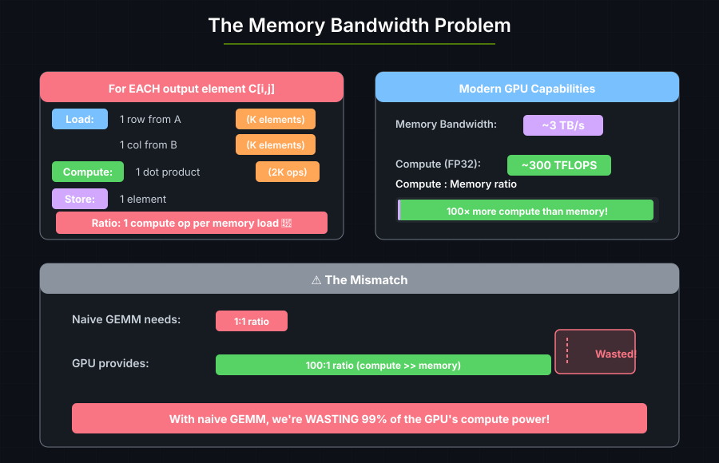
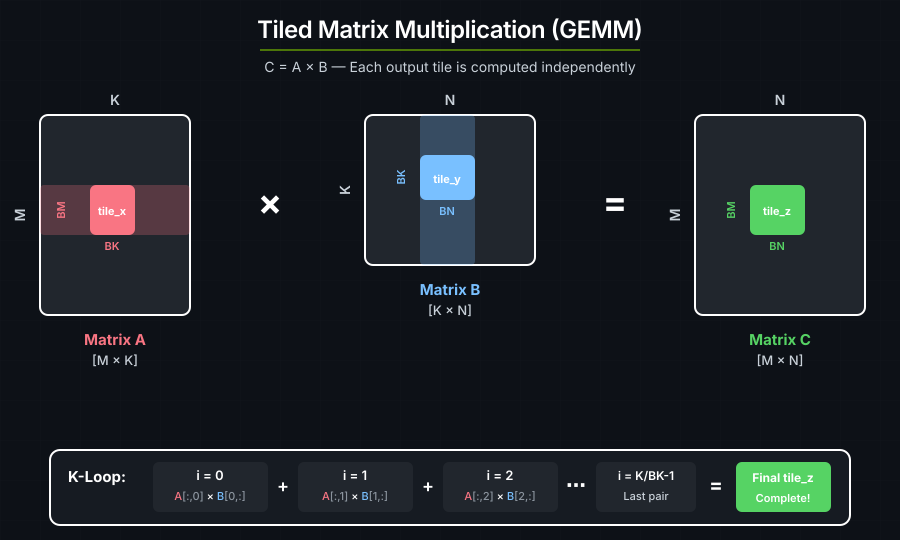
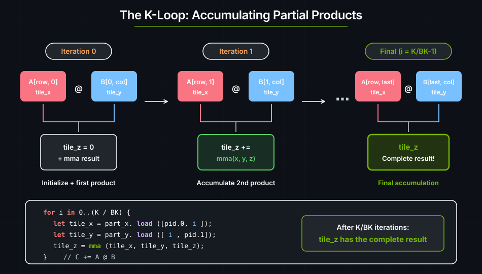
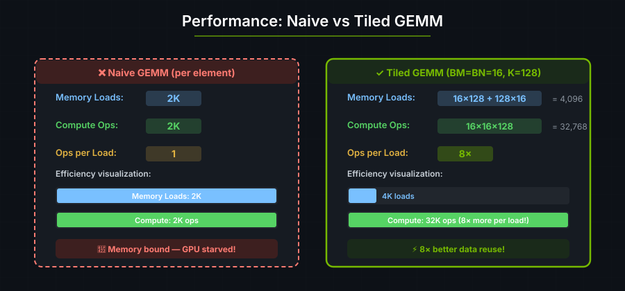

# 4. 矩阵乘法

<!-- TODO: 本教程已膨胀到同时覆盖基础 GEMM、const 泛型推断、
映射持久化 GEMM、unsafe 优化提示以及全静态 GEMM。有余力时请拆分或精简：
让本页专注于第一条 GEMM 路径，把进阶性能变体移到单独的页面。 -->

矩阵乘法（GEMM，General Matrix Multiply）广泛应用于：

| 应用领域 | GEMM 的用武之地 |
|-------------|-------------------|
| **Transformer** | 注意力层与全连接层 —— 占 90%+ 的计算量 |
| **CNN** | 把卷积表达为矩阵乘法 |
| **科学计算** | 仿真与求解器 |
| **图形学** | 变换、光照计算 |

---

## 朴素 GEMM 是带宽受限的

计算 C = A × B 的朴素算法是：

```text
for each output element C[i,j]:
    sum = 0
    for k in 0..K:
        sum += A[i,k] * B[k,j]
    C[i,j] = sum
```



A 和 B 的每个元素都会被反复从全局内存加载。要获得好的性能，我们需要把数据加载一次、复用多次。

---

## 分块矩阵乘法

我们不是一次算一个元素，而是一次算一块（**tile**）元素：



```text
Per output TILE (BM × BN elements):
  - Load BM × K elements from A (once per row group)
  - Load K × BN elements from B (once per column group)
  - Do BM × BN × K multiply-adds

Memory loads: BM×K + K×BN    Compute: BM×BN×K ops
Ratio: With BM=BN=BK=16: ~16× better data reuse!
```

A 中每个被加载的元素会被复用 BN 次，B 中每个元素会被复用 BM 次。这就降低了全局内存流量。

---

<a id="the-code"></a>
## GEMM kernel

```rust
use cuda_async::device_operation::DeviceOp;
use cuda_core::Device;
use std::sync::Arc;
use cutile;
use cutile::api;
use cutile::DType;
use cutile::error::Error;
use cutile::tensor::{IntoPartition, Tensor, ToHostVec, Unpartition};
use cutile::tile_kernel::TileKernel;

#[cutile::module]
mod my_module {
    use cutile::core::*;

    #[cutile::entry()]
    fn gemm<E: ElementType, const BM: i32, const BN: i32, const BK: i32, const K: i32>(
        z: &mut Tensor<E, { [BM, BN] }>,   // 输出 tile
        x: &Tensor<E, { [-1, K] }>,        // A 矩阵
        y: &Tensor<E, { [K, -1] }>,        // B 矩阵
    ) {
        let part_x = x.partition(shape![BM, BK]);
        let part_y = y.partition(shape![BK, BN]);
        let pid_m = program_id(0);
        let pid_n = program_id(1);

        let mut tile_z = load_tile_mut(z);

        for i in 0i32..(K / BK) {
            let tile_x = part_x.load([pid_m, i]);
            let tile_y = part_y.load([i, pid_n]);
            tile_z = mma(tile_x, tile_y, tile_z);  // C += A @ B
        }
        z.store(tile_z);
    }
}

use my_module::gemm;

fn main() -> Result<(), Error> {
    let device = Device::new(0)?;
    let stream = device.new_stream()?;

    let (bm, bn, bk) = (16usize, 16usize, 8usize);
    let (m, n, k) = (64usize, 64usize, 64usize);

    let generics = vec![
        f32::DTYPE.as_str().to_string(),
        bm.to_string(), bn.to_string(), bk.to_string(), k.to_string()
    ];

    let z = api::zeros(&[m, n]).partition([bm, bn]).sync_on(&stream)?;
    let x: Arc<Tensor<f32>> = api::ones(&[m, k]).map(Into::into).sync_on(&stream)?;
    let y: Arc<Tensor<f32>> = api::ones(&[k, n]).map(Into::into).sync_on(&stream)?;

    let (z, _x, _y) = gemm(z, x, y).generics(generics).sync_on(&stream)?;

    let z_host: Vec<f32> = z.unpartition().to_host_vec().sync_on(&stream)?;
    println!("z[0] = {} (expected {})", z_host[0], k);


    Ok(())
}
```

**输出：**

```text
z[0] = 64 (expected 64)
```

每个输出元素都是一行全 1 与一列全 1 的点积，等于 K。当 K=64 时，每个输出元素都是 64。

---

## K 循环

K 循环遍历 A 与 B 的 tile 对，把部分乘积累加进输出 tile：

```rust
for i in 0i32..(K / BK) {
    let tile_x = part_x.load([pid_m, i]);  // 加载 A[row_group, i]
    let tile_y = part_y.load([i, pid_n]);  // 加载 B[i, col_group]
    tile_z = mma(tile_x, tile_y, tile_z);  // 累加：C += A @ B
}
```



---

## `mma()` 内建函数

`mma` 是 **Matrix Multiply-Accumulate**（矩阵乘累加）的缩写：

```rust
tile_z = mma(tile_x, tile_y, tile_z);
// 等价于：tile_z = tile_x @ tile_y + tile_z
```

在现代 GPU（Volta 及以后）上，它直接映射到 **Tensor Core** —— 一种专用硬件，可以在一次操作中完成小矩阵（例如 16×16×16）的乘法。

---

## const 泛型与 JIT 重新编译

```rust
fn gemm<E: ElementType, const BM: i32, const BN: i32, const BK: i32, const K: i32>
```

这些是 **const 泛型** —— 编译期就已知的取值：

1. **循环展开：** `for i in 0..(K/BK)` 可以被完全展开。
2. **寄存器分配：** 编译器确切知道需要多少个寄存器。
3. **Tensor Core 映射：** 硬件要求特定的 tile 尺寸。

它们通过 `.generics()` 传入：

```rust
let generics = vec!["f32".to_string(), "16".to_string(), "16".to_string(), "8".to_string(), "64".to_string()];
gemm(z, x, y).generics(generics)
```

改变入口函数签名中的类型参数或 const 泛型，会产生一个新的编译变体。某个变体首次被启动时，cuTile 会把 kernel 经 Tile IR 字节码 → cubin 编译一遍。生成的二进制会被缓存，因此之后解析到同一变体的启动会复用它。用不同的泛型启动 —— 例如把 `K=64` 换成 `K=128` —— 会触发一次新的编译。完整的缓存规则（包括编译选项与特化提示）见[编译](../guide/jit-compilation.md)。

这就是**静态**形状维度与**动态**形状维度之间的取舍。在上面这个 GEMM 签名中，`K` 是 const 泛型，而 `x` 和 `y` 的 M、N 维度是动态的（`-1`）：

```rust
x: &Tensor<E, { [-1, K] }>,   // M 是动态的（-1），K 是静态的
y: &Tensor<E, { [K, -1] }>,   // K 是静态的，N 是动态的（-1）
```

- **静态维度**（const 泛型）能带来激进的优化，但一旦取值变化就会触发重新编译。
- **动态维度**（`-1`）不带来优化收益，但可以在多次启动之间自由变化，而不会产生新的编译变体。

一般来说，把 tile 尺寸（`BM`、`BN`、`BK`）设为静态 —— 它们对某个给定的 kernel 变体是固定的，编译器需要它们来做寄存器分配和 Tensor Core 映射。而经常变化的问题维度（例如序列长度或批大小）则应设为动态。



使用更大的 tile（例如 128×128），可以获得更高的复用比，逼近 GPU 的理论峰值。

---

## const 泛型推断

SAXPY 不需要调用 `.generics()`：cuTile 会从宿主侧的输出分区推断出 const 泛型。

看一下 SAXPY 的 kernel 签名：

```rust
fn saxpy<const S: [i32; 2]>(
    y: &mut Tensor<f32, S>,
    a: f32,
    x: &Tensor<f32, { [-1, -1] }>
)
```

在宿主侧，`y` 是通过 `.partition([2, 2])` 创建出来的 `Partition<Tensor<f32>>`。该 `Partition` 的 `partition_shape` —— 即 `[2, 2]` —— 被用来推断 `S`。由于 `S` 是唯一的 const 泛型，并且它直接出现在 `&mut Tensor<f32, S>` 参数中，cutile 仅凭宿主侧的类型就能推断出它需要的一切。无需调用 `.generics()`。

推断规则与 Rust 一致：出现在 `&mut Tensor` 形状中的 const 泛型，从 `Partition` 的 `partition_shape` 读取；出现在 `&Tensor` 形状中的 const 泛型，从 tensor 的 `shape` 读取。像 `E: ElementType` 这样的类型参数则从 tensor 的 `dtype()` 推断。

对 GEMM 来说，这种推断是**不完整的**：

```rust
fn gemm<E: ElementType, const BM: i32, const BN: i32, const BK: i32, const K: i32>(
    z: &mut Tensor<E, { [BM, BN] }>,   // BM、BN 从 z 的 partition_shape 推断
    x: &Tensor<E, { [-1, K] }>,        // K 从 x 的 shape[1] 推断
    y: &Tensor<E, { [K, -1] }>,        // K 也可以从 y 的 shape[0] 得到
)
```

| 泛型 | 出现在 | 从何推断 | 可推断？ |
|---------|-----------|---------------|------------|
| `E` | `z`、`x`、`y` | `z.dtype()` | 是 |
| `BM` | `z`（`&mut`） | `z.partition_shape[0]` | 是 |
| `BN` | `z`（`&mut`） | `z.partition_shape[1]` | 是 |
| `K` | `x`、`y` | `x.shape()[1]` | 是 |
| `BK` | — | — | 否 |

`BM` 和 `BN` 在 kernel 启动时就已知，因为它们被嵌入在由 `.partition([bm, bn])` 创建出来的 `Partition` 里。`K` 也已知，因为它作为维度出现在输入 tensor `x` 和 `y` 中。但 `BK` 不出现在任何 kernel 参数的类型里 —— 它只在 kernel 体**内部**把 `x` 和 `y` 分区成 tile 时才被用到：

```rust
let part_x = x.partition(shape![BM, BK]);
let part_y = y.partition(shape![BK, BN]);
```

启动器无法从 tensor 或分区推断出 `BK`，因此 GEMM 需要显式调用 `.generics()`。

一般规则是：如果每一个 const 泛型都出现在 kernel 的 `&Tensor` 或 `&mut Tensor` 参数类型中，推断就能生效，`.generics()` 是可选的。如果有任何一个 const 泛型只在 kernel 体内使用（比如 `BK`），你就必须显式传入全部泛型。

---

<a id="optimization-achieving-speed-of-light-performance"></a>
## GEMM 优化

上面那个 GEMM kernel 是正确的，但还没有达到 GPU 的理论峰值（speed-of-light，SoL）吞吐。推荐的安全路径是**映射持久化 GEMM**：输出分区产生有界且互不相交的索引，编译器则从产生每个索引的循环中推导出输入边界。这样既避免了 `unsafe`，也不需要把完整的 tensor 维度都变成 const 泛型。

### 方案 1：映射持久化 GEMM（安全，推荐）

映射输出分区暴露一个遍历输出 tile 索引的迭代器。这些索引由分区本身产生，因此存储是有界且互不相交的。K 循环遍历 `0..num_tiles(&part_x, 1)`，并用普通数组索引输入分区；编译器会从循环和映射分量中推断出同样的边界，并在任何 GPU 工作之前把跨 tensor 的关联（例如 `ceil(dim(x, 1)/BK) <= ceil(dim(y, 0)/BK)`）作为启动检查来校验。`deny_in_kernel_checks = true` 会把任何本会残留在 kernel 内的检查变成编译错误，因此循环体在构造上就是无 assert 的：

```rust
#[cutile::entry(
    optimization_hints = (
        sm_120 = (num_cta_in_cga = 2,),
        sm_100 = (num_cta_in_cga = 2,),
    ),
    deny_in_kernel_checks = true,
)]
fn gemm_persistent<
    T: ElementType,
    const BM: i32,
    const BN: i32,
    const BK: i32,
    const MAP_SHAPE: [i32; 2],
>(
    mut z: MappedPartitionMut<T, { [BM, BN] }, MAP_SHAPE>,
    x: &Tensor<T, { [-1, -1] }>,
    y: &Tensor<T, { [-1, -1] }>,
) {
    let part_x = x.partition(shape![BM, BK]);
    let part_y = y.partition(shape![BK, BN]);

    for out_idx in z.iter_indices() {
        let (bid_m, bid_n) = out_idx.components();

        let mut tile_z: Tile<T, { [BM, BN] }> = constant(T::ZERO, shape![BM, BN]);
        for k_tile in 0i32..num_tiles(&part_x, 1) {
            let tile_x = part_x.load([bid_m, k_tile]);
            let tile_y = part_y.load([k_tile, bid_n]);
            tile_z = mma(tile_x, tile_y, tile_z);
        }
        z.store(tile_z, out_idx);
    }
}
```

这个 kernel 早期版本中使用的 `with_bounds(...)`、`Dim::new(...)` 和 `coord(...)` 自 0.3.0 起已废弃；放置规则见[边界检查的放置](../guide/bounds-check-placement.md)。

在宿主侧，`.map(...)` 选择映射输出遍历方式，启动网格则从映射分区推断：

```rust
let z = z.partition([BM, BN]).map([4, 1], num_tile_blocks);
let (z, _x, _y) = gemm_persistent(z, x, y)
    .generics(generics)
    .sync_on(&stream)?;
```

改变运行时的完整 tensor 维度不需要重新编译。只有类型层面的参数（例如 tile 尺寸和映射形状）才产生 JIT 编译特化。

完整示例见 [`cutile-rs-examples/examples/persistent_gemm.rs`](https://github.com/NVIDIA/cuda-rust/blob/main/cutile-rs/cutile-rs-examples/examples/persistent_gemm.rs)。

### 方案 2：关闭边界检查（unsafe）

`#[cutile::entry()]` 属性接受 `unchecked_accesses` 和 `optimization_hints`。把 `unchecked_accesses` 设为 `true` 会禁用所有 tensor 加载与存储的运行时边界检查，并要求入口是 `unsafe` 的。`optimization_hints` 提供架构相关的调优参数：

```rust
#[cutile::entry(
    unchecked_accesses = true,
    optimization_hints = (
        sm_120 = (num_cta_in_cga = 2, max_divisibility = 16,),
    )
)]
unsafe fn gemm<T: ElementType, const BM: i32, const BN: i32, const BK: i32>(
    z: &mut Tensor<T, { [BM, BN] }>,
    x: &Tensor<T, { [-1, -1] }>,
    y: &Tensor<T, { [-1, -1] }>,
    k: i32,
) {
    let part_x = x.partition(shape![BM, BK]);
    let part_y = y.partition(shape![BK, BN]);
    let pid_m = program_id(0);
    let pid_n = program_id(1);
    let mut tile_z: Tile<T, { [BM, BN] }> = z.load();
    for i in 0i32..(k / BK) {
        let tile_x = part_x.load([pid_m, i]);
        let tile_y = part_y.load([i, pid_n]);
        tile_z = mma(tile_x, tile_y, tile_z);
    }
    z.store(tile_z);
}
```

这个版本改动了 kernel 的三处：

- **`unchecked_accesses = true`** 去掉了每次 `load` 和 `store` 调用上的边界检查开销。
- **`sm_120 = (num_cta_in_cga = 2, max_divisibility = 16,)`** 是针对 Blackwell（SM 120）的架构相关提示：把两个 CTA 合成一个 CGA 以获得更好的跨 SM 数据共享，并把自动推断的对齐上限设为 16。
- **`k` 作为运行时 `i32` 传入**，而不是 const 泛型，因此改变 K 维度不会产生新的编译变体。

编译器仍然会检查 tile 形状、`mma` 维度以及元素类型。`unchecked_accesses` 只禁用运行时边界检查。

调用点也必须使用 `unsafe` 块：

```rust
unsafe {
    let (z, _, _, _) = gemm(z, x, y, k as i32)
        .generics(generics)
        .sync_on(&stream)?;
}
```

优化版与未优化版的完整基准对比见 [`cutile-benchmarks/benches/gemm.rs`](https://github.com/NVIDIA/cuda-rust/blob/main/cutile-rs/cutile-benchmarks/benches/gemm.rs)。

### 方案 3：全静态 GEMM（安全，旧式）

更早的安全性能路径是把**所有** tensor 维度都做成静态 const 泛型。当编译器在 JIT 阶段就知道每一个维度和启动网格时，它就能证明直接的 `program_id(axis)` 分区访问在界内，从而把检查完全优化掉 —— 不需要 `unsafe`：

```rust
#[cutile::entry()]
fn gemm<
    E: ElementType,
    const BM: i32, const BN: i32, const BK: i32,
    const M: i32, const N: i32, const K: i32,
>(
    z: &mut Tensor<E, { [BM, BN] }>,
    x: &Tensor<E, { [M, K] }>,
    y: &Tensor<E, { [K, N] }>,
) {
    let part_x = x.partition(shape![BM, BK]);
    let part_y = y.partition(shape![BK, BN]);
    let mut tile_z = load_tile_mut(z);
    let pid_m = program_id(0);
    let pid_n = program_id(1);
    for i in 0i32..(K / BK) {
        let tile_x = part_x.load([pid_m, i]);
        let tile_y = part_y.load([i, pid_n]);
        tile_z = mma(tile_x, tile_y, tile_z);
    }
    z.store(tile_z);
}
```

在这个版本里：

- **`x: &Tensor<E, { [M, K] }>` 与 `y: &Tensor<E, { [K, N] }>`** —— 输入维度是完全静态的，而不是动态的（`-1`）。编译器能看到每个 tensor 的确切形状。
- **没有 `unsafe`，没有 `unchecked_accesses`** —— 边界检查在源码中仍然存在，但 JIT 编译器会证明它们是多余的，并在优化阶段消除掉。
- **`M`、`N`、`K` 是 const 泛型** —— 启动时必须通过 `.generics()` 传入，且每一种新组合都会创建一个新的编译变体。
- **`.const_grid(grid)`** —— 可选。启动网格照常从输出分区推断；`.const_grid()` 额外把网格作为编译期常量传入，从而让编译器获得 `program_id(axis)` / `num_programs(axis)` 的确切边界，并把网格纳入特化键的一部分（每个不同的网格都是各自独立的编译变体）。网格可以从输出分区算出（`let grid = z.grid()?;`）：

```rust
let grid = z.grid()?;
let (z, _x, _y) = gemm(z, x, y)
    .const_grid(grid)
    .generics(generics)
    .sync_on(&stream)?;
```

旧式静态示例见 [`cutile-rs-examples/examples/gemm_static.rs`](https://github.com/NVIDIA/cuda-rust/blob/main/cutile-rs/cutile-rs-examples/examples/gemm_static.rs)。

### 如何在几种方案之间选择

| | 映射持久化 | Unsafe + 提示 | 全静态 |
|---|---|---|---|
| **安全性** | 安全的有界/不相交输出遍历 | `unsafe` —— 程序员必须自行保证维度正确 | 安全 —— 编译器校验直接的静态访问 |
| **编译行为** | tile 尺寸与映射形状产生新的编译变体 | tile 尺寸产生新的编译变体 | 每一个完整 tensor 形状都产生新的编译变体 |
| **灵活性** | 问题规模可在运行时变化 | 问题规模可在运行时变化 | 每种新的问题规模都要重新编译 |
| **编译期检查** | tile 形状、类型以及映射索引的证明 | tile 形状与类型仍会被检查 | 所有形状与类型都会被检查 |
| **最适合** | 默认的高性能安全 GEMM | 手动证明过访问模式的 kernel 的逃生口 | 旧式固定尺寸 kernel |

请从映射持久化 GEMM 起步。unsafe kernel 需要对它的访存模式给出人工证明，适用于该模式暂时还无法用安全 DSL 表达的情形。全静态 GEMM 适合更老的 kernel，或者规模小而固定的 tensor 形状集合。

---

## 要点

| 概念 | 含义 |
|---------|---------------|
| **分块（Tiling）** | 按块处理数据以最大化数据复用 |
| **K 循环** | 遍历 tile 对，累加部分结果 |
| **mma()** | 矩阵乘累加，映射到 Tensor Core |
| **const 泛型** | 编译期已知的 tile 尺寸，用于优化；改变它们会产生新的编译变体 |
| **const 泛型推断** | 出现在 `&mut Tensor` / `&Tensor` 参数类型中的泛型，从宿主侧 `Partition` 的形状和 tensor 形状推断；只在 kernel 体内使用的泛型（如 `BK`）必须显式传入 |
| **动态维度（`-1`）** | 可以在多次启动之间变化而不产生新的编译变体 |
| **算术强度** | 计算量与访存量的比值 —— 越高越好 |
| **映射输出遍历** | 持久化 GEMM 推荐的安全高性能路径 |
| **`unchecked_accesses`** | 为追求峰值性能而禁用运行时边界检查；需要 `unsafe` |
| **全静态形状** | 旧式的安全路径，让编译器消除对 block id 的直接边界检查 |

---

### 练习 1：改变 tile 尺寸

用不同的 `(BM, BN, BK)` 取值做实验：
- 试试 `(32, 32, 16)` —— 更大的 tile。
- 试试 `(8, 8, 4)` —— 更小的 tile。

对每种配置做多次测量。哪个更快？

### 练习 2：非方阵

改成计算 `[M, K] @ [K, N]`，其中 M ≠ N：

```rust
let (m, n, k) = (128, 256, 64);  // 非方阵输出
```

代码需要改动吗？

### 练习 3：混合精度

试试用 `f16`（半精度）做输入、用 `f32` 做累加器。这在 ML 中很常见，可以加快计算。

---

## 参见

- [张量与 tile](../guide/tensors-and-tiles.md#tiled-matrix-multiply) —— `mma` 的用法与累加模式
- [实用的心智模型](../guide/useful-mental-models.md) —— 二维分区与网格映射
- [性能](../guide/performance.md) —— Tensor Core 的使用与 tile 尺寸的选择
- [DSL API](../reference/dsl-api.md#matrix-multiply) —— `mma` 的签名与元素类型约束
- [使用 NVFP4/MXFP8 做推理](11-nvfp4-inference.md) —— 打包的 FP4、FP8 数据以及块缩放 MMA
